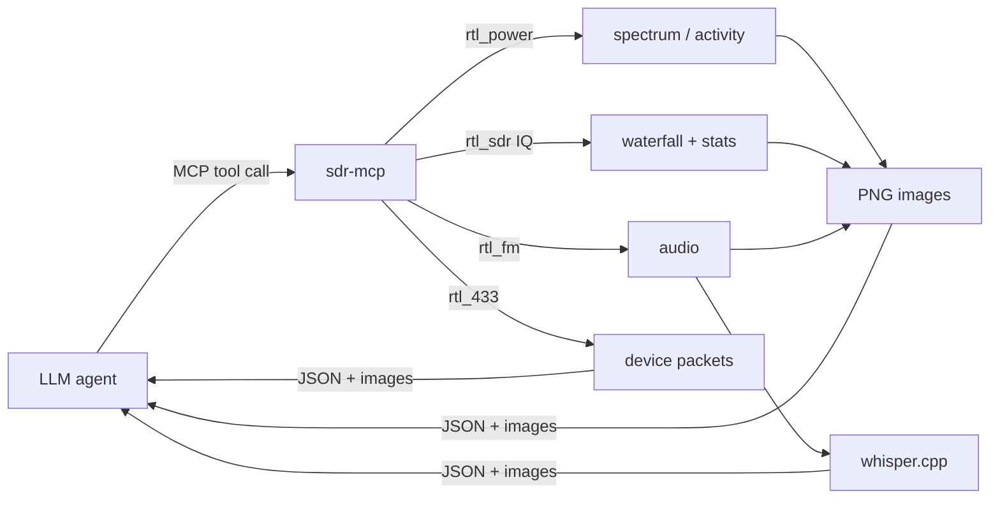

# rtl-sdr-mcp

**Give your LLM agent a real radio.** An [MCP](https://modelcontextprotocol.io) server that turns a $30 RTL-SDR dongle into tools an AI agent can use on its own: sweep the spectrum, *look* at waterfalls, demodulate and transcribe audio, watch for intermittent transmitters and decode ISM devices.

[](https://github.com/kiritomp3/rtl-sdr-mcp/actions/workflows/ci.yml)


Most SDR + AI projects pipe recordings into an LLM after the fact. Here the model **drives the receiver**. It picks frequencies, chooses what to look at, forms hypotheses about unknown signals and tests them. Spectra, waterfalls and audio spectrograms come back as **images**, so a multimodal model reasons about signal shape the way a human operator does.

## A real session

Prompt: *"There is an intermittent transmitter near 434.55 MHz. Figure out what it is."* (Claude, 10 tool calls, ~11 minutes. Translated and condensed from the original run.)

```text
📡 waterfall(434.55 MHz, ±200 kHz, 20 s)       → nothing in 20 s: rare transmitter, watch longer
📡 activity_monitor(433.9–435.2 MHz, 5 min)    → faint bursts at 434.55; repeating mark at 434.25 every ~55 s;
                                                 steady unmodulated line at 434.60 = tuner spur
📡 decode_devices(434.55 MHz, 120 s)           → rtl_433 decodes nothing: not a standard sensor/remote
📡 waterfall(434.25 MHz, ±50 kHz, 20 s)        → 2.5 s burst, 5 narrow lines spaced 6 kHz (−12…+12 kHz):
                                                 carrier with sidebands
📡 listen(434.25 MHz, nfm, 60 s)               → noise + short ~6 kHz tone at 22–24 s, matches the burst

💬 Hypotheses: (1) standard ISM sensor: rejected, rtl_433 is silent. (2) tuner spur: true for 434.60 only,
   434.25 varies in time. (3) non-standard periodic transmitter (DIY / alarm): plausible, unproven.
   Next step: catch a burst at 434.55 with a longer narrow waterfall.
```

In the same run it scanned the FM band, found the one station with speech rather than music (from the audio spectrogram) and summarized the interview that was on air.

## Tools

| Tool | What it does | Returns |
|---|---|---|
| `sdr_info` | Detects tuner, frequency range, gain | JSON |
| `spectrum_sweep` | Sweeps a range, finds signals above the noise floor and tags each with its likely band allocation | JSON + spectrum image |
| `waterfall` | Captures IQ around a frequency: occupied bandwidth, duty cycle, bursts, SNR | JSON + waterfall image |
| `listen` | Demodulates WFM / NFM / AM / USB / LSB, saves WAV, transcribes speech with whisper.cpp | JSON + audio spectrogram |
| `activity_monitor` | Repeated sweeps for minutes, finds transmitters that are only on now and then | JSON + frequency × time map |
| `decode_devices` | Decodes 200+ ISM protocols with rtl_433: weather stations, TPMS, doorbells, meters | JSON |
| `satellite_passes` | Upcoming Meteor-M (LRPT 137.9 MHz) and ISS (145.800 MHz) passes | JSON |

The radio is a single shared resource, so calls are serialized with a lock.

## Quick start

**1. Hardware.** Any RTL2832U dongle (RTL-SDR Blog V3/V4, NooElec, a generic DVB-T stick). The stock whip antenna works for FM, 433 MHz and cellular. Put it near a window.

**2. System tools**

```bash
# macOS
brew install librtlsdr rtl_433 whisper-cpp
# Debian / Ubuntu
sudo apt install rtl-sdr rtl-433   # whisper.cpp: build from https://github.com/ggml-org/whisper.cpp
```

Speech-to-text is optional. To enable it, download a model:

```bash
mkdir -p ~/.cache/whisper && curl -L -o ~/.cache/whisper/ggml-small.bin \
  https://huggingface.co/ggerganov/whisper.cpp/resolve/main/ggml-small.bin
```

**3. Install the server**

```bash
uv tool install git+https://github.com/kiritomp3/rtl-sdr-mcp
# or: pipx install git+https://github.com/kiritomp3/rtl-sdr-mcp
```

**4. Connect it to your agent**

Claude Code:
```bash
claude mcp add sdr -e SDR_LAT=52.52 -e SDR_LON=13.40 -- sdr-mcp
```

Claude Desktop, Cursor and other MCP clients:
```json
{
  "mcpServers": {
    "sdr": { "command": "sdr-mcp", "env": { "SDR_LAT": "52.52", "SDR_LON": "13.40" } }
  }
}
```

Then just ask:

- *"What's on the air around me? Survey 24–1100 MHz and explain the strongest signals."*
- *"Find an FM station where people are talking right now and summarize it."*
- *"Watch 433–435 MHz for 5 minutes and identify every device you catch."*
- *"Is that narrow peak at 115 MHz a real transmitter or a spur? Prove it."*
- *"When is the next good ISS pass? Listen to 145.800 during it."*

Prefer fully autonomous runs? [`examples/agent.sh`](examples/agent.sh) runs Claude Code headless and streams the agent's reasoning and tool calls to your terminal.

## Configuration

| Env var | Default | Meaning |
|---|---|---|
| `SDR_DEVICE` | `0` | rtl-sdr device index |
| `SDR_GAIN` | tuner max | Gain in dB |
| `SDR_LAT`, `SDR_LON` | unset | Your location, for satellite passes |
| `SDR_DATA_DIR` | `~/rtl-sdr-mcp-data` | Where WAV recordings and TLE cache go |
| `WHISPER_MODEL` | `~/.cache/whisper/ggml-small.bin` | whisper.cpp model |

Supported tuners (auto-detected): R820T/T2, R828D, R860 (V4), E4000, FC0012, FC0013, FC2580.

## How it works



The signal-processing helpers (peak finding, IQ spectrogram and burst statistics, activity detection) are plain NumPy and covered by hardware-free tests (`pytest`).

## Roadmap

Ideas and PRs welcome:

- [ ] `capture_on_trigger`: wait for a burst on a frequency and record it (IQ + waterfall)
- [ ] Meteor-M LRPT image capture via SatDump, with the agent describing the weather it sees
- [ ] Radiosonde tracking (400–406 MHz) and landing prediction
- [ ] ADS-B (`dump1090`) aircraft tool
- [ ] SoapySDR backend for HackRF / Airspy / SDRplay
- [ ] Long-running "radio memory": continuous logging plus a semantic search tool

## Legal

Receive-only. Rules on listening to and especially *disclosing* the content of non-broadcast transmissions differ by country. Know yours before you ask an agent to summarize what it hears.

## License

MIT
