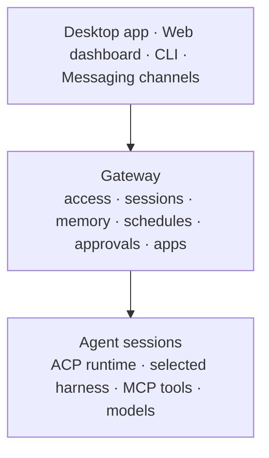

<p align="center">
  
</p>

<h1 align="center">Kiro Crew</h1>

<p align="center">
  <strong>A persistent workspace for development work that self-improves and continues beyond one session.</strong>
</p>

<p align="center">
  <a href="https://trendshift.io/repositories/103032" target="_blank" rel="noopener noreferrer"></a>
</p>

<p align="center">
  Kiro Crew is an open source development workspace that runs locally or remotely on
  your hardware. It is persistent, self-learning, and self-evolving. Work with it
  from the desktop app, web dashboard, and CLI, or continue the same work through
  connection tools like Slack and Discord.
  Your multi-step tasks can run unattended, recurring jobs run on your schedule,
  and heartbeats monitor systems until something needs attention. Kiro Crew Apps
  tailor that experience to a specific job, combining a purpose-built interface
  with agents, skills, schedules, integrations, and backend services.
</p>

<p align="center">
  <a href="https://github.com/kirodotdev/KiroCrew/releases"></a>
  <a href="docs/README.md"></a>
  <a href="docs/guides/install.md"></a>
  <a href="CONTRIBUTING.md"></a>
  <a href="SECURITY.md"></a>
  <a href="LICENSE"></a>
</p>

<p align="center">
  <a href="#quick-start">Quick start</a> ·
  <a href="#build-from-source">Build from source</a> ·
  <a href="#why-kiro-crew">Why Kiro Crew</a> ·
  <a href="#what-kiro-crew-does">Capabilities</a> ·
  <a href="#how-it-works">How it works</a> ·
  <a href="#security-and-control">Security</a> ·
  <a href="#install-configure-and-operate">Install</a> ·
  <a href="#anonymous-usage-telemetry">Telemetry</a> ·
  <a href="#docs-and-contributing">Docs</a>
</p>

## Quick start

You choose how to run Kiro Crew: the desktop app with automatic updates, a
one-line install on your machine or a remote host, the Docker image for
always-on servers, or a build from source. The default agent runs on
`kiro-cli`, which you install and sign in to separately. First launch checks
that prerequisite and links to the official setup guide when it is missing.

### App downloads

Each link fetches the newest build on that channel, and the app then updates
itself on the same channel. Take Stable unless you have a reason not to; see
[Release channels](#release-channels) below.

| Download | Stable | Insider | Nightly |
|---|---|---|---|
| **macOS** (Apple Silicon/Intel) `.dmg` | [Stable](https://download.crew.kiro.dev/desktop/stable/latest/KiroCrew.dmg) | [Insider](https://download.crew.kiro.dev/desktop/insider/latest/KiroCrew.dmg) | [Nightly](https://download.crew.kiro.dev/desktop/nightly/latest/KiroCrew.dmg) |
| **Windows** (x64) `.exe` | [Stable](https://download.crew.kiro.dev/desktop/stable/latest/KiroCrew-Setup.exe) | [Insider](https://download.crew.kiro.dev/desktop/insider/latest/KiroCrew-Setup.exe) | [Nightly](https://download.crew.kiro.dev/desktop/nightly/latest/KiroCrew-Setup.exe) |
| **Linux** x86_64 `.deb` | [Stable](https://download.crew.kiro.dev/desktop/stable/latest/KiroCrew-x86_64.deb) | [Insider](https://download.crew.kiro.dev/desktop/insider/latest/KiroCrew-x86_64.deb) | [Nightly](https://download.crew.kiro.dev/desktop/nightly/latest/KiroCrew-x86_64.deb) |
| **Linux** aarch64 `.deb` | [Stable](https://download.crew.kiro.dev/desktop/stable/latest/KiroCrew-aarch64.deb) | [Insider](https://download.crew.kiro.dev/desktop/insider/latest/KiroCrew-aarch64.deb) | [Nightly](https://download.crew.kiro.dev/desktop/nightly/latest/KiroCrew-aarch64.deb) |
| **Linux** x86_64 `.rpm` | [Stable](https://download.crew.kiro.dev/desktop/stable/latest/KiroCrew-x86_64.rpm) | [Insider](https://download.crew.kiro.dev/desktop/insider/latest/KiroCrew-x86_64.rpm) | [Nightly](https://download.crew.kiro.dev/desktop/nightly/latest/KiroCrew-x86_64.rpm) |
| **Linux** aarch64 `.rpm` | [Stable](https://download.crew.kiro.dev/desktop/stable/latest/KiroCrew-aarch64.rpm) | [Insider](https://download.crew.kiro.dev/desktop/insider/latest/KiroCrew-aarch64.rpm) | [Nightly](https://download.crew.kiro.dev/desktop/nightly/latest/KiroCrew-aarch64.rpm) |
| **Linux** x86_64 AppImage | [Stable](https://download.crew.kiro.dev/desktop/stable/latest/KiroCrew-x86_64.AppImage) | [Insider](https://download.crew.kiro.dev/desktop/insider/latest/KiroCrew-x86_64.AppImage) | [Nightly](https://download.crew.kiro.dev/desktop/nightly/latest/KiroCrew-x86_64.AppImage) |
| **Linux** aarch64 AppImage | [Stable](https://download.crew.kiro.dev/desktop/stable/latest/KiroCrew-aarch64.AppImage) | [Insider](https://download.crew.kiro.dev/desktop/insider/latest/KiroCrew-aarch64.AppImage) | [Nightly](https://download.crew.kiro.dev/desktop/nightly/latest/KiroCrew-aarch64.AppImage) |

On Linux, start with the one-line install below and add a desktop package when
you want a native window and in-app updates. The
[install guide](docs/guides/install.md#installing-a-linux-desktop-package) owns
which Linux package to pick, platform requirements, and sandbox setup.

### Release channels

Stable is the default; Insider follows release candidates, and Nightly follows
`main`. The [release runbook](docs/build/release.md#the-three-channels) owns the
current triggers, version shapes, promotion behavior, cadence, and update-lane
semantics.

### One-line install

Install the signed Stable wheel without cloning the repository or building the
frontend:

```bash
curl -fsSL https://download.crew.kiro.dev/cli.sh | sh
```

Then open `http://localhost:5476`. Pass `--version` to pin an exact release —
the minimum pinnable release is `0.1.2`, because `0.1.0` and `0.1.1` predate
manifest signing and have no signed manifest to resolve:

```bash
curl -fsSL https://download.crew.kiro.dev/cli.sh | sh -s -- --version 0.6.0
```

The [install guide](docs/guides/install.md#a-one-line-install-fastest) owns
channel selection, managed versus system Python, mirrors, first-run setup,
upgrades, and recovery.

### Docker

For always-on servers, the Gateway ships as a public multi-arch image on GHCR:

```bash
docker run -d --name kirocrew \
  -p 127.0.0.1:5476:5476 \
  -v kirocrew-home:/home/kirocrew \
  ghcr.io/kirodotdev/kirocrew:stable
```

See the [Docker guide](docs/guides/docker.md) for first-run login, channel tags, and
the container security model.

### Build from source

macOS and Linux require Python 3.12+, Node.js 22.12+ (24 LTS recommended), and
npm. The default ACP backend also requires
[`kiro-cli`](https://kiro.dev/docs/cli/): install it on the Gateway host and run
`kiro-cli login` before using that backend. Other verified ACP harnesses have
their own prerequisites in the [install guide](docs/guides/install.md). Windows
is supported through a native source install; follow the
[Windows guide](docs/guides/windows-install.md) instead of the shell steps below.

```bash
# 1. Clone and build Kiro Crew
git clone https://github.com/kirodotdev/KiroCrew.git
cd KiroCrew
make build
source .venv/bin/activate

# 2. Configure, verify, and start
kirocrew setup
kirocrew doctor
kirocrew gateway
```

## Why Kiro Crew

Most agent sessions end when the chat closes. Kiro Crew runs continuously on
hardware you control and keeps working between conversations.

**Persistent.** Sessions, memory, schedules, and task checkpoints survive
Gateway restarts, and scheduled or reactive work continues without someone at
the terminal.

**Self-learning.** Corrections and task failures become durable lessons.
Preferences and project context carry into new sessions.

**Self-evolving.** Repeated patterns become reusable skills. Memory, lessons,
and skills stay visible and editable, so each Kiro Crew grows more tailored to
the person and work around it.

**Runs where you choose.** Your Mac, a local container, or a remote machine
you control.

**One Gateway, many surfaces.** Work directly in the desktop app or web dashboard,
or continue the same work from the CLI and messaging surfaces like Slack and
Discord.

## What Kiro Crew does

| Capability | What it gives you |
|---|---|
| **Persistent sessions** | Run concurrent, isolated conversations, resume them after Gateway restarts, search prior sessions, and carry recent context into new work. |
| **Self-learning** | Turn corrections and task failures into durable lessons that change later behavior. Lessons can apply globally or carry a `repo_scope` that limits them to one repository; Crew Members keep private lessons in their own memory store. |
| **Self-evolving skills** | Synthesize reusable skills from repeated patterns, then inspect, refine, or remove them as your work changes. |
| **Long-running tasks** | Give Kiro Crew a task spec and walk away. It plans steps, executes them, validates results, retries failures, and resumes from checkpoints. *"Implement this migration plan and stop if the tests fail"* runs as a checkpointed task with validation at each step. |
| **Unattended autonomy** | Run scheduled agent work or deterministic scripts and commands without a model call. Monitor work until it is done, or react to messaging events and authenticated webhooks without someone at the terminal. *"Every weekday at 9, summarize the open work I should review"* becomes a timezone-aware recurring job delivered to the surface you choose. |
| **Delegation** | Spawn isolated subagents for parallel work and bring their results back into the parent conversation. *"Research these three options in parallel and recommend one"* fans out to isolated subagents and synthesizes the tradeoffs. |
| **Work where you choose** | Work directly in the desktop app or web dashboard, or continue through the CLI and any connected messaging surface without moving the agent runtime or its state. |
| **Installable Apps** | Add focused interfaces and domain workflows through dashboard pages, scoped Gateway APIs, events, and lifecycle hooks. |
| **Extensible tools** | Add MCP servers, markdown skills, and hooks without changing the core runtime. |
| **Visible execution** | Watch tool calls, subagent progress, context usage, approvals, schedules, memory, and logs from the dashboard. |
| **Defense in depth** | Combine tool approvals, OS sandboxing, sensitive-path checks, credential redaction, deny rules, audit events, and governance profiles. |

You can also paste a screenshot and ask what is causing an error. Kiro Crew sends
the image to the active Kiro model and keeps the diagnosis in the conversation
history.

The complete inventory is in [Features](src/kiro_crew/docs/index.md) and
[What's New](CHANGELOG.md).

## How it works



The Gateway separates where the agent runs from where you work. Each
conversation or background task is a logical agent session driven through the
selected `agent.acp_backend`; depending on that harness and workload, the
session uses a dedicated process or a handle on a shared ACP runtime. State,
policy, approvals, schedules, memory, and apps remain on the Gateway host.

See the [architecture overview](docs/architecture/overview.md) for component
boundaries, [sessions](docs/system-specs/modules/session.md) for lifecycle and
isolation, and [MCP architecture](docs/architecture/mcp.md) for tool exposure.

## Security and control

Kiro Crew enforces approvals, OS isolation where available, sensitive-path and
credential guards, denied-operation rules, audit records, and an optional
policy/profile ceiling at the runtime boundary. The dashboard binds to loopback
by default; any remote exposure requires authenticated configuration.

Read the canonical [security model](docs/system-specs/modules/security.md) and
[security architecture](docs/architecture/security-deep-dive.md) before changing
or widening those controls. Protect credentials, review high-impact actions, and
use [SECURITY.md](SECURITY.md) for private vulnerability reporting.

## Install, configure, and operate

The [install guide](docs/guides/install.md) owns every install path, first-run
step, optional dependency, upgrade, uninstall, and recovery procedure. User data
lives under `~/.kiro/crew` by default and moves with `KIROCREW_HOME`; configuration
keys and precedence are canonical in the
[config spec](docs/system-specs/modules/config.md).

For a new source or wheel install:

```bash
kirocrew setup
kirocrew doctor
kirocrew gateway
```

Run the Gateway as a boot-persistent service when needed:

```bash
kirocrew service install
kirocrew service status
kirocrew logs
```

Service ports, systemd/launchd behavior, containers, and remote-host access are
documented in the [install guide](docs/guides/install.md#running-as-a-service),
[Docker guide](docs/guides/docker.md), and
[remote host guide](docs/guides/remote-and-mobile.md).

Use `kirocrew config get`, `kirocrew config set <key> <value>`, and
`kirocrew config edit` for the main configuration. Set a process port with
`KIROCREW_PORT` or `kirocrew gateway --port <n>`. Start troubleshooting with
`kirocrew doctor`, then inspect `kirocrew logs` (or `kirocrew logs -f`). See the
[troubleshooting guide](src/kiro_crew/docs/troubleshooting.md) for log sources,
levels, diagnostics bundles, and recovery steps.

## Anonymous usage telemetry

Kiro Crew sends **one anonymous heartbeat per day** so maintainers can see how
many copies are actively running and which releases, Python minors, and install
paths still need support. After a successful install or update from the official
app catalog, it also sends one anonymous per-app receipt. Both signals are
enabled by default, but first egress waits until the first-run privacy disclosure
has been shown; they use the same controls below.

To turn it off, flip **Settings → Privacy → Send anonymous usage heartbeat** in
the dashboard (the same switch appears on the last step of first-run
onboarding). Or from a terminal:

```bash
kirocrew telemetry disable        # persists to config.json
export KIROCREW_TELEMETRY_DISABLED=1   # or per-shell / per-container
kirocrew telemetry status         # print exactly what would be sent
```

The toggle and `kirocrew telemetry disable` write the same setting, so either
one sticks across restarts and upgrades. `KIROCREW_TELEMETRY_DISABLED` overrides
both — when it is set, the dashboard toggle is disabled and says so.

**Exactly these five fields are sent, at most once per day, and nothing else:**

| Field | Example | Why |
|-------|---------|-----|
| Random instance id | `9c75560d…` (UUID4) | Lets us count how many copies ran on a given day. Generated once on first run and derived from nothing — not your hostname, username, MAC, IP, or any account. It identifies an installed copy, never a person. |
| App version | `0.1.2` | Which releases are still in use. **Release number only** — build stamps like `-nightly.20260731t065756` are stripped before sending, because a per-build timestamp is near-unique and would help identify a specific machine. |
| Python minor version | `3.12` | When the minimum can move up |
| Install path | `dmg` | Which distribution format people actually use |
| First-send flag | `1` / `0` | First successfully reported install vs returning |

**Official-app install receipts are separate and event-based.** After a
successful official-catalog install or update, Kiro Crew sends one GET to
`/b/1/install/<app-slug>?t=<token>&k=<fresh|update>&v=<release>` on the same
telemetry host. The slug is the public catalog identifier. `t` is the first 32
hex characters of HMAC-SHA256 keyed by an independent local receipt secret over
`app-install:<slug>`; that secret never leaves the machine, so tokens for
different apps cannot be linked to each other or to the heartbeat install id.
`k` separates fresh installs from updates, and `v` is the same release-only Kiro
Crew version clamp used by the heartbeat.

Receipts are emitted only for bundled or edition-provided official catalog
entries. Apps from user-configured registries, local-directory installs, and
self-registered apps emit nothing, so private app names never leave the machine.
If the receipt-only secret cannot be persisted, the receipt is skipped.

This list used to be nine fields. Release channel, OS, CPU architecture and
governance posture were **removed** — each was coarse on its own, but the
instance id is stable, so those attributes all describe the *same* copy and
together they narrowed the group any one install blends into far more than any
single field suggests.

We report this as **Daily Active Crews** rather than "users": Kiro Crew has
no account system of its own, and the Kiro sign-in that `kiro-cli` uses for
model access is never read or sent. There is no way to resolve a copy to a
person, so one person running Kiro Crew on three machines counts as three
Crews.

**Never sent:** your prompts, model responses, file contents, file paths, repo
or branch names, credentials, environment variables, hostname, username, or IP
address. The receiving CDN is configured **not to log client IP addresses** — the
log delivery does not include that field, so no IP is stored at all.

**Automatically off** in CI, and whenever `KIROCREW_HOME` points somewhere other
than `~/.kiro/crew` (dev instances and pods are never counted).

**Enterprise administrators can pin it off entirely.** A `capabilities.telemetry`
entry in the security policy blocks both outbound signals regardless of the local
setting, and the dashboard toggle then says so instead of offering a change that
would not take effect:

```json
{"version": 1, "boot": {"fail_closed": true},
 "capabilities": {"telemetry": {"enabled": false}}}
```

See [docs/system-specs/modules/governance.md](docs/system-specs/modules/governance.md).

This is separate from `telemetry.enabled`, which controls **local-only**
performance metrics that never leave your machine. See
[docs/system-specs/modules/metrics.md](docs/system-specs/modules/metrics.md).

## Docs and contributing

| Topic | Start here |
|---|---|
| Install and packaging | [Install and build](docs/guides/install.md), [Windows](docs/guides/windows-install.md), [Docker](docs/guides/docker.md), [Desktop](docs/build/desktop-app.md), [Remote host](docs/guides/remote-and-mobile.md), [Release process](docs/build/release.md) |
| Product capabilities | [Features](src/kiro_crew/docs/index.md), [Skills](skills/README.md), [All user docs](src/kiro_crew/docs/README.md) |
| All documentation | [docs/](docs/README.md) for contributor and architecture docs |
| Channels | [Slack](docs/guides/slack-setup.md), [Discord](src/kiro_crew/docs/discord-integration.md), [Telegram](src/kiro_crew/docs/telegram-integration.md), [Teams](src/kiro_crew/docs/teams-integration.md), [Webex](src/kiro_crew/docs/webex-integration.md), [WeCom](src/kiro_crew/docs/wecom-integration.md), [WeChat (Weixin)](src/kiro_crew/docs/weixin-integration.md), [WhatsApp](src/kiro_crew/docs/whatsapp-integration.md), [Feishu (Lark)](src/kiro_crew/docs/feishu-integration.md), [iMessage](src/kiro_crew/docs/imessage-integration.md) |
| Architecture | [System architecture](docs/architecture/overview.md), [Memory](docs/system-specs/modules/memory-skills-hooks.md), [MCP](docs/architecture/mcp.md), [App Kit](docs/app-kit/getting-started.md) |
| Trust and dependencies | [Security](docs/architecture/security-deep-dive.md), [Security policy](SECURITY.md) |
| Project work | [Contributing](CONTRIBUTING.md), [Tenets](TENETS.md), [Governance](GOVERNANCE.md), [Maintainers](MAINTAINERS.md), [AI assistant rules](AGENTS.md), [Changelog](CHANGELOG.md) |

Contributions are welcome. Follow [CONTRIBUTING.md](CONTRIBUTING.md) for setup,
change-scoped validation, commit format, and the pull-request workflow. Use
[GitHub Issues](https://github.com/kirodotdev/KiroCrew/issues) for bugs and
feature requests; report vulnerabilities privately through
[SECURITY.md](SECURITY.md).


## Contributors

Kiro Crew was made possible by its internal community, the people who supported the
project and shipped its code, together with everyone who has since opened a pull
request in the open. This is that founding group; as Kiro Crew grows in the open, we
look forward to many more contributors joining them. Thank you to everyone who helped
make this tool possible:

<a href="https://github.com/0618" title="MJ Zhang"></a>
<a href="https://github.com/0V" title="G2"></a>
<a href="https://github.com/0xParth" title="Parth Shukla"></a>
<a href="https://github.com/4a43" title="4a43"></a>
<a href="https://github.com/aahei" title="Ahei"></a>
<a href="https://github.com/aahung" title="_sam"></a>
<a href="https://github.com/abe238" title="Abe Diaz (@abe238)"></a>
<a href="https://github.com/abhikarode" title="Abhijit Karode"></a>
<a href="https://github.com/abhishekdhameja" title="Abhishek Dhameja"></a>
<a href="https://github.com/Abhishekmitra-slg" title="Abhishek Mitra"></a>
<a href="https://github.com/abhishekshasthry" title="Abhishek Shasthry B M"></a>
<a href="https://github.com/abhraina-aws" title="abhraina-aws"></a>
<a href="https://github.com/abirkel" title="abirkel"></a>
<a href="https://github.com/acdoussan" title="acdoussan"></a>
<a href="https://github.com/acluft" title="acluft"></a>
<a href="https://github.com/adam-dunc" title="Adam Duncan"></a>
<a href="https://github.com/AddisonTustin" title="AddisonTustin"></a>
<a href="https://github.com/adiarora06" title="Adi Arora"></a>
<a href="https://github.com/AdityaNarayanan851996" title="Aditya Narayanan"></a>
<a href="https://github.com/adlio" title="Aaron Longwell"></a>
<a href="https://github.com/adunuthulan" title="Nirav Adunuthula"></a>
<a href="https://github.com/agenticarus" title="agenticarus"></a>
<a href="https://github.com/ahom" title="Antoine Hom"></a>
<a href="https://github.com/Aiden-Gaines" title="Aiden Gaines"></a>
<a href="https://github.com/akavalerov" title="akavalerov"></a>
<a href="https://github.com/akhjones" title="Alexander Jones"></a>
<a href="https://github.com/akshitdesai" title="Akshit Desai"></a>
<a href="https://github.com/akushonkamen" title="akushonkamen"></a>
<a href="https://github.com/Albisourous" title="Albin Shrestha"></a>
<a href="https://github.com/alecgdouglas" title="Alec Douglas"></a>
<a href="https://github.com/alejacre" title="Alejandro"></a>
<a href="https://github.com/alekwo" title="Aleksander W. Oleszkiewicz (auticon)"></a>
<a href="https://github.com/alevz257" title="Johanes Glenn"></a>
<a href="https://github.com/Alexander-Yuan" title="Alexander-Yuan"></a>
<a href="https://github.com/AlexCaboVaz" title="Alejandro Cabo Vázquez"></a>
<a href="https://github.com/AlexShen101" title="Alex Shen"></a>
<a href="https://github.com/alparamonov" title="Alex Paramonov"></a>
<a href="https://github.com/alyssamd" title="alyssamd"></a>
<a href="https://github.com/amadsalmon" title="Amad Salmon"></a>
<a href="https://github.com/amaxymillian" title="Andrew Maxymillian-Wheeler"></a>
<a href="https://github.com/amergrgic" title="Amer Grgic"></a>
<a href="https://github.com/AmirNaghibi" title="Amir Naghibi"></a>
<a href="https://github.com/amulya349" title="Amulya Kumar Sahoo"></a>
<a href="https://github.com/analisaperlengkapan" title="Irhas Abdul Rosyid"></a>
<a href="https://github.com/anant-kaushik" title="Anant Kaushik"></a>
<a href="https://github.com/andreaschiappacasse" title="Andrea Schiappacasse"></a>
<a href="https://github.com/AndrewSDHarsh" title="AndrewSDHarsh"></a>
<a href="https://github.com/andrewtakeshi" title="Andrew Golightly"></a>
<a href="https://github.com/andreyaurelien" title="andreyaurelien"></a>
<a href="https://github.com/andriifonaskov" title="andriifonaskov"></a>
<a href="https://github.com/angeloyu" title="angeloyu"></a>
<a href="https://github.com/aniketshukla1" title="Aniket Shukla"></a>
<a href="https://github.com/aniruddhaadak80" title="ANIRUDDHA ADAK"></a>
<a href="https://github.com/anjn98" title="anjn98"></a>
<a href="https://github.com/ankit-doclens" title="ankit-doclens"></a>
<a href="https://github.com/anmolsaxena10" title="Anmol Saxena"></a>
<a href="https://github.com/anshulgupta0803" title="Anshul Gupta"></a>
<a href="https://github.com/Anthony-dominianni" title="Anthony-dominianni"></a>
<a href="https://github.com/Anurag461" title="Anurag Kashyap"></a>
<a href="https://github.com/aph3rson" title="Ian Williams"></a>
<a href="https://github.com/apoorv06s" title="apoorv06s"></a>
<a href="https://github.com/aqiaojoe08" title="aqiaojoe08"></a>
<a href="https://github.com/aravance" title="Alex Avance"></a>
<a href="https://github.com/architect4dj" title="architect4dj"></a>
<a href="https://github.com/Arin016" title="Arin Tumbagi"></a>
<a href="https://github.com/arjunsoota" title="Arjun Soota"></a>
<a href="https://github.com/arimorgan" title="Ariana Morgan"></a>
<a href="https://github.com/Arna13" title="Arnau B."></a>
<a href="https://github.com/arpan98" title="Arpan Banerjee"></a>
<a href="https://github.com/arshdefoamed" title="Arshdeep Takkar"></a>
<a href="https://github.com/artemu78" title="ArtemReva"></a>
<a href="https://github.com/arthurspa" title="Arthur Silva"></a>
<a href="https://github.com/arvindsrinathus-tech" title="arvindsrinathus-tech"></a>
<a href="https://github.com/AryPathania" title="Ary Pathania"></a>
<a href="https://github.com/asaifuddin18" title="Aziz Saifuddin"></a>
<a href="https://github.com/asedarski" title="Alicia Sedarski"></a>
<a href="https://github.com/ash663" title="Ashish Patil"></a>
<a href="https://github.com/ashryanbeats" title="Ash Ryan Arnwine"></a>
<a href="https://github.com/ashtnemi448" title="ashtnemi448"></a>
<a href="https://github.com/ashvinctrl" title="Ashvin"></a>
<a href="https://github.com/ashvinnihalani" title="Ashvin Nihalani"></a>
<a href="https://github.com/AsierRF" title="Asier"></a>
<a href="https://github.com/aswindjs" title="Aswin Damodar"></a>
<a href="https://github.com/ataernam-coder" title="ataernam-coder"></a>
<a href="https://github.com/atomsbaza" title="PISIT KOOLPLUKPOL"></a>
<a href="https://github.com/Autofix" title="Autofix"></a>
<a href="https://github.com/autopipeline" title="autopipeline"></a>
<a href="https://github.com/av-writes-code" title="av-writes-code"></a>
<a href="https://github.com/avgvi" title="August Vi"></a>
<a href="https://github.com/avmikhli1" title="avmikhli1"></a>
<a href="https://github.com/aws-jitani" title="Julia Itani"></a>
<a href="https://github.com/awsdarko" title="awsdarko"></a>
<a href="https://github.com/awsdataarchitect" title="Vivek V."></a>
<a href="https://github.com/awsthomas" title="awsthomas"></a>
<a href="https://github.com/awsywu" title="Yapeng Wu"></a>
<a href="https://github.com/ayahiro1729" title="ayahiro1729"></a>
<a href="https://github.com/bagg3rs" title="Richard Baguley"></a>
<a href="https://github.com/bayshanhai-dev" title="Steven Chen"></a>
<a href="https://github.com/bbbco" title="Brian Goad"></a>
<a href="https://github.com/bberryctdi" title="bberryctdi"></a>
<a href="https://github.com/bbodenmiller" title="Ben Bodenmiller"></a>
<a href="https://github.com/beau-bright" title="beau-bright"></a>
<a href="https://github.com/beholla-amzn" title="beholla-amzn"></a>
<a href="https://github.com/Behordeun" title="Muhammad Abiodun SULAIMAN"></a>
<a href="https://github.com/bellingman" title="bellingman"></a>
<a href="https://github.com/benquack88" title="benquack88"></a>
<a href="https://github.com/benwart-consensus" title="Ben Wart"></a>
<a href="https://github.com/beramzn" title="beramzn"></a>
<a href="https://github.com/berylqliu1122" title="berylqliu1122"></a>
<a href="https://github.com/bgrubin-amzn" title="bgrubin-amzn"></a>
<a href="https://github.com/bhargav5000" title="bhargav5000"></a>
<a href="https://github.com/bhumin18" title="Bhumin Paladiya"></a>
<a href="https://github.com/bigchkn" title="bigchkn"></a>
<a href="https://github.com/billsbdb3" title="William Berry"></a>
<a href="https://github.com/billyae" title="Zihao Yang"></a>
<a href="https://github.com/billygerhard" title="Billy Gerhard"></a>
<a href="https://github.com/bjoernd" title="Bjoern Doebel"></a>
<a href="https://github.com/bkarson" title="bkarson"></a>
<a href="https://github.com/bl457hun73r" title="Matias Solis"></a>
<a href="https://github.com/blandes" title="Bryan Landes"></a>
<a href="https://github.com/bloom7yue" title="Rina Wulandari"></a>
<a href="https://github.com/BlumenthalJD" title="Joel Blumenthal"></a>
<a href="https://github.com/bobbyearl" title="Bobby Earl"></a>
<a href="https://github.com/bobbyrc" title="Bobby Craig"></a>
<a href="https://github.com/Bojun-Feng" title="Bojun Feng"></a>
<a href="https://github.com/BoliChen" title="BoliChen"></a>
<a href="https://github.com/bolichen97" title="Bolin Chen"></a>
<a href="https://github.com/bottyBotz" title="Dan Efting"></a>
<a href="https://github.com/bowale01" title="Adeleke Adebowale J"></a>
<a href="https://github.com/Boxpo" title="Boxpo"></a>
<a href="https://github.com/brantai" title="Brent Naylor"></a>
<a href="https://github.com/breadcentric" title="breadcentric"></a>
<a href="https://github.com/brennyD" title="Brendan DeMilt"></a>
<a href="https://github.com/brianwthomas" title="Brian Thomas"></a>
<a href="https://github.com/brunokktro" title="Bruno Lopes"></a>
<a href="https://github.com/btyrrell-mn" title="Bryson Tyrrell"></a>
<a href="https://github.com/buddhaCode" title="Arne Becker"></a>
<a href="https://github.com/buluoray" title="Ray Xu"></a>
<a href="https://github.com/c020627" title="XiaoChen"></a>
<a href="https://github.com/c200chromebook" title="c200chromebook"></a>
<a href="https://github.com/cabbey" title="Chris Abbey"></a>
<a href="https://github.com/Canaut" title="Canaut"></a>
<a href="https://github.com/caribbeansteve" title="George Coll"></a>
<a href="https://github.com/carlfugate" title="Carl Fugate"></a>
<a href="https://github.com/CarterKwon" title="Carter Kwon"></a>
<a href="https://github.com/carttrp" title="carttrp"></a>
<a href="https://github.com/castralis122" title="castralis122"></a>
<a href="https://github.com/cathar" title="cathar"></a>
<a href="https://github.com/catoneone" title="Allan"></a>
<a href="https://github.com/cbarlow1993" title="cbarlow1993"></a>
<a href="https://github.com/cbeesle1" title="cbeesle1"></a>
<a href="https://github.com/ccidral" title="Celio Cidral"></a>
<a href="https://github.com/chalo1988" title="chalo1988"></a>
<a href="https://github.com/chancepants" title="Chance"></a>
<a href="https://github.com/ChaonengQuan" title="ChaonengQuan"></a>
<a href="https://github.com/chaoshi451" title="Amy Pope"></a>
<a href="https://github.com/chapmanjw" title="John Chapman"></a>
<a href="https://github.com/chasetrox" title="Chase"></a>
<a href="https://github.com/chengliang8056" title="CHENG"></a>
<a href="https://github.com/chenmingwei23" title="Raymond Chen"></a>
<a href="https://github.com/chenyjade" title="Yu Cheng"></a>
<a href="https://github.com/chloerli" title="Chloe Li"></a>
<a href="https://github.com/ChrisBoomhower" title="ChrisBoomhower"></a>
<a href="https://github.com/chrispaton" title="Chris Paton"></a>
<a href="https://github.com/Christian-Sidak" title="Christian Sidak"></a>
<a href="https://github.com/christopher-h-johnson" title="Christopher Hanna Johnson"></a>
<a href="https://github.com/chua5683" title="chua5683"></a>
<a href="https://github.com/chuazm" title="chuazm"></a>
<a href="https://github.com/chuqijiang2026" title="chuqijiang2026"></a>
<a href="https://github.com/cixuuz" title="cixuuuuuuuuz"></a>
<a href="https://github.com/Ckarthik18" title="Ckarthik18"></a>
<a href="https://github.com/clareliguori" title="Clare Liguori"></a>
<a href="https://github.com/clarezoe" title="clarezoe"></a>
<a href="https://github.com/claude" title="Claude"></a>
<a href="https://github.com/Clearedkinkajou" title="Jake Bédard"></a>
<a href="https://github.com/coffeencoke" title="Matt Simpson"></a>
<a href="https://github.com/cohilla" title="Cody Hill"></a>
<a href="https://github.com/colewhitley" title="Cole Whitley"></a>
<a href="https://github.com/coman1977" title="coman1977"></a>
<a href="https://github.com/comdaze" title="Sean Yang"></a>
<a href="https://github.com/ConnorLoP" title="Connor LoPresti"></a>
<a href="https://github.com/ConstantineWang" title="Jiacheng Wang"></a>
<a href="https://github.com/constevalsimon" title="constevalsimon"></a>
<a href="https://github.com/coozgan" title="Joshyfruit"></a>
<a href="https://github.com/Copilot" title="{&quot;message&quot;:&quot;Not Found&quot;,&quot;documentation_url&quot;:&quot;https://docs.github.com/rest&quot;,&quot;status&quot;:&quot;404&quot;}Copilot"></a>
<a href="https://github.com/cplieger" title="Christopher Plieger"></a>
<a href="https://github.com/craigdneo" title="Craig Dahlinger"></a>
<a href="https://github.com/cremich" title="Christian Bonzelet"></a>
<a href="https://github.com/crlgb" title="carl"></a>
<a href="https://github.com/cruisercohen" title="Matt Cohen"></a>
<a href="https://github.com/CrysisDeu" title="Zezhen Xu"></a>
<a href="https://github.com/Csan25" title="Csan25"></a>
<a href="https://github.com/cschnidr" title="cschnidr"></a>
<a href="https://github.com/ctodd" title="Chris Miller"></a>
<a href="https://github.com/ctyndall" title="ctyndall"></a>
<a href="https://github.com/cursoragent" title="Cursor Agent"></a>
<a href="https://github.com/cykhoo0108" title="CY Khoo"></a>
<a href="https://github.com/d-fay" title="Dustin Fay"></a>
<a href="https://github.com/dagayev1" title="Dagadansbot"></a>
<a href="https://github.com/dajiaohuang" title="Wu Shuwen"></a>
<a href="https://github.com/DallinKooyman" title="Dallin Kooyman"></a>
<a href="https://github.com/dan-alex-nistor" title="Daniel-Alexandru Nistor"></a>
<a href="https://github.com/dan-lloyd-ww" title="dan-lloyd-ww"></a>
<a href="https://github.com/danielkhtse" title="Daniel Tse"></a>
<a href="https://github.com/danielsan24" title="danielsan24"></a>
<a href="https://github.com/DanieSharpe" title="DanieSharpe"></a>
<a href="https://github.com/danmcclain" title="Dan McClain"></a>
<a href="https://github.com/darko-mesaros" title="Darko Mesaros"></a>
<a href="https://github.com/datoastmachine" title="datoastmachine"></a>
<a href="https://github.com/datowq" title="datowq"></a>
<a href="https://github.com/DavidGangel" title="DavidGangel"></a>
<a href="https://github.com/davidmages" title="davidmages"></a>
<a href="https://github.com/davidtlee-amzn" title="davidtlee-amzn"></a>
<a href="https://github.com/davihara" title="David Hara"></a>
<a href="https://github.com/DaxterXS" title="Davide Bisso"></a>
<a href="https://github.com/DBAA-LCT" title="DBAA-LCT"></a>
<a href="https://github.com/dcorelibran" title="dcorelibran"></a>
<a href="https://github.com/DcXiaoBing" title="DcXiaoBing"></a>
<a href="https://github.com/DebasishTripathy13" title="Debasish Tripathy"></a>
<a href="https://github.com/default50" title="Sebastian Cruz"></a>
<a href="https://github.com/derrick0714" title="Xu Deng"></a>
<a href="https://github.com/DeryFerd" title="Dery Ferdika"></a>
<a href="https://github.com/desaip05" title="Parikshit Desai"></a>
<a href="https://github.com/desmith" title="Dave Smith"></a>
<a href="https://github.com/devansh1401" title="devansh"></a>
<a href="https://github.com/developer-front" title="Pylyp Borysov"></a>
<a href="https://github.com/devreeda" title="devreeda"></a>
<a href="https://github.com/devsdmf" title="Lucas Mendes"></a>
<a href="https://github.com/devx" title="Victor Palma"></a>
<a href="https://github.com/Dextheking1" title="Benjamin Kincses"></a>
<a href="https://github.com/DFayerman" title="DFayerman"></a>
<a href="https://github.com/dgomesbr" title="Diego Magalhães"></a>
<a href="https://github.com/Dhaivat717" title="Dhaivat Patel"></a>
<a href="https://github.com/DHILIP-S-E" title="DHILIP S E"></a>
<a href="https://github.com/diegomalone" title="Diego Malone"></a>
<a href="https://github.com/dillmr" title="dillmr"></a>
<a href="https://github.com/dimwael" title="Wael"></a>
<a href="https://github.com/diwm" title="diwm"></a>
<a href="https://github.com/dixitrathod16" title="Dixit R Jain"></a>
<a href="https://github.com/djglaser" title="David Glaser"></a>
<a href="https://github.com/djman-aws" title="djman-aws"></a>
<a href="https://github.com/dkillion" title="Dave Killion"></a>
<a href="https://github.com/dmar4506" title="dmar4506"></a>
<a href="https://github.com/dmast3r" title="Sourabh Khandelwal"></a>
<a href="https://github.com/dmitryon" title="Dmitry C"></a>
<a href="https://github.com/doc88129" title="Doc"></a>
<a href="https://github.com/dodgeblaster" title="Gary Jennings"></a>
<a href="https://github.com/dominicfreeston" title="Dominic Freeston"></a>
<a href="https://github.com/dominick-han" title="Dominick Han"></a>
<a href="https://github.com/dominik-richter" title="Dom"></a>
<a href="https://github.com/donghuicc" title="donghuicc"></a>
<a href="https://github.com/donisewell" title="donisewell"></a>
<a href="https://github.com/doug-he" title="doug-he"></a>
<a href="https://github.com/dougclauson" title="dougclauson"></a>
<a href="https://github.com/dpb1" title="David Britton"></a>
<a href="https://github.com/drakeo338" title="Y.B."></a>
<a href="https://github.com/dream-yen" title="dream-yen"></a>
<a href="https://github.com/drukota" title="Druva Kota"></a>
<a href="https://github.com/dscriptX" title="dscriptX"></a>
<a href="https://github.com/dsm0709" title="Siming Deng"></a>
<a href="https://github.com/DTrippe" title="DTrippe"></a>
<a href="https://github.com/dvddpl" title="Davide de Paolis"></a>
<a href="https://github.com/dwalleck" title="Daryl Walleck"></a>
<a href="https://github.com/dwu96" title="Di Wu"></a>
<a href="https://github.com/dwzhangx" title="dwzhangx"></a>
<a href="https://github.com/dylanl321" title="Dylan Lewis"></a>
<a href="https://github.com/DylanMotzWGU" title="DylanMotzWGU"></a>
<a href="https://github.com/eajajhossain" title="Eajaj Hossain"></a>
<a href="https://github.com/eakjothundal" title="Eakjot Hundal"></a>
<a href="https://github.com/EastSea" title="EastSea"></a>
<a href="https://github.com/easyshot" title="D"></a>
<a href="https://github.com/echorubisco" title="echorubisco"></a>
<a href="https://github.com/EduVencovsky" title="Eduardo Vencovsky"></a>
<a href="https://github.com/ekson73" title="Emilson Moraes"></a>
<a href="https://github.com/el-pedrito" title="Pierre"></a>
<a href="https://github.com/eladrkatz" title="Elad Katz"></a>
<a href="https://github.com/EllaRed" title="Emmanuella Dasilva-Domingos"></a>
<a href="https://github.com/EllianCarlos" title="Ellian Carlos"></a>
<a href="https://github.com/elphastori" title="Elphas Toringepi"></a>
<a href="https://github.com/em-sec" title="Eric M"></a>
<a href="https://github.com/eneault" title="Eric Neault"></a>
<a href="https://github.com/Eng-Ahmd" title="Ahmed Hassanin"></a>
<a href="https://github.com/envyN" title="Naveen Adarsh"></a>
<a href="https://github.com/erichays" title="Eric Hays"></a>
<a href="https://github.com/erikbomb" title="Erik Schweiss"></a>
<a href="https://github.com/estaban" title="estaban"></a>
<a href="https://github.com/estenger" title="Evan Stenger"></a>
<a href="https://github.com/estesp" title="Phil Estes"></a>
<a href="https://github.com/ethanlevine" title="ethanlevine"></a>
<a href="https://github.com/etoscano" title="Eleonora Toscano"></a>
<a href="https://github.com/eungfue" title="eungfue"></a>
<a href="https://github.com/evajcwork-max" title="evajcwork-max"></a>
<a href="https://github.com/evidens" title="F. Gabriel Gosselin"></a>
<a href="https://github.com/EzzatQ" title="Ezzat Qupty"></a>
<a href="https://github.com/f-jordao" title="Fabio Jordao"></a>
<a href="https://github.com/famanson" title="Son Pham"></a>
<a href="https://github.com/fanhongy" title="Stan Fan"></a>
<a href="https://github.com/fanne-stat" title="Yifan Zhu"></a>
<a href="https://github.com/fapspirit" title="Anton Fedorov"></a>
<a href="https://github.com/fatihcaliss" title="Fatih Çalış"></a>
<a href="https://github.com/felipeb" title="Felipe"></a>
<a href="https://github.com/FelixWang1994" title="Kejian Wang"></a>
<a href="https://github.com/fenjen" title="fenjen"></a>
<a href="https://github.com/ferdauszab" title="Ferdaus Zabihzadeh"></a>
<a href="https://github.com/filipgodina" title="filipgodina"></a>
<a href="https://github.com/finnhad" title="Finn H"></a>
<a href="https://github.com/FlameFrost" title="FlameFrost"></a>
<a href="https://github.com/Flolight" title="Florian Clanet"></a>
<a href="https://github.com/FlorentLa" title="FlorentLa"></a>
<a href="https://github.com/FlowTable0" title="FlowTable0"></a>
<a href="https://github.com/floze-the-genius" title="Floze"></a>
<a href="https://github.com/flukschander" title="Florian Lukschander"></a>
<a href="https://github.com/fo2rist" title="Dmitry Sitnikov"></a>
<a href="https://github.com/forkercat" title="Junhao Wang"></a>
<a href="https://github.com/FrancescoGalloR3" title="FrancescoGalloR3"></a>
<a href="https://github.com/frankkuosh-bit" title="frankkuosh-bit"></a>
<a href="https://github.com/Frxnesvo" title="Francesco Gallo"></a>
<a href="https://github.com/fsiegwald" title="François Siegwald"></a>
<a href="https://github.com/gabrielmateitoma" title="gabrielmateitoma"></a>
<a href="https://github.com/galaxicey" title="galaxicey"></a>
<a href="https://github.com/GarethFlandro" title="Gareth Flandro"></a>
<a href="https://github.com/Garnethil" title="Gabriel Sanchez"></a>
<a href="https://github.com/gbrunoo" title="Gabriel"></a>
<a href="https://github.com/geetsawhney" title="geet sawhney"></a>
<a href="https://github.com/genedragon" title="Gene Alpert"></a>
<a href="https://github.com/geraldvienna" title="Gerald"></a>
<a href="https://github.com/giovannibaratta" title="Giovanni Baratta"></a>
<a href="https://github.com/giridhar-shyam" title="Giridhar Shyam"></a>
<a href="https://github.com/gjjnn" title="gjjnn"></a>
<a href="https://github.com/gjoris" title="Geroen Joris"></a>
<a href="https://github.com/gmealy1" title="Gavin Mealy"></a>
<a href="https://github.com/Godivamasterpiece" title="Vivek Teja Sayyaparaju"></a> <!-- wokeignore:rule=master -->
<a href="https://github.com/goldjo-grmc" title="goldjo-grmc"></a>
<a href="https://github.com/goretkin-amzn" title="goretkin-amzn"></a>
<a href="https://github.com/GouthamHM" title="Goutham"></a>
<a href="https://github.com/GoZippy" title="GoZippy"></a>
<a href="https://github.com/gragollier" title="Grant Gollier"></a>
<a href="https://github.com/greatfighter" title="Spencer"></a>
<a href="https://github.com/gregory-chapman" title="Gregory Chapman"></a>
<a href="https://github.com/gretrix" title="gretrix"></a>
<a href="https://github.com/greysonevins" title="Greyson Nevins"></a>
<a href="https://github.com/gsboylan" title="gsboylan"></a>
<a href="https://github.com/gspivey" title="Gerard Spivey"></a>
<a href="https://github.com/gstair" title="Gene Stair"></a>
<a href="https://github.com/gwapoats" title="gwapoats"></a>
<a href="https://github.com/HaakTuah" title="Haakon Pettersen"></a>
<a href="https://github.com/HaaLeo" title="Leo Hanisch"></a>
<a href="https://github.com/hanyun2019" title="Haowen Huang"></a>
<a href="https://github.com/haozihong" title="haozihong"></a>
<a href="https://github.com/hardjaso" title="Jason Harding"></a>
<a href="https://github.com/harking" title="George Montana Harkin"></a>
<a href="https://github.com/harpreetmultani1994" title="Harpreet Singh"></a>
<a href="https://github.com/harshakshit" title="Harsh Akshit"></a>
<a href="https://github.com/hazlijohar95" title="Hazli Johar"></a>
<a href="https://github.com/hchy0422" title="Kathy Han"></a>
<a href="https://github.com/hegxiten" title="Zezhou Wang"></a>
<a href="https://github.com/helenastafford" title="helenastafford"></a>
<a href="https://github.com/helvinho" title="helvinho"></a>
<a href="https://github.com/Hemphill39" title="Eric Hemphill"></a>
<a href="https://github.com/HermiteBai" title="Hermite Bai"></a>
<a href="https://github.com/hhllii" title="hhllii"></a>
<a href="https://github.com/hickoxd" title="hickoxd"></a>
<a href="https://github.com/hilljm-418" title="hilljm-418"></a>
<a href="https://github.com/hkrishg-aws" title="Hari Krishna"></a>
<a href="https://github.com/hlbence" title="hlbence"></a>
<a href="https://github.com/hoang-phan98" title="Hoang "></a>
<a href="https://github.com/hoegertn" title="Thorsten Hoeger"></a>
<a href="https://github.com/hohosungho" title="hohosungho"></a>
<a href="https://github.com/hoodand" title="Andrew Hood"></a>
<a href="https://github.com/hskiba" title="Henry Skiba"></a>
<a href="https://github.com/huanghang111" title="Zihang Huang"></a>
<a href="https://github.com/hugoncosta" title="Hugo Costa"></a>
<a href="https://github.com/Huiwen-Zuo" title="Huiwen-Zuo"></a>
<a href="https://github.com/hungtnvu" title="Hung Vu"></a>
<a href="https://github.com/Huy-OneMedical" title="Huy-OneMedical"></a>
<a href="https://github.com/Hymian7" title="Lukas M"></a>
<a href="https://github.com/iamwhatever" title="Zejiang Guo (Joe)"></a>
<a href="https://github.com/ianlenora" title="ianlenora"></a>
<a href="https://github.com/icyasblue" title="Angelo Yu"></a>
<a href="https://github.com/iizotov" title="Igor Izotov"></a>
<a href="https://github.com/iizus" title="Shota Iizuka"></a>
<a href="https://github.com/ilku-leo" title="ilku-leo"></a>
<a href="https://github.com/inaoy" title="inaoy"></a>
<a href="https://github.com/inariku" title="Riku Inada"></a>
<a href="https://github.com/IngridMorstrad" title="IngridMorstrad"></a>
<a href="https://github.com/Inthuson" title="Inthuson"></a>
<a href="https://github.com/IshaanSamant" title="Ishaan Samant"></a>
<a href="https://github.com/ishansmishra" title="Ishan Mishra"></a>
<a href="https://github.com/IskanderNovena" title="Sebastiaan Brozius"></a>
<a href="https://github.com/isotope14" title="isotope14"></a>
<a href="https://github.com/izikovic" title="Ivan Žiković"></a>
<a href="https://github.com/j20120307" title="j20120307"></a>
<a href="https://github.com/JainSid96" title="Siddhant Jain"></a>
<a href="https://github.com/jakeg0615" title="jakeg0615"></a>
<a href="https://github.com/jakeinater" title="Jake Zhao"></a>
<a href="https://github.com/jakenoc" title="Jacob Nocentino"></a>
<a href="https://github.com/janvoll" title="janvoll"></a>
<a href="https://github.com/janvryck" title="janvryck"></a>
<a href="https://github.com/jason-depaolo" title="jason-depaolo"></a>
<a href="https://github.com/JasonZhang1993" title="Jason Zhang's Git"></a>
<a href="https://github.com/javenciu" title="javenciu"></a>
<a href="https://github.com/jayaganeshk" title="Jaya Ganesh K"></a>
<a href="https://github.com/jayaprakashreddy007" title="jayaprakashreddy007"></a>
<a href="https://github.com/jaydedm" title="Jayde Mitchell"></a>
<a href="https://github.com/jaysonsantos" title="Jayson Reis"></a>
<a href="https://github.com/jbandon" title="Jack Bandon"></a>
<a href="https://github.com/jbnunn" title="Jeff Nunn"></a>
<a href="https://github.com/jbrinkman" title="Joe Brinkman"></a>
<a href="https://github.com/jcjaskula-aws" title="Jean-Christophe Jaskula"></a>
<a href="https://github.com/jdrahoz" title="Julia Drahozal"></a>
<a href="https://github.com/jebeaudet" title="Jacques-Etienne Beaudet"></a>
<a href="https://github.com/jeeshofone" title="Will Laws"></a>
<a href="https://github.com/jeffn12" title="Jeff Neuberger"></a>
<a href="https://github.com/JeromeGuyon" title="Jérôme GUYON"></a>
<a href="https://github.com/jfnlewis-aws" title="Jeffrey Lewis"></a>
<a href="https://github.com/jfuechsl" title="Johann Fuechsl"></a>
<a href="https://github.com/jgericke" title="Julian Gericke"></a>
<a href="https://github.com/JiaDe-Wu" title="JiaDe WU"></a>
<a href="https://github.com/jianwenl" title="jianwenl"></a>
<a href="https://github.com/Jim-Kincaid-CSTG" title="Jim Kincaid"></a>
<a href="https://github.com/JimAva" title="JimAva"></a>
<a href="https://github.com/jingchaodev" title="chao"></a>
<a href="https://github.com/jjrawlins" title="Jayson Rawlins"></a>
<a href="https://github.com/jkasiraj" title="jkasiraj"></a>
<a href="https://github.com/jkiepert" title="jkiepert"></a>
<a href="https://github.com/JLargent42" title="JLargent"></a>
<a href="https://github.com/jlmonteiro" title="Jorge Luiz Monteiro"></a>
<a href="https://github.com/jmonagas-mwb" title="Jose T. Monagas"></a>
<a href="https://github.com/jmortonWGU" title="jmortonWGU"></a>
<a href="https://github.com/joaogac" title="Joao Guilherme Almeida Cesar"></a>
<a href="https://github.com/jodoyodo" title="David Qian"></a>
<a href="https://github.com/JoernZheng" title="Yaowen Zheng"></a>
<a href="https://github.com/johann-sew" title="johann-sew"></a>
<a href="https://github.com/johansew" title="johansew"></a>
<a href="https://github.com/JohnCrickett" title="John Crickett"></a>
<a href="https://github.com/JohnEspenhahn" title="John Espenhahn"></a>
<a href="https://github.com/johnnymastin" title="Johnny Mastin"></a>
<a href="https://github.com/johnnynaught" title="johnnynaught"></a>
<a href="https://github.com/jonesmz" title="Michael Jones"></a>
<a href="https://github.com/jongaffen" title="jongaffen"></a>
<a href="https://github.com/jonnygraham" title="jonnygraham"></a>
<a href="https://github.com/jonwendt" title="Jon Wendt"></a>
<a href="https://github.com/jordanvn" title="Jordan Van Ness"></a>
<a href="https://github.com/jorgerubio-tech" title="jorgerubio-tech"></a>
<a href="https://github.com/Jos-HJD" title="joseph hu"></a>
<a href="https://github.com/josej4m" title="James Joseph"></a>
<a href="https://github.com/josephcoombe" title="Joseph Coombe"></a>
<a href="https://github.com/joshymle" title="Joshua Yeung"></a>
<a href="https://github.com/joyboy5477" title="Akash Vishwakarma"></a>
<a href="https://github.com/JPLachance" title="Jean-Philippe Lachance"></a>
<a href="https://github.com/Jpontone" title="JPontone"></a>
<a href="https://github.com/jpvelasco" title="Juan Pablo (JP)"></a>
<a href="https://github.com/jrgaray27" title="Ryan Garay"></a>
<a href="https://github.com/jrha2" title="jrha2"></a>
<a href="https://github.com/jshyeung" title="Joseph Yeung"></a>
<a href="https://github.com/jstrunk" title="Jeff Strunk"></a>
<a href="https://github.com/jtoloui" title="Jamie Toloui"></a>
<a href="https://github.com/juliafealves" title="Júlia Fernandes Alves"></a>
<a href="https://github.com/junjiequ" title="JJ_Q"></a>
<a href="https://github.com/junoha" title="Jun Ohashi"></a>
<a href="https://github.com/Jus973" title="Justin Z"></a>
<a href="https://github.com/jwoehrle" title="jwoehrle"></a>
<a href="https://github.com/JWThewes" title="Jan Thewes"></a>
<a href="https://github.com/jyuros" title="Jaden Yuros"></a>
<a href="https://github.com/k33bz" title="Matthew Kastro"></a>
<a href="https://github.com/kadaan" title="Joel Baranick"></a>
<a href="https://github.com/kadito" title="Ricardo Bernardes"></a>
<a href="https://github.com/KaiqueGovani" title="Kaique Govani"></a>
<a href="https://github.com/kaizawa97" title="Kai Mitsuzawa"></a>
<a href="https://github.com/kamleshnanda" title="Kamlesh Nanda"></a>
<a href="https://github.com/kamleshnanda-amazon" title="kamleshnanda-amazon"></a>
<a href="https://github.com/KarlLeen" title="karl4c"></a>
<a href="https://github.com/karraghu" title="karraghu"></a>
<a href="https://github.com/kawaji" title="kawaji"></a>
<a href="https://github.com/kazimovzaman2" title="Zaman Kazimov"></a>
<a href="https://github.com/ken-25" title="ke"></a>
<a href="https://github.com/kesh97-hub" title="kesh97-hub"></a>
<a href="https://github.com/keyejia" title="Kellen Jia"></a>
<a href="https://github.com/kian-zh" title="张景源"></a>
<a href="https://github.com/kiavashsamadi" title="Kiavash"></a>
<a href="https://github.com/kidbrax" title="Braxton Beyer"></a>
<a href="https://github.com/kimlucky7" title="Kim @AdsAgent"></a>
<a href="https://github.com/kirankumar15" title="kirankumar"></a>
<a href="https://github.com/kiro" title="Kiril Minkov"></a>
<a href="https://github.com/KiroCrew" title="KiroCrew"></a>
<a href="https://github.com/KiroCrewCaptain" title="KiroCrewCaptain"></a>
<a href="https://github.com/kishoreb95" title="Kishore Baskar"></a>
<a href="https://github.com/Kive1ru" title="Jiahao Guo"></a>
<a href="https://github.com/kkautenburger" title="Kasey Kautenburger"></a>
<a href="https://github.com/kkourmousis" title="Konstantinos Kourmousis"></a>
<a href="https://github.com/koenvincent" title="Koen Vincent"></a>
<a href="https://github.com/kondisettyravi" title="Ravi Teja Kondisetty"></a>
<a href="https://github.com/konippi" title="Kyosuke Konishi"></a>
<a href="https://github.com/kotyara1005" title="Artem Krivonos"></a>
<a href="https://github.com/koushal2018" title="Koushal"></a>
<a href="https://github.com/koushikginjupally" title="koushikginjupally"></a>
<a href="https://github.com/kr-abhishek" title="Kumar Abhishek"></a>
<a href="https://github.com/krishdhasmana" title="Krish Dhasmana"></a>
<a href="https://github.com/krunalpa-amzn" title="krunalpa-amzn"></a>
<a href="https://github.com/ksarieddine" title="ksarieddine"></a>
<a href="https://github.com/kseamaws" title="ksea