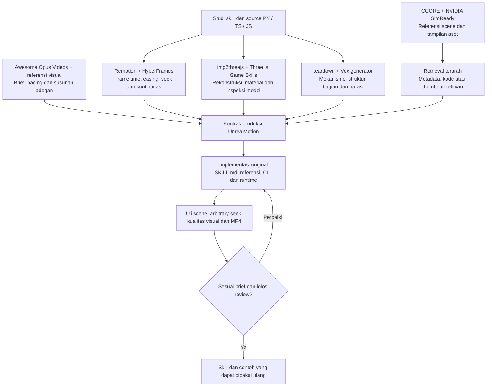
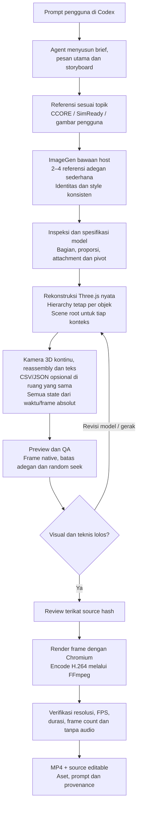
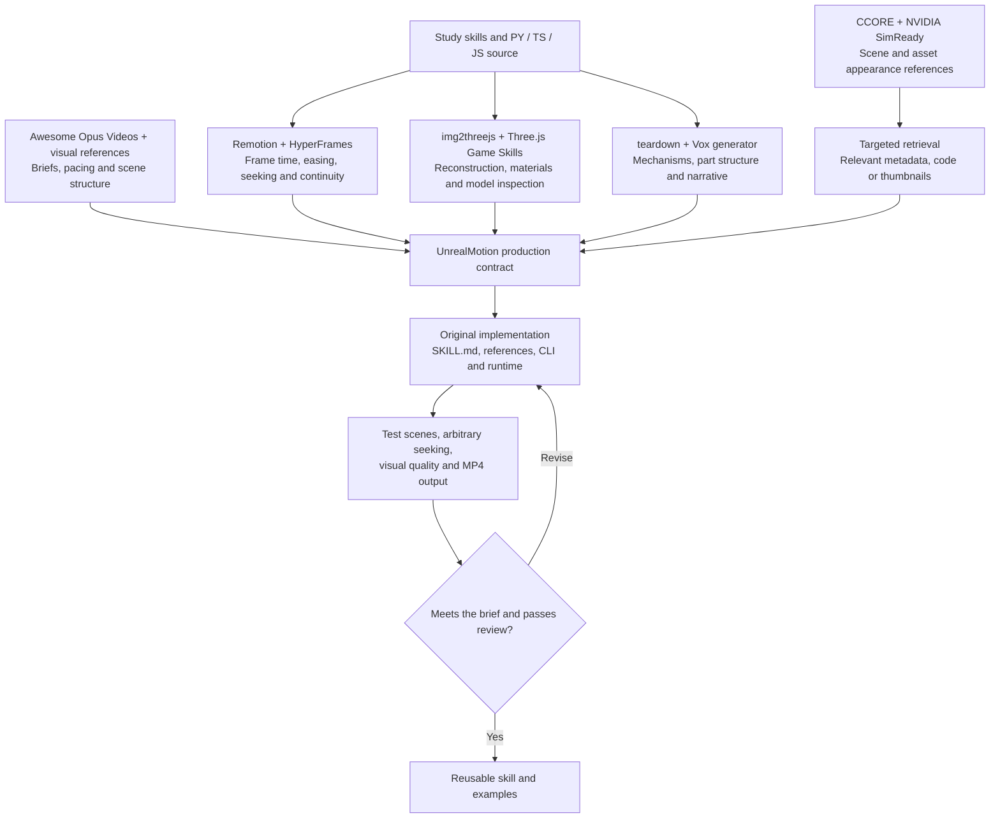
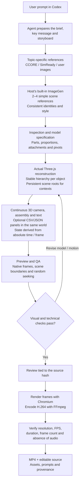

# UnrealMotion

<details>
<summary><strong>Bahasa Indonesia</strong> — buka / tutup</summary>

**Dari brief menjadi gerak. Three.js, source terbuka, MP4 siap pakai.**

Skill untuk coding agent dengan pipeline **prompt → ImageGen → rekonstruksi Three.js → video explainer tanpa audio**. Style explainer mengikuti contoh pastel cutaway yang sederhana; subjek, model, storyboard, dan motion mengikuti prompt. Bahasa copy utama: Indonesia. Engine: Three.js; tidak memakai Unreal Engine atau layanan text-to-video berbayar.

[](examples/media/optical-studio.mp4)

## Baru di 1.2 — kamera kontinu dan reassembly

Beberapa referensi ImageGen yang konsisten → scene Three.js dengan identitas bagian tetap → transisi cutaway/reassembly → teks kinetik dan grafik data → MP4 tanpa audio. Style pastel sederhana dan renderer lokal tetap dipertahankan.

- Kamera 3D bergerak kontinu dalam satu dunia: mendekati mekanisme, berputar ke sudut oblique, mengikuti pipa, lalu menuju grafik yang menetap di ruang yang sama.
- Reassembly bertahap dengan lubang/poros, bearing, rotor, seal, bezel dan baut yang duduk sebelum mekanisme bekerja. Pace default `calm`; `dynamic` tetap tersedia.
- Teks word/character reveal, wipe dan impact; ruang baca tetap diperhitungkan.
- Bar, line, donut, counter dan bar-chart race dari CSV/JSON lokal; domain tetap, unit, sumber dan label data ilustratif.
- Bundle referensi per adegan dengan prompt, hash dan part binding; bukan satu gambar yang digerakkan sepanjang video.

[](examples/media/dynamic-water.mp4)

**Aliran Jadi Data** · 32 detik · 9:16 · 1080×1920 · 30 fps · tanpa audio. Tiga referensi ImageGen, dua konteks 3D, sepuluh beat, kamera kontinu, reassembly sensor dan empat bentuk grafik. Tempo diperpanjang dari 24 menjadi 32 detik (0,75×). Angka serta mekanismenya ilustratif. [Tonton MP4](examples/media/dynamic-water.mp4) · [Source dan aset](examples/dynamic-water) · [Changelog versi](CHANGELOG.md).

Tambahan prompt opsional: `Pace: dinamis, tetap terbaca`, `Data: [file CSV/JSON + unit + sumber]`, dan `Fokus data: [perbandingan/tren/pembagian]`. Jika tidak ada data faktual, gunakan ilustrasi yang diberi label atau jelaskan prosesnya tanpa angka rekaan. [Kamera kontinu](references/continuous-camera.md) · [Data motion](references/data-motion.md) · [Teks dinamis](references/text-motion.md).

## Contoh Video Motion Graphics

Dua explainer lengkap dengan alur **ImageGen → Three.js → video tanpa audio**. Klik thumbnail atau **Tonton MP4** untuk membuka videonya.

| Pipa / aliran air | Pencahayaan rumah — Rumah, Ramah Cahaya |
| --- | --- |
| [](examples/media/water-imagegen-threejs.mp4) | [](examples/media/rumah-ramah-cahaya.mp4) |
| Ikuti pompa, aliran pipa, ketinggian air, dan kontrol otomatis. | Pahami posisi jendela, cahaya alami, peneduh, serta lampu umum dan lampu kerja. |
| [▶ Tonton MP4](examples/media/water-imagegen-threejs.mp4) | [▶ Tonton MP4](examples/media/rumah-ramah-cahaya.mp4) |

Keduanya: **60 detik · 9:16 · 1080×1920 · 30 fps · tanpa audio**. Copy di dalam video memakai bahasa Indonesia.

## Contoh Video 3D Assembly

| Optik / kamera konsep | Bearing mekanik | Rakitan arsitektur |
| --- | --- | --- |
| [](examples/media/optical-studio.mp4) | [](examples/media/mechanical-reassembly.mp4) | [](examples/media/architectural-light.mp4) |
| Susunan optik terpisah, lalu dirakit kembali. | Bola masuk ke cage, race menutup, lalu bearing berputar. | Atap terangkat, struktur terbuka, lalu kembali terpasang. |
| [▶ Tonton MP4](examples/media/optical-studio.mp4) · [Source](examples/optic) | [▶ Tonton MP4](examples/media/mechanical-reassembly.mp4) · [Source](examples/reassembly) | [▶ Tonton MP4](examples/media/architectural-light.mp4) · [Source](examples/pavilion) |

Contoh assembly: **6 detik · 16:9 · 1920×1080 · 60 fps · tanpa audio**. Studi motion lain: [tipografi kinetik](examples/media/kinetic-editorial.mp4) · [ubur-ubur](examples/media/pelagic-bloom.mp4). [Format dan batas verifikasi](examples/verification.md).

## Instalasi skill di Codex

Siapkan **Git, Node.js 22+, Python 3.10+, FFmpeg dan ffprobe**, serta Codex yang dapat membaca/menulis project dan menjalankan perintah lokal. Pipeline referensi gambar membutuhkan **ImageGen bawaan host**. Instalasi npm menyediakan runtime Three.js dan renderer; ketersediaan ImageGen mengikuti host tempat agent berjalan.

### 1. Unduh repo dan pasang runtime

Perintah berikut untuk shell macOS/Linux:

```sh
git clone https://github.com/kohryan/unrealmotion-skill.git
cd unrealmotion-skill
npm ci
npx playwright install chromium
```

Di Linux yang belum memiliki dependency browser, gunakan `npx playwright install --with-deps chromium` sebagai pengganti perintah instalasi Chromium di atas. FFmpeg harus menyediakan encoder H.264; pastikan `ffmpeg` dan `ffprobe` tersedia di `PATH`.

### 2. Daftarkan skill personal

Untuk instalasi baru, buat symlink ke **seluruh checkout**, dari folder `unrealmotion-skill` yang baru di-clone:

```sh
mkdir -p "$HOME/.agents/skills"
ln -s "$(pwd)" "$HOME/.agents/skills/unrealmotion"
node scripts/unrealmotion.mjs doctor
```

Codex mendukung folder skill personal di `~/.agents/skills` dan mengikuti symlink. Perintah `ln -s` akan menolak tujuan yang sudah ada; jika skill sudah terpasang dan terdeteksi, lanjutkan ke langkah penggunaan. Simpan checkout di lokasinya agar symlink tetap valid. Rujukan: [dokumentasi resmi OpenAI tentang skill dan lokasi discovery](https://learn.chatgpt.com/docs/build-skills#where-codex-loads-local-skills).

**Installer bawaan repo:** `node scripts/install.mjs` memakai `${CODEX_HOME:-$HOME/.codex}/skills/unrealmotion`, sesuai implementasi saat ini. Installer mempertahankan skill yang sudah ada dan bersifat idempotent untuk checkout yang sama. Jalur ini tersedia bagi host yang membaca lokasi tersebut; untuk lokasi personal pada dokumentasi Codex saat ini, gunakan langkah `~/.agents/skills` di atas. Satu instalasi yang sudah terdeteksi cukup.

### 3. Panggil dari chat Codex

Buka folder kerja untuk hasil video, lalu kirim prompt dengan `Gunakan $unrealmotion`. Codex mendeteksi skill baru/perubahannya secara otomatis; jika belum muncul, restart Codex, lalu panggil ulang. Lihat [dokumentasi instalasi dan pembaruan skill](https://learn.chatgpt.com/docs/build-skills#install-curated-skills-for-local-use).

Untuk memperbarui runtime dan instruksi, jalankan dari checkout repo:

```sh
git pull --ff-only
npm ci
npx playwright install chromium
node scripts/unrealmotion.mjs doctor
```

Symlink tetap menunjuk ke checkout yang sama. Instalasi UnrealMotion cukup untuk memakai renderer bawaan; daftar upstream yang pernah dipelajari tidak perlu dipasang satu per satu untuk menjalankan pipeline ini.

## Template prompt untuk Codex

Tidak ada format wajib. Minimal sebutkan **topik** dan **tujuan penonton**; alur, fokus visual, durasi dan referensi boleh dilengkapi sesuai kebutuhan. Salin template ini ke chat Codex:

```text
Gunakan $unrealmotion.

Topik: [objek atau proses yang dijelaskan]
Tujuan: [hal yang harus dipahami penonton]
Alur: [tahapan atau bagian penting, jika diketahui]
Fokus visual: [bagian yang perlu diperlihatkan/cutaway/reassembly]
Durasi dan rasio: [opsional]
Referensi: [gambar/link, opsional]

Pertahankan style pastel cutaway sederhana seperti demo.
Tanpa suara atau musik.
```

Contoh terisi:

```text
Gunakan $unrealmotion.

Topik: Tutorial membangun rumah dengan pencahayaan yang cukup
Tujuan: Penonton memahami aspek pencahayaan pada bagian rumah
Alur: Syarat pencahayaan rumah yang baik dan cara merencanakannya
Fokus visual: Jendela, pencahayaan lampu, cahaya alami, dan struktur rumah
Durasi dan rasio: 1 menit, 9:16
Referensi: -

Pertahankan style pastel cutaway sederhana seperti demo.
Tanpa suara atau musik.
```

Jika durasi/format belum ditentukan, explainer memakai **60 detik, 9:16, 1080×1920, 30 fps, tanpa audio**. Agent menyusun storyboard dan motion sesuai topik. Untuk mekanisme, Anda bisa menambahkan arahan seperti “buka casing, jelaskan komponen aktif, rakit kembali, lalu perlihatkan operasinya”. Output yang dituju adalah **MP4 yang bisa diputar beserta source yang bisa diedit**.

Agent membaca [SKILL.md](SKILL.md), menghasilkan referensi adegan yang konsisten melalui ImageGen bawaan host, menulis model/scene khusus, melakukan QA visual, dan merender lokal. CLI `create --prompt` membuat starter serta menyimpan brief; perintah itu **tidak menafsirkan prompt atau menggantikan authoring oleh agent**. ImageGen bawaan tidak memerlukan API key tambahan.

## Metode pembangunan UnrealMotion

UnrealMotion dikembangkan melalui studi instruksi skill serta script Python/TypeScript/JavaScript, pemilihan prinsip yang relevan, lalu implementasi dan pengujian kode original. Hubungan sumber, revisi dan batas lisensinya tercatat di [source study](references/source-study.md).



Dataset digunakan sebagai korpus referensi. Prinsip upstream diadaptasi ke runtime lokal; engine Remotion/HyperFrames tidak otomatis menjadi dependency atau renderer di balik setiap video. Tidak ada training atau fine-tuning model dalam proses ini.

## Pipeline produksi video



Retrieval dipakai saat relevan: SimReady berperan untuk aset yang sesuai, sementara gambar/referensi lain dapat memandu topik berbeda. Gambar ImageGen menjadi panduan model; output visual utama dirender dari volume Three.js. Satu model dengan bagian bernama dipertahankan saat cutaway, reassembly, operasi dan perpindahan kamera.

## Explainer dari ImageGen

```sh
node scripts/unrealmotion.mjs create output/explainer --mode explainer --prompt "Jelaskan mekanisme sesuai brief, tanpa audio"
```

Default: 60 detik, 1080×1920, 30fps, tanpa audio, `--pace calm --assets multi`. Agent membuat referensi ImageGen, spesifikasi bagian/attachment, model Three.js nyata, lalu storyboard dan motion yang menjelaskan sebab-akibat. Referensi tidak diputar sebagai plane atau potongan gambar. Starter meminta authoring sebelum bisa dirender, agar prompt lain tidak menghasilkan contoh air yang sama.

Pilihan motion dalam style yang sama: **ikuti aliran**, **cutaway mekanisme**, **explode → reassemble → operate**, **akumulasi → ambang → respons**, dan **perbandingan/transformasi**. Pilih sesuai ide yang dijelaskan. [Pipeline lengkap](references/imagegen-threejs.md) · [source contoh](examples/water-imagegen-threejs) · [prompt ImageGen dan provenance](examples/water-imagegen-threejs/asset-plan.json).

## Fondasi visual dan motion

| Fondasi scene | Arah visual |
| --- | --- |
| `imagegen-explainer` | Default explainer: referensi khusus prompt → model Three.js → storyboard → MP4 |
| `water-system-explainer` | Studi motion SVG terdahulu; bukan jalur rekonstruksi 3D final |
| `optical-studio` | Kamera konseptual, ring lensa, permukaan mikro, metal, coated optics |
| `architectural-light` | Paviliun, struktur, kisi kayu, glazing, planter dan refleksi air |
| `kinetic-editorial` | Tipografi 2D dan bentuk metal 3D dengan gerak berlapis |
| `pelagic-bloom` | Ubur-ubur translucent, bell berdenyut dan tentakel dengan phase lag |
| `mechanical-reassembly` | Bearing dengan raceway, cage, 18 bola dan urutan assembly yang konsisten |

Pilih motion `cinematic-orbit`, `precision-assembly`, `macro-dolly`, `continuous-flow`, atau `editorial-spring`. Agent mengadaptasi action dan koreografi untuk subjek asli; fondasi bukan katalog subjek yang membatasi prompt. [Panduan motion](references/motion-library.md).

## Dataset yang benar-benar dipakai

Repo memuat indeks offline **4.146 scene**, 41 domain, dari [CCORE ThreeJS-3D-Scenes](https://huggingface.co/datasets/ccore/ThreeJS-3D-Scenes). Pencarian BM25 mengambil referensi berdasarkan subjek, material, dan mekanisme. Fetch mengunduh shard pada revision tetap, memverifikasi SHA-256, lalu mengekstrak HTML/JS scene beserta provenance dan lisensi.

```sh
python3 scripts/hf_dataset.py search "optical camera lens mechanism" --limit 3
# Opsional, untuk mengambil kode lengkap:
python3 -m pip install -r requirements-dataset.txt
python3 scripts/hf_dataset.py fetch scene-002322 --output output/references/camera
```

Indeks tidak memuat reasoning traces. Ini retrieval referensi, bukan klaim training/fine-tuning. Preview-image dataset 1,37GB tidak diunduh otomatis. [Detail dataset](references/dataset.md).

## SimReady + ImageGen, hemat storage

Katalog tambahan berisi **2.677 aset NVIDIA SimReady** dan hanya memakan sekitar **391 KB**. Perintah berikut mengambil thumbnail dan lisensi satu aset; tidak mengunduh USD, texture pack, atau seluruh dataset:

```sh
python3 scripts/simready.py search "bearing ball"
python3 scripts/simready.py reference consumable_bearing_ball_a01 --output output/bearing-reference --max-mb 2
```

Demo bearing mengambil referensi NVIDIA sebesar **591 KB**, membuat [lembar visual dengan ImageGen](assets/references/bearing/imagegen-reference.png), lalu membangun **mesh 3D nyata** dari referensi itu: lathed raceways, collar, cage berlubang dan bola. Komponen tersebut dirakit dengan identitas/pose tetap, kemudian bergerak setelah assembly. Gambar tidak dianimasikan sebagai potongan palsu 3D.

ImageGen membantu mereplikasi tampilan; ia tidak mengekstrak mesh, dimensi CAD, bagian tersembunyi atau metadata simulasi NVIDIA. Hasilnya rekonstruksi visual perkiraan. [Alur dan batas fidelity](references/simready-imagegen.md) · [reassembly dan teardown](references/reassembly.md). Thumbnail/material referensi NVIDIA mempertahankan atribusi **CC BY 4.0**.

## Preview dan render manual

```sh
node scripts/unrealmotion.mjs create output/film --prompt "Brief Anda" --template optical-studio --motion precision-assembly
# Edit output/film/scene.mjs, project.json, dan plan.json.
node scripts/unrealmotion.mjs preview output/film
node scripts/unrealmotion.mjs qa output/film
# Periksa contact sheet + frame native, lalu tulis review.json.
node scripts/unrealmotion.mjs render output/film --final
node scripts/unrealmotion.mjs probe output/film/output/video.mp4
```

Preview mendukung play/pause dan scrub frame. Final dirender frame demi frame, dengan random seed tetap, aset lokal dan anti-aliasing. Explainer memakai proyeksi orthographic, warna pastel dan soft light; showcase memakai studio sRGB/ACES. MP4 diverifikasi kembali untuk resolusi, FPS, frame count dan durasi. Render gagal tidak mengganti MP4 lama. `render` tanpa `--final` menghasilkan draft dengan status visual pending.

Laporan QA mendeteksi error browser/aset, frame kosong, transform invalid, copy terpotong, random-seek inconsistency, dan perubahan gambar pada paruh akhir. **Penilaian visual tetap dilakukan oleh agent/manusia.** Checksum dan pemeriksaan pixel tidak membuktikan fotorealisme atau anatomi yang benar. [Protokol review](references/quality.md).

## Penggunaan token: riwayat dua video

**Model produksi: GPT-6.1 Sol (Extra High)**, sebagai agent utama Codex untuk kedua video.

Berikut counter token **agent utama Codex** dari sesi produksi pada **4 November 2026**. Kedua video berdurasi 60 detik, 9:16, 1080×1920, 30 fps, tanpa audio. Angka dihitung dari selisih counter kumulatif `token_count` sebelum permintaan produksi dan setelah hasil diserahkan.


Cached input sudah termasuk dalam input; reasoning tokens sudah termasuk dalam output. Keduanya tidak dijumlahkan lagi ke total.

- **Pipa / aliran air:** mencakup pengembangan pipeline explainer, revisi brief/aset, ImageGen-to-Three.js, motion, render dan QA; bukan sekadar render ulang contoh yang sudah siap.
- **Rumah, Ramah Cahaya:** mencakup penerapan skill yang sudah dibangun ke prompt baru, authoring model/aset khusus, motion, render dan QA.
- Angka ini menghitung pemakaian agent utama, termasuk konteks yang diproses kembali sepanjang iterasi. Pemakaian terpisah subagent dan model ImageGen tidak tercakup. Proses Chromium/FFmpeg lokal tidak memakai token model.

Ini **catatan historis produksi**, bukan estimasi biaya USD, kebutuhan token tetap per video, atau benchmark yang menjamin penggunaan berikutnya. Data agregat, batas interval dan metode perhitungan tersedia di [video-token-usage.json](data/video-token-usage.json); log percakapan mentah tidak dipublikasikan.

## Kredit dan atribusi

Terima kasih kepada pembuat skill, dataset dan referensi berikut. Tabel ini membedakan kontribusi yang dipelajari dari dependency runtime yang benar-benar dijalankan.

| Sumber dan pembuat | Kontribusi yang dipelajari / digunakan | Peran dalam UnrealMotion |
| --- | --- | --- |
| [Remotion — remotion-dev](https://github.com/remotion-dev/remotion) | Waktu berbasis frame, interpolation/spring, readiness dan render per frame | Studi source dan skill; runtime Remotion bersifat opsional |
| [HyperFrames — heygen-com](https://github.com/heygen-com/hyperframes) | Timeline/seek, authoring motion, kontinuitas, `motion-doctrine`, `cut-the-curve` dan `seam-craft` | Studi skill dan source; prinsip motion diadaptasi ke scene lokal |
| [img2threejs — img2threejs](https://github.com/img2threejs/img2threejs) | Spesifikasi sebelum modeling, rekonstruksi bertahap, hierarki bagian dan review dari beberapa sudut | Metode ImageGen → model Three.js yang konsisten |
| [Three.js Game Skills — majidmanzarpour](https://github.com/majidmanzarpour/threejs-game-skills) | Geometri, material, pencahayaan, diagnostic dan QA grafis | Pedoman kualitas model dan inspeksi runtime |
| [teardown — elvarofficial](https://github.com/elvarofficial/teardown) | Satu model mekanisme, cutaway, urutan assembly, rest pose dan capture deterministik | Prinsip untuk reassembly dan explainer mekanisme |
| [Vox AI Motion Graphics Generator — Anil-matcha](https://github.com/Anil-matcha/vox-ai-motion-graphics-generator) | Alur script → beats → aset → motion → assembly | Studi workflow naratif; layanan MuAPI-nya terpisah dari renderer lokal |
| [Awesome Opus 5.5 Videos — yihui-dev dan para kreator yang ditautkan](https://github.com/yihui-dev/awesome-opus5-5-videos) | Referensi brief, showcase, pacing dan progresi visual | Koleksi inspirasi/prompt, bukan engine atau kode seluruh video |
| [ThreeJS-3D-Scenes — CCORE](https://huggingface.co/datasets/ccore/ThreeJS-3D-Scenes) | 4.146 entri scene untuk pencarian metadata dan retrieval kode terpilih | Korpus referensi bentuk, struktur dan konstruksi scene |
| [SimReady Assets — NVIDIA](https://huggingface.co/datasets/nvidia/simready-assets) | Katalog 2.677 paket dan thumbnail/lisensi aset terpilih | Referensi tampilan hemat storage; koleksi USD/tekstur penuh tidak dibundel |
| [OpenAI ImageGen](https://developers.openai.com/api/docs/guides/image-generation) | Pembuatan referensi visual baru melalui tool bawaan host | Sumber referensi gambar; prompt dan provenance disimpan per project |

Runtime menggunakan [Three.js](https://github.com/mrdoob/three.js), [Playwright](https://github.com/microsoft/playwright), [FFmpeg/ffprobe](https://ffmpeg.org/) dan font [Inter](https://github.com/rsms/inter). Lisensi font disertakan di [OFL.txt](assets/runtime/fonts/OFL.txt).

Kode original UnrealMotion memakai [MIT](LICENSE). Materi CCORE mempertahankan [MIT CCORE](data/CCORE-LICENSE), sementara referensi NVIDIA mempertahankan **CC BY 4.0** beserta atribusi dan provenance. Lisensi upstream lain mengikuti sumbernya masing-masing; instalasi/studi sebuah skill tidak mengubah lisensinya menjadi MIT. Revisi yang diteliti, status lisensi snapshot dan batas pemakaian tercatat dalam [source-study.md](references/source-study.md), dengan inventaris instalasi di [installed-upstreams.json](data/installed-upstreams.json).

Remotion/HyperFrames memiliki [resep interoperabilitas](references/engine-interop.md). Default yang diuji repo ini adalah renderer Three.js lokal; layanan generasi/audio eksternal dari skill upstream tidak diaktifkan oleh `npm ci`.

## Verifikasi

```sh
npm test
npm run test:render
```

Unit checks menguji retrieval, integritas katalog, determinisme motion, validasi format dan batas file. Integration checks menjalankan scene/motion pada browser, format portrait, encode MP4 dan proteksi output. Demo dan batas pengujian tercatat di [examples/verification.md](examples/verification.md).

MIT untuk kode original; dataset mempertahankan MIT CCORE. Kualitas akhir bergantung pada authoring, aset, rig, serta review untuk setiap brief. Realisme karakter atau rekonstruksi brand tidak dijamin oleh template prosedural; gunakan aset berlisensi yang sesuai ketika diperlukan.

</details>

**From brief to motion. Three.js, editable source, ready-to-play MP4.**

A coding-agent skill with a **prompt → ImageGen → Three.js reconstruction → silent explainer video** pipeline. Explainers follow the demo's simple pastel cutaway style; the subject, model, storyboard, and motion follow your prompt. On-screen copy defaults to Indonesian. Built with Three.js; it does not use Unreal Engine or a paid text-to-video service.

[](examples/media/optical-studio.mp4)

## New in 1.2 — continuous camera and reassembly

Consistent ImageGen references → Three.js scenes with stable part identities → cutaway/reassembly handoffs → kinetic text and data graphics → silent MP4. The simple pastel style and local renderer remain the foundation.

- An actual 3D camera travels continuously through one world: close-ups, oblique arcs, a connected pipe and data panels anchored in the same space.
- Dependency-ordered reassembly: shaft clearances, bearing, rotor, seal, bezel and bolts seat before operation. `calm` is the default pace; `dynamic` remains available.
- Word/character reveals, wipes and impact text, with time reserved for reading.
- Bar, line, donut, counter and bar-chart race graphics from local CSV/JSON; fixed domains, units, sources and illustrative-data labels.
- Per-scene reference bundles with exact prompts, image hashes and part bindings, rather than one image stretched into a whole film.

[](examples/media/dynamic-water.mp4)

**Aliran Jadi Data** · 32 seconds · 9:16 · 1080×1920 · 30 fps · no audio. Three ImageGen references, two 3D contexts, ten beats, a continuous camera, sensor reassembly and four chart forms. Pacing extends the former 24-second demo to 32 seconds (0.75×). Values and mechanics are illustrative. [Watch MP4](examples/media/dynamic-water.mp4) · [Source and assets](examples/dynamic-water) · [Version changelog](CHANGELOG.md).

Optional prompt additions: `Pace: dynamic, readable`, `Data: [CSV/JSON file + units + source]`, and `Data focus: [comparison/trend/share]`. Without factual data, clearly label illustrative values or explain the process without invented numbers. [Continuous camera](references/continuous-camera.md) · [Data motion](references/data-motion.md) · [Kinetic text](references/text-motion.md).

## Motion Graphic Video Examples

Two full explainers made with **ImageGen → Three.js → silent video**. Click a thumbnail or **Watch MP4** to open the video.

| Pipes / water flow | House lighting — Rumah, Ramah Cahaya |
| --- | --- |
| [](examples/media/water-imagegen-threejs.mp4) | [](examples/media/rumah-ramah-cahaya.mp4) |
| Follow the pump, pipe flow, tank level, and automatic control. | Explain window placement, natural light, shading, and ambient/task lighting. |
| [▶ Watch MP4](examples/media/water-imagegen-threejs.mp4) | [▶ Watch MP4](examples/media/rumah-ramah-cahaya.mp4) |

Both: **60 seconds · 9:16 · 1080×1920 · 30 fps · no audio**. On-screen copy is Indonesian.

## 3D Assembly Video Examples

| Optics / concept camera | Mechanical bearing | Architectural assembly |
| --- | --- | --- |
| [](examples/media/optical-studio.mp4) | [](examples/media/mechanical-reassembly.mp4) | [](examples/media/architectural-light.mp4) |
| Optical stack separation and reassembly. | Balls seat in the cage, races close, then rotation begins. | Roof lift, structural reveal, and return. |
| [▶ Watch MP4](examples/media/optical-studio.mp4) · [Source](examples/optic) | [▶ Watch MP4](examples/media/mechanical-reassembly.mp4) · [Source](examples/reassembly) | [▶ Watch MP4](examples/media/architectural-light.mp4) · [Source](examples/pavilion) |

Assembly examples: **6 seconds · 16:9 · 1920×1080 · 60 fps · no audio**. More motion studies: [kinetic typography](examples/media/kinetic-editorial.mp4) · [jellyfish](examples/media/pelagic-bloom.mp4). [Formats and verification limits](examples/verification.md).

## Install the skill in Codex

You need **Git, Node.js 22+, Python 3.10+, FFmpeg, and ffprobe**, plus Codex with permission to read/write the project and run local commands. The image-reference pipeline requires the **host's built-in ImageGen tool**. npm installs the Three.js runtime and renderer; ImageGen availability depends on the agent's host.

### 1. Clone the repository and install the runtime

Run these commands in a macOS/Linux shell:

```sh
git clone https://github.com/kohryan/unrealmotion-skill.git
cd unrealmotion-skill
npm ci
npx playwright install chromium
```

On Linux without browser dependencies, replace the Chromium installation command with `npx playwright install --with-deps chromium`. FFmpeg must provide an H.264 encoder; make sure `ffmpeg` and `ffprobe` are on your `PATH`.

### 2. Register the personal skill

For a new installation, create a symlink to the **entire checkout**, from the `unrealmotion-skill` directory you just cloned:

```sh
mkdir -p "$HOME/.agents/skills"
ln -s "$(pwd)" "$HOME/.agents/skills/unrealmotion"
node scripts/unrealmotion.mjs doctor
```

Codex supports personal skills in `~/.agents/skills` and follows symlinks. `ln -s` refuses to replace an existing destination; if the skill is already installed and discoverable, proceed to usage. Keep the checkout in place so the symlink remains valid. See the [official OpenAI documentation on skills and discovery locations](https://learn.chatgpt.com/docs/build-skills#where-codex-loads-local-skills).

**Repository installer:** `node scripts/install.mjs` currently uses `${CODEX_HOME:-$HOME/.codex}/skills/unrealmotion`. It preserves existing skills and is idempotent for the same checkout. This path is available to hosts that read that location; use the `~/.agents/skills` steps above for the personal location in current Codex documentation. One discoverable installation is enough.

### 3. Invoke it in a Codex chat

Open a working folder for your video output, then send a prompt containing `Use $unrealmotion`. Codex discovers new and updated skills automatically; if it does not appear, restart Codex and try again. See the [skill installation and update documentation](https://learn.chatgpt.com/docs/build-skills#install-curated-skills-for-local-use).

To update the runtime and instructions, run these commands from the repository checkout:

```sh
git pull --ff-only
npm ci
npx playwright install chromium
node scripts/unrealmotion.mjs doctor
```

The symlink continues to point to the same checkout. Installing UnrealMotion is enough to use its built-in renderer; you do not need to install every upstream skill studied during development.

## Prompt template for Codex

There is no mandatory format. At minimum, give the **topic** and **what the viewer should understand**. Add a sequence, visual focus, duration, and references when useful. Copy this template into Codex:

```text
Use $unrealmotion.

Topic: [object or process to explain]
Goal: [what the viewer should understand]
Sequence: [important stages or sections, if known]
Visual focus: [parts to show, cut away, or reassemble]
Duration and aspect ratio: [optional]
References: [image/link, optional]

Keep the simple pastel cutaway style shown in the demo.
No voice or music.
```

Example:

```text
Use $unrealmotion.

Topic: Building a house with adequate lighting
Goal: Help viewers understand lighting across different parts of a home
Sequence: What good home lighting requires and how to plan it
Visual focus: Windows, lamps, natural light, and the house structure
Duration and aspect ratio: 1 minute, 9:16
References: -

Keep the simple pastel cutaway style shown in the demo.
No voice or music.
```

If duration and format are unspecified, explainers default to **60 seconds, 9:16, 1080×1920, 30 fps, without audio**. The agent builds a storyboard and motion around the topic. For mechanisms, you can add directions such as “open the casing, explain the active components, reassemble them, then show the mechanism working.” The intended delivery is a **playable MP4 and editable source**.

The agent reads [SKILL.md](SKILL.md), generates consistent scene references with the host's built-in ImageGen, writes a custom model/scene, reviews the visuals, and renders locally. The CLI's `create --prompt` command creates a starter and saves the brief; it **does not interpret the prompt or replace agent authoring**. Built-in ImageGen requires no additional API key.

## How UnrealMotion was built

UnrealMotion was developed by studying skill instructions and Python/TypeScript/JavaScript scripts, selecting relevant principles, then implementing and testing original code. Sources, revisions, and licensing limits are recorded in the [source study](references/source-study.md).



The datasets serve as reference corpora. Upstream principles are adapted to the local runtime; Remotion and HyperFrames are not automatically dependencies or the renderer behind every video. This process does not train or fine-tune a model.

## Video production pipeline



Retrieval is used when relevant: SimReady supports suitable assets, while other images and references can guide different topics. ImageGen images guide modeling; the main visuals are rendered from Three.js volumes. One model with named parts persists through cutaways, reassembly, operation, and camera moves.

## Explainers from ImageGen

```sh
node scripts/unrealmotion.mjs create output/explainer --mode explainer --prompt "Explain the mechanism in the brief, without audio"
```

Defaults: 60 seconds, 1080×1920, 30 fps, without audio. The agent creates an ImageGen reference, specifies parts and attachments, builds an actual Three.js model, then authors a storyboard and motion that explain cause and effect. The reference is not animated as a plane or image fragments. The starter requires authoring before rendering, so a different prompt does not produce the same water example.

Motion choices within the same style: **follow the flow**, **mechanism cutaway**, **explode → reassemble → operate**, **accumulation → threshold → response**, and **comparison/transformation**. Choose the motion that serves the explanation. [Full pipeline](references/imagegen-threejs.md) · [example source](examples/water-imagegen-threejs) · [ImageGen prompt and provenance](examples/water-imagegen-threejs/asset-plan.json).

## Visual and motion foundations

| Scene foundation | Visual direction |
| --- | --- |
| `imagegen-explainer` | Default explainer: prompt-specific reference → Three.js model → storyboard → MP4 |
| `water-system-explainer` | Earlier SVG motion study; not the final 3D reconstruction path |
| `optical-studio` | Concept camera, lens rings, micro-surfaces, metal, coated optics |
| `architectural-light` | Pavilion, structure, timber slats, glazing, planters, and water reflections |
| `kinetic-editorial` | 2D typography and 3D metal forms with layered motion |
| `pelagic-bloom` | Translucent jellyfish, pulsing bell, and tentacles with phase lag |
| `mechanical-reassembly` | Bearing with raceways, cage, 18 balls, and a consistent assembly sequence |

Choose `cinematic-orbit`, `precision-assembly`, `macro-dolly`, `continuous-flow`, or `editorial-spring` motion. The agent adapts actions and choreography to the actual subject; these foundations do not limit the topics you can request. [Motion guide](references/motion-library.md).

## Datasets actually used

The repository includes an offline index of **4,146 scenes** across 41 domains from [CCORE ThreeJS-3D-Scenes](https://huggingface.co/datasets/ccore/ThreeJS-3D-Scenes). BM25 search retrieves references by subject, material, and mechanism. Fetch downloads a shard at a pinned revision, verifies its SHA-256, and extracts the scene's HTML/JS with provenance and license information.

```sh
python3 scripts/hf_dataset.py search "optical camera lens mechanism" --limit 3
# Optional: retrieve the full scene code.
python3 -m pip install -r requirements-dataset.txt
python3 scripts/hf_dataset.py fetch scene-002322 --output output/references/camera
```

The index excludes reasoning traces. This is reference retrieval, not a claim of training or fine-tuning. The 1.37 GB preview-image dataset is not downloaded automatically. [Dataset details](references/dataset.md).

## SimReady + ImageGen with less storage

The additional catalog lists **2,677 NVIDIA SimReady assets** in approximately **391 KB**. These commands retrieve one asset's thumbnail and license without downloading USD files, texture packs, or the full dataset:

```sh
python3 scripts/simready.py search "bearing ball"
python3 scripts/simready.py reference consumable_bearing_ball_a01 --output output/bearing-reference --max-mb 2
```

The bearing demo retrieved **591 KB** of NVIDIA reference material, created an [ImageGen visual sheet](assets/references/bearing/imagegen-reference.png), then built **actual 3D meshes** from it: lathed raceways, collars, a perforated cage, and balls. Components retain their identities and poses during assembly, then move after assembly. The image is not animated as fake 3D fragments.

ImageGen helps reproduce appearance; it does not extract meshes, CAD dimensions, hidden parts, or NVIDIA simulation metadata. The result is an approximate visual reconstruction. [Workflow and fidelity limits](references/simready-imagegen.md) · [reassembly and teardown](references/reassembly.md). NVIDIA reference thumbnails/materials retain **CC BY 4.0** attribution.

## Manual preview and rendering

```sh
node scripts/unrealmotion.mjs create output/film --prompt "Your brief" --template optical-studio --motion precision-assembly
# Edit output/film/scene.mjs, project.json, and plan.json.
node scripts/unrealmotion.mjs preview output/film
node scripts/unrealmotion.mjs qa output/film
# Inspect the contact sheet and native frames, then write review.json.
node scripts/unrealmotion.mjs render output/film --final
node scripts/unrealmotion.mjs probe output/film/output/video.mp4
```

Preview supports play/pause and frame scrubbing. Final output is rendered frame by frame with a fixed random seed, local assets, and anti-aliasing. Explainers use orthographic projection, pastel colors, and soft lighting; showcases use studio sRGB/ACES. MP4 output is checked again for resolution, FPS, frame count, and duration. A failed render preserves the previous MP4. `render` without `--final` produces a draft with visual review pending.

QA reports detect browser/asset errors, blank frames, invalid transforms, clipped copy, inconsistent random seeking, and image changes in the second half. **An agent or human still performs the visual assessment.** Checksums and pixel checks do not prove photorealism or correct anatomy. [Review protocol](references/quality.md).

## Token usage: two production histories

**Production model: GPT-6.1 Sol (Extra High)**, used as the main Codex authoring agent for both videos.

These are **main Codex agent** token counters from production on **November 4, 2026**. Both videos are 60 seconds, 9:16, 1080×1920, 30 fps, without audio. Counts are the difference between cumulative `token_count` counters before each production request and after delivery.


Cached input is already included in input; reasoning tokens are already included in output. Neither is added to the total a second time.

- **Pipes / water flow:** includes explainer pipeline development, brief/asset revisions, ImageGen-to-Three.js work, motion, rendering, and QA; it is more than rerendering a finished example.
- **Rumah, Ramah Cahaya:** includes applying the existing skill to a new prompt, authoring a custom model/reference, motion, rendering, and QA.
- These figures cover the main agent, including context processed again throughout the iterations. Separate subagent usage and ImageGen model usage are excluded. Local Chromium/FFmpeg processes consume no model tokens.

This is a **historical production record**, not a USD cost estimate, a fixed token requirement per video, or a benchmark guaranteeing future usage. Aggregates, interval boundaries, and calculation details are in [video-token-usage.json](data/video-token-usage.json); raw conversation logs are not published.

## Credits and attribution

Thanks to the authors of these skills, datasets, and references. This table distinguishes studied contributions from runtime dependencies actually executed.

| Source and author | Contribution studied / used | Role in UnrealMotion |
| --- | --- | --- |
| [Remotion — remotion-dev](https://github.com/remotion-dev/remotion) | Frame-based time, interpolation/springs, readiness, and frame rendering | Source and skill study; the Remotion runtime is optional |
| [HyperFrames — heygen-com](https://github.com/heygen-com/hyperframes) | Timelines/seeking, motion authoring, continuity, `motion-doctrine`, `cut-the-curve`, and `seam-craft` | Skill and source study; motion principles adapted to local scenes |
| [img2threejs — img2threejs](https://github.com/img2threejs/img2threejs) | Specification before modeling, staged reconstruction, part hierarchy, and multi-angle review | Method for consistent ImageGen → Three.js models |
| [Three.js Game Skills — majidmanzarpour](https://github.com/majidmanzarpour/threejs-game-skills) | Geometry, materials, lighting, diagnostics, and graphics QA | Model quality and runtime inspection guidance |
| [teardown — elvarofficial](https://github.com/elvarofficial/teardown) | One mechanism model, cutaways, assembly order, rest poses, and deterministic capture | Principles for reassembly and mechanism explainers |
| [Vox AI Motion Graphics Generator — Anil-matcha](https://github.com/Anil-matcha/vox-ai-motion-graphics-generator) | Script → beats → assets → motion → assembly workflow | Narrative workflow study; its MuAPI service is separate from the local renderer |
| [Awesome Opus 5.5 Videos — yihui-dev and linked creators](https://github.com/yihui-dev/awesome-opus5-5-videos) | Briefs, showcases, pacing, and visual progression | Inspiration/prompt collection, not an engine or all the videos' source code |
| [ThreeJS-3D-Scenes — CCORE](https://huggingface.co/datasets/ccore/ThreeJS-3D-Scenes) | 4,146 scene entries for metadata search and selected code retrieval | Reference corpus for forms, structure, and scene construction |
| [SimReady Assets — NVIDIA](https://huggingface.co/datasets/nvidia/simready-assets) | Catalog of 2,677 packages and selected asset thumbnails/licenses | Storage-efficient appearance references; full USD/texture collections are not bundled |
| [OpenAI ImageGen](https://developers.openai.com/api/docs/guides/image-generation) | New visual references generated through the host's built-in tool | Image reference source; prompts and provenance saved per project |

The runtime uses [Three.js](https://github.com/mrdoob/three.js), [Playwright](https://github.com/microsoft/playwright), [FFmpeg/ffprobe](https://ffmpeg.org/), and the [Inter](https://github.com/rsms/inter) font. The font license is included in [OFL.txt](assets/runtime/fonts/OFL.txt).

Original UnrealMotion code is licensed under [MIT](LICENSE). CCORE material retains the [CCORE MIT license](data/CCORE-LICENSE), while NVIDIA references retain **CC BY 4.0** with attribution and provenance. Other upstream materials follow their own licenses; installing or studying a skill does not relicense it under MIT. Studied revisions, snapshot license status, and usage limits are recorded in [source-study.md](references/source-study.md), with an installation inventory in [installed-upstreams.json](data/installed-upstreams.json).

Remotion/HyperFrames have [interoperability recipes](references/engine-interop.md). The tested default in this repository is the local Three.js renderer; upstream generation/audio services are not activated by `npm ci`.

## Verification

```sh
npm test
npm run test:render
```

Unit checks cover retrieval, catalog integrity, motion determinism, format validation, and file boundaries. Integration checks run scenes/motion in a browser, portrait formats, MP4 encoding, and output protection. Demos and test limits are recorded in [examples/verification.md](examples/verification.md).

MIT for original code; dataset materials retain CCORE MIT. Final quality depends on authoring, assets, rigs, and review for each brief. Procedural templates do not guarantee realistic characters or brand reconstruction; use appropriately licensed assets where needed.
