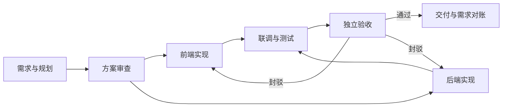

<div align="center">

# DSH Boss Worker

**用节点选择模型，用流程组织协作，用证据完成交付。**

面向 DeepSeek Harness 的多模型流程工作台

[](CHANGELOG.md)
[](COMPATIBILITY.md)
[](LICENSE)

**简体中文** · [English](README.en.md)

[快速开始](#快速开始) · [工作方式](#工作方式) · [文档中心](docs/README.md) · [更新记录](CHANGELOG.md)

</div>

---

> [!NOTE]
> 当前版本为 **[`0.2.0-beta.28` · Beta 预发布版](https://github.com/kongbai9420/dsh-boss-worker/releases/tag/v0.2.0-beta.28)**。验证范围见下文，安装包与校验文件见 Release。

## 为什么使用

在 DSH 官方“流程”页签中，把需求拆为节点，为每个节点选择 Provider / 模型，再用连线表达依赖、审查与返工。从草案到交付，模型配置、执行状态和验收依据都有记录。

| 能力 | 使用体验 |
| --- | --- |
| 节点配置模型 | 直接选择执行模型与独立验收模型，无需维护执行成员池 |
| 分支与汇合 | 满足依赖、写入范围不冲突的独立节点并行执行 |
| 可编辑的流程 | 拖拽连线、布局切换、撤销重做、Skill 绑定、模板导入导出 |
| 按依据验收 | 原需求逐项对账，保留核验历史，区分失败与证据不足 |
| 显式返工 | 按画布中的封驳连线重做目标及受影响下游 |
| 运行可观测 | 查看节点调用、返工、独立验收、Token 与预估费用 |

## 工作方式



这是分支、汇合与返工的概念示例。实际依赖由画布连线决定，内置全栈模板还包含架构、UX 与交付等节点。

**不再设置执行成员数量或最大并发数。** 同一模型可以创建多个独立执行实例；运行时按依赖和申报的写入范围调度，写冲突排队。同一个主控直接执行上下文仍保持串行。

| 流程类型 | 适合场景 | 规则 |
| --- | --- | --- |
| 并行流程 · `kind=dag` | 自由搭建分支与汇合；新模板默认使用 | `passed` 依赖必须无环；`rejected` 返回前置节点或自身 |
| 模型接管链 · 不指定 `kind` | 同一任务顺次切换模型 | 支持通过、封驳、返工超限、超时与错误；每个条件一个后继 |
| 治理编排 · `kind=orchestration` | 三省六部、全栈开发团队 | 结构化规划、方案审议、分工、汇合、最终验收与报告 |

并行流程有多个末端且未显式汇合时，应用后增加可见的“汇合交付与验收”节点。接管图出现同一起点的多个通过后继时，按并行流程识别和校验。详见[节点与流程](docs/WORKFLOW.md)。

## 快速开始

### 在 DSH 中使用

1. 在 DSH 配置可用 Provider 和模型，通过应用内插件管理安装本地插件包。
2. 打开官方 **流程** 页签，选择模板或新建流程。
3. 为节点选择模型、职责、Skill、写入范围、返工预算与超时；按需调整独立验收模型。
4. 用 **通过** 连线建立依赖，用 **封驳** 连线指定返工目标。
5. 保存草案，或应用到未启动任务；按当前审批策略批准或启动编排。
6. 在运行记录与需求对账中核对成果，补齐原需求的有效验收依据后交付。

预览、保存和应用流程不会立即调用模型。已应用节点保存执行与验收模型快照，修改共享目录不会悄悄替换正在使用的模型。

<details>
<summary><strong>界面预览 · 节点直接选择模型</strong></summary>

离线交互验证截图，展示模板编辑、节点模型和职责配置。`offline / C` 为测试夹具。

<p align="center">
  
</p>

</details>

### 从源码构建

使用 Node.js 24（与仓库 CI 一致）。

```powershell
git clone https://github.com/kongbai9420/dsh-boss-worker.git
cd dsh-boss-worker
npm ci --legacy-peer-deps --ignore-scripts
npm run build:client
npm test
npm run test:client
npm pack --ignore-scripts
```

产物为本地 `.tgz` 安装包；请核对当前检出源码中的 `package.json` 版本。`client/` 是前端源码，`client.js` 是构建产物。宿主契约检查还需要官方 DSH 依赖，安装及执行方式见 [CI 配置](.github/workflows/check.yml)。

离线体验工作台：

```powershell
node scripts/preview-workbench.mjs
```

按终端提示打开本地地址。预览使用临时 Profile 与离线模型，不操作真实会话、不产生模型调用费用。

## 验收与运行控制

| 环节 | 当前行为 |
| --- | --- |
| 质量与证据 | 已确认失败不能被模型 `passed=true` 放行；证据不足时保留成果等待补充核验 |
| 最终交付 | 逐条核对原需求的版本、状态和可复核依据；口头总结不能替代证据 |
| 核验修正 | 同版本、同执行轮次采用最近一次可信核验，保留历史；执行者自报不能覆盖可信结论 |
| 独立验收 | 新建实现节点默认使用独立审查上下文；人工核验需先记录依据再审查 |
| 只读审查 | 检查文件与已有证据；执行测试交给测试节点 |
| 暂停调度 | 停止新派发，已启动调用继续结算；中断、取消和停工排空分别处理 |
| 取消与恢复 | 取消上游会阻塞相关下游；重启后中断任务需核查并确认恢复 |

`writeScopes` 用于任务契约、调度冲突和交付检查，**不是文件系统硬隔离**。模型执行仍遵循宿主沙箱与审批。BOSS 直派、全自动托管为会话私有开关，返工与审批默认值沿用共享设置。

## 用量与计价

节点累计包含返工和独立验收，并按实际 Provider / 模型记录用量。用量设置直接选择可用模型添加单价，支持官方参考报价、手动覆盖、显示单位与显式换算。

**会话预算用于提醒，不会自动停机。** 未知用量与未计价费用会明确显示；预估费用不代表实际账单、订阅额度或账户余额。详见[运行监控](docs/RUNTIME_MONITORING.md)。

## 验证状态

最近验证日期：**2026-10-27**。以下为本地记录，不代表远端 GitHub Actions 已运行。

| 检查 | 结果与范围 |
| --- | --- |
| 单元与业务回归 | **412 通过，0 失败，0 跳过** |
| 官方宿主与前端契约 | DSH `0.1.7-rc.2`、`0.2.0-rc.2`、`0.2.1-rc.2` 均通过 |
| 界面交互 | 离线验证模板编辑、节点模型选择、保存与重新打开 |
| 真实 Provider | 完整付费任务、限流与账单对照仍待独立验收 |

兼容测试使用真实官方宿主依赖和离线模型夹具。详细记录见[兼容性](COMPATIBILITY.md)。旧 `members` / `memberId` 和 `maxParallel` 仅用于迁移兼容；不再表示执行实例数量或调度上限。

## 文档与参与

| 文档 | 内容 |
| --- | --- |
| [文档中心](docs/README.md) | 中英双语导航与阅读顺序 |
| [节点与流程](docs/WORKFLOW.md) | 并行、接管、封驳、应用与恢复 |
| [模型路由](docs/MODEL_ROUTING.md) | 固定模型、档位、快照与迁移 |
| [全栈团队](docs/FULLSTACK_TEMPLATE.md) | 角色、依赖与定向返工 |
| [运行监控](docs/RUNTIME_MONITORING.md) | Token、计价、预算与数据口径 |
| [兼容性](COMPATIBILITY.md) · [规划](ROADMAP.md) · [更新记录](CHANGELOG.md) | 验证边界、后续工作与版本历史 |

欢迎通过 [Issues](https://github.com/kongbai9420/dsh-boss-worker/issues) 提交问题，附上插件版本、DSH 版本、复现步骤和脱敏日志。代码贡献请说明行为变化与验证结果；开发命令见上文。

基于 [MIT License](LICENSE) 开源。打包依赖许可证见 [第三方声明](THIRD_PARTY_NOTICES.md)。
