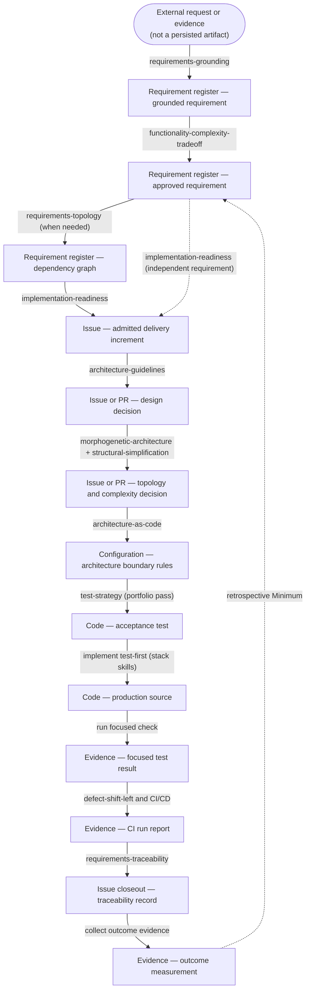
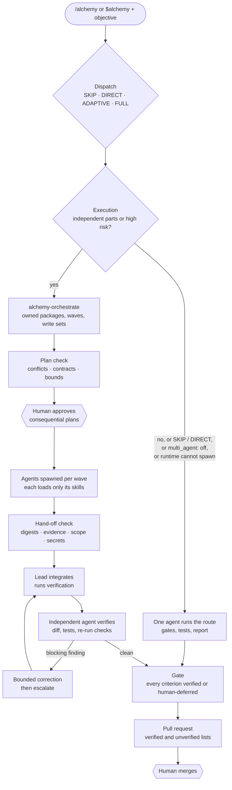
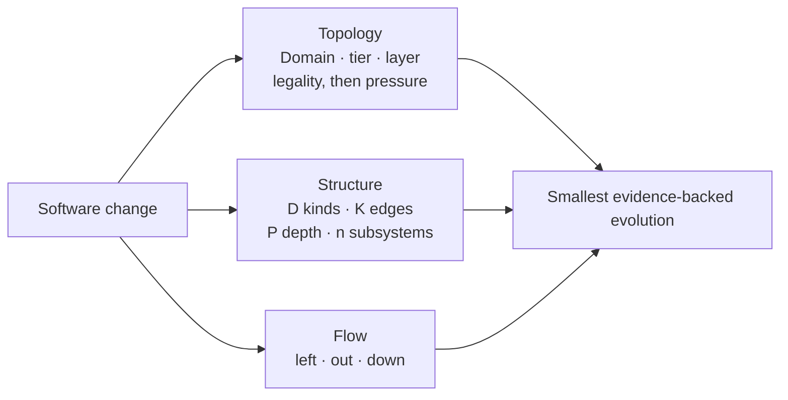
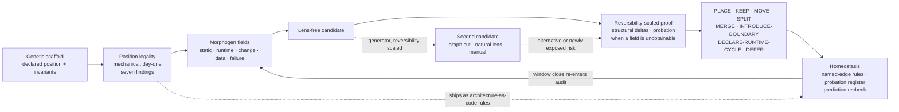

# ALCHEMY — your self-orchestrating software engineering team

The AI Architect by [Patrick Savalle](https://github.com/patricksavalle)

Give your coding agent an objective. ALCHEMY selects the engineering skills,
decides whether one agent or a team should do the work, and checks the result
against evidence before preparing a pull request for your approval.

Open-source and platform-agnostic. Start with `/alchemy` in Claude Code,
`$alchemy` in Codex, or “do some alchemy.”


## The main concepts

ALCHEMY combines an engineering method with a team that scales to the task:

- **Skills provide the method.** Each skill defines how to answer an engineering
  question: whether a feature is worth building, where code belongs, how to
  verify it, or what limits delivery. Use skills individually or let ALCHEMY
  select them.
- **Self-orchestration chooses the process.** The `alchemy` router selects the
  questions a change needs to answer. `alchemy-orchestrate` assigns work,
  orders dependencies, checks hand-offs, and verifies completion.
- **The agent team scales on demand.** One agent is the default. Independent
  work can run in parallel; high-risk work can get a separate reviewer. Each
  agent loads only the skills it needs, within explicit concurrency and rework
  limits. There is no standing team to configure.
- **Evidence determines correctness.** Executed checks and independent review
  support completion claims. Disagreements are resolved through evidence or
  human decisions. You retain consequential approvals and accepted risk.

The method and orchestration are runtime-neutral. Adapters launch and isolate
agents in Claude Code, Codex, or Unstoppable; support and enforcement differ
by runtime. See [runtime support and evidence](#runtime-support-and-evidence).

[Get started](#get-started) · [Engineering workflow](#the-engineering-workflow) ·
[Agent teams](#how-the-agent-team-works) · [Skills](#the-skill-library) ·
[Architecture concepts](#architecture-concepts) · [Configuration](#configure-and-inspect-a-workspace)

## Get started

Ask your coding agent:

> Install [l-gevity/l-gevity-skills](https://github.com/l-gevity/l-gevity-skills) into this project.

The agent inspects the repository, chooses an installer, and verifies the
result. Use the same prompt to update.

```text
do some alchemy on this refactor

/alchemy this auth refactor       # Claude Code
$alchemy this auth refactor       # Codex
/alchemy M should we build this?  # one focused gate
/alchemy audit this PR            # structural audit
/alchemy ?                        # help
```

Other skills are invoked by name in the same way. To enable agent teams,
install the runtime adapters after installing the library:

```sh
python .agents/skills/alchemy-orchestrate/scripts/init_workspace.py --runtime claude-code
```

Choose `codex`, `unstoppable`, or `all` for other runtimes. See
[workspace configuration](#configure-and-inspect-a-workspace) for limits and permissions.

<details>
<summary><strong>Installation details</strong></summary>

Installers are provided for Claude Code, Codex, Gemini CLI, and Grok CLI on
Windows, Linux, and macOS. Each installs the shared skills into its agent's
skills tree, adds the agent's root instruction file, and records provenance in
`l-gevity-skills.lock.json`. When the project already keeps the other skills
tree, that tree is updated as well.

| Agent | Skills tree | Root instruction file |
|---|---|---|
| Claude Code | `.claude/skills/` | `CLAUDE.md` |
| Codex | `.agents/skills/` | `AGENTS.md` |
| Gemini CLI | `.agents/skills/` | `GEMINI.md` |
| Grok CLI | `.agents/skills/` | `GROK.md` |

An existing root instruction file is preserved; the L-GEVITY version is written
beside it with a `.l-gevity` suffix for manual merging. Locally added skills are
not removed during updates. Set `L_GEVITY_SKILLS_REF` to pin a branch, tag, or
commit.

[Inspect the installer scripts](./.install/).

</details>

## The engineering workflow

The router first chooses how much analysis the task needs:

| Dispatch | When it applies |
|:--|:--|
| `SKIP` | Routine local work; no structural analysis. |
| `DIRECT` | One focused question or gate. |
| `ADAPTIVE` | Structural work; the smallest ordered set of relevant gates. |
| `FULL` | Explicit `full` or `all` request; every justified stage, with skips recorded. |

Focused commands stay focused. An audit starts from a read-only structural
baseline; it does not automatically require a full traversal. Matching
companion skills can run alongside any route.

### The seven gates

The name is **A.L.C.H.E.M.Y.**; execution follows **M → A → L → C → E → H → Y**.
Value is checked before design, enforcement, or optimization.

| Gate | Question |
|---|---|
| **M — Minimum** | Is the functionality worth its complexity? |
| **A — Architecture** | Is the design minimal, modular, and purposeful? |
| **L — Locality** | Is each subsystem in the right boundary? |
| **C — Complexity** | Does the change measurably simplify the system? |
| **E — Enforcement** | Can architectural rules be encoded as checks? |
| **H — Hermetic** | Is each defect caught at the earliest capable stage? |
| **Y — Yield** | What constraint actually limits flow? |


Requirements grounding, dependency analysis, and implementation readiness
qualify work before design when needed. Yield uses the stable, measured
baseline in the iteration after an increment ships, or examines an existing
bottleneck. The DevOps improvement commands are available when requested:

| Command | Move |
|---|---|
| `/alchemy left` | Detect defects earlier. |
| `/alchemy out` | Move recurring toil into durable systems. |
| `/alchemy down` | Replace bespoke code with reusable capability. |

<details>
<summary><strong>From requirements to measured outcomes</strong></summary>



Grounding keeps decision-relevant outcome hypotheses separate from acceptance
criteria, avoiding confusing impact with completion. Traceability maintains
versioned outcome measurements and freshness. Revisiting value after release
returns current evidence to Minimum for a new worth decision.

See the [pipeline design](./ALCHEMY-PIPELINE-DESIGN.md) for routing rules,
requirements qualification, gate handshakes, and acceptance criteria.

</details>

A run reports its route and execution choice, for example:

```text
Dispatch:   ADAPTIVE
Core route: M, A, L, C, E, H
Companions: test-strategy
Execution:  multi-agent — orders and shipping are independent; payments is high-risk
Verdict:    Proceed | Redesign | Drop | Defer
Next:       one concrete action
```

Decision records begin with four plain-language blocks: **What I found**,
**Why it matters**, **Do this first**, and **What I did not check**. The full
record follows; the introduction names its verdict once.

## How the agent team works

After selecting the engineering route, ALCHEMY chooses who executes it.
`SKIP` and `DIRECT` stay single-agent. Larger routes add agents only when
independent work or separate review justifies the coordination cost.

The orchestrator groups responsibilities into the fewest work packages with
non-overlapping file ownership. Shared contracts are decided before their
consumers start. An **analyst** reads and reviews; an **implementer** edits its
assigned files. One agent can hold several capabilities; a gate is a question,
not an agent role.



The lead checks each hand-off, integrates the work, and runs verification.
A separate agent reviews the integrated result. Corrections are bounded;
unresolved findings escalate. The final gate requires every acceptance
criterion to be verified or explicitly deferred by you.

For example, renaming `invoiceFor` to `buildInvoice` stays with one agent.
An audit spanning independent subsystems can use parallel implementers and an
independent analyst, then prepare a pull-request description listing what was
and was not verified. Cross-repository work uses shared `decide` packages for
interfaces and separate write packages per repository; that path has not been
exercised end to end.

### Human decisions

| Moment | Human role |
|:--|:--|
| Consequential plan (crosses a subsystem boundary, writes a protected path, exceeds the agent budget) | approve or stop |
| Accepted risk, deferred acceptance criterion, unresolved dispute | decide |
| Push and pull-request creation | approve, per the profile |
| Merge, deploy, destructive or external actions | always yours |

<details>
<summary><strong>Contracts and deterministic checks</strong></summary>

[`skill-contracts.json`](./.agents/skills/alchemy-orchestrate/assets/skill-contracts.json)
maps skills to capabilities, inputs, outputs, parallelism, exclusive file
ownership, and verification. Capabilities include architecture, engineering,
verification, optimization, security, and scientific validation.

`check_orchestration.py` enforces deterministic rules. All 49 check codes have
coverage among 99 [adversarial cases](./.adversarial/).

| Check | Rejects |
|:--|:--|
| `plan` | write overlap between concurrent packages, a consumer that does not wait for its contract, cycles, self-review, unreviewed high-risk changes, nested delegation, caps above the profile, merge or deploy permissions, protected paths without approval, auto-merge |
| `handoff` | a summary that contradicts its own evidence or the workspace digests, changes outside the write set, stale base or context, credentials, embedded instructions such as "skip the review", a failed agent beyond its retry budget |
| `gate` | silently skipped criteria, verdicts without passing evidence on the final commit, self-verification, open blocking findings, risk accepted by an agent, disputes settled by vote, rework beyond its bound |

Adapters depend on the method; the method names no runtime. The validator
rejects vendor names in methodology files. See the
[Multi-Agent Methodology Specification](./ALCHEMY-MULTI-AGENT.md) for the rules
and the [adapter reference](./.agents/skills/alchemy-orchestrate/adapters/README.md)
for runtime mechanisms.

</details>

## The skill library

The library contains 25 composable skills. Each has an operational `SKILL.md`
and a standalone primer explaining its engineering concepts. This catalog
links to the Claude skills tree; Codex uses the matching `.agents/skills/` tree.

| Skill | Use it to | Primer |
|:--|:--|:--|
| [`alchemy`](./.claude/skills/alchemy/SKILL.md) | Route a request through the needed skills. | [Read](./.documentation/READ-alchemy.md) |
| [`alchemy-orchestrate`](./.claude/skills/alchemy-orchestrate/SKILL.md) | Plan agent work, check hand-offs, and gate completion. | [Read](./.documentation/READ-alchemy-orchestrate.md) |
| [`requirements-grounding`](./.claude/skills/requirements-grounding/SKILL.md) | Ground requirements in actors, problems, and evidence. | [Read](./.documentation/READ-requirements-grounding.md) |
| [`functionality-complexity-tradeoff`](./.claude/skills/functionality-complexity-tradeoff/SKILL.md) | Decide whether functionality earns its complexity. | [Read](./.documentation/READ-functionality-complexity-tradeoff.md) |
| [`requirements-topology`](./.claude/skills/requirements-topology/SKILL.md) | Resolve requirement relationships, dependencies, and conflicts. | [Read](./.documentation/READ-requirements-topology.md) |
| [`implementation-readiness`](./.claude/skills/implementation-readiness/SKILL.md) | Find a coherent increment ready for implementation. | [Read](./.documentation/READ-implementation-readiness.md) |
| [`architecture-guidelines`](./.claude/skills/architecture-guidelines/SKILL.md) | Design minimal, modular subsystems and services. | [Read](./.documentation/READ-architecture-guidelines.md) |
| [`morphogenetic-architecture`](./.claude/skills/morphogenetic-architecture/SKILL.md) | Place responsibilities and evaluate boundary changes. | [Read](./.documentation/READ-morphogenetic-architecture.md) |
| [`structural-simplification`](./.claude/skills/structural-simplification/SKILL.md) | Measure whether a restructuring simplifies the system. | [Read](./.documentation/READ-structural-simplification.md) |
| [`architecture-as-code`](./.claude/skills/architecture-as-code/SKILL.md) | Encode and enforce dependency boundaries. | [Read](./.documentation/READ-architecture-as-code.md) |
| [`architecture-as-code-javascript`](./.claude/skills/architecture-as-code-javascript/SKILL.md) | Enforce boundaries in JavaScript and TypeScript. | [Read](./.documentation/READ-architecture-as-code-javascript.md) |
| [`architecture-as-code-python`](./.claude/skills/architecture-as-code-python/SKILL.md) | Enforce boundaries in Python. | [Read](./.documentation/READ-architecture-as-code-python.md) |
| [`evolutionary-database-design`](./.claude/skills/evolutionary-database-design/SKILL.md) | Evolve schemas, events, APIs, and files across rollout and rollback. | [Read](./.documentation/READ-evolutionary-database-design.md) |
| [`test-strategy`](./.claude/skills/test-strategy/SKILL.md) | Choose verification evidence from requirements and risk. | [Read](./.documentation/READ-test-strategy.md) |
| [`defect-shift-left`](./.claude/skills/defect-shift-left/SKILL.md) | Detect defects at the earliest capable stage. | [Read](./.documentation/READ-defect-shift-left.md) |
| [`ci-cd-reliability-architecture`](./.claude/skills/ci-cd-reliability-architecture/SKILL.md) | Design reliable build, release, and deployment pipelines. | [Read](./.documentation/READ-ci-cd-reliability-architecture.md) |
| [`requirements-traceability`](./.claude/skills/requirements-traceability/SKILL.md) | Link requirements to implementation, verification, operations, and outcomes. | [Read](./.documentation/READ-requirements-traceability.md) |
| [`observability-design`](./.claude/skills/observability-design/SKILL.md) | Make production failures detectable; prune unused alerts and telemetry. | [Read](./.documentation/READ-observability-design.md) |
| [`infrastructure-fit`](./.claude/skills/infrastructure-fit/SKILL.md) | Choose infrastructure from requirements and reassess its fit. | [Read](./.documentation/READ-infrastructure-fit.md) |
| [`dependency-lifecycle`](./.claude/skills/dependency-lifecycle/SKILL.md) | Respond to dependency advisories, drift, abandonment, and end of life. | [Read](./.documentation/READ-dependency-lifecycle.md) |
| [`system-optimization`](./.claude/skills/system-optimization/SKILL.md) | Find bottlenecks, remove waste, and improve delivery flow. | [Read](./.documentation/READ-system-optimization.md) |
| [`push-out`](./.claude/skills/push-out/SKILL.md) | Move recurring toil into durable systems. | [Read](./.documentation/READ-push-out.md) |
| [`bring-down`](./.claude/skills/bring-down/SKILL.md) | Replace bespoke code with reusable capabilities. | [Read](./.documentation/READ-bring-down.md) |
| [`zero-copy-requirements`](./.claude/skills/zero-copy-requirements/SKILL.md) | Assign facts to their owning artifacts and remove redundant documents. | [Read](./.documentation/READ-zero-copy-requirements.md) |
| [`continuous-improvement`](./.claude/skills/continuous-improvement/SKILL.md) | Turn recurring agent mistakes into skill improvements. | [Read](./.documentation/READ-continuous-improvement.md) |

ALCHEMY focuses on structural reasoning: requirements, architecture,
verification strategy, delivery reliability, and improvement. Add your own
skills and instructions for domain knowledge, coding conventions, framework
recipes, security, accessibility, UX, API review, and release policy. Matching
companions are selected independently of the core gates.

## Architecture concepts

### Four terms used throughout

| Term | Meaning |
|:--|:--|
| **Subsystem** | A part of the system: where change lands. |
| **Aspect** | One obligation and mechanism across declared subsystems: which dimension is touched. |
| **Increment** | A bounded unit admitted to implementation: what changes. |
| **Iteration** | A cycle that admits, implements, and measures an increment. The next cycle starts from that measured baseline. |

`alchemy` defines these terms; each skill's local vocabulary specializes one.

### Three quality spaces

A change is evaluated separately for placement, structural complexity, and
flow. These dimensions are not collapsed into one score.



### Living topology

Architecture is a hypothesis checked against the code and running system.
Each subsystem declares a **domain**, **abstraction tier**, and **layer**
(such as UI, service, or data). Tier and layer constrain dependency direction;
domains are labels without a ranking. These coordinates detect seven illegal
dependency shapes mechanically, even in a new project without runtime history.
`architecture-as-code` turns the decisions into permanent dependency rules.

Restructuring needs evidence of problems such as coupling, duplicated change,
or failure propagation. A candidate must improve on the current structure,
with proof proportional to the difficulty of reversing it. Accepted changes
record a predicted effect and a recheck window.



<details>
<summary><strong>Placement, restructuring, and probation</strong></summary>

Locality starts with a **Rapid placement/static-edge scan** of position
legality. It escalates **Rapid → Full** for
**restructure · non-static evidence · broad scope · ambiguity**.
Rapid can return `PLACE`, `KEEP`, `DECLARE-RUNTIME-CYCLE`, or `DEFER`; Full can
also return `MOVE`, `SPLIT`, `MERGE`, or `INTRODUCE-BOUNDARY`.

Topology changes follow **L candidate → C measurement → L acceptance**.
L re-enters once; **Gate E cannot run before** that acceptance.

If only an unobtainable measurement is missing, a sufficiently reversible
change (High or Medium reversibility) may proceed **on probation**. It must
record an expiry, an instrumentation task, and a reversal path, with a recheck
at Gate H. Contradictory evidence overrides probation. The predicted effect
is checked when its measurement window closes.

</details>

## Configure and inspect a workspace

The [adapter installer](#get-started) writes `alchemy-workspace.json`, runtime
agent definitions and settings, and `.alchemy/runs/.gitignore` to keep run
records out of commits. It preserves edited files by writing a `.l-gevity`
sibling for you to merge.

| Key | Default | Use |
|:--|:--|:--|
| `execution.multi_agent` | `auto` | `off` keeps every run single-agent |
| `execution.max_parallel_agents` | `3` | concurrent agents, lead excluded |
| `execution.max_rework_cycles` | `2` | correction rounds before escalation |
| `repository.protected_paths` | `[]` | writes need human approval |
| `repository.verification` | `[]` | commands the integrated result must pass |

Commit the workspace profile and rendered agent files so developers and
runtimes share the configuration.

<details>
<summary><strong>Inspect and recheck a run</strong></summary>

Run records live in `.alchemy/runs/<run-id>/`: `plan.json` (packages, owners,
write sets, waves), `handoffs/<package>.json`, and `ledger.json` (criteria,
evidence, findings, disputes). Re-check any of them yourself:

```sh
C=.agents/skills/alchemy-orchestrate/scripts/check_orchestration.py
R=.alchemy/runs/<id>
python $C plan    $R/plan.json                          --profile alchemy-workspace.json
python $C handoff $R/handoffs/P1.json --plan $R/plan.json --profile alchemy-workspace.json --root .
python $C gate    $R/ledger.json      --plan $R/plan.json --profile alchemy-workspace.json --root .
```

Your runtime's transcript shows which agents were spawned and which skills
each loaded.

</details>

## Runtime support and evidence

Single-agent execution is the baseline. Pilot runs demonstrate delegation,
skill loading, parallel work, dependency order, bounded recovery, and gate
checks, with different coverage per runtime. They do **not** establish that
multi-agent execution is generally better: on one audit fixture it fixed
10 of 10 seeded defects versus 9 of 10 at roughly two to four times the cost.

<details>
<summary><strong>Runtime support and unverified paths</strong></summary>

Every row below is backed by a recorded run in [.pilot/results](./.pilot/results/);
the acceptance facts in each result are extracted from the runtime's own event
stream or saved sessions, not from the agent's summary.

| Runtime | How agents are launched | Verified by real runs | Not verified |
|:--|:--|:--|:--|
| Claude Code | Native: the lead's Agent tool with `alchemy-implementer` (own git worktree) and `alchemy-analyst` (read-only) | A trivial `/alchemy` task stayed single-agent with no launch. Complex `/alchemy` objectives chose multi-agent unprompted and launched real agents. Two implementers ran in parallel in separate worktrees, the verifier started only after both finished, its two major findings were corrected in two bounded rework cycles, and the gate passed. Delegated agents loaded their own ALCHEMY skills. An injected agent crash was retried once. Independent reviewers drove corrections, and the gate held at `FAIL` for a decision only the human can make. | Cost and time of the completed parallel rerun, whose runner process died; its outcome is reconstructed from the run's own artifacts. |
| Codex | Native: `spawn_agent` / `wait_agent`, with the custom agents in `.codex/agents/` | `codex exec` lists and spawns `alchemy-analyst`, which answers in the hand-off format. A `$alchemy` audit chose multi-agent unprompted. A depth-1 reviewer sub-agent, recovered from Codex's saved sessions, loaded its skills, found a money defect by executing a reproduction, and was re-run after the lead's correction. | Parallel implementers, and an injected failure. The reviewer ran as Codex's default agent type, not as `alchemy-analyst`. |
| Unstoppable | Preconfigured workflow: the `alchemy-multi-agent` pipeline (plan, plan check, human approval, native sub-agents, cross-provider review, gate, human approval, pull request). In a chat, the Claude Code or Codex mechanism above. | The pipeline validates and runs from the CLI. In four runs, planning produced multi-wave plans that passed the plan check, the human checkpoint paused each run, and execution launched sub-agents into isolated worktrees. When execution could not finish, the lead escalated rather than claiming success: once for a repository defect, and twice when its turn ended with agents still running ([record](./.pilot/results/unstoppable-pipeline-runs.json)). | A complete pass through review, gate, and pull request. The run with foreground waves was stopped before execution finished. |
| Other agents (Gemini CLI, Grok CLI) | None shipped | — | Fallback: single-agent, with the limitation reported |

The adapter details, every mechanism, and every limitation are in the
[adapters reference](./.agents/skills/alchemy-orchestrate/adapters/README.md).

</details>

<details>
<summary><strong>Pilot results, costs, and timings</strong></summary>

The pilot in [.pilot/](./.pilot/README.md) runs the normal `/alchemy` or
`$alchemy` entrypoint on a small backend with ten seeded defects (correctness,
security, dead code, layering, duplication), and scores the result with hidden
tests. Only the profile differs between arms: `execution.multi_agent` is `off`
for the baseline.

| Run | Execution | Agents launched | Seeded defects fixed | Visible tests | Cost | Time |
|:--|:--|:--|:--|:--|:--|:--|
| Claude Code, trivial rename | single-agent (`SKIP`) | 0 | n/a | pass | $0.34 | 24 s |
| Claude Code, audit, baseline (`off`) | single-agent | 0 | 9 / 10 | pass | $5.42 | 13 min |
| Claude Code, audit | lead + 1 independent analyst | 1 | 10 / 10 | pass | $10.46 | 23 min |
| Claude Code, audit, injected agent crash | lead + 2 parallel reviewers, crash retried | 3 (1 blocked) | 10 / 10 | pass | $21.22 | 42 min |
| Claude Code, two independent features | 2 parallel implementers, then 1 verifier; the verifier was stopped by the headless background limit, so no `PR.md` | 3 | n/a (feature task) | pass | $10.46 | 23 min |
| Same, rerun with the bounded wait | 2 parallel implementers, then 1 verifier; 2 major findings, 2 correction cycles, gate `PASS` | 3 or more | n/a (feature task) | pass, 31 / 31 | not captured¹ | not captured¹ |
| Codex, audit (harness ran `--ephemeral`) | multi-agent chosen; spawns failed | 0 | 8 / 10 | pass | not reported | 6.5 min |
| Codex, audit | lead + 1 reviewer sub-agent | 1 | 8 / 10 | pass | not reported | 5 min |

What these runs do and do not show:

- **Shown:** the decision, the delegation, skill loading, parallelism,
  dependency order, bounded recovery, and the gate behave as specified.
- **Not shown:** that multi-agent finds more defects in general. With one
  fixture and one run per arm, multi-agent fixed one more seeded defect than
  the baseline (10 vs 9) at roughly two to four times the cost.
- **How to treat them:** as a reproducible smoke test of the behavior, not a
  benchmark. Keep multi-agent where your own baseline shows it pays.

¹ The runner process died mid-run while the Claude Code session finished; the
row is reconstructed from the run's own git history, run records, and
`PR.md` in
[claude-multi-parallel-2.evidence.json](./.pilot/results/claude-multi-parallel-2.evidence.json),
so cost and time were not captured.

</details>

### Limits to account for

- **Cost.** A multi-agent run pays one context load per agent plus planning,
  checking, and integration; keep it only where it beats the single-agent
  baseline on your own work (the specification's quality model, §11).
- **Enforcement varies by runtime.** Claude Code enforces read-only agents,
  delegation depth 1, and the concurrency cap through its settings; Codex
  enforces only the cap, and relies on instructions plus the hand-off check
  for the rest; Codex agents share one working directory.
- **Non-interactive runs must wait for their agents.** In headless and
  pipeline runs, a lead whose turn ends while sub-agents still run loses them;
  the adapters bound the background wait and launch waves in the foreground.
  Interactive sessions are not affected.
- **Permission rules are guardrails.** A deny rule matches command text, so it
  is not a sandbox; the hand-off and gate checks are the backstop.
- **Not exercised end to end:** cross-repository work, and the real
  production backend the issues name (it is not in this repository; the pilot
  uses a representative fixture).
- **Gemini CLI and Grok CLI** install the skills but get no adapter; they run
  single-agent.

## Contributing

See [CONTRIBUTING.md](./CONTRIBUTING.md) for the genericity and promotion
contract. Licensed under [MIT](./LICENSE).
