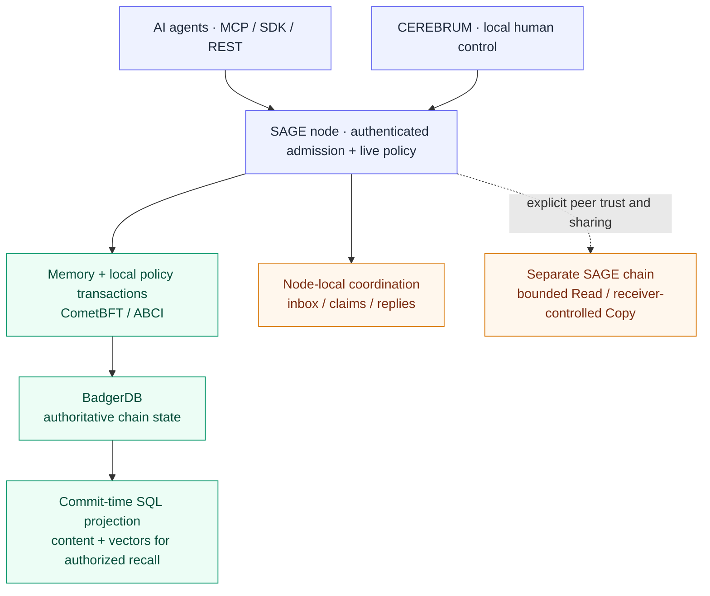
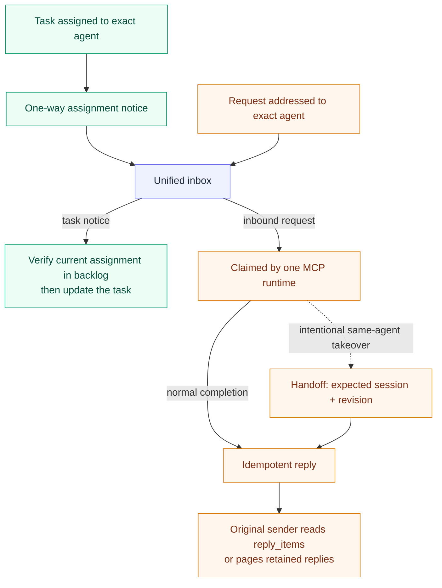

# (S)AGE — Sovereign Agent Governed Experience


**Memory your agents can be held to.**

SAGE is a governed memory and messaging layer for AI agents. Every memory is
signed by an agent, admitted through a reviewable process, scoped by permissions
you set, and kept with an audit trail you can inspect.

Connect your tools to the same local node so authorized agents can record
experience and recall relevant context in later sessions. Inspect what they keep
in CEREBRUM, SAGE's local dashboard.

Works with Claude Code, Codex, Cursor and other MCP-capable clients. Developers
can integrate through the Python SDK or signed REST API. Recall depends on what
is recorded, your configuration and the agent's use of its tools.

[Download SAGE](https://github.com/l33tdawg/sage/releases/latest) ·
[Get started](https://l33tdawg.github.io/sage/#get-started) ·
[Connect your AI](https://l33tdawg.github.io/sage/connect.html) ·
[Developer quickstart](https://l33tdawg.github.io/sage/#developers)

[Why SAGE](#why-sage) · [Quick Start](#quick-start) · [For Developers](#for-developers) · [Architecture](#architecture) ·
[Capabilities](#current-capabilities) · [Dashboard](#cerebrum-dashboard) ·
[Release history](#release-history) · [Documentation](#documentation)

<a href="https://glama.ai/mcp/servers/l33tdawg/s-age">
  
</a>

---

## Why SAGE

Use SAGE when your agents return to ongoing work: a design decision worth
keeping, an approach that failed, or a lesson the next session should use.
RAG retrieves source material; SAGE uses retrieval too, with a governed record
of agent experience around it.

- **Trace the origin.** Agent-signed writes attribute memories to their recorded author.
- **Review admission.** Memories pass through a validation lifecycle before they enter normal recall.
- **Control access.** Enrollment, domain permissions and classification determine which agents can use a memory.
- **Keep memory useful.** Inspect confidence and status, apply decay, or deprecate a memory while retaining its audit history.

A personal install runs one validator and casts its own signed admission vote.
A multi-validator network requires a BFT quorum. These checks govern what is
committed; they do not prove every remembered claim is true or change your
model's weights. See the [memory lifecycle](docs/reference/concepts/memory-lifecycle.md)
and [consensus reference](docs/reference/concepts/consensus-confidence-decay.md).

Memory is local by default. Optional federation, connectors and remote model
providers can send data to configured destinations. Enable the vault for
memory-content encryption at rest; see the [privacy details](https://l33tdawg.github.io/sage/privacy.html)
and [Security FAQ](SECURITY_FAQ.md).

## Quick Start

**Desktop:** [Download the latest release](https://github.com/l33tdawg/sage/releases/latest),
open SAGE and complete setup in CEREBRUM. Choose your memory engine, connect an
AI client and review agent access. Follow the
[connection guide](https://l33tdawg.github.io/sage/connect.html) for your tool or
the full [Getting Started](docs/GETTING_STARTED.md) walkthrough.

If SAGE is already running, check it before starting another server:

```bash
curl http://127.0.0.1:8080/health
```

A healthy node returns `{"status":"healthy"}`. After connecting an MCP client,
call `sage_inception` and follow its returned memory mode.

<details>
<summary>Build from source</summary>

**From source (Go 1.26.10+):**

```bash
git clone https://github.com/l33tdawg/sage.git && cd sage
go build -o sage-gui ./cmd/sage-gui/
./sage-gui setup    # Pick your AI, get MCP config
./sage-gui serve    # SAGE + Dashboard on :8080
```

</details>

Desktop packages: [macOS DMG](https://github.com/l33tdawg/sage/releases/latest) (signed & notarized) | [Windows EXE](https://github.com/l33tdawg/sage/releases/latest) | [Linux tar.gz](https://github.com/l33tdawg/sage/releases/latest)

<details>
<summary>Docker and containerized MCP setup</summary>

### Docker

```bash
docker pull ghcr.io/l33tdawg/sage:latest
docker run -d --name sage \
  -p 8080:8080 \
  -v ~/.sage:/root/.sage \
  ghcr.io/l33tdawg/sage:latest
```

Pin a specific version with `ghcr.io/l33tdawg/sage:11.24.1`.

The SAGE server stays in that container. To give a local MCP client a stdio
bridge, start a second process **inside the same running container**:

```bash
docker exec -i \
  -e SAGE_PROVIDER=claude-code \
  -e SAGE_PROJECT=my-project \
  -e SAGE_IDENTITY_PATH=/root/.sage/agents/claude-code-my-project/agent.key \
  sage /usr/local/bin/sage-gui mcp
```

For the shipped Compose stack, use the service name rather than a generated
container name:

```bash
docker compose -f docker-compose.sage-gui.yml exec -T \
  -e SAGE_PROVIDER=claude-code \
  -e SAGE_PROJECT=my-project \
  -e SAGE_IDENTITY_PATH=/root/.sage/agents/claude-code-my-project/agent.key \
  sage /usr/local/bin/sage-gui mcp
```

If an MCP client launches this through a wrapper, point its stdio configuration
at the wrapper's absolute path. Pass `SAGE_PROVIDER`, `SAGE_PROJECT`, and
`SAGE_IDENTITY_PATH` through `docker exec -e`/`docker compose exec -e`; setting
them only on the host-side Docker command does not place them in the container.
Keep the whole SAGE data root mounted at `/root/.sage`, including agent keys and
the ledger. Do not start a separate `docker run ... mcp` container: its
`localhost:8080` is isolated from the running SAGE server.

HTTP MCP is also available at `/v1/mcp/sse` and `/v1/mcp/streamable`, but both
require a bearer token or OAuth. Bare `http://localhost:8080` is the REST base,
not an unauthenticated MCP endpoint.

</details>

<details>
<summary>Upgrading an existing node</summary>

### Upgrading from an older version?

**Upgrading an existing node — including the v10.x → v11 jump — is
[docs/UPGRADING.md](docs/UPGRADING.md).** In the desktop app, accept the update:
SAGE verifies canonical upgrade compatibility, captures a full recovery
snapshot, installs, and restarts automatically. Headless and quorum operators
have separate technical procedures in the guide.
Your chain advances in place; a personal node climbs the consensus fork ladder by
itself. Read the guide before a multi-admin chain crosses app-v23 — that
activation re-derives administrator authority.

If you installed SAGE before v5.0 and your AI isn't doing turn-by-turn memory updates, re-run the installer in your project directory:

```bash
cd /path/to/your/project
sage-gui mcp install
```

This installs Claude Code hooks that prompt the memory lifecycle (boot, turn, reflect) — even if your `.mcp.json` is already configured. Restart your Claude Code session after running this.

</details>

---

## For Developers

Choose an integration for your workflow:

| Integration | Use it for | Start here |
| --- | --- | --- |
| MCP | Giving an existing AI client memory and coordination tools | [Connection guide](https://l33tdawg.github.io/sage/connect.html) · [MCP reference](docs/reference/mcp-tools.md) |
| Python SDK | Building a memory-aware agent or application with sync/async clients | [Developer quickstart](https://l33tdawg.github.io/sage/#developers) · [SDK reference](docs/reference/python-sdk.md) |
| Signed REST API | Integrating from another language over HTTP | [REST reference](docs/reference/rest-api.md) |

The [authoritative reference index](docs/reference/INDEX.md) covers exact API
behavior, authentication, access controls and lifecycle rules. Start there
when implementing an integration.

### Python: read existing memories

Requires Python 3.10+, a running node and an enrolled agent. Set
`SAGE_IDENTITY_PATH` to that agent's existing key file and `SAGE_DOMAIN` to a
domain it can read.

```bash
python -m pip install sage-agent-sdk
```

```python
import os
from sage_sdk import AgentIdentity, SageClient

identity = AgentIdentity.from_file(os.environ["SAGE_IDENTITY_PATH"])
domain = os.environ["SAGE_DOMAIN"]

with SageClient(
    base_url="http://127.0.0.1:8080",
    identity=identity,
    trust_env=False,
) as client:
    page = client.list_memories(
        domain=domain, status="committed", limit=3,
    )
    for memory in page.memories:
        print(memory.memory_id, memory.content)
```

Save as `quickstart.py` and run `python quickstart.py`. An empty list means no
committed memories are visible to this agent in that domain. Review enrollment
and domain permissions in CEREBRUM if access is denied.

To record experience, use `propose()` in a domain the agent can write to and set
classification explicitly. A submitted memory starts as `proposed`; normal
recall includes it after admission commits it. For semantic retrieval, use
`hybrid()` with query text and a matching embedding. See the
[SDK examples](docs/reference/python-sdk.md) and
[memory admission guide](docs/reference/concepts/voter-operations.md).

---

## Architecture



**Agents are not validators.** Personal mode runs one real CometBFT validator
with a per-node memory auto-voter; it has no Byzantine redundancy. Registering
more agents does not add consensus voters. A multi-validator deployment runs
one shared chain; federation connects separate chains under explicit policy.

**Storage has two roles.** BadgerDB is authoritative for consensus state.
SQLite (personal) or PostgreSQL + pgvector (cluster) projects memory content
and vectors at Commit. Node-local message coordination is separate from the
memory consensus path. Block inclusion is not the same as memory acceptance.

For the detailed trust boundaries, lifecycles, and deployment topology, see
[Architecture & Deployment](docs/ARCHITECTURE.md).

## Current Capabilities

| Capability | What it provides |
|------------|------------------|
| Governed memory | Persistent, attributed memories with consensus validation, semantic recall, confidence, and lifecycle controls |
| Durable tasks | Exact-agent assigned backlog; open tasks do not decay; idempotent creation and workflow status |
| Unified inbox | Local/federated requests, assignment notices, and a separate passive reply page |
| Runtime handoff | Explicit session-and-revision-fenced takeover of claimed work within the same signed agent identity |
| Access controls | Active enrollment, roles/profiles, ownership, Access Groups, compatible grants, and classification checks |
| Controlled federation | Explicit agent exports and bounded Read/Copy policy, without granting local membership or Write |
| Recovery and updates | In-place chain upgrades, recovery snapshots, and retained message claims across ordinary restarts |

### How agents collaborate



Assignment, claim, and reply are different states. A task notice is not a
request for a message result, and a reply is not a new assignment. Runtime
handoff does not reassign a task to another agent. Wake notifications are
payload-free hints, not delivery or claim evidence. Every agent request and
result remains untrusted data, not authority to expand the user's instructions.

See the [MCP task/inbox reference](docs/reference/mcp-tools.md) and
[message/reply lifecycle](docs/reference/concepts/message-reply-lifecycle.md)
for exact fields, recovery, and authorization rules.

---

## CEREBRUM Dashboard


`http://127.0.0.1:8080/ui/` — a dashboard-native operator console centered on the 3D MRI memory brain, with chain health, agents, federation, semantic memory, recall tuning, vault recovery, tasks, imports, and updates around it. Every major workflow is available from the browser; the CLI stays there for automation and recovery.

| Control Board | Federation | Recall Engine |
|:---:|:---:|:---:|
|  |  |  |
| Chain health, quorum, agents, federation, and embeddings | One trust-only JOIN that prepares Direct and Secure relay automatically, followed by independent Read/Copy choices on each SAGE | Smart-memory setup, managed reranker install, and recall-depth tuning |

The dashboard also includes governed agent enrollment, Access Groups, domain
permissions, separate CEREBRUM Root credential handover, import/export,
software updates, and encryption controls. Ordinary agent identity replacement
uses re-enrollment; historical memory authorship is preserved.

---

<details>
<summary>Recent release notes (v11.24.1 and earlier)</summary>

## What's New in v11.24.1

**App-v29 now activates automatically after its evidence gates pass.** The auto-vote readiness ceiling moves from app-v28 to app-v29, so personal nodes converge on the architecture-independent PoE arithmetic already compiled in v11.24.0. The activation block keeps app-v28 behavior; deterministic EWMA, recency, corroboration, logarithm, exponential and final-weight calculations begin at H+1. Historical blocks continue to replay under their original app versions.

**The app-v29 evidence spans the real failure surfaces.** A four-validator ladder crosses app-v2 through app-v29 with byte-identical AppHash at H-1, H and H+1, then continues through the first post-activation PoE epoch. A separate quorum runs two validators and CometBFT processes on arm64 and two on amd64 against one chain. The real-process crash, partition, restart and state-sync gate targets exact app-v29 state.

**The patch closes the release security gaps.** Go 1.26.10 fixes GO-2026-6809 in `crypto/x509`; certifi 2026.10.19 removes the compromised emSign intermediate CA bundle from all benchmark environments; and the dependency group updates chi, klauspost/compress, go-winio, Playwright and pinned GitHub Actions.

**No chain migration.** Existing memories, identities, governance state and chain history are preserved. Container: `ghcr.io/l33tdawg/sage:11.24.1`. SDK 11.24.1.

## What's New in v11.24.0

**PoE weights now have an architecture-independent path.** App-v29 compiles a new consensus form of the proof-of-experience arithmetic: EWMA state updates, recency, corroboration and final weights use explicitly rounded operations that produce the same float64 bits on arm64 and amd64. The gate remains dormant above the app-v28 auto-vote ceiling, so existing chains keep their current app version and historical blocks keep replaying under their original arithmetic until the mixed-architecture, replay, snapshot and state-sync evidence is complete. CI and release workflows now run exact golden vectors on native amd64 and arm64.

**Org fleet enrollment Phase 1 lands.** Organizations can issue 24-hour, single-use tokens bound to one exact node key and immutable policy scope. Redemption atomically stores the consume marker, replayable result and first signed policy in node-local SQLite; concurrent attempts cannot overwrite the winner, and a lost response can be replayed even after token expiry or revocation. Signed policy delivery adds monotonic revisions, rollback protection, persisted rotation history and overlap, a durable owner-visible equivocation alarm, and per-operation offline/expiry gates for enrollment and new peering. `sage-gui org-token create|list|revoke` exposes the operator flow.

**No chain migration.** App-v28 remains active and app-v29 remains compiled but dormant. Existing memories, identities, governance state and chain history are preserved. Container: `ghcr.io/l33tdawg/sage:11.24.0`. SDK 11.24.0.

## What's New in v11.23.27

**Find the exact MCP session before a handover.** `sage_sessions` is a new read-only, self-only inventory of this agent's live MCP claimant sessions on the local node. It returns each exact `session_id`, transport kind, provider/project, whether it is the current session, liveness from the same OS advisory lock used by claimant identity acquisition, and the exact count of unfinished claims held by that session. Stale identity records are counted separately and are not presented as live sessions. The tool never claims, hands off, replies, or grants authority; session IDs remain coordination metadata, not authorization principals.

**Access Group controls say what they do.** CEREBRUM's Access Group editor now labels its close and delete actions accurately instead of putting Delete in the conventional close slot.

**No chain migration.** App-v28 remains active. The MCP catalog grows to 38 tools; clients with a cached catalog should re-list or reconnect. Container: `ghcr.io/l33tdawg/sage:11.23.27`. SDK 11.23.27.

## What's New in v11.23.26

**App-v28 activation now succeeds on legacy public corpora.** The public-memory stage is built before the activation block's consensus transaction, so a record it could not encode aborted the activation on every replay and left the pending plan with no in-band downgrade. Records born before app-v25 whose canonical envelope lacks a domain, author, or author principal, carries a non-32-byte content hash, or carries a co-commit tombstone are now quarantined out of the committed public set instead of refusing the build. Records born under app-v25 or later still fail closed, and a recorded-but-empty or malformed field still refuses on every record. A record returns to the public set in the block that re-anchors its envelope.

**Preflight now checks the corpus before the fork.** `sage-gui upgrade preflight` runs the same read-only census as `sage-gui upgrade public-memory-audit` when a chain still has to cross app-v28, and refuses "clear to climb" when a record would block activation. The audit names every record, the exact failed checks, and whether the stage would quarantine or refuse it. `--limit` bounds the printed list; the counters still cover the whole corpus.

**Quarantined records are visible, not silent.** The audit reports them by memory id, and they stay outside the app-v28 public-memory tree until re-anchored. No chain migration is required; app-v28 remains active.

Container: `ghcr.io/l33tdawg/sage:11.23.26`. SDK 11.23.26.

## What's New in v11.23.25

**Unscoped recall works again on a mature node.** An app-v23 node refuses a ranked recall whose candidate set exceeds its authorization scan budget rather than ranking an arbitrary prefix. On a node with a large corpus that made a domainless `sage_recall` fail permanently — the tool's default shape. Recall now falls back once to your governed home domain and reports the effective scope in `domain`, `recall_scope` and `recall_scope_note`, so an empty home-domain result is never read as proof the memory does not exist elsewhere. An explicitly scoped recall is never redirected.

**Federated recall is bounded, and says why it is empty.** `/v1/federation/recall-plan` now carries a server-side deadline with a per-peer budget, so one unreachable peer can no longer hold the request open until the caller gives up. An empty plan reports `unavailable_reason` — `no_active_agreement`, `requested_chains_not_connected`, `peer_unreachable`, `domain_not_shared`, `planner_unavailable` or `federation_unavailable` — instead of an empty error map that read as an authorization verdict. The reasons are aggregate by design and never name a peer.

**Federated agents appear inside their Access Group.** A federated agent linked to a local Access Group is now shown with the local members, with its authority stated. Federated write remains unavailable: it requires a consensus-bound federation ingress capability.

**Product-specific bootstrap policy leaves core.** A root-owned provisioning profile now drives `init-fresh-personal-sage` and `check-private-config`. SAGE core no longer carries any one product's home path, Unix account, or unit list. Products that shipped `init-lantern-private` must ship the profile and update their scripts before pinning this release.

App-v28 remains active and no chain migration is required.

Container: `ghcr.io/l33tdawg/sage:11.23.25`. SDK 11.23.25.

## What's New in v11.23.24

**Find agents across connected SAGEs in one call.** `sage_find_agent(name="...")` searches this SAGE and caller-authorized contacts on connected SAGEs together by default. Exact name matches rank first in one bounded list. Local matches no longer hide remote matches, and same-named agents keep distinct exact addresses so you can choose the intended recipient.

Use `scope="local"` to search only this SAGE, or `peer_chain` to select one connected SAGE. If federated discovery cannot be verified, local matches remain available with an explicit incomplete flag. Cached contacts retain their caller-specific authorization checks, and each continuation still reads one bounded peer page.

MCP descriptions and message guidance now point to the combined lookup. After upgrading, re-list tools or reconnect clients with a cached catalog to load the new parameter and guidance. App-v28 remains active and no chain migration is required.

Container: `ghcr.io/l33tdawg/sage:11.23.24`. SDK 11.23.24.

## What's New in v11.23.23

**Close reviewed notices without replying.** `sage_message_close(message_id, reason)` records an explicit “closed without reply” outcome for informational or withdrawn messages. Closing retains history and clears pending and unfinished inbox reminders across sessions and restarts. Exact-recipient pending messages need no claim; existing claims remain protected by their current session.

The close reason stays in recipient history and uses the content vault when enabled. Closures create no reply, read receipt, or sender reply activity. Inbound federated closure is local to the receiving SAGE. REST and both Python clients expose the same action, and startup nudges explain when to use it.

App-v28 remains active and no chain migration is required. Clients with a cached tool catalog re-list or reconnect to discover the new action.

Container: `ghcr.io/l33tdawg/sage:11.23.23`. SDK 11.23.23.

## What's New in v11.23.22

**Choose which agents a peer can find.** Federation visibility uses the complete eligible roster instead of general registry entries that could make a partial selection fail. Search by name, provider, or ID, filter Visible/Hidden, and change an individual agent or only the agents matching your filters.

**Review choices in one place.** Compact rows, Save/Discard, and inline refresh controls keep visibility edits together. Filtered rows stay in place until saving, preserving keyboard focus. The peer's contacts have their own read-only view, while optional memory sharing and access settings are collapsed separately. Agents whose security policy blocks messages remain marked Not accepting.

Individual and filtered choices stay an exact selection, even when all current agents are selected. **Show all agents** explicitly includes future eligible agents. Visibility grants discovery only; memory access and message delivery keep their existing authorization checks.

App-v28 remains active and no chain migration is required.

Container: `ghcr.io/l33tdawg/sage:11.23.22`. SDK 11.23.22.

## What's New in v11.23.21

**Reliable inbox reply catch-up.** The inbox now returns an explicit `reply_watermark_candidate` to save after processing the complete reply range. Its safety flags describe that inbox response and stay fixed while you page. For a truncated reply page, continue until `sage_message_replies` returns `page_truncated=false`, then use the candidate from the original inbox response as the next `reply_since`. An already complete inbox page needs no pager call. This replaces guidance that could send clients through the retained archive repeatedly.

**Paging keeps its bounds.** Each continuation supplies the next cursor with the same inclusive `since` and page limit. If the retained-reply pointer has no valid head, a returned reply page can still supply a candidate; a response with no valid candidate tells the client to omit `reply_since` on its next poll. Replies at the inclusive boundary remain deduplicated by message ID.

Clients carrying a tool catalog from before inbox v3 must re-list tools or reconnect to discover the existing `sage_message_claim` and `sage_task_notice_ack` actions. The server already advertises those tools and sends its tool-list change notification during runtime handoff.

App-v28 remains active and no chain migration is required.

Container: `ghcr.io/l33tdawg/sage:11.23.21`. SDK 11.23.21.

## What's New in v11.23.20

**Reading the inbox leaves work pending.** `sage_inbox` now inspects messages and task notices without claiming messages, marking notices read, or creating a reply obligation. Agents accept one authorized message with `sage_message_claim(message_id)` and acknowledge one reviewed task notice with `sage_task_notice_ack(notification_id)`. Message and task-notice pages advance independently, so a busy message inbox cannot hide task notices.

**Agent integrations use the explicit acceptance contract.** The old `sage_messages_receive` MCP tool is removed. Hooks, startup guidance, the Claude channel and the Python SDK use passive inspection; clients must explicitly claim a message before replying. Session ownership, signed federated receipts and recovery of existing claims remain enforced. Reconnect MCP clients after updating so they discover the 36-tool inventory.

Source builds and release builders move to Go 1.26.9, and both Go modules use `golang.org/x/net` v0.60.0 for the patched standard-library and HTTP/2 dependencies.

App-v28 remains active and no chain migration is required.

Container: `ghcr.io/l33tdawg/sage:11.23.20`. SDK 11.23.20.

## What's New in v11.23.18

**SQLite dependency maintenance.** The SQLite driver moves to 1.60.1 with its matching libc dependency. This includes WAL shared-memory read-fault handling that returns an I/O error instead of crashing, plus faster argument binding for statements with many parameters. The embedded SQLite engine remains 3.53.4; Go tooling dependencies are also refreshed.

**Reranker allocation checks.** The reranker keeps its existing limit of 1,000 results. Its result slice now grows only within the capped selection loop, with no input-sized preallocation. Regression tests cover extreme limits, empty and oversized candidate pools, upstream failures and malformed scores.

The optional LoCoMo and LongMemEval benchmark environments now pin `datasets==5.0.1`, addressing [GHSA-379c-qx7v-6h59 / CVE-2026-66007](https://github.com/advisories/GHSA-379c-qx7v-6h59). Browser fixture tests use Playwright 1.63.0.

No consensus execution change, app-version change or chain migration; app-v28 stays active. The experimental, default-off local judge remains pinned to v16, with its runtime, thresholds and published qualification limits unchanged.

Container: `ghcr.io/l33tdawg/sage:11.23.18`. SDK 11.23.18.

## What's New in v11.23.17

**The optional local judge is now pinned to v16.** On the disclosed frozen 40-item synthetic regression set, the attributed tank-warning example moves from rejection to operator review. All 18 genuine examples avoid rejection: 16 pass and two hold. All 22 negative examples still reject. These results were independently measured on Linux/arm64 with Ollama v0.31.1; they do not establish fresh-holdout accuracy or qualify production installation on every platform.

Select `SAGE_LOCAL_JUDGE_MODEL=sage-memory-judge:v16` to use the new pin. The memory gate remains experimental and off by default; upgrading does not rewrite an explicit v15 setting. The download uses an immutable Hugging Face revision with separate SHA-256 pins for the downloaded GGUF and Ollama's registered blob. Thresholds, serving template and runtime are unchanged. See the [memory-gate guide](docs/reference/write-gate.md) and [v16 regression results](bench/judge-qualify/results/sage-judge-v16-ollama-0.31.1-go-arm64.json). Thanks to [@ihubanov](https://github.com/ihubanov) for the update.

No consensus execution change, app-version change or chain migration; app-v28 stays active.

Container: `ghcr.io/l33tdawg/sage:11.23.17`. SDK 11.23.17.

## What's New in v11.23.16

**Task creation starts at 0.90 across MCP.** When confidence is omitted, `sage_remember(type="task")` now matches `sage_task`; other memory types keep their 0.80 default. Corrections resolve the inherited memory type before choosing the default. Explicit scores, including 0 and 0.80, are preserved; malformed, non-finite and out-of-range scores are rejected. The tool schema describes the conditional defaults without inserting a fixed value that could override correction inheritance.

**Submission receipts report the score that was signed.** `submitted_confidence` appears on submitted `sage_remember` writes, including corrections and indeterminate outcomes, and on `sage_task` creation, replay and committed-but-unconfirmed receipts. It describes the request, not a later stored or query-time score. Skipped or rejected pre-validation and task-status updates do not report a submitted score.

Existing memory scores and task idempotency checks remain intact. There is no consensus execution change, app-version change or chain migration; app-v28 stays active and the qualified v15 local judge pin is unchanged.

Container: `ghcr.io/l33tdawg/sage:11.23.16`. SDK 11.23.16.

## What's New in v11.23.15

**MCP stdio bridges exit when their client process dies.** Inherited pipes can keep a bridge's input open after its client has gone. SAGE now watches the original parent process, cancels its tools and subscriptions on confirmed parent exit, and bounds cleanup even when input or output is blocked. An idle client keeps its bridge.

**Correction lineage resolves by content hash in CEREBRUM.** The graph and related-memory view find the parent of a correction through bounded metadata lookups on SQLite and PostgreSQL. Legacy exact-ID pointers still work; ambiguous hashes and hidden parents do not expose a lineage edge or memory body.

**A malformed reranker response preserves the original recall results.** Missing, duplicate or invalid candidate indices and non-finite scores now discard the reranking response as a whole, keeping the existing reciprocal-rank-fusion ordering. The optional reranker remains off by default; its guidance now asks users to compare relevance and latency on their own queries.

**Federation and message failures explain the next step.** Local storage and target-resolution failures, plus failed requests to known peers, include bounded diagnostics and remedies. Route diagnostics report only attempted candidates and omit credentials, payloads and peer response bodies. Messaging controls also explain that blocking delivery does not hide an agent from discovery.

The release removes unused memory-transition helpers, expands bounded CI coverage, and documents reproducible retrieval benchmarks and the limits of the public research artifacts. No consensus execution change, app-version change or chain migration; app-v28 remains active. The local judge model stays pinned to the qualified v15 artifact.

Container: `ghcr.io/l33tdawg/sage:11.23.15`. SDK 11.23.15.

## What's New in v11.23.14

**MCP tool calls stay responsive while another tool waits on HTTP.** Stdio now runs up to 16 tool requests concurrently and reads cancellation notifications immediately. A slow history read can no longer hold later independent tools or the tool registry behind it. Cancellation stops the matching request context; an indeterminate write still requires its normal reconciliation.

**AMID restores unresolved signer fences before it starts serving.** A private, node-local SQLite ledger preserves identity-only submission intents across process exits. Startup refuses an unreadable or malformed ledger, and a restored fence settles only on chain-proven fate. Disabling the REST validator key also removes the inherited key from ordinary signing paths. A proven fence finishes its durable cleanup before reopening the signer, so a fast next submission cannot lose its new recovery record to the prior cleanup.

**Block sync rounds quorum-blocking power up correctly.** A validator with power 1 out of 4 no longer leaves block sync early. Actual quorum-blocking power keeps its existing behavior.

**An optional local judge checks lasting knowledge and its submitted evidence.** Set `SAGE_LOCAL_JUDGE_MODEL=sage-memory-judge:v15` to use SAGE's verified local model through its managed Ollama runtime. It remains experimental and off by default. Judge traffic is restricted to loopback, cloud aliases and mismatched model blobs are refused, and an unavailable judge holds proposals for operator review. Public seed-set qualification on SAGE's pinned runtime passed with external networking blocked; support precision was 97% with one accepted trap, and lasting precision was 100%. See the [memory-gate guide](docs/reference/write-gate.md) and [runtime qualification report](bench/judge-qualify/reports/sage-judge-v15-sage-runtime.md) for configuration and limits. Thanks to [@ihubanov](https://github.com/ihubanov) for the contribution.

No consensus execution change, app-version change or chain migration.

Container: `ghcr.io/l33tdawg/sage:11.23.14`. SDK 11.23.14.

## What's New in v11.23.13

**REST submissions keep their acknowledgment through the full write budget.** A memory could commit after the server's response deadline had expired, leaving the caller with a connection error instead of the result. The deadline now accounts for embedding retries, the bounded nonce-lease wait and the consensus commit wait, with time for the response. The default is 285.75 seconds and the combined budget is capped at ten minutes; larger custom settings can still outlast that cap.

**Vault recovery verifies the key before replacing `vault.key`.** An invalid recovery key is refused before it can overwrite the existing vault key file.

This patch retains the memory gate shipped in v11.23.11. The unreleased evidence checks, managed local judge and model work are deferred. There is no consensus execution change, app-version change or chain migration. The cancelled v11.23.12 tag remains unchanged.

Container: `ghcr.io/l33tdawg/sage:11.23.13`. SDK 11.23.13.

## What's New in v11.23.11

**An optional memory-quality gate can hold uncertain memories for review.** Set `SAGE_HUNCH_URL` to enable a background judge for proposed memories, with domain include/exempt settings controlling which memory text reaches the service. Built-in checks still run on every vote, and Settings → Memory gate lets the operator accept or reject held memories. The gate is off by default, supports SQLite stores, and does not change consensus or recall. See the [memory-gate guide](docs/reference/write-gate.md) for configuration and limits. Thanks to [@ihubanov](https://github.com/ihubanov) for the contribution.

**A provably stale memory vote can release its signer fence.** When a vote's target has already committed, a stale-vote mempool filter can reject every retry before it reaches an indexed block result. SAGE now recognizes a narrow, versioned refusal for complete canonical memories submitted after app-v25 activation. The resolver binds that refusal to the exact signed vote and rechecks the transaction index before reporting its outcome. Ordinary CheckTx 13 errors and historical or incomplete targets keep the fence held.

**CLI help is inert.** Asking for `serve --help`, `setup --help`, or `mcp --help` returns usage before command dispatch, configuration, or instance locking, without creating home or project files.

**Inbound federated messages wake their exact local recipient.** Wake allocation commits atomically with message admission and transport deduplication. Duplicate or rolled-back deliveries cannot create extra wakes, and startup catches up existing unfinished inbound work.

No consensus execution change, transaction-type change, upgrade height, or chain reset. AMID operators must preserve unresolved transaction identity and signed bytes during maintenance: `cmd/amid` does not wire the durable-intent restore hooks used by `sage-gui`, so restarting it is not a fence-recovery proof.

Container: `ghcr.io/l33tdawg/sage:11.23.11`. SDK 11.23.11.

## What's New in v11.23.10

**A held signing key can no longer park the node's whole write path.** A signer fence refuses every write from its key while it waits for proof of an earlier submission's fate, and that wait was bounded only by the caller's context — which the submit path passed as `context.Background()`, a context that never cancels and carries no deadline. The one goroutine holding the node's single signing lease sat there for as long as the fence stood — one observed node carried handlers parked 122–768 minutes — and every later writer for that key queued behind it on the same size-one lease, including the automatic reconciler whose job is to settle the fence and release it, so the hold could not clear itself. Reads stayed fast and denied writes still failed fast, which is why the incident reached the operator as *writes time out, no error*. `WithNonceLease` now derives a bounded wait (90 s) when the caller supplies no deadline, so a held fence fails retryable instead of parking, the lease is released, and the reconciler is no longer starved by the fence it exists to lift. A caller that supplies its own shorter deadline keeps it.

**Background work the embedded web handler starts can no longer outlive the store it writes to.** That handler started goroutines with no lifecycle owner, and unowned work that outlived its caller's store touched a closed database and panicked the process — first seen inside this repository's own suite, where one test's projection audit tore down another test's store. Unowned background work is counted now, and a caller that owns the stores drains it with `WaitBackground` before closing them.

**Build and tooling.** Local `make` builds pin to the host architecture instead of assuming amd64, and a Codex session started in a checkout inherits that checkout's Codex pin from `.codex/config.toml` — the counterpart of the existing `.mcp.json` Claude Code pin, so one workspace can carry both providers' pins. Dependency groups were refreshed.

No consensus change, no transaction-type change, no upgrade height, and no chain reset.

Container: `ghcr.io/l33tdawg/sage:11.23.10`. SDK 11.23.10.

## What's New in v11.23.9

**CEREBRUM now shows a held signing key.** A signer fence refuses every write from its key and every coordinated restart while it waits for proof of an earlier submission's fate, and until this release the dashboard said nothing about it — the field report that produced the fence workstream read from the outside as *reads are fine, writes time out, no error*. System Status gains a row that appears only while a key is held: how many keys and how long, the node's own explanation of why the hold is deliberate, and one line per fence naming its resolution. `reconciling` means the identical bytes are still being re-submitted and it clears itself; `waiting on proof` means the signed bytes did not survive the process, so the chain or an operator has to settle it. Each line carries the nonce, how long the key has been held, the attempt count and the last recorded detail.

**A hold that ends stays visible.** The row above disappears with the fence, which left no way to tell *it lifted while I was reading* from *it never happened*. The last resolution is now kept and rendered — `committed`, `rejected`, `spent`, or resolved without a proof — so a fence that cleared itself is still on screen afterwards.

**Two details that make the numbers trustworthy.** The nonce crosses the wire as a string: SAGE nonces are nanosecond allocations that exceed JavaScript's safe integer range, and as a JSON number it reached the browser silently rounded, in the one place the operator compares it against the chain. And the panel never suggests restarting to clear a hold — a restart discards the fence and loses the transaction it protects, which is the failure the whole mechanism exists to prevent.

No consensus change, no transaction-type change, no upgrade height, and no chain reset.

Container: `ghcr.io/l33tdawg/sage:11.23.9`. SDK 11.23.9.

## What's New in v11.23.8

**A node stops manufacturing signer fences on an ordinary quit.** Since the fence landed, every coordinated restart has drained signing before it committed, so its teardown could not sever a broadcast mid-flight. A plain signal or a serve error had no such drain: the HTTP force-close could catch a submission, raise an indeterminate outcome, write a durable fence record, and cost that payload at the next start — the fence can only lift on a proof, and a live one whose re-submission is refused by anything other than the nonce gate has no proof to reach. The ordinary exit now drains the same way the restart does: signing is quiesced, in-flight submissions get a bounded five-second window to finish, and only then do the listeners close. Signing is deliberately not resumed, because the process is leaving; an operator-ordered exit is never vetoed by the drain; and a submission that cannot finish in the window fails closed onto the durable record and the restored fence.

**`sage-gui fence abandon` works on a node that keeps a peer.** The credential-free operator exit added in 11.23.6 applies the same evidence gate as the daemon's abandon route, including its second acknowledgement for connected peers — a peer is a route the abandoned bytes could still take back into this node's mempool. The CLI had no way to carry that acknowledgement, so on a federated desktop node or a validator with a persistent peer it could only ever refuse and point at a field it had no way to set. `--peer-redelivery-acknowledged` now carries it, `fence list` names the requirement when peers are connected, and every unproven record states the restart step: a running daemon keeps holding the key until it restarts, and the durable record is what the next boot restores from.

No consensus change, no transaction-type change, no upgrade height, and no chain reset.

Container: `ghcr.io/l33tdawg/sage:11.23.8`. SDK 11.23.8.

## What's New in v11.23.7

**A node that has activated app-v28 can install its own updates again.** The signed update flow takes a pre-upgrade recovery snapshot and proves it before it touches the installed app: the manifest carries the AppHash the running chain committed, and the proof restores the Badger backup and re-derives that digest from the restored bytes. Since app-v28 the committed AppHash is the public-memory composite commitment — the app-v13 digest of the state WITHOUT the public-memory index nodes, composed with the sparse index root — and the proof only knew the three earlier eras. Every app-v28 node therefore refused its own recovery snapshot, and the field report was exactly this shape: `Failed to install signed app update: verify pre-upgrade snapshot: ... AppHash mismatch under every hash rule (legacy/app-v12/app-v13)`, with the update stuck on the snapshot step and no way forward from inside the app.

**What now happens:** the composite joins the candidate set, read through the same `internal/store` implementation the commit path uses instead of a second copy of the rule — the state-sync provider verification path already went stale exactly that way once, refusing every v28 provider while every pre-v28 chain stayed green. A pre-v28 state carries no public-memory commitment, so the composite is reported as not-applicable there and the three older candidates decide alone. The mismatch message now names the rules that were actually tried.

**If you are reading this from an app-v28 node on 11.23.6 or earlier, read this part.** The gate that just failed runs inside the binary you have installed, so that binary cannot install this release either — and the same gate vetoes a version-changing restart. Installing 11.23.7 once by hand is the path out: quit SAGE, drag `SAGE.app` from the DMG into `/Applications`, relaunch. Every update after that one works from inside the app again.

No consensus change, no transaction-type change, no upgrade height, and no chain reset.

Container: `ghcr.io/l33tdawg/sage:11.23.7`. SDK 11.23.7.

## What's New in v11.23.6

**A fence on a quiet chain settles itself, and the operator has a way in when it cannot.** SAGE chains are idle by design: since app-v12 every node sets `create_empty_blocks=false`, so a block is minted exactly when a signed transaction enters the mempool and the chain sits still otherwise. A fence restored from durable intent refuses to sign, and its signed bytes did not survive the process — so on a chain that was already quiet when the fence was raised, the fence was holding the only thing that could produce the proof it was waiting for. No transaction meant no block; no block meant no committed hash and no advanced committed nonce. The key was held forever, every write and every cleanup on that node was refused, and the field report was exactly this shape on a single-validator personal node.

**What now happens:** when the node is caught up, has no peer and has seen none while this fence was held, holds no mempool copy of the transaction, sees no committed fate for its hash and holds an unspent allocation, the node settles the fence itself, records `fence_abandoned` and the full evidence, reserves the abandoned allocation so the next transaction cannot reuse it, and lets the next write mint the block that wakes the chain. TWO EVIDENCE SETS REACH THAT DECISION and the log names which one did: `mode=automatic_unprovable` is the original startup resolution, and `mode=automatic_quiescent` is the rule added here for a chain that has minted nothing since the fence was raised — the first now succeeds where it previously could not, because the reader defects below were what stopped it reaching its gates.

**What still holds the fence:** a tip that has minted since the fence was raised, any connected peer, a peer seen under this fence, a mempool that holds the transaction — that is a chain with something to mint and the fence is what stops it, so it stays an operator decision — a node still catching up, a tip that cannot be read, a live fence whose exact bytes still exist, and any record without a nonce.

**Every outcome of the automatic route is now visible.** Its refusal reason reaches the fence's `last_detail`, and so does a FAULT — the fault branch was previously dropped silently, which made a node whose self-heal could not read its own evidence look identical to one that was merely waiting. A field report read that as "the automatic route never ran".

**The operator has a real entry.** `sage-gui fence list` prints every recorded fence with its signer, transaction, nonce and age, and says whether the chain can already settle it. `sage-gui fence abandon --signer <key> --reason <why> --acknowledge-payload-loss` retires one record from the node host through the same evidence gate the daemon's operator route applies — no credential, no browser, and it says plainly that a running daemon keeps its in-process fence until it restarts. This closes a field gap: the dashboard had no control for this action, and an HTTP MCP bearer token is not accepted by the operator gate, so the only local entry was a browser console.

No consensus change, no transaction-type change, no upgrade height, and no chain reset.

Container: `ghcr.io/l33tdawg/sage:11.23.6`. SDK 11.23.6.

## What's New in v11.23.4

**A fence on a quiet chain settles itself.** SAGE chains are idle by design: since app-v12 every node sets `create_empty_blocks=false`, so a block is minted exactly when a signed transaction enters the mempool and the chain sits still otherwise. A fence restored from durable intent refuses to sign, and its signed bytes did not survive the process — so on a chain that was already quiet when the fence was raised, the fence was holding the only thing that could produce the proof it was waiting for. No transaction meant no block; no block meant no committed hash and no advanced committed nonce. The key was held forever, every write and every cleanup on that node was refused, and on a single-validator personal node the hold had no exit at all — the operator route needed a credential the operator could not present.

**What now happens:** when the node is caught up, has no peer and has seen none while this fence was held, holds no mempool copy of the transaction, sees no committed fate for its hash, holds an unspent allocation, and the chain's tip was minted before this fence was raised, the node settles the fence itself, records the decision as `fence_abandoned` with `mode=automatic_quiescent` and the full evidence (including the tip height and time), reserves the abandoned allocation so the next transaction cannot reuse it, and lets the next write mint the block that wakes the chain.

**What still holds the fence:** a tip that has minted since the fence was raised (that chain can still speak to these bytes), any connected peer, a peer seen under this fence, a mempool that holds the transaction — that is a chain with something to mint and the fence is what stops it, so it stays an operator decision — a node still catching up, a tip that cannot be read, a live fence whose exact bytes still exist, and any record without a nonce.

No consensus change, no transaction-type change, no upgrade height, and no chain reset.

Container: `ghcr.io/l33tdawg/sage:11.23.4`. SDK 11.23.4.

## What's New in v11.23.3

**The fence fixes now reach the nodes that keep a peer.** v11.23.3 could prove a restored fence's fate and settle the shape no proof can reach — but only on a node that had never seen a peer since it started, and its operator abandon route refused outright whenever any peer was connected. A federated desktop node, or any validator with a persistent peer, therefore sat behind a fence that no proof could settle with **both** recovery routes closed: writes refused, updates vetoed, indefinitely. That is the report this release answers.

**The peer observation is anchored to the fence, not to the process.** A sighting from an earlier outage — a peer that connected while the node was starting, a peer gone for hours — can no longer switch self-healing off for every fence raised afterwards. What still holds is the honest rule: the automatic route refuses while a peer is connected, or was seen while *this* fence was held, because a peer is how a transaction gets delivered back.

**The operator abandon route now says what it needs.** It reads the live peer count, still records it with the decision, and requires a second, explicit acknowledgement — `peer_redelivery_acknowledged` — when peers are connected. The operator can see the topology (whether that peer was running when the submission went out, whether it ever held the bytes); the node cannot, so it states the route it cannot rule out instead of refusing by construction.

**The health surface says HOW a fence ends.** Each held fence now reports a resolution class: `reconciling` means the node still holds the exact signed bytes and is re-submitting them until consensus answers, so it clears itself; `proof_or_operator` means the fence was restored from durable intent and its signed bytes did not survive, so only a chain-read proof or an explicit operator abandon will lift it. The block's explanation is rendered from that distinction instead of promising self-healing for every fence, and the automatic route's own refusal reason (still catching up / peers connected / a peer seen under this fence) is recorded with the fence rather than computed and dropped.

**Agents can read it directly.** The MCP surface gains a read-only `sage_node_health` tool (the 35th): it forwards the node's `signer_fences` block and renders the guidance from the resolution class, and says "not knowable from here" rather than guessing on a node too old to report one. A write refused with `503 Signing key temporarily held` can now be diagnosed by the agent that hit it, without an operator shell.

No consensus change, no transaction-type change, no upgrade height, and no chain reset: this decides when a key may sign again, not what the chain accepts.

Container: `ghcr.io/l33tdawg/sage:11.23.3`. SDK 11.23.3.

## What's New in v11.23.3

**A held signing key can no longer strand a node, and a write that hits one says so.** The signer fence refuses to let a key sign anything new while an earlier transaction's fate is unproven — that part is deliberate and unchanged. What was wrong was everything around a fence that got restored after a restart: its signed bytes are gone, so re-submission cannot prove anything, and the node had no other way to settle it. It held the key, refused every coordinated restart (which is every in-app update), and the only exits were an operator POST that needed a proof the chain did not have, or hand-editing the database. Users hit it as an upgrade that could not be installed and, on the nodes that did restart, as writes that timed out with no error while reads stayed fine.

**A restored fence now proves what it can, and settles what it cannot.** On the first boot of this release the node re-reads the chain for the two proofs it accepts — the recorded transaction hash found in a committed block, or the signer's committed nonce having reached the fenced allocation — on the same retry schedule the live reconciler uses, and lifts the fence the moment either exists. For the shape no proof can ever settle (the transaction never committed, and the bytes died with the process that sent them) the node resolves the fence itself once the evidence is unambiguous: it is caught up, it has seen no peer this run, nothing is queued in its mempool, the recorded hash is in no block, and the allocation is unspent. That decision is recorded as a `fence_abandoned` event with `mode=automatic_unprovable` and the full evidence, and the abandoned nonce is reserved so the next transaction cannot reuse it. A node that has talked to a peer keeps its fence — there the transaction can still come back, and only a proof or an operator may lift it.

**The restart veto now asks the right question.** It used to refuse any coordinated restart while a fence was held, on the reasoning that a restart discards the only record of a possibly in-flight transaction. Since durable intent landed, that record is on disk and is re-raised at the next start, so the veto now refuses only when it cannot confirm the record survives (an unwired, unreadable or missing intent row — it fails closed). Refusing blanket-wide was itself the bug: a fenced node would not take the restart that installs the release carrying the fence's own proof reader and recovery.

**A fenced write is refused immediately instead of hanging.** The lease's fence wait blocks until the caller's deadline, so an agent writing to a fenced node saw a bare timeout. Request-serving paths now check first and answer `503` with `Retry-After`, naming the transaction the key is held on and stating that nothing was signed or sent.

**Already stuck on v11.23.2? Replace the app.** A node that is fenced right now refuses the in-app restart that would install this release, so the recovery is the app itself: drag the new SAGE into `Applications`, replacing the old copy, then quit and reopen it. The first boot of v11.23.3 resolves the fence on the evidence above and writes work again — no terminal, no command to run. The proof route (`POST /v1/dashboard/signer-fence/lift`) still exists for anyone whose key can be proven, and the operator abandon route remains for fleets that keep their fence because they have peers.

No consensus change, no transaction-type change, no upgrade height, and no chain reset: this decides when a key may sign again, not what the chain accepts.

Container: `ghcr.io/l33tdawg/sage:11.23.2`. SDK 11.23.2.

## What's New in v11.23.2

**A chain whose public corpus predates app-v28 can open the fork.** The public-memory stage is built by `BuildPublicMemoryMigration`, which refused to produce a leaf for any `PUBLIC=0` record it could not canonically encode — and a real chain carried 53 legacy records whose canonical content hash had been erased by a historical lifecycle transition. Because the stage is prepared outside the consensus transaction, that refusal aborted the activation block on **every** replay: CometBFT re-entered "replay last block using real app" and the node could not start at all, so `upgrade cancel` could not help either — it is itself a consensus transaction. Those records are now quarantined out of the committed public set instead of failing the build, exactly as the co-commit tombstone index already treats a record whose decoded hash is not 32 bytes, and a record joins the set in the block that re-anchors its hash.

**Narrow by design.** Only a record accepted before app-v25 lacks a submission-height marker, and only those could have had their hash erased by a legacy lifecycle transition, so a missing hash on a record born under app-v25 or later is still a hard inconsistency that refuses the build. Nothing about the commitment itself changes: this decides whether an activation succeeds, not what the fork commits.

No transaction-type change, no upgrade height, and no chain reset.

Container: `ghcr.io/l33tdawg/sage:11.23.2`. SDK 11.23.2.

## What's New in v11.23.1

**An amid-only fleet can set an agent's enrollment clearance.** A validator fleet with no CEREBRUM SPA could not raise an existing agent's clearance: the only producer of `TxTypeAgentRoleChange` is the dashboard policy route, the legacy PATCH route is retired post-app-v23, and `amid` served neither. `amid` now mounts exactly two dashboard routes on its own REST listener — `GET /v1/dashboard/network/access` and `PUT /v1/dashboard/network/access/agents/{id}/policy` — with the same handlers and the same operator gate CEREBRUM serves, so the transaction is identical. The caller signs the exact request as the current Root; the node's configured broker key (`--cerebrum-root-key-file` / `SAGE_CEREBRUM_ROOT_KEY_FILE`) is that credential, and a node without it answers `root_key_unavailable` instead of degrading open.

**Enrollment clearance is the one the memory-write gate reads.** Membership clearance is a different record and never satisfies the gate that compares a submission's classification against the agent's *enrollment* clearance; this is the surface that writes it, with the role and enrollment revisions the read route exposes.

No transaction-type change, no consensus change, and no chain reset. A patch release inside the 11.23 line: the shipped native shell already admits v11.23 daemons, so no shell range moves.

Container: `ghcr.io/l33tdawg/sage:11.23.1`. SDK 11.23.1.

## What's New in v11.23.0

**App-v28 activates.** `maxSupportedAppVersion` moves 27 → 28 and converges with the compiled ceiling, so the gate v11.22.0 shipped dormant becomes an automatic rung: a personal node now advances its own chain across the seam on upgrade with no governance ceremony, the same path every earlier rung took. What activates is the sparse public-memory Merkle commitment over committed `PUBLIC=0` records — AppHash-covered through a composite rule that hashes the legacy tree without the index nodes and composes it with the index root — and the co-commit tombstone rule, now enforced by the consensus path behind a content-hash reverse index maintained by every memory write and backfilled at activation.

**The state-sync item that blocked it is fixed, and the contract's evidence is complete.** A v28 provider used to die on its state-sync serving boot: the verification family recomputed the pre-v28 AppHash rule unconditionally, so the composite root could never match, the process exited with `persisted AppHash does not match Badger state`, and the caller waited on a Comet RPC that never became ready. The rule is now selected in one function shared by the commit path and the verification path, so the two cannot disagree about which rule is in force. `TestAppHashDeterminism_AppV28Activation` walks a fresh four-validator devnet app-v2 → app-v28 one rung at a time with byte-identical AppHash at H-1/H/H+1 of every seam; both Consensus Fault Gates pass on this change; and the real-process state-sync gate drives its provider through app-v28 (`TARGET_APP_VERSION=28`), so a pristine receiver restores from the provider snapshot and both sides report exact app-v28 state with converging AppHash. The gate's receiver pre-publication SIGKILL and provider SIGKILL phases, plus the replay family that pins historical blocks to their original app versions, cover restart and replay equivalence across H.

**The native shell rides this release.** A minor bump is the release that widens the shipped shell's SSCP compatibility range, which now admits v11.23 daemons — so fixes after this one ship as patch releases under the same shell.

No chain reset and no transaction-type change; historical blocks keep replaying under their original app versions.

Container: `ghcr.io/l33tdawg/sage:11.23.0`. SDK 11.23.0.

## What's New in v11.22.1

**App-v28 stays dormant in this release.** v11.22.0 shipped the public-memory commitment and the consensus-side co-commit tombstone rule as one compiled gate, with the auto-vote ceiling deliberately held at 27 until its evidence existed. That evidence is nearly complete — the four-validator determinism ladder crosses every seam to app-v28 with byte-identical AppHash, and the upgrade gate drives the whole ladder with auto-votes — but the contract's last item, a promoted node surviving state-sync and restore, currently fails: a v28 node restarted by the real-process state-sync gate comes back, serves, and then stops answering. The ceiling bump ships in the release that turns that green, so app-v27 remains the ceiling here and the deliberate path (propose plus explicit votes) is unchanged.

**The Federation page now leads with your connections.** Managing a link used to mean scrolling past a status rail, the master switch, a network-name editor, a connectome for every agent, an always-open pairing wizard and only then the connections themselves, and per-agent discovery hid behind a Save button inside an expanded panel. The page opens on Your trusted SAGEs instead. Each connection row states its own discovery posture — all agents visible, N agents visible, or no agents visible — from one bounded read per link, so the row answers without expanding. The connectome and sharing groups move into collapsed Explore agents and Sharing groups sections at the bottom, and the pairing wizard appears only when there are no connections or when Connect a SAGE is used.

**Agent visibility is a switch, not a form.** Every eligible agent on a connection's roster carries a Visible/Not-visible switch that saves immediately under the connection's revision-bound agreement. The switch works on the full roster, so hidden agents never vanish from the operator's list, and Show all agents / Hide all agents move the whole roster at once. The Save-then-Saved form is gone, and copy-address is demoted to a quiet secondary action on peer cards.

**The SDK can set an agent's enrollment clearance.** `set_agent_access_policy(agent_id, role, profile, clearance, capabilities=0, home_domain=None)` writes the atomic app-v23 policy endpoint, and `get_access_state()` reads the consensus-authoritative snapshot back, so a script verifies the write landed instead of inferring it. This closes a gap that reads as a bug: the memory-write gate compares a submission's classification against the agent's *enrollment* clearance, not its organization or department membership clearance, so an operator who granted clearance through membership saw every classification ≥ 2 write refused while `get_profile()` still reported clearance 1.

**CEREBRUM's App version panel renders on every node.** The panel (chain rung, both ceilings, the Propose button) was nested behind the governance-scope list, so it never rendered on a personal node — scope records only exist once a `scope_action` commits, and most nodes have none. It now renders on its own, and only the scope cards stay gated.

No consensus change and no chain reset. `maxSupportedAppVersion` stays 27.

Container: `ghcr.io/l33tdawg/sage:11.22.1`. SDK 11.22.1.

## What's New in v11.22.0

**App-v28 ships compiled and dormant, on purpose.** Two consensus-visible changes now exist behind one gate. The sparse public-memory Merkle index over committed `PUBLIC=0` records becomes AppHash-covered at the activation height, through a composite rule that hashes the legacy tree without the index nodes and composes it with the index root. The co-commit tombstone rule stops being a check at the local REST submission boundary and becomes a rule the consensus path enforces. Neither one is active: `maxSupportedAppVersion` stays 27, so every node's upgrade auto-voter abstains on v28 and a personal node cannot advance itself into the fork. Activation waits for the evidence the contract names — byte-identical AppHash across the seam on a four-validator devnet, both Consensus Fault Gates, a promoted node surviving state-sync and restore, and replay equivalence — and ships in the release that carries it. An explicitly proposed, quorum-approved plan can still activate it; nothing does so on its own.

**The tombstone rule is a consensus rule now.** A co-commit never consults the voter — block inclusion is decisive — so the content-hash dedup that keeps a rejected memory's exact bytes out of the store never ran on that path, and a directly broadcast envelope never met the REST guard at all. The predicate needs data consensus state did not carry: `memory:<id>` is a content hash plus status, so "did these exact bytes already leave `proposed` under a different id" had no reverse lookup. The fork adds one — an entry per content hash and id that has left proposed — maintained by every memory write, backfilled from existing records at activation, and consulted from H+1 with the candidate's own id excluded so an idempotent re-send is decided by its own record.

**The binary now states two ceilings instead of one.** What it can execute (app-v28, compiled) and what it will auto-vote (app-v27) are different numbers while a gate awaits its evidence, and the surfaces say which is which: `upgrade status` and `upgrade preflight` print both, the version banner and full-backup stamp follow the compiled ceiling, and state sync accepts a restore up to it, so a promoted node can be rebuilt from a snapshot. The acceptance gate and the authorization ceiling moved with them, and the invariant that used to require all three numbers to be equal now states what each one means.

**Upgrades can be proposed and voted on from CEREBRUM, and voted on from the terminal.** The Governance view gains an App version panel — the chain's rung, both ceilings, the pending plan, the active ballot, a Propose button for the next rung — and `sage-gui upgrade vote` casts an explicit accept, reject or abstain. That path matters because a dormant gate is designed so nothing auto-votes: reaching quorum is a deliberate act by validators, which is what the panel and the command exist for. The generic governance-propose route still refuses `OpUpgrade` by design; the dashboard speaks the dedicated `UpgradePropose` transaction instead.

No chain reset, no transaction-type change, and historical blocks keep replaying under their original app versions. app-v27 remains the ceiling until v11.22.0's dormant gate gets its evidence.

Container: `ghcr.io/l33tdawg/sage:11.22.0`. SDK 11.22.0.

## What's New in v11.21.0

**The 11.21 line opens, and the shell that admits it ships with it.** The daemon is the v11.20.5 build: a peer whose address moved repairs its own route, a flapping peer's windows are spent on the backlog, and recall names the confidence floor that filtered a result instead of returning an empty answer. What is new is the line itself. The SSCP compatibility range lives in the shipped native shell, not in the daemon, so a minor bump is the release that has to widen it: the shell now accepts v11.10 through v11.21 daemons, which is what lets the fixes after this one ship as patch releases instead of a rebuilt shell each time. If you run the daemon and the desktop app as separate installs, update both — an 11.21 daemon under the 11.20.5 shell is refused control by design, and that refusal is the gate doing its job rather than a fault.

No consensus change or chain migration; app-v27 remains the ceiling.

Container: `ghcr.io/l33tdawg/sage:11.21.0`. SDK 11.21.0.

## What's New in v11.20.5

**A peer whose address moved repairs itself instead of waiting for a human.** The R2 fix let a P2P-only agreement run the authenticated route exchange across trust generations, because withholding the route fallback left it no transport at all. The same assumption fails for an agreement paired with a *concrete* endpoint once that host moves: the address is real, so nothing looks unroutable, but every request dials a machine that no longer answers while the peer's own traffic keeps arriving — the asymmetry operators report as "they can reach us, we cannot reach them". Withholding the fallback there also blocked the exchange, which is the only thing that can replace the stale snapshot, so the pair could never recover without re-pairing. The exemption is now about the path rather than the agreement shape: the exchange may use a stale snapshot as an authenticated bootstrap hint for both, while every other request still refuses a cross-generation route, and the persisted result is revalidated against the exact agreement and binding before it is written. A moved host also no longer reads as an offline one: the failure carries the trust-generation recovery code, so the operator's next move is a route repair rather than a network investigation.

**A window of reachability is spent on the backlog, not on one message.** A peer that flaps hands out short windows, and the drain only attempts rows whose backoff has expired — so a fresh event, due immediately on its first attempt, consumed the window while older rows slept through it. That is exactly the shape of a message created at 21:15 delivering while messages from 21:10 and 21:11 stayed queued. A successful delivery now proves the peer reachable and makes the rest of *that peer's* backlog due at once (attempt counts and last errors untouched — only the sleep is cleared), and a drain pass covers sixteen rows rather than four, with concurrency unchanged.

**Recall no longer hides results behind the confidence floor without saying so.** A memory reachable by tag was invisible to semantic recall because the node's floor (85) sat above the confidence its records were written with (0.80): the floor is applied before ranking, so no query can compensate, and the response said nothing — the whole observation tier is unreachable on a node tuned that way. Recall now reports the floor it ran with, how many candidates the floor removed, and a one-line note naming the remedy and the tiers a floor above 0.80 or 0.60 hides; the REST envelope carries the same facts under `filtered` and the `X-SAGE-Filter-Applied` header, and the settings surface warns where the value is read and saved. A floor that removed nothing is disclosed too, because that is what lets an empty result be trusted.

No consensus change or chain migration; app-v27 remains the ceiling.

Container: `ghcr.io/l33tdawg/sage:11.20.5`. SDK 11.20.5.

## What's New in v11.20.4

**A signer fence now survives the process that raised it.** The fence is in-process state, and its own documentation named the hole: a restart, crash or SIGKILL discarded it, after which the nonce allocator re-seeded each key from the highest *committed* nonce — below the abandoned one by definition, because "unresolved" is what unresolved means — and the next action signed into that gap. The abandoned transaction was refused Code 4 when it finally landed, and the loss was untraceable: an operator saw an unrelated later action fail as a replay. Every submission is now shadowed by a durable record written at the last boundary before the bytes reach the transport, retired only on a proven fate, and re-raised as a fence at startup — so a node that was killed mid-submission comes back **refusing to sign that key** instead of re-seeding past it. Measured against a real cluster: two validators held fences for 13 days while their transaction sat in neither chain nor mempool, and their restarts bought exactly one signature each because the discarded fence was the only record of it.

**A nonce that is provably dead now has an exit.** The fence's rule is that only proven fate lifts it, which left one shape it could not resolve on its own: a submission whose fate was never observed and whose signed bytes did not survive the process. `POST /v1/dashboard/signer-fence/lift` (behind the CEREBRUM operator gate) accepts two proofs and nothing weaker — the exact transaction found in a committed block, or supersession, meaning a higher nonce for that signer has already committed, which makes the fenced allocation permanently uncommittable under the consensus nonce rule. Both proofs are read by the node rather than asserted by the caller, and a superseded lift records that the fenced transaction's payload is permanently lost. A lookup miss stays unproven: CometBFT indexes a transaction only once it is in a block, so a mempool-resident transaction answers not-found exactly as it does one second before it commits.

**What the record deliberately does not carry.** Not the signed bytes. Those routinely hold memory content that must not be copied into a plaintext table, so a restored fence resolves by proven fate instead of by re-submission. And a crash between the record and the wire holds a key that may have nothing in flight — the safe direction, resolved through the same proof path.

No consensus change or chain migration; app-v27 remains the ceiling.

Container: `ghcr.io/l33tdawg/sage:11.20.4`. SDK 11.20.4.

## What's New in v11.20.3

**A peer's "too large" answer no longer kills the message.** The federated outbox classified `413` alongside the 4xx statuses that mean the peer understood the request and refused the bytes, so a single refusal marked the transport event `failed` and the canonical message with it: the row is never scanned again, and a durable-until-handled message carries an expiry a century out that never relieves it. That verdict is wrong for this status. A peer's per-route body cap is a build-time constant that moves when the peer upgrades, and the refusal is frequently not about size at all — on 2026-09-15 a message was refused as too large while its signed body sat 2.6 KB *under* the route's 16 KiB cap, and a *larger* message to the same peer was accepted unchanged minutes later. `413` now retries on an hourly floor, like the other capability-shaped status, so the event stays pending and delivers once the peer can take it.

**The listener stopped calling every body it could not read "too large".** The federation gate read the request body and answered `413` for any error, which merged a genuine over-cap body with a truncated upload, a mid-body disconnect and a stream reset — and the sender's terminal `413` rule turned that mislabel into permanent loss. Only a real `*http.MaxBytesError` is `413` now; a body this node could not read is answered as a read failure, which stays retryable, and logged with its underlying cause.

**A delivery failure is visible in the log.** The transport worker logged only when *recording* a failure failed, so an event could die with nothing in the log to say why. Every failed attempt now carries the event, the peer, the kind, the attempt count, the verdict and the retry delay.

No consensus change or chain migration; app-v27 remains the ceiling.

Container: `ghcr.io/l33tdawg/sage:11.20.3`. SDK 11.20.3.

## What's New in v11.20.2

**A submission whose outcome the node could not observe is now reported as exactly that, instead of as a failure.** Every REST submit waits for `broadcast_tx_commit`, and that wait can expire before the block lands — on a loaded cluster the transaction then commits seconds later, while the caller has already been told `500 Broadcast error`, indistinguishable from a genuine internal fault. That was worse than unhelpful: a caller retrying "on error" re-signs, so one write can be applied twice. The endpoint now answers `202` with `"status":"indeterminate"`, the exact `tx_hash` of the bytes that went on the wire, the allocated `nonce`, and `"retryable":false`, while the node's signer nonce fence keeps reconciling the real fate.

**Definitive outcomes keep their verdicts.** A CheckTx or FinalizeBlock rejection still returns the status it always did, and a full mempool still returns `429` with `Retry-After` — nothing was admitted, so there is nothing in flight to chase.

**Generated testnets stop inheriting the wait that causes it.** `deploy/init-testnet.sh` now writes `timeout_broadcast_tx_commit` explicitly (45s) rather than leaving CometBFT's 10s default, and keeps it strictly below SAGE's own client-side wait (`SAGE_TX_COMMIT_TIMEOUT_MS`, 60s) so the node — which knows whether it admitted the bytes and can name the transaction hash — is always the party that answers.

No consensus change or chain migration; app-v27 remains the ceiling.

Container: `ghcr.io/l33tdawg/sage:11.20.2`. SDK 11.20.2.

## What's New in v11.20.1

**Federated replies are deliverable for a week, not a day.** The window a reply stays admissible, and the deadline its retained outbox event is retried until, move from 24 hours to seven days (`federation.PipeEventResultLifetime`). A destination re-derives that window from the signed proof, still admits the legacy 24-hour window, and a destination that predates the longer one is answered by one downgraded retry at the old window instead of a terminal failure — so replies keep flowing while peers upgrade at their own pace. Receipt evidence about a message keeps its own separate 24-hour grace.

**Replies can no longer be permanently lost to a local retention re-stamp.** The startup migration that extends durable canonical sends matched every pending `msg-%` outbox row, including the receiver-local `msg-fed-…` id of an imported message — whose outbox row is a reply. It re-stamped those replies to a +100-year lifetime, which the destination refuses as an invalid proof, and because the same column is the retry deadline it also removed the give-up path, so the reply retried until it happened to reach the peer and collect the permanent 400. The rescue is now scoped to sends, stamps the exact durable sentinel (`+36500 days`, not SQLite's calendar `+100 years`), repairs rows an earlier build already extended, and reply envelopes are built from the signed proof so local retention state can never reach the wire.

**A refused proof now says why.** The destination logged nothing when it refused a proof, and the sender only recorded the destination's single opaque `invalid pipeline agent proof` refusal, which is how ten historical reply failures stayed unattributable. The destination now logs the exact reason and the sender checks its own reply envelope against that same rule before pushing.

No consensus change or chain migration; app-v27 remains the ceiling.

Container: `ghcr.io/l33tdawg/sage:11.20.1`. SDK 11.20.1.

## What's New in v11.20.0

**An agent's working state can now be stored encrypted on the node.** Two new surfaces are reachable only from inside the app-v23 pipeline agent boundary, and both refuse to run without the Synaptic Ledger vault: `PUT`/`GET /v1/private-media/{uuid}` stores immutable JPEG originals with ciphertext-only rows, per-caller actor isolation, quota enforcement and a startup disk-floor probe, and `PUT`/`GET /v1/workflows[/{uuid}]` gives an agent an encrypted, actor-bound journal for long-running work with compare-and-swap revisions, strict argument bounds and an opt-out conversation guard. Neither surface can be reached for another agent's rows, and neither writes a plaintext copy to the database or its WAL.

**You can now prove whether message storage is encrypted.** `GET /v1/messages/storage` reports the honest storage posture of this node, and `POST /v1/messages` accepts a strict signed `require_encrypted_storage` boolean: an agent that must not be stored in the clear now gets a `503` instead of a silent downgrade, and a malformed or unsigned value is rejected rather than ignored. The authenticated request-body limit became route-aware for exactly one route: a canonical-UUID private-media `PUT` gets one extra MiB, everything else keeps the 1 MiB ceiling.

**Local durability is no longer taken on faith.** SQLite opens with `synchronous=FULL` in both DSN and `PRAGMA` form and the node verifies `journal_mode` and `synchronous` at boot, refusing to serve when the durability posture is not provable. Vault publication is atomic in the same vein: attaching a vault and marking encryption required can no longer be observed separately, so an unlock cannot leave a window where a write is accepted against a store that does not yet require encryption.

**Managed appliance bring-up, with no product names in core.** `sage-gui init-fresh-personal-sage --profile <path> --unit <id> --owner-approved-companion-bootstrap` creates a fresh-only personal identity from a root-owned, mode-0600 provisioning profile. It refuses an existing or mismatched node rather than reusing it, takes its companion-key bootstrap explicitly, and never installs services or enables public enrollment. A profile that sets `private_listeners: true` makes a missing config an explicit error rather than a default, and the policy is re-checked when the YAML is loaded so an edit cannot silently weaken it. The product that ships a profile owns its home path, Unix account, unit ids and artifact filenames; SAGE core knows none of them.

**A public-memory Merkle index ships dormant, and no fork is opened.** The sparse SHA-256 index over committed `PUBLIC=0` records, its migration builder and its stage/promote path are in the tree with their tests, and no production code calls any of them. Staged rows live under a local namespace that is excluded from the AppHash; promotion is what writes into AppHash-covered state, it is explicitly named for app-v28, and it is not reachable from a running node. Read that as preparation, not as activation.

**Federation: you decide which of your agents the other side can find.** A trusted link advertised every eligible ordinary agent to the peer, which is convenient with one agent and confusing with a dozen — the other operator sees names they do not recognise and sends work to the wrong one. Each connection now carries an explicit discovery policy: **All agents** (the default), **Only the ones I pick**, or **None**. Ticking one agent narrows the connection to exactly that agent, ticking more adds them, and **Save discovery policy** commits it under the same revision-bound agreement the rest of federation uses. It governs listing and exact-name search only: it grants no memory Read and authorises no delivery, and an agent that still refuses federated delivery stays visible as **Not accepting** by design so the peer is never promised a route it cannot use.

No consensus change or chain migration; app-v27 remains the ceiling.

Container: `ghcr.io/l33tdawg/sage:11.20.0`. SDK 11.20.0.

## What's New in v11.19.22

**The Go build floor moves to patched 1.26.8.** Both modules now declare `go 1.26.8`, up from `1.25.13`, and every Go container builder moved with them: `Dockerfile`, `deploy/Dockerfile.abci`, `deploy/Dockerfile.node`, both federation-acceptance Dockerfiles and `deploy/init-testnet.sh`. Building from source now requires Go 1.26.8 or later.

This is not a fix for a hole you have. v11.19.21 and everything before it were built with Go 1.25.13, and that toolchain scans clean on its own standard library. It is a deliberate move forward: the dependency group below requires Go 1.26, and the bare `1.26.0` those tools would otherwise have pinned is precisely the version `govulncheck` reports 26 reachable standard-library advisories against — among them `net/url` (GO-2026-6218), `html/template` (GO-2026-6091), `crypto/tls` (GO-2026-6090, GO-2026-5856), `net/http` (GO-2026-6089, GO-2026-5026), `encoding/xml` (GO-2026-6088), `encoding/asn1` (GO-2026-5972), `net/textproto` (GO-2026-5039) and `crypto/x509` (GO-2026-5037). 1.26.6 is the minimum fix for those; 1.26.8 is the newest patch of the line, and on it the vulnerability gate reports no reachable vulnerabilities in either module.

**Dependencies refreshed.** `github.com/jackc/pgx/v5` v5.11.0, `github.com/klauspost/compress` v1.20.0, `golang.org/x/crypto` v0.57.0, `golang.org/x/sync` v0.23.0, `golang.org/x/sys` v0.48.0, `golang.org/x/tools` v0.50.0 and `modernc.org/sqlite` v1.58.0, plus the `x/net`, `x/mod`, `x/text` and `x/telemetry` indirects. The SQLite driver moves to SQLite 3.53.4, which carries upstream's own journal-rollback fix — the reason the local super-journal patch existed — so that patch retires with no change to recovery behaviour. The pgx bump adds `TypeMap` to the `pgx.Rows` interface, so the store tests move from `pgxmock/v4` to `pgxmock/v5`; that is a test-only import change with no runtime effect.

Also in this release: `golang.org/x/crypto` still carries GO-2026-5932 at v0.57.0, its newest release. It is in the module graph and is not reachable from SAGE code; the gate reports it as uncalled rather than failing.

No consensus change or chain migration; app-v27 remains the ceiling.

Container: `ghcr.io/l33tdawg/sage:11.19.22`. SDK 11.19.22.

## What's New in v11.19.21

**A co-commit can no longer re-commit bytes the quorum already rejected.** A co-commit commits on block inclusion and never runs the voter, so the content-hash dedup that keeps a rejected memory's exact bytes out was skipped on that one write path: a jointly-signed envelope could re-admit content that had been deprecated, under a fresh memory id, while the same bytes submitted through `POST /v1/memory/submit` were refused as a duplicate. `POST /v1/cocommit/submit` now consults the same lookup before it broadcasts and refuses a tombstoned hash with `409 Tombstoned content`; the envelope's own `SharedID` is excluded so an idempotent re-send still works. It is a submission-boundary check rather than a consensus rule — the consensus path deliberately reads no off-chain state — so a node that broadcasts a co-commit transaction directly, bypassing its own REST surface, is not covered by it.

**The MCP client stopped keeping its own duplicate rule.** `sage_remember`, `sage_observe` and `sage_reflect` used to drop a write when more than 60% of its significant words appeared inside one of the first 50 committed memories in the domain — silently, order-dependently, and only on MCP, so the same write over REST or the SDK landed. They now report the node's own verdict: `POST /v1/memory/pre-validate` runs the same dedup, quality and consistency checks the vote applies, an exact duplicate comes back as `status: "skipped"` carrying the node's reason, and a memory that merely shares vocabulary with an existing one is stored instead of discarded.

Also in this release: the `validated` status is documented as declared-but-unwritten (nothing has ever produced it, and recall would hide such a row), an unused `ValidateMemoryRecord` that duplicated the REST validator is gone, and the reference docs state plainly that knowledge triples and `access_logs` are write-only.

No consensus change or chain migration; app-v27 remains the ceiling.

Container: `ghcr.io/l33tdawg/sage:11.19.21`. SDK 11.19.21.

## What's New in v11.19.20

**Dedup rejection is sticky.** Content that was rejected, challenged, or forgotten can no longer be re-admitted by submitting the identical bytes again: the voter's dedup lookup now matches any *other* memory that has left `proposed`, not just committed ones, while a candidate can never match its own row (the v10.1 self-match fix stays fixed). Two identical submissions racing each other no longer veto each other, and a correction still passes whenever its content actually changed.

The dedup lookup — evaluated once per pending memory on the voter's two-second poll — is now indexed on both stores. SQLite gains a `content_hash` index; Postgres drops its legacy committed-only partial index at startup and rebuilds once, which can make the first boot after upgrade slower on a large `memories` table.

Also in this release: the README, the `sage-memory` skill, and the reference docs qualify the BFT/consensus claims for single-validator personal installs, and the papers section now cites the true published provenance.

No consensus change or chain migration; app-v27 remains the ceiling.

Container: `ghcr.io/l33tdawg/sage:11.19.20`. SDK 11.19.20.

## What's New in v11.19.19

**Security dependency update:** upgrades gRPC-Go from v1.83.1 to v1.83.2, addressing [CVE-2026-84445 / GHSA-2v4p-qf9q-27wj](https://github.com/grpc/grpc-go/security/advisories/GHSA-2v4p-qf9q-27wj). The upstream fix rejects HTTP/2 requests missing both `:authority` and `Host` headers, preventing a panic in xDS servers. SAGE's CometBFT servers use ordinary gRPC servers, but the dependency is patched for defense in depth.

No consensus or storage migration; app-v27 remains the ceiling.

Container: `ghcr.io/l33tdawg/sage:11.19.19`. SDK 11.19.19.

## What's New in v11.19.18

Federation agents now visibly orbit their nodes. Motion continues over empty map space and resumes after pointer selection; hovering an agent, keyboard inspection, and dragging keep targets steady. Pause motion and reduced-motion preferences remain supported.

Container: `ghcr.io/l33tdawg/sage:11.19.18`. SDK 11.19.18.

## What's New in v11.19.17

**See your federation.** CEREBRUM opens connected nodes as an interactive
connectome with agent clusters, search, zoom, a List view, and a selection panel
for exact addresses and connection controls. Gentle ambient agent drift includes
a pause toggle, stops during interaction, and respects reduced-motion settings.
Actual node names make the viewed
node clear, including when you open another SAGE through a tunnel.

A dedicated operator-only SSE stream shows recent message and reply transport
status without exposing message text or proofs. Live changes animate when their
endpoints are loaded; reconnecting refreshes history without replaying old
traffic. The view is bounded, with explicit agent and node paging.

Federation onboarding now explains **Exchange codes → Verify together → Explore
agents**. Both confirmation screens preserve the explicit number check and
explain that memory sharing is optional. Read, Copy, and Clear domain permissions accept
bulk selection or drag-and-drop into a draft, with an explicit save. Removing
trust keeps its separate confirmation and pairing-again explanation.

No consensus-rule or application-version change; app-v27 remains the ceiling.
Existing permissions and trust agreements stay in place.
Container: `ghcr.io/l33tdawg/sage:11.19.17`. SDK 11.19.17.

## What's New in v11.19.16

**Connect nodes, find agents, send messages.** Trusted peers running v11.19.16
make eligible ordinary agents discoverable and messageable automatically, without
exporting each agent or granting access to memory domains. Root identities stay
excluded, and explicit messaging blocks still apply.

CEREBRUM adds a searchable directory grouped by node, exact-address copying, and
paged agent lists. Bulk selection and drag-and-drop prepare Read/Copy sharing
choices; saving those choices explicitly grants memory access. Pairing alone
shares no memory domains, and existing approved grants remain in place.

MCP `sage_directory` searches local and federated agents by default. Upgrade both
peers for automatic node messaging; older peers retain their export-based behavior.
New sends refresh legacy recipient tickets, while queued messages retain their
original authorization mode.

Federated replies now accept the signed claimant-session field emitted by MCP,
fixing peer rejection of otherwise valid replies. Reply retries report the actual
retained delivery state and diagnostic instead of always claiming "queued".
Existing failed events remain failed; the upgrade does not silently resend them.

No consensus-rule or application-version change; app-v27 remains the ceiling.
Container: `ghcr.io/l33tdawg/sage:11.19.16`. SDK 11.19.16.

## What's New in v11.19.15

**Consensus-safe memory cleanup, without the 500-record cap.** CEREBRUM now
scans the full inventory, previews verified eligible counts, and processes
manual or automatic cleanup through existing consensus challenge transactions.
Open tasks and internal records are protected. The UI distinguishes queued work,
confirmed submissions, and observed outcomes instead of reporting premature success.

Automatic cleanup requires **fresh current-Root authorization after upgrading**;
old enabled toggles do not silently activate it. Preview does not enable cleanup.
Exact signed transactions are saved before submission for safe recovery. A
challenge may need further votes; audit history is retained. See the
[cleanup guide](docs/reference/concepts/memory-cleanup.md).

No consensus-rule or application-version change; app-v27 remains the ceiling.
Container: `ghcr.io/l33tdawg/sage:11.19.15`. SDK 11.19.15.

## What's New in v11.19.14

**Security dependency update:** gRPC-Go is upgraded to v1.83.1 to address
HTTP/2 DATA-frame fragmentation heap exhaustion (CVE-2026-84304, Dependabot
alert #45). The required genproto and OpenTelemetry dependencies are refreshed
alongside it. CodeQL workflow actions are pinned to the verified v4.37.9 commit.

This patch introduces no consensus-rule, AppHash-input, key-encoding, fork-target,
or application-version changes. App-v27 remains the supported ceiling.

Container: `ghcr.io/l33tdawg/sage:11.19.14`. SDK 11.19.14.

## What's New in v11.19.13

**The stdio MCP bridge no longer self-installs project hooks into the user’s
home directory.** When `sage-gui mcp` starts with `$HOME` as its working
directory, automatic project repair now returns without writing `.claude`
hooks or project-relative hook registrations into user-global configuration.

Explicit `sage-gui mcp install` and `sage-gui codex install` commands keep their
existing home-directory refusal. Normal project-directory self-healing also
remains unchanged, including when `CLAUDE_CONFIG_DIR` points elsewhere.

This patch changes no consensus rule, AppHash input, key encoding, fork target,
or application version. Existing app-v27 chains replay byte-identically.

Container: `ghcr.io/l33tdawg/sage:11.19.13`. SDK 11.19.13.

</details>

## Release History

The latest release notes are above. Earlier entries below describe behavior at
their release dates; use the current reference for present-day contracts.

<details>
<summary>Earlier releases — preserved changelog</summary>

## What's New in v11.19.12

**Project-scoped MCP and Codex installs can no longer corrupt user-global host
configuration.** `sage-gui mcp install` and `sage-gui codex install` now refuse
to run when the working directory resolves to the user's home directory. Run
the command from the intended project instead; ordinary project installs are
unchanged.

The native-shell build also refreshes its fail-closed checksum for the official
September `linuxdeploy-plugin-appimage` rebuild. The replacement was produced
by the upstream project's successful scheduled workflow from its unchanged
source commit, and its downloaded SHA-256 matches GitHub's release-asset
digest. An unexpected future replacement will continue to stop the build.

This patch changes no consensus rule, AppHash input, key encoding, fork target,
or application version. Existing app-v27 chains replay byte-identically.

Container: `ghcr.io/l33tdawg/sage:11.19.12`. SDK 11.19.12.

## What's New in v11.19.11

**CEREBRUM now supports operator-configured hostnames behind a local TLS
reverse proxy.** Set `SAGE_ALLOWED_CEREBRUM_HOSTS` to an exact comma-separated
hostname allowlist when Caddy, Traefik, or another loopback proxy preserves the
browser-facing `Host` instead of rewriting it to `localhost`. Ports are
normalized and wildcards are deliberately unsupported.

The trust boundary stays local: the connected peer and every forwarded IP hop
must still be loopback, unconfigured hostnames still fail closed, and browser
origin matching accepts `X-Forwarded-Proto` only when every field-line and
comma-joined token is a valid, case-insensitive `http` or `https` value and all
hops agree. Empty, malformed, or mixed scheme chains are rejected.

This patch changes no consensus rule, AppHash input, key encoding, fork target,
or application version. Existing app-v27 chains replay byte-identically.

Container: `ghcr.io/l33tdawg/sage:11.19.11`. SDK 11.19.11.

## What's New in v11.19.10

**Returning agents can be reviewed normally again.** When app-v26 retirement
has handed an agent's former home domain to the stable Root principal,
CEREBRUM reapproval now binds the existing owner and uses the established
Root-to-agent recovery transfer for that exact recorded home. Fresh or
operator-entered domains never receive an implicit transfer.

Rejecting a pending registration now counts active memories—the same lifecycle
view shown by the recovery panel—instead of treating deprecated audit history
as work the operator can still remediate. Active records continue to block
ordinary rejection unless they are deprecated, transferred, or the explicit
attribution-preserving force path is chosen.

This patch changes no consensus rule, AppHash input, key encoding, fork target,
or application version. Existing app-v27 chains replay byte-identically.

Container: `ghcr.io/l33tdawg/sage:11.19.10`. SDK 11.19.10.

## What's New in v11.19.9

**Codex workspace identity resolution now fails closed at the filesystem
root.** A user-level Codex MCP process launched from `/` can no longer reuse the
retired `global-codex` signer or auto-register the synthetic name `codex//`.
SAGE rejects that broad, untrustworthy boundary before Git discovery,
project-config lookup, key loading, or key generation. Real project and linked
worktree roots continue to resolve to their stable workspace identities;
operators who intentionally need a non-workspace shared identity must pin it
explicitly with `SAGE_IDENTITY_PATH`.

This patch changes no transaction, AppHash input, key encoding, fork target, or
application version. Existing app-v27 chains replay byte-identically.

Container: `ghcr.io/l33tdawg/sage:11.19.9`. SDK 11.19.9.

## What's New in v11.19.8

**Access Groups now discover transferred historical domains, not only each
member's enrollment-time home domain.** CEREBRUM's bounded caller-domain
projection consults the consensus-maintained current-owner index for the caller
and active local group peers. A transferred `user-*` domain therefore appears
as a usable exact recall or write target even when its current owner never
authored a memory there.

Every discovered candidate is still re-authorized against current ownership,
group authority, profile restrictions, and hard denies before it is returned.
Per-record classification checks remain on the memory disclosure path. The
result remains bounded and explicitly reports truncation; it does
not expose a global domain roster, change ownership, copy grants, or weaken
shared-domain and foreign-write restrictions.

This patch changes no transaction, AppHash input, key encoding, fork target, or
application version. Existing app-v27 chains replay byte-identically.

Container: `ghcr.io/l33tdawg/sage:11.19.8`. SDK 11.19.8.

## What's New in v11.19.5

**Claim recovery and host wake coordination now survive real multi-transport
runtimes.** Both exact-local compatibility claim paths—`GET /v1/pipe/inbox`
and explicit `PUT /v1/pipe/{pipe_id}/claim`—atomically bind the session and
create its receipt, so ownership cannot commit without recovery evidence. MCP
claimant identities are durable and transport-scoped across stdio,
Streamable HTTP, and SSE; `claimant_identity_mode` discloses whether the
identity is durable, a safe concurrent ephemeral fallback, inherited, or
unavailable.

Claim transfer remains deliberate. `sage_message_handoff` requires the exact
`claimant_session_id` and `claim_revisio