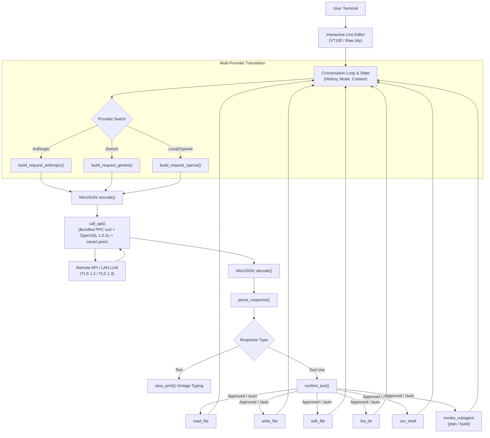

# Code Agent

<p align="center">
  <pre>
   _____          _         ___                    _   
  / ____|        | |       / _ \                  | |  
 | |     ___   __| | ___  / /_\ \ __ _  ___ _ __  | |_ 
 | |    / _ \ / _` |/ _ \ |  _  |/ _` |/ _ \ '_ \ | __|
 | |___| (_) | (_| |  __/ | | | | (_| |  __/ | | || |_ 
  \_____\___/ \__,_|\___| \_| |_/\__, |\___|_| |_| \__|
                                  __/ |                
                                 |___/                 
  </pre>
  <b>Code AI Agent for Vintage PowerPC Macs (Mac OS X 10.4 Tiger)</b>
  <br>
  <i>Autonomous terminal coding agent powered by Claude, Gemini, and Local LLMs for your vintage iBook, PowerBook, iMac, and Power Mac.</i>
</p>

<p align="center">
  
  
  
  
  
  
</p>

<p align="center">
  
</p>

---

## 📖 Overview

**Code Agent** is a self-contained, interactive terminal AI agent created specifically for vintage PowerPC Macintosh computers running **Mac OS X 10.4 Tiger**.

Vintage Macs are wonderful pieces of industrial design and distraction-free computing, but browsing the modern web and interfacing with cloud services is notoriously difficult. Mac OS X 10.4's bundled OpenSSL and `curl` only support SSLv3 and TLS 1.0, making it impossible to connect to modern HTTPS APIs. Furthermore, running modern language toolchains (Python 3, Node.js, Rust, or modern Perl) on Tiger requires hours of complex compilation or broken package managers.

**Code Agent solves this completely:**
- **Zero CPAN Dependencies**: 100% pure Perl standard library that runs out of the box on stock **Perl 5.8.6** in OS X 10.4.
- **Embedded `MiniJSON` Engine**: Built-in recursive-descent JSON parser and encoder with UTF-16 surrogate pair decoding (`\uD800..\uDBFF\uDC00..\uDFFF`), CRLF line endings, and JSON edge-case hardening without external CPAN modules.
- **Bundled Modern TLS `curl`**: Includes a prebuilt, statically-linked PowerPC `curl` binary with OpenSSL 1.0.2u supporting **TLS 1.2 & TLS 1.3**, alongside a current Mozilla `cacert.pem` root certificate bundle.
- **Multi-Provider AI**: Connects to **Anthropic Claude**, **Google Gemini** (with a free tier requiring no credit card), or **Local OpenAI-compatible models** (Ollama, llama.cpp, LocalAI running on your home LAN) with interactive runtime switching (`/openai`, `/local`), endpoint normalization, and persistent config in `~/.code-agent/env`.
- **Context & Token Budgeting**: Bounded context management with automatic and manual `/compact` tool output compaction, preserving strict `tool_use`/`tool_result` ID pairs while keeping pure-Perl JSON processing lightning-fast on vintage PowerPC CPUs.
- **Automated Perl 5.8.6 CI Enforcement**: Continuous integration enforcing strict Perl 5.8.6 syntax compatibility across every commit using `scripts/check_minimum_version.pl` and GitHub Actions.
- **Agentic Tool Execution**: Autonomously inspects directories, reads files, writes code, and executes shell commands directly on your Mac.
- **Custom Instructions & Skills Discovery**: Automatically loads global (`~/.agents/AGENTS.md`) and project (`./AGENTS.md`) instructions, plus indexes global (`~/.agents/skills/<name>/SKILL.md`) and project (`./.agents/skills/<name>/SKILL.md`) skills via bounded 4 KB frontmatter scanning for lazy on-demand loading via `read_file`.
- **Autonomous Sub-Agents**: Delegates complex tasks to specialized sub-agents with isolated conversation contexts (`plan` for read-only exploration and `build` for implementation), preserving context tokens and displaying progress in an indented tree view.
- **Automatic LLM Call Retries**: Resilient transport layer that automatically retries failed or transient LLM API calls up to **3 retries** with a **5-second** delay between attempts (configurable via `CLAUDE_MAX_RETRIES` and `CLAUDE_RETRY_DELAY`).
- **Safety Modes**: Switch between **Manual Mode** (`/manual`, requiring user confirmation for disk writes and commands) and **Autonomous Mode** (`/auto`, executing tools automatically).
- **Session Management**: Start a fresh conversation at any time with `/new` to reset context history without restarting the agent or re-authenticating.
- **Retro Vintage Terminal UX**: Built-in VT100 line editor with history navigation, arrow keys, and a nostalgic typewriter typing effect (`slow_print`).

---

## ⚡ Quick Start (2 Minutes)

No Xcode, MacPorts, Homebrew, or CPAN setup required!

### 1. Download & Transfer
Copy this repository folder to your PowerPC Mac using a USB drive, local network file share (AFP/SMB), FTP, or Target Disk Mode.

### 2. Run the Installer
- **On PowerPC Mac (OS X 10.4 Tiger)**: In Finder or Terminal, run `Install.command`:
  ```bash
  ./Install.command
  ```
- **On Modern macOS (Intel / Apple Silicon) or Linux**: Run `modern-install.command`:
  ```bash
  ./modern-install.command
  ```

Follow the prompts to:
1. Select your preferred provider (**Anthropic Claude** or **Google Gemini**).
   > **Tip**: Google Gemini has a free tier with no credit card required at [aistudio.google.com/apikey](https://aistudio.google.com/apikey).
2. Enter your API key (stored securely in `~/.code-agent/env`).
3. Deploy the CLI wrapper to `~/bin/code` (or `~/bin/code-agent` if VS Code is detected).

### 3. Start Chatting
Open a fresh Terminal window and type:
```bash
code
# or 'code-agent' on modern systems with VS Code installed
```

---

## 🎮 Interactive Slash Commands

While in the agent prompt (`User> `), use these commands at any time:

<p align="center">
  
</p>

| Command | Description |
| :--- | :--- |
| `/help` | Display interactive command cheatsheet and usage tips. |
| `/new` | **Start a new conversation**: Clears chat history and resets context window without restarting the agent. |
| `/compact` | **Compact conversation history**: Truncates verbose older tool outputs while keeping recent turns and strict tool IDs intact, reducing context bloat and speeding up serialization on slow CPUs. |
| `/stats` | **View session statistics**: Inspect live session duration, user/assistant turns, API calls, tokens (input, output, cache), and per-tool usage. |
| `/ctx [tokens]` | **View or set max output tokens**: Inspect current generation limit (default: 16k / 16,384 tokens) or set a new limit for model responses (e.g. `/ctx 65536`, `/ctx 64k`, `/ctx 128k`). |
| `/auto` | **Enable Autonomous Mode**: Tools (`write_file`, `edit_file`, `run_shell`) execute without asking for permission. |
| `/manual` | **Enable Manual Mode**: Requires explicit `[y/N]` user confirmation before modifying files or running shell commands. |
| `/claude` | Switch active provider to **Anthropic Claude** (Claude Sonnet 4.5 / 3.7). |
| `/gemini` | Switch active provider to **Google Gemini** (Gemini 2.5 Flash / Flash-Lite). |
| `/openai`, `/local` | Switch active provider to **Local / OpenAI endpoint** (Ollama / LAN LLM). Interactively prompts for base URL (default `http://localhost:11434/v1`) and normalizes/persists config if unset. |
| `/model <name>` | Change the active model (e.g. `/model claude-3-7-sonnet-20250219`). |
| `/models` | List recommended models for the currently selected provider. |
| `/exit`, `/quit` | Exit the agent and return to shell. |

---

## 🛠️ Agent Tools & Capabilities

Code Agent is equipped with native tools that allow it to act as an autonomous coding and system assistant on your Mac:

- **`read_file`**: Read file contents with automatic UTF-8 decoding, optionally slicing a specific line range via `start_line` and `end_line` (1-based, inclusive).
- **`write_file`**: Create or overwrite files on the filesystem.
- **`edit_file`**: Surgically edit existing files by replacing, inserting, or deleting specific line ranges (`start_line` to `end_line`, 1-based, inclusive) with replacement `content`.
- **`list_dir`**: Browse directories and examine repository structures.
- **`run_shell`**: Execute Unix commands in the Tiger shell (`sh`/`bash`), allowing the agent to run tests, inspect system metrics, manage processes, and build software.
- **`invoke_subagent`**: Delegate complex, multi-turn tasks to an isolated sub-agent (`plan` or `build`) with its own turn budget and conversation history.

### Sub-Agent Delegation & Context Isolation

When dealing with large codebases or exploratory analysis, running multiple tool calls in the primary conversation history quickly exhausts token context and increases network latency on vintage Macs. Sub-agents solve this through hierarchical delegation:

1. **Context Isolation**: The sub-agent executes in a completely separate, temporary message session. Only its final summary is returned to the parent agent, keeping the main context clean and fast.
2. **Specialized Roles**:
   - **`plan`**: Strictly **read-only** mode (`read_file`, `list_dir`). File modification and shell execution are blocked, so it never prompts for destructive confirmation. Perfect for codebase survey and planning.
   - **`build`** (default): Full implementation mode (`read_file`, `write_file`, `edit_file`, `list_dir`, `run_shell`). To prevent runaway recursion, sub-agents cannot invoke further sub-agents.
3. **Turn Budget & Loop Safety**:
   - Sub-agents are capped at **50 turns** maximum.
   - In both the initial prompt and every tool result, the remaining turn countdown is injected into the context (`[Turn X of 50. Turns remaining: Y]`), ensuring the sub-agent plans within its budget.
4. **Visual Tree Rendering**:
   Sub-agent actions are visually nested with 2-space indentation and Cyan ANSI connectors:
   ```text
     ┌── [Sub-agent: plan] Inspect codebase structure
     │ [Turn 1/50] list_dir   src
     │ [Turn 2/50] read_file   src/tools.pl   L1-40
     └── [Sub-agent: plan] Completed in 2 turn(s)
   ```
5. **Confirmation Transparency**: In manual mode, destructive actions by a build sub-agent are explicitly labeled:
   ```text
   [Confirm] [Sub-agent: build] Edit file 'src/tools.pl' (lines 10-20)?
   Proceed? [y/N]
   ```

### Permission & Safety Model

```
                    [ Agent Tool Request ]
                              │
                    ┌─────────┴─────────┐
                    │  Tool has side    │
                    │  effects? (write, │
                    │  edit, run_shell) │
                    └─────────┬─────────┘
                             / \
                       No   /   \   Yes
                           /     \
             [ Execute Tool ]     [ confirm_tool() ]
                                          │
                            ┌─────────────┴─────────────┐
                            │      Is $AUTO_MODE on?     │
                            └─────────────┬─────────────┘
                                         / \
                                  Yes   /   \   No (/manual)
                                       /     \
                         [ Execute Tool ]     [ Prompt User: "Allow? (y/n)" ]
                                                      │
                                                ┌─────┴─────┐
                                                │ Approved? │
                                                └─────┬─────┘
                                                     / \
                                              Yes   /   \   No
                                                   /     \
                                     [ Execute Tool ]     [ Abort: "Cancelled by user" ]
```

- In **Manual Mode** (`/manual`, default), destructive tools (`write_file`, `edit_file`, `run_shell`) always pause and ask for confirmation:
  ```text
  Tool: write_file path="hello.c"
  Write to file 'hello.c'? (y/n): y
  ```
- In **Autonomous Mode** (`/auto`), tools execute automatically for uninterrupted multi-step workflows.
- Critical operations (such as persisting API keys to disk) **always** require interactive confirmation regardless of mode.

### Session & Context Lifecycle

Conversation state is tracked in a structured in-memory session (`$CURRENT_SESSION`). You can start a fresh conversation at any point:
- Type `/new` at the `User> ` prompt.
- The agent invokes lifecycle hook `archive_session()` and initializes a new session with an empty message list.
- Active AI provider, chosen model, and autonomous mode settings are preserved across session resets.

### Context & Token Budgeting (`/compact`)

On vintage PowerPC processors (G3/G4/G5), pure-Perl JSON re-serialization of large conversation histories with verbose tool outputs can cause noticeable CPU latency. Code Agent solves this with two-tiered compaction:

- **Automatic Compaction**: Before dispatching requests to LLM providers, `auto_compact_session_if_needed()` evaluates conversation volume against configured thresholds (defaults: 100,000 characters or 10 user turns). When exceeded, older tool results are truncated, preserving the initial lines and concluding summary while omitting intermediate lines.
- **Manual Compaction**: Run `/compact` at the prompt anytime to immediately compress older tool results.
- **Schema & ID Integrity**: Unlike naive truncation, the compaction algorithm strictly preserves `tool_use_id` / `tool_result` pairing required by Anthropic Claude and Gemini function calling schemas, preventing API errors caused by mismatched or orphan tool blocks.
- **Configuration**: Fine-tune compaction via `CLAUDE_AUTO_COMPACT` (`1` or `0`), `CLAUDE_COMPACT_THRESHOLD_CHARS` (default: `100000`), and `CLAUDE_COMPACT_THRESHOLD_TURNS` (default: `10`).

### Session Statistics & Token Metrics (`/stats`)

Inspect live session health and token economics at any time during an interactive session by running `/stats`:
- **Session Duration & Timestamp**: Track total active conversation lifetime and start time.
- **Turn & Message Activity**: View user turns, assistant responses, total messages in history, and API call count.
- **Multi-Provider Token Usage**: Monitor input, output, and total tokens across Anthropic, Gemini, and OpenAI, including cache read and write tokens when available.
- **Tool Invocations Breakdown**: Live audit of total tool executions with an alphabetical per-tool breakdown and sub-agent invocation count.
- **Compaction Savings**: Track cumulative compaction events and total bytes saved from context optimization.

---

## 🏗️ Architecture



---

## 🖥️ System & Hardware Compatibility

| Component | Minimum Requirement | Verified & Tested On |
| :--- | :--- | :--- |
| **Operating System** | Mac OS X 10.4.0 Tiger | **Mac OS X 10.4.11 Tiger** |
| **Processor** | PowerPC G3 (300 MHz+) | **PowerPC G4 (1.2 GHz / 1.33 GHz)** |
| **RAM** | 256 MB RAM | **512 MB – 1.5 GB RAM** |
| **Perl** | Perl 5.8.6 (Standard OS X install) | **Perl 5.8.6 (darwin-thread-multi-2level)** |
| **Networking** | Any working Ethernet / AirPort / PPP | **Built-in Ethernet & AirPort Extreme** |
| **Models Tested** | iBook G4, PowerBook G4, iMac G4, Power Mac G4 / G5 | **iBook G4 (PowerBook6,5)** |

---

## 🌐 Local LAN Models (No Internet API Key Needed)

If you prefer to run private models without internet access, you can run [Ollama](https://ollama.ai) or `llama.cpp` on a modern PC/Mac on your local network:

1. Start Ollama on your modern computer:
   ```bash
   OLLAMA_HOST=0.0.0.0 ollama serve
   ```
2. On your PowerPC Mac, simply run `code` and switch interactively:
   ```text
   User> /openai
   Enter OpenAI/local base URL [http://localhost:11434/v1]: http://192.168.1.100:11434/v1
   Enter API key (leave empty for none) [none]: 
   Save this configuration to ~/.code-agent/env? (y/n): y
   ```
   Or pre-configure environment variables in `~/.code-agent/env` or your shell:
   ```bash
   export OPENAI_BASE_URL="http://192.168.1.100:11434/v1"
   export OPENAI_API_KEY="none"
   export CLAUDE_PROVIDER="openai"
   export CLAUDE_MODEL="llama3.2:1b"
   code
   ```
3. Your vintage Mac will now communicate with your local neural network with sub-second response times!

---

## ⚙️ Configuration & Environment (`~/.code-agent/`)

`code-agent` stores configuration, runtime files, and remote MCP settings in a dedicated directory located at `~/.code-agent/`:
- `~/.code-agent/env`: Provider selection, API keys, and runtime preferences.
- `~/.code-agent/mcp.json`: Remote MCP server configurations.
- `~/.code-agent/build/`: Installed agent script (`code-agent.pl`) and CA bundle (`src/cacert.pem`).
- `~/.code-agent/toolchain/`: Prebuilt TLS 1.2/1.3 curl binary (`bin/curl`, on PowerPC Tiger).

### How It Works

* **Automatic Loading**: The CLI launchers (`~/bin/code` and `~/bin/code-agent`) source `~/.code-agent/env` before running Perl. In addition, `code-agent.pl` parses it on startup via `load_env_file()`, so credentials load even if you run `perl code-agent.pl` directly.
* **Security**: The installer sets directory permissions to `0700` and file permissions to `0600`, ensuring only your user account can read or write API keys and configuration.
* **Precedence**: Environment variables already defined in your current shell session take precedence over values in `~/.code-agent/env`. You can temporarily override any setting on the command line:
  ```bash
  CLAUDE_PROVIDER=anthropic code
  ```
* **Migration**: During installation, any legacy `~/.code-agent-env` or `~/.claude-agent-env` file is automatically migrated into `~/.code-agent/env`.

### Example File

Lines can use standard shell assignment (`export KEY="VALUE"` or `KEY=VALUE`). Blank lines and comments (`#`) are ignored:

```bash
# ~/.code-agent/env - Code Agent Configuration

# Default provider: "gemini", "anthropic", or "openai"
export CLAUDE_PROVIDER="gemini"

# Google Gemini API key (free tier at https://aistudio.google.com/apikey)
export GEMINI_API_KEY="AIzaSy..."

# Anthropic API key (pay-as-you-go at https://console.anthropic.com)
# export ANTHROPIC_API_KEY="sk-ant-api03-..."

# Local OpenAI / Ollama endpoint (optional)
# export OPENAI_BASE_URL="http://192.168.1.100:11434/v1"
# export OPENAI_API_KEY="none"

# Model override (optional; defaults to provider recommendation)
# export CLAUDE_MODEL="gemini-3.5-flash-lite"

# Autonomous mode: "1" to enable without confirmation, "0" for manual confirmations
# export CLAUDE_AUTO_MODE="0"

# Typewriter print delay (seconds per char; set to "0" to disable typing effect)
# export CLAUDE_TYPE_DELAY="0.005"

# Automatic API retry settings (max retries on error and delay in seconds between retries)
# export CLAUDE_MAX_RETRIES="3"
# export CLAUDE_RETRY_DELAY="5"

# Context & token budgeting settings (automatic tool result compaction for slow CPUs)
# export CLAUDE_AUTO_COMPACT="1"
# export CLAUDE_COMPACT_THRESHOLD_CHARS="100000"
# export CLAUDE_COMPACT_THRESHOLD_TURNS="10"
```

### Supported Environment Variables

| Variable | Description | Default |
| :--- | :--- | :--- |
| `CLAUDE_PROVIDER` | Active AI backend: `gemini`, `anthropic`, or `openai` | `anthropic` (or selected in installer) |
| `GEMINI_API_KEY` | API key for Google Gemini models | None |
| `ANTHROPIC_API_KEY` | API key for Anthropic Claude models | None |
| `OPENAI_BASE_URL` | Base URL for OpenAI-compatible API (e.g. `http://localhost:11434/v1`) | None |
| `OPENAI_API_KEY` | API key for OpenAI-compatible endpoint | `none` |
| `CLAUDE_MODEL` | Specific model identifier to use with the active provider | `gemini-3.5-flash-lite` / `claude-sonnet-4-5-20250929` |
| `CLAUDE_AUTO_MODE` | Default tool permission mode: `1` (autonomous) or `0` (manual) | `0` |
| `CLAUDE_MAX_RETRIES` | Maximum number of automatic retry attempts when an LLM API call returns an error | `3` |
| `CLAUDE_RETRY_DELAY` | Wait interval in seconds between LLM API call retry attempts | `5` |
| `CLAUDE_AUTO_COMPACT` | Enable automatic background tool output compaction | `1` |
| `CLAUDE_COMPACT_THRESHOLD_CHARS` | Character threshold in conversation history before triggering compaction | `100000` |
| `CLAUDE_COMPACT_THRESHOLD_TURNS` | User turn count in conversation history before triggering compaction | `10` |
| `CLAUDE_CURL` | Custom path to a TLS 1.2+ capable `curl` binary | Auto-detected / bundled toolchain |
| `CLAUDE_CACERT` | Custom path to Mozilla root CA certificate bundle (`cacert.pem`) | Auto-detected / `$BUILD_DIR/src/cacert.pem` |
| `CLAUDE_TYPE_DELAY` | Simulated typing speed in seconds per character (`0` to disable) | `0.005` (PowerPC) / `0.003` (modern) |
| `NO_COLOR` | Disable ANSI color codes when set to `1` | None |

### Managing Your Credentials

* **To edit credentials**: Open `~/.code-agent/env` in any text editor:
  ```bash
  nano ~/.code-agent/env
  ```
* **To re-run the setup wizard**: Delete the configuration and execute the installer:
  ```bash
  rm -rf ~/.code-agent
  ./Install.command          # On PowerPC Tiger
  # or ./modern-install.command  # On modern macOS / Linux
  ```

---

## 🧪 Development & Testing

Run the test suite directly on your Mac or any Unix machine with Perl 5.8+:

```bash
# Assemble code-agent.pl from modular source files in src/
perl build.pl

# Verify source-to-distribution artifact synchronization
perl build.pl --check

# Verify Perl syntax (strict Perl 5.8.6 compatibility)
perl -c code-agent.pl

# Verify Perl 5.8.6 syntax compatibility across codebase
perl scripts/check_minimum_version.pl --perl 5.008006 code-agent.pl build.pl scripts/check_minimum_version.pl src/*.pl

# Run the full automated test suite
prove -v t/*.t
```

Test coverage includes 25 automated test suites:
- `t/agents_context.t`: Global (~/.agents/AGENTS.md) and project-local instructions loading and deduplication.
- `t/auto_manual_commands.t`: Unit tests for `/auto`, `/manual`, state accessors, and tool bypass logic.
- `t/banner.t`: Unit tests for two-tone ANSI banner formatting, 80-column bounds, and `$NO_COLOR` graceful degradation.
- `t/build.t`: Unit tests for `build.pl` modular assembly, syntax checks, and sync verification.
- `t/call_api.t`: Mocked curl transport invocation and error handling tests.
- `t/compact_context.t`: Unit tests for tool result head/tail compaction, user turn counting, automatic threshold triggers, and schema/ID preservation.
- `t/ctx_command.t`: Unit tests for `/ctx` max output token inspection and configuration.
- `t/env_config.t`: Environment configuration and fallback provider tests.
- `t/fetch_models.t`: Model discovery normalization tests across providers.
- `t/json.t`: Unit tests for `MiniJSON` recursive-descent parser/encoder, UTF-16 surrogate pair decoding, line endings (`\r\n`, `\r`, `\n`), nested data, and edge case resilience.
- `t/markdown.t`: Terminal markdown formatting, ANSI word-wrapping, and table card rendering tests.
- `t/mcp.t`: Remote MCP client, JSON-RPC 2.0 handshake, tool discovery, and `/mcp` command tests.
- `t/minimum_version.t`: Automated Perl 5.8.6 static syntax verification test suite.
- `t/models_command.t`: Interactive `/models` slash command handling.
- `t/new_command.t`: Session reset, conversation archiving, and context clearing tests.
- `t/openai_switch.t`: Unit tests for interactive `/openai` and `/local` switching, base URL prompt, normalization, and config persistence.
- `t/prompt_injection.t`: Security tests for untrusted tool output XML tag escaping and spotlighting.
- `t/retry.t`: Unit tests for automatic LLM API call retry logic (max 3 retries, 5s delay, transient HTTP/JSON/provider error recovery, and sub-agent resilience).
- `t/select_model_interactive.t`: Terminal menu navigation, key reading, and scrolling tests.
- `t/skills_context.t`: Global (`~/.agents/skills`) and project (`./.agents/skills`) skill frontmatter parsing, scope tagging (`[global]` / `[project]`), `dev`/`ino` deduplication, and lazy `<available_skills>` system prompt injection.
- `t/stats_command.t`: Unit tests for session statistics, provider token extraction, formatting engine, `/stats` command, and `/new` reset.
- `t/subagents.t`: Unit tests for sub-agent invocation (`plan`/`build`), turn countdown injection, loop limits, and ANSI tree formatting.
- `t/thinking_visuals.t`: Extended reasoning / thinking progress visual timers.
- `t/tool_call_visuals.t`: ANSI formatting and compact parameter summaries for tool calls.
- `t/tool_read_edit_file.t`: Line slicing and targeted multi-line editing tests.

---

## 📦 File Breakdown

- **`code-agent.pl`**: The standalone, self-contained distribution agent script (JSON engine, API adapters, terminal line editor, tool executor) assembled by `build.pl`.
- **`build.pl`**: Zero-dependency build script that compiles `src/*.pl` into `code-agent.pl` and verifies syntax.
- **`src/`**: Modular source files (13 domain-specific components: `header.pl`, `prompts.pl`, `json.pl`, `transport.pl`, `providers.pl`, `models_menu.pl`, `session.pl`, `tools.pl`, `mcp.pl`, `terminal.pl`, `markdown.pl`, `ui.pl`, `main.pl`).
- **`scripts/`**: Development, verification, and CI scripts (`scripts/check_minimum_version.pl` for Perl 5.8.6 static compatibility checking).
- **`Install.command`**: Interactive double-click setup wizard for Mac OS X Tiger / PowerPC (automatically rebuilds from `src/` if present).
- **`modern-install.command`**: Setup wizard for modern macOS (Intel/Apple Silicon) and Linux environments using system curl.
- **`curl`**: Precompiled PowerPC Tiger binary (statically linked against OpenSSL 1.0.2u with TLS 1.2/1.3 support).
- **`cacert.pem`**: Mozilla root CA certificate bundle for TLS verification.
- **`t/`**: Test suite with automated unit and integration tests.
- **`context/`**: Codebase context maps and architectural documentation.

---

## 📜 License

MIT License. Feel free to use, modify, and distribute on your vintage Mac setups!
