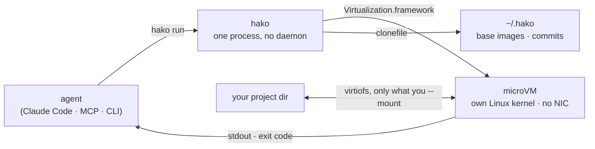

<p align="center">
  <h1 align="center">HakoVM</h1>
</p>

<p align="center">
  <strong>Firecracker-class microVMs for macOS. Built for AI agents.</strong>
</p>

<p align="center">
  <a href="https://github.com/las7/HakoVM/actions"></a>
  <a href="https://github.com/las7/HakoVM/blob/main/LICENSE"></a>
  
  
</p>

<p align="center">
  <a href="#install"><strong>Install</strong></a> · <a href="docs/agents.md"><strong>For agents</strong></a> · <a href="docs/comparison.md"><strong>vs Docker / Apple container / Lima</strong></a> · <a href="docs/design.md"><strong>Design</strong></a> · <a href="docs/performance.md"><strong>Performance</strong></a> · <a href="docs/roadmap.md"><strong>Roadmap</strong></a>
</p>

Boot a hardware-isolated Linux VM from any OCI image in about 300 ms, run
commands in it at ~10 ms each, throw it away. No daemon, no Docker, no root.
The guest has no network card unless you give it one.

```bash
curl -fsSL https://raw.githubusercontent.com/las7/HakoVM/main/install.sh | sh
hako run --mount $PWD:/work --cwd /work -- python3 -c 'print("hello from a VM")'
```

```
$ hako bench
rootfs prepare : 1 ms
boot to init   : 240 ms
exec p50/p90   : 8 / 12 ms  (n=20)
stop           : 10 ms
```

| Fresh env → first command | Exec in running env | Isolation layer RSS |
|---|---|---|
| **~300 ms** (Docker: ~200, Apple `container`: ~900, Lima: 12 s) | **8 ms** (Lima: 48, Docker: 75, Apple: 93) | **~20 MB** per VM (Docker Desktop: ~430) |

Full numbers and caveats in [docs/comparison.md](docs/comparison.md).

## Why microvm?

Firecracker needs KVM, so it does not run on a Mac. Docker Desktop, OrbStack
and Lima give you one big shared VM. Apple's `container` CLI is close, but it
is a general container tool with a daemon and a network stack you may not want.

HakoVM is a thin Swift runtime on Apple's open-source
[Containerization](https://github.com/apple/containerization) framework, shaped
for one job: giving an AI agent a disposable machine it cannot escape from.

| | Docker / OrbStack | Apple `container` | hako |
|---|---|---|---|
| Isolation boundary | shared kernel | per-container VM | per-sandbox VM |
| Boot from OCI image | n/a | ~0.9 s | ~0.3 s |
| Guest network by default | yes | yes | **none** |
| Daemon | yes | yes | no |
| Root / sudo | Docker: yes | install only | no |
| Designed for | dev containers | dev containers | agent sandboxes |



## What it does today

- **Boots a Linux microVM** from any OCI image via Virtualization.framework.
- **Runs commands** over vsock with streamed stdout/stderr and exit codes.
- **Shares host directories** into the guest with virtiofs, read-write.
- **No NIC by default.** Loopback only. Host access is exactly the mounts you declare.
  `--network` opts one run into a NAT interface.
- **No daemon, no root.** One signed binary. Images cache under `~/.hako/store`.
- **Claude Code hook** that routes every Bash call into a VM with only the project mounted.

## Using it for AI work

**Code interpreter.** Run model-generated code, get stdout, exit code and files back.
The guest cannot reach the network or any host path you did not mount.

```bash
hako run --image python:3.12-alpine --mount ./out:/work --cwd /work -- python3 /work/task.py
echo "exit=$?"; cat out/result.json
```

**Dependencies.** The guest is offline by default. Install once with
`--network` and commit the result; every later run boots a copy-on-write
clone of it, offline, in about a second:

```bash
hako run --network --image python:3.12-alpine --commit py-deps -- pip install numpy pandas requests
hako run --from py-deps --mount .:/work --cwd /work -- python3 analysis.py
```

Commits layer (`--from py-deps --commit py-deps-ml`), and ten agents booting
from one commit each get their own clone. Mounting a host `venv` or
`node_modules` works too, and so does any image from a registry. See
[docs/dependencies.md](docs/dependencies.md) for when to use which.

**Claude Code.** Put every Bash call the agent makes inside a VM. Add to
`.claude/settings.json`:

```json
{"hooks": {"PreToolUse": [{"matcher": "Bash",
  "hooks": [{"type": "command", "command": "python3 ~/hakovm/hooks/claude-code-bash.py"}]}]}}
```

The project directory is mounted at the same path, so the agent's relative and
absolute paths keep working. `HAKO_IMAGE`, `HAKO_NETWORK=1` and `HAKO_MOUNT`
tune it. Round trip per command is about 0.7 s including the boot; a warm pool
is next on the roadmap to bring that to the exec latency.

**MCP server.** One command registers HakoVM as a tool for any MCP client:

```bash
claude mcp add hako -- hako mcp --image python:3.12-alpine --mount "$PWD:/work"
```

The model gets `hako_run` (command, image or commit, timeout, cwd) and
`hako_commits`. Network and extra mounts are refused unless you start the
server with `--allow-network` / `--allow-mounts`.

**Any language.** `hako run --json --timeout 60 -- ...` prints one JSON
object with stdout, stderr, exit code and timings. See
[docs/agents.md](docs/agents.md) for all four integration paths and the
patterns that work.

## CLI

```bash
hako setup                                 # one-time: kernel + guest init + alpine
hako pull [image]                          # cache an image for offline boots
hako run [opts] -- <cmd...>                # fresh VM, run one command, destroy
hako run --image python:3.12-alpine -- ... # any OCI image; short names resolve like Docker
hako run --mount /host/dir:/work -- ...    # share a directory (repeatable)
hako run --network -- ...                  # give this run a NAT interface
hako run --commit NAME -- ...             # save the rootfs after the command exits 0
hako run --from NAME -- ...               # boot a clone of a commit
hako commit ls | hako commit rm NAME      # manage commits
hako run --json --timeout 60 -- ...       # machine-readable result, kill after 60 s (exit 124)
hako run --lean -- ...                    # minimal guest mounts, no VM overhead: ~30 ms faster
hako mcp [--allow-network] [--allow-mounts]  # MCP tool server on stdio
hako run --cpus 1 --memory 256 -- ...      # size the VM
hako run --kernel-arg quiet -- ...         # extra kernel command line
hako bench [--execs N]                     # boot / exec / stop timings
```

## Install

Apple Silicon and macOS 26 or later. No sudo, no developer account.

```bash
curl -fsSL https://raw.githubusercontent.com/las7/HakoVM/main/install.sh | sh
```

That drops `hako` in `~/.local/bin` and runs `hako setup`, which downloads a
28 MB Linux kernel built from Apple's Containerization config and caches
Apple's guest init plus alpine. Everything lives under `~/.hako`.

From source, with Xcode 26:

```bash
git clone https://github.com/las7/HakoVM && cd hakovm
make install          # build, sign with the virtualization entitlement, copy to ~/.local/bin
hako setup
```

## Where it is going

hako is being built around six agent workloads: coding-agent shell, code
interpreter, parallel fan-out, browser agent, eval runs, and hosting untrusted
MCP servers. The [design doc](docs/design.md) describes the primitives that
serve them: profiles, warm pools, host-terminated egress with hostname
allowlists, a credential broker, and commit/fork of prepared rootfs images.

See the [roadmap](docs/roadmap.md) for order and status.

## Documentation

| Topic | Link |
|---|---|
| Architecture | [docs/architecture.md](docs/architecture.md) |
| Using it from agents (CLI JSON, MCP, Claude Code hook) | [docs/agents.md](docs/agents.md) |
| Security model and red-team results | [docs/security.md](docs/security.md) |
| Design for AI workloads | [docs/design.md](docs/design.md) |
| Dependencies: commit, mounts, images | [docs/dependencies.md](docs/dependencies.md) |
| vs Docker, Apple container, Lima | [docs/comparison.md](docs/comparison.md) |
| Performance and tuning | [docs/performance.md](docs/performance.md) |
| Roadmap | [docs/roadmap.md](docs/roadmap.md) |
| Contributing | [CONTRIBUTING.md](CONTRIBUTING.md) |

## License

Apache License 2.0. See [LICENSE](LICENSE) and [NOTICE](NOTICE).
