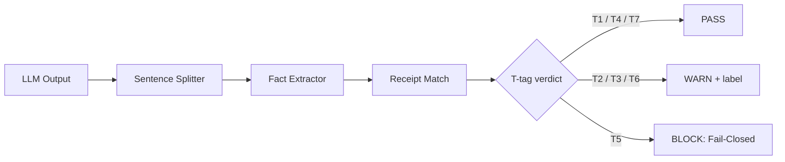

# Anti-Lie: The LLM Truth X-Ray 🔍
[English](./README.md) | [中文](./README.zh.md)

> Don't make LLMs honest. Make every factual claim auditable.
>
> Do not gag the model. Strip its hallucinations sentence by sentence.

[](LICENSE)
[](#quick-start)
[](#quick-start)
[](#contributing)
[](#contributing)

Anti-Lie is an LLM Claim Auditing Layer. It does not try to train large language models into saints. It does not bet production safety on another paragraph of prompt prayer. It does one colder, more mechanical thing: before an answer leaves your system, it splits the output into sentences, extracts factual claims, matches every number, entity, date, and business-critical assertion against receipts, and assigns an auditable T1-T7 verdict. Green claims pass. Yellow claims ship with warning labels. Red claims are physically blocked.

---

## 🎯 Benchmark Headline (LiarBench v0.2, 210 samples)

| Metric | Score |
|---|---|
| **Business effectiveness** | **98.1%** |
| True info correctly allowed | 98.7% |
| False info correctly caught | 96.4% |
| False-block rate | 1.3% |
| Miss rate | 3.6% |

> Dataset SHA256 `bd3dfb9c04af70ecc27d44bb79b0ebffaf4dd5b17f04e2dd8054521d85747bc2` · All 210 samples and the benchmark runner are open-sourced in [`benchmarks/`](./benchmarks/) for independent reproduction · Production performance may differ due to input distribution.

---

This project is not another polite wrapper around model behavior. It is a receipt ledger for generated text: a final outbound gate that asks, for every factual sentence, “What gives you the right to say that?” The model can still reason, explore, summarize, and improvise. The delivery layer simply refuses to publish unsupported hard facts as if they were earned knowledge.

## Why Anti-Lie?

The current AI industry is trapped in a ridiculous loop: everyone is trying to defeat language magic with more language magic. Developers write hundreds of lines of prompts and beg the model: “Please be honest. Please do not fabricate.” Then a user adds pressure, the context gets noisy, the model wants to be helpful, and it confidently invents a number, a customer promise, a legal clause, a release date, or a medical-sounding answer. For hackers, that is a bug. For finance, healthcare, enterprise support, legal review, and government workflows, it is a compliance sinkhole.

**Trying to gag an LLM is anti-human.** Its ability to explore, generalize, and improvise is part of its intelligence. So Anti-Lie takes the colder route: do not interfere with the model’s thinking; audit every sentence it tries to send. This is not language magic. This is bookkeeping. This is not “please be truthful.” This is “show the receipt, or shut up.”

The macOS node hook is blunt: don't gag the model; inspect the books. A model should not be punished for being imaginative, but a production system should be punished if it publishes unsupported commercial facts. Anti-Lie is the flight recorder for that boundary. It keeps the creative engine alive while attaching a red price tag to every unsupported hard claim. When the ledger is missing, the system should Fail-Closed rather than pretend confidence is evidence.

## T1-T7 Truth Granularity

Anti-Lie’s core asset is not the vague slogan “hallucination detection.” It is a truth granularity system. Every outbound sentence must land in one of seven tags. If the system cannot explain why a factual claim is safe, the claim does not get to borrow the model’s confidence. Green means physically traceable. Yellow means useful but not proven. Red means the system refuses to absorb liability for the model.

| Tag | Color | Meaning | Evidence Source | Default Action | Example |
|---|---|---|---|---|---|
| T1 Verified Tool/Web | 🟢 Green | The claim is verified by a recent tool call, web search, API response, command output, or structured tool result. Extracted facts overlap with a receipt. | ToolReceipt, web receipt, API response, command log | Pass; optionally attach receipt id | “Version 0.1.0 was released on 2026-05-01,” with a matching release query receipt. |
| T2 Logic/Inference | 🟡 Yellow | The sentence is a logical inference, not a directly evidenced fact. It may be reasonable, but it is still reasoning. | Explicit reasoning markers such as “therefore,” “if,” “should,” or “logically” | Warn; label as inference | “If every financial claim requires a receipt, review workload should become more predictable.” |
| T3 Common Knowledge | 🟡 Yellow | The claim relies on common knowledge or training-memory style background, without a fresh receipt. | General knowledge, model prior, non-current public background | Warn; do not present as current verified fact | “RAG is commonly used to reduce hallucinations.” |
| T4 Local Memory/RAG | 🟢 Green | The claim is grounded in a local knowledge base, private document, database row, or RAG-retrieved span. | RAG chunk, database row, document span, local memory receipt | Pass; preserve source location | “Section 4 says payment is due within 30 days,” with a matching document span. |
| T5 Hallucination/Blocked | 🔴 Red | A hard factual claim has no ledger support, or the model fabricates a verification label that the logs do not support. | No matching receipt, or claimed receipt absent from logs | BLOCK; Fail-Closed | “Quarterly revenue grew 37%,” with no financial receipt. |
| T6 Speculation | 🟡 Yellow | The sentence is explicitly uncertain: maybe, likely, estimated, possible, hypothetical. Allowed, but not treated as proof. | Hedge words, scenario assumptions, no factual commitment | Warn; preserve uncertainty | “This metric may continue to rise.” |
| T7 User Material | 🟢 Green | The sentence restates material provided by the user, without adding external facts. | User message, uploaded file, provided table, prompt context | Pass; mark as user material | “In the table you provided, row A shows 100.” |

The point of T1-T7 is to avoid replacing one hallucinating model with another model-as-judge hallucination. A verdict must be tied to a ledger. The sentence came from a tool, a local document, the user’s material, an inference, a common background assumption, a speculation, or nowhere. Anti-Lie does not care how confident the prose sounds. It cares whether the evidence exists.

This is why the labels are deliberately operational. T5 is not a moral accusation. It is an engineering state: a hard factual sentence with no acceptable receipt. If the output contains a business amount, a medical instruction, a legal claim, a contract date, a customer promise, a benchmark number, or a percentage, and the system cannot find the receipt, Anti-Lie treats that sentence as shrapnel.

## Quick Start

Anti-Lie is distributed as an OpenClaw outbound hook bundle that includes a Python verifier service, a Node.js shadow worker, and platform-specific service definitions for Linux (systemd) and macOS (launchd).

```bash
git clone https://github.com/lc198707/anti-lie.git
cd anti-lie/skill
bash install.sh        # Linux
# or
bash install.sh --dry-run  # run environment checks first
# macOS users see SKILL.md for launchd setup
```

Minimal demo: Anti-Lie is an outbound hook, not a library you call from Python. After installation, send a normal agent/channel message that contains a concrete, unverified number or business fact. On the next outbound delivery, Anti-Lie audits the sentence and appends an audit tail with the relevant T1-T7 verdict instead of silently letting unsupported factual claims pass as verified knowledge.

A practical integration has four layers:

1. **Hook placement.** Anti-Lie lives in the OpenClaw skill/hook location and loads with the runtime. It should not depend on the model remembering to invoke it voluntarily.
2. **Manifest hook.** The manifest declares an outbound interceptor. The hook sees candidate messages before delivery. It does not need to stop the model from thinking or using tools; it only audits the text that is about to leave.
3. **Policy configuration.** A policy file defines fail_closed versus warn_only behavior, risk classes, freshness windows, and escalation rules. Financial amounts, contract claims, legal statements, medical guidance, customer promises, and benchmark numbers usually belong closer to Fail-Closed. Explicit speculation and ordinary reasoning can often ship with labels.
4. **Receipt adapters.** A log reader adapter rebuilds recent tool actions. A RAG adapter exposes retrieved chunks and document spans. A web adapter exposes search or fetch results. Database or business-system adapters expose approved rows. A user-material adapter records files, tables, and messages supplied by the user.
5. **Verify Engine settings.** Teams tune sentence splitting, claim extraction, receipt matching, source priority, stale evidence handling, and T1-T7 mapping. The engine should be strict enough to catch fabricated micro-claims but transparent enough that a blocked sentence can be debugged.
6. **Outbound decision.** T1/T4/T7 claims pass. T2/T3/T6 claims pass with labels, disclaimers, or downgraded wording. T5 claims block, or in low-risk environments become a safe request for confirmation instead of a published fact.

This approach means Anti-Lie does not require you to replace LangChain, OpenAI Agents, RAG pipelines, observability platforms, customer-service systems, or internal chat gateways. It asks for one invariant before delivery: hard factual claims must be backed by a ledger. If there is no receipt, the system should not ship the claim as fact.

## 📊 Benchmarks  *(planned)*

**Status: [planned] [planned benchmark]**

We benchmark Anti-Lie against four public hallucination/faithfulness benchmarks in the LLM safety community. **All numbers below are placeholders pending independent runs in v0.2.0** — we do not publish numbers we have not measured ourselves.

| Benchmark | What it measures | Anti-Lie target | Status |
|---|---|---|---|
| [Vectara HHEM 2.3](https://github.com/vectara/hallucination-leaderboard) | Hallucination rate when summarizing source documents | Reduce baseline hallucination rate by X% via outbound verify hook | ⏳ planned v0.2.0 |
| [TruthfulQA](https://github.com/sylinrl/TruthfulQA) | LLM resistance to common misconceptions across 38 categories | % of false claims caught by Anti-Lie verify on hard subset | ⏳ planned v0.2.0 |
| [HaluEval](https://github.com/RUCAIBox/HaluEval) | 35K large-scale hallucination QA / dialogue / summarization benchmark | Precision/recall of Anti-Lie verdict on QA-fact subset | ⏳ planned v0.2.0 |
| **LiarBench** *(in-house, planned open release)* | Outbound business-claim audit: revenue, percentages, contract values, market share | Claim-detection precision ≥ 90% on 100-case demo set | ⏳ planned v0.2.0 |

### Why four benchmarks instead of one
- **HHEM** is the most-cited industry leaderboard (GPT-4o 1.5%, Gemini-2 Flash 0.7%) and is what serious LLM-ops teams check first.
- **TruthfulQA** is part of the Open LLM Leaderboard family; near-universal name recognition.
- **HaluEval** provides the largest open dataset (35K) for QA-fact-style claim detection.
- **LiarBench** is what we are building specifically for **outbound business-claim audit** — the niche Anti-Lie targets and that the others do not cover.

### How to reproduce *(once v0.2.0 ships)*
See `benchmarks/PLAN.md` for setup, datasets, and acceptance scripts.

> ⚠️ **No fake numbers**: Anti-Lie will never claim a benchmark score we have not run end-to-end on the open dataset with hook installed. We follow the standard set by the [MemPalace independent review](https://vectorize.io/articles/mempalace-review) — credit benchmark scores to the embedding/model component when applicable, not to the wrapper.


## Architecture

Anti-Lie does not primarily intercept API calls. It intercepts unsupported factual claims in outbound language. The standard pipeline has five conceptual stages: Session Log Reader / Sentence Splitter / Fact Extractor / Verify Engine / Interceptor Middleware. Think of it as a flight recorder and liability audit desk for the AI era. When something goes wrong, you do not ask the model to explain itself. You inspect the ledger.



Session Log Reader rebuilds the tool timeline and receipt book. Sentence Splitter makes the unit of review small enough to matter. Fact Extractor extracts numbers, entities, dates, source attributions, and hard claims. Verify Engine assigns T1-T7 using receipt overlap, freshness windows, and policy rules. Interceptor Middleware passes, warns, rewrites, or physically blocks outbound messages.

The pipeline is intentionally dull, hard-edged, and falsifiable. Enterprise systems cannot use “the answer sounded grounded” as a safety policy. Anti-Lie requires a verdict before outbound delivery. If the model tries to forge trust by writing something like “I checked the file” or “[T1 verified]” but the session log contains no corresponding action, the Verify Engine treats that as a more dangerous T5, not a more trustworthy T1.

The architecture also keeps Anti-Lie compatible with existing stacks. You can use prompt guardrails, RAG, eval frameworks, tracing platforms, agent runtimes, and custom middleware. Anti-Lie sits at the outbound edge and asks the final question those systems often skip: does this exact sentence have a receipt?

## Real-World Interception Examples

The examples below are public-safe demonstrations. The receipts are illustrative samples, not private production data. The important part is the chain from sentence to extracted fact to receipt state to verdict. Anti-Lie is useful only when this chain is inspectable.

### Example 1 — T1 Green: verified web/tool fact

**Original output**

> “The package requires Node.js 20 or newer.”

**Extracted fact**

- Entity: package runtime requirement
- Number: Node.js 20+
- Claim type: technical requirement

**Receipt status**

- Matched receipt: package manifest or documentation fetch contains the same runtime requirement
- Overlap: exact numeric and entity match
- Risk class: low-to-medium technical fact

**Final verdict**

- `T1 Verified Tool/Web`
- Action: PASS
- Why: the sentence is not merely plausible; it is backed by a fresh tool receipt. If the receipt changes, the verdict changes.

### Example 2 — T2 Yellow: logic without receipt

**Original output**

> “If all outbound financial claims require receipts, the review workload should become more predictable.”

**Extracted fact**

- No hard number
- Conditional structure
- Contains “if” and “should”
- Claim type: operational inference

**Receipt status**

- No receipt required for a conditional inference
- No claim of measured reduction, benchmark result, or customer outcome
- No attempt to present the inference as a historical fact

**Final verdict**

- `T2 Logic/Inference`
- Action: WARN + label as inference
- Why: the sentence may be useful, but it is not evidence. Anti-Lie keeps the thought and strips the fake certainty.

### Example 3 — T5 Red: commercial amount without ledger

**Original output**

> “The customer signed a 2.4 million USD annual contract last Friday.”

**Extracted fact**

- Entity: customer contract
- Amount: 2.4 million USD
- Date: last Friday
- Claim type: business-critical commercial fact

**Receipt status**

- No contract receipt
- No CRM row
- No approved user-provided material
- No tool log supporting the amount or date
- No source span that can be shown to an auditor

**Final verdict**

- `T5 Hallucination/Blocked`
- Action: BLOCK via Fail-Closed
- Why: a confident sentence with no ledger is not “almost correct.” It is legal shrapnel. The system would rather become silent than publish an unsupported commercial claim.

These examples also show why Anti-Lie does not merely look for scary words. A number can be safe if it has a receipt. A soft inference can be allowed if it admits uncertainty. A beautifully written executive sentence can be blocked if it smuggles in an unsupported fact.

## Comparison Table

Anti-Lie does not need to pretend adjacent tools are useless. Prompt guardrails, RAG citation, human review, eval frameworks, and observability systems all solve real problems. They act at different moments and fail in different ways. Anti-Lie is the last outbound fact gate: after the model has already generated language, the system still demands receipts for hard claims.

| Approach | When it acts | Granularity | What it stops | Failure mode |
|---|---|---|---|---|
| Prompt-only Guardrails | Before and during generation | Prompt / response level | Some unsafe style, policy drift, obvious forbidden content | The model may ignore or reinterpret instructions; no physical receipt; persuasive hallucinations can pass. |
| RAG Citation | Retrieval and answer composition | Paragraph / citation level | Unsupported answers when retrieval is well-formed and cited spans are relevant | Citations can be stale, irrelevant, too broad, or used as decoration; generated numbers can exceed the source. |
| Human Review | After generation, before publication | Document / ticket level | High-risk errors that reviewers notice | Slow, expensive, inconsistent; humans miss fabricated micro-claims under time pressure. |
| Anti-Lie Receipt Audit (this project) | Outbound interception after generation | Sentence / claim level | Hard factual claims without tool, RAG, database, or user-material receipts | Requires receipt instrumentation; if upstream systems never log evidence, Anti-Lie blocks aggressively. |

The honest conclusion is simple: Anti-Lie is not a replacement for the rest of the LLM safety stack. It is a brake pad, not a steering wheel. Prompts shape intent. RAG supplies knowledge. Evals measure behavior offline. Observability traces execution. Anti-Lie handles the final outbound question: without a receipt, why is this hard fact allowed to leave?

That difference matters because many hallucinations are not full-document failures. They are micro-claims: a single percentage, a date, a customer name, a policy limit, a version number, a contract amount. A paragraph-level citation can look respectable while one sentence inside it fabricates the number that matters. Anti-Lie is built for that granularity.

## Use Cases

### Enterprise AI compliance review

Internal report generation, contract summarization, finance Q&A, board-deck drafting, procurement support, and sales operations all share the same failure mode: the model makes a sentence sound official before the organization has evidence for it. Anti-Lie can sit as a pre-publication gate. Amounts, percentages, dates, customer commitments, contractual clauses, regulatory statements, and medical or legal claims must match receipts. Otherwise, the system blocks the claim instead of forwarding liability to the reader.

For compliance teams, the value is not only prevention. It is accountability. Every allowed factual sentence can point back to a receipt class. Every blocked sentence explains which evidence was missing. That turns review from a vibe-based redline process into a ledger-backed audit trail.

### LLM-powered customer service audit

Customer-service bots rarely lie out of malice. They lie because they are optimized to be helpful, fluent, and complete. Under pressure, they may invent a refund window, delivery date, discount amount, policy exception, or escalation promise. Anti-Lie marks outbound service messages with T1/T2/T5 verdicts so teams can distinguish knowledge-base facts from model inferences and unsupported promises.

The same ledger helps managers debug the system. If a refund policy is blocked as T5, the fix may be to add the policy to the knowledge base, instrument the retrieval tool, or tighten the policy rule. If the model invents a promise despite missing data, the fix is not another motivational prompt. The fix is an outbound gate.

### Developer debug truth-meter

Agent developers constantly see confident phrases such as “I checked the file,” “the API returned,” “the logs show,” or “according to the database.” Those phrases are cheap for a model to generate and expensive for a developer to trust. Anti-Lie can run locally as a debug truth-meter: it reads the session log and checks whether the claimed action actually happened.

If the action exists and the extracted facts match the output, the sentence can be T1. If the action exists but the number drifted, it becomes T5. If the action never happened, it is also T5, even if the model writes a fake verification label. If the sentence is merely an inference, it becomes T2. This is the difference between debugging with a flashlight and debugging with a lie detector attached to the tool ledger.

### AI-generated content publication gate

Content teams can use Anti-Lie before publishing articles, white papers, outbound emails, product announcements, research summaries, PRDs, scripts, and support macros. The system does not block opinions, metaphors, creative phrasing, or strategy. It watches hard claims. Public numbers, source attributions, dates, product requirements, benchmark statements, and quotes must be traceable.

That matters because a single unsupported statistic can poison an otherwise useful document. Anti-Lie keeps the creative layer free while forcing the factual layer to show receipts. It is not anti-writing. It is anti-unearned certainty.

### Agent middleware and incident forensics

Multi-tool agents are difficult to audit after an incident. User input, tool calls, local documents, intermediate reasoning, and final text are scattered across logs. Anti-Lie’s receipt ledger binds claims to origins. When something goes wrong, the team does not have to archaeologically reconstruct the chat. It can inspect the verdict, the matched receipt, the missing receipt, and the policy action.

This is why the flight-recorder metaphor matters. A flight recorder does not prevent pilots from thinking. It records what happened so responsibility can be assigned. Anti-Lie is the flight recorder and liability audit desk for AI-generated factual claims.

## Performance & Roadmap

### Performance

The original prototype direction aims for low-latency outbound interception, but a public README should not make naked benchmark claims. Current performance language is therefore conservative: **based on initial prototype, full benchmark TBD**. Any number such as “p50,” “p95,” or “under 100ms” must remain `[planned benchmark]` until the benchmark harness, environment, sample sizes, and receipt modes are published.

Planned benchmark dimensions:

- `[planned benchmark]` sentence count: 1 / 5 / 20 / 100 sentences
- `[planned benchmark]` receipt count: 10 / 100 / 1,000 receipts
- `[planned benchmark]` p50 / p95 latency for local-only receipt matching
- `[planned benchmark]` overhead when web receipt matching is enabled
- `[planned benchmark]` extraction accuracy for numbers, dates, entities, and source spans
- `[planned benchmark]` false-block and false-pass rate across adversarial claim sets
- `[planned benchmark]` middleware overhead in streaming and non-streaming outbound paths

Benchmarks will be published with scripts, fixtures, hardware notes, and policy configuration. Without those, performance numbers are just another hallucination with better typography.

### Roadmap

| Version | Scope | Notes |
|---|---|---|
| v0.1 | Local log reader + Python middleware | Parse session logs, build a receipt book, apply T1-T7 policy, and ship a fail-closed demo. |
| v0.2 | LangChain + OpenAI Agents adapter | Wrap common agent runtimes without forcing teams to migrate architecture. |
| v0.3 | Web receipt matcher + RAG receipt matcher | Match extracted claims against search results, API responses, local chunks, document spans, and database rows. |
| v0.4 | Dashboard + policy engine | Review verdict history, tune high-risk claim classes, export audit reports, and configure team policies. |

The roadmap principle is deliberately harsh: make the smallest audit loop solid before making the interface beautiful. A dashboard without falsifiable interception is just a more attractive hallucination console.

## Contributing

Anti-Lie needs cold engineering, not inspirational slogans. The smallest useful contributions are:

1. **Add a T-tag detector**: specialized extractors and verdict rules for money claims, medical claims, legal clauses, version numbers, dates, customer promises, benchmark statements, or policy limits.
2. **Add a middleware adapter**: Python ASGI, FastAPI, LangChain callback, OpenAI Agents hook, Node/Express, WebSocket, message queue, browser extension, or internal chat gateway.
3. **Submit benchmark cases**: each case should include original text, extracted facts, receipts, expected verdicts, and adversarial variants. Good cases try to break the system; they do not only demonstrate the happy path.

Small PRs are preferred. Every rule should include tests. Every block should be reproducible. Every performance claim should include a script. Every example should avoid private data. Anti-Lie dislikes two things: unverifiable confidence and marketing adjectives dressed as engineering conclusions.

If you are unsure where to start, implement a detector for one narrow claim type. For example: “percentage with no receipt,” “contract amount with no receipt,” “date claim with stale receipt,” or “model says it checked a file but no file-read action exists.” A narrow, testable detector is more valuable than a grand theory of truth.

## License

MIT License — see LICENSE.

MIT is the project license. Anti-Lie is meant to be easy to inspect, fork, embed, and improve in agent runtimes, internal audit systems, and open-source toolchains. If your organization needs additional compliance documents, open an issue rather than hiding legal assumptions in README prose.

## Closing

Anti-Lie’s worldview is blunt: large language models may continue to explore, infer, summarize, generalize, improvise, and even lie. But the delivery system does not have to endorse every sentence they produce. Creativity belongs to the model. Facts belong to the ledger. Liability belongs to whoever ignored the missing receipt.

Stop writing longer prompt prayers and calling that safety. Split the output. Extract the claims. Match the receipts. Tag the truth granularity. Warn when the sentence is inference. Block when the sentence is unsupported. Keep the model’s intelligence; remove its ability to smuggle unearned certainty into production.

LLMs can lie all they want. With Anti-Lie watching, every lie comes with a red price tag.
