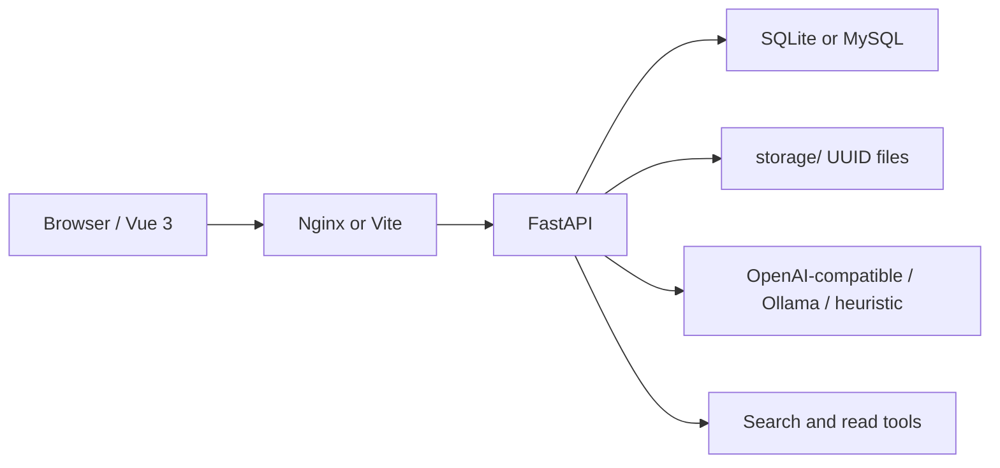

# KnowledgeAgent

Lightweight, self-hosted **Agentic RAG**. Import Markdown, PDF, and DOCX; organize a private knowledge tree; search with keywords, grep, and optional vectors; let an agent call tools and answer **only from retrieved snippets**, with clickable sources.

[中文说明](README.zh-CN.md) · [Architecture](docs/architecture.md) · [API](docs/api.md) · [Operations](docs/operations.md) · [Security](SECURITY.md) · [Contributing](CONTRIBUTING.md) · [License](LICENSE)


## Features

- **Three file types** — Markdown, PDF, and DOCX. Parse failures can be retried from the immutable original.
- **Folders without path tricks** — Storage paths are `{knowledge_base_id}/{document_id}/…` (UUIDs only). Moving a file only updates logical location.
- **Hybrid search** — FTS5/BM25 keywords, bounded grep (ideal for error codes), optional embeddings, fused with Reciprocal Rank Fusion. Works with `EMBEDDING_PROVIDER=none`.
- **Agent tools** — `vector_search`, `keyword_search`, `grep_search`, `read_document`, `read_section`, `list_folder`. The loop stops at a round/token budget.
- **Citations** — Each answer can open a Sources drawer: document, relative path, heading, page range, snippet.
- **Your LLM** — Any OpenAI-compatible Chat Completions endpoint, including Ollama at `http://localhost:11434/v1`. No cloud key? Set `LLM_PROVIDER=heuristic` for an offline tool loop used in tests and demos.
- **Privacy by default** — Single user-owner isolation (foreign IDs are **404**). API keys stay in server `.env`, never in the SPA or Git.
- **Ship it** — Docker Compose, `deploy/start.sh` / `deploy.sh` / `backup.sh`, JSON logs, optional Prometheus `/metrics` (not on the public Nginx).

v1 is **not** a mesh of microservices, Kubernetes, a message queue, SSO, billing, or extra tenants. See [开发规划.md](开发规划.md).

## Architecture



Development: UI on `http://127.0.0.1:5173` (Vite proxies `/api` and `/health`). Compose: UI on `http://127.0.0.1:8080`. Details in [docs/architecture.md](docs/architecture.md).

## Requirements

- Python 3.12 and [uv](https://docs.astral.sh/uv/)
- Node.js 20 LTS or newer, npm 10+
- Docker Engine 24+ and Compose v2 only if you use `deploy/start.sh`

## Quick start

```bash
git clone <repo-url> KnowledgeAgent
cd KnowledgeAgent
cp .env.example .env
```

Replace `SECRET_KEY` with a long random string. Leave `LLM_API_KEY=replace-me` and set `LLM_PROVIDER=heuristic` if you have no cloud or local model yet.

**Windows PowerShell**

```powershell
.\start.ps1
```

Then open http://127.0.0.1:5173 — local demo skips login and opens chat with sample knowledge. Try asking `错误码 E42 是什么意思？`. Register/login still works if you sign out.

**macOS / Linux**

```bash
chmod +x scripts/dev.sh
./scripts/dev.sh
```

Then open:

| URL | What |
| --- | --- |
| http://127.0.0.1:5173 | App (demo chat when `DEMO_MODE=true`) |
| http://127.0.0.1:8000/health | `{"status":"ok","demo":true}` in local demo |
| http://127.0.0.1:8000/docs | OpenAPI |

### Manual start

For a login-free local demo, set `DEMO_MODE=true` in `.env` (`.\start.ps1` / `scripts/dev.sh` do this automatically). Do not enable it in production.

```bash
cd backend
uv sync --all-groups
uv run uvicorn app.main:app --reload --host 127.0.0.1 --port 8000
```

```bash
cd frontend
npm install
npm run dev
```

### Demo knowledge

With the API running:

```bash
cd backend
uv run python ../scripts/seed_demo.py --base-url http://127.0.0.1:8000
```

Default login: `demo@example.com` / `demo-pass-12`. This is a **local demo password**, not a production secret. Sample files live in `examples/knowledge/` (Markdown, PDF, DOCX).

### Docker (Linux)

```bash
cp .env.example .env
# set LLM_API_KEY or LLM_PROVIDER=heuristic
bash deploy/start.sh
```

UI: http://127.0.0.1:8080 — health: http://127.0.0.1:8080/health. Data stays in a Docker volume across restarts. Backup: `bash deploy/backup.sh`. Remote install: `bash deploy/deploy.sh user@host` (does **not** upload `.env`). See [docs/operations.md](docs/operations.md).

## LLM without a cloud API

Cloud APIs and Ollama share the **same** OpenAI-compatible `/v1` protocol. The project does not install Ollama.

**Offline / CI / first run**

```env
LLM_PROVIDER=heuristic
EMBEDDING_PROVIDER=none
```

**Any compatible HTTP API** (OpenAI, a gateway, a company proxy)

```env
LLM_PROVIDER=openai-compatible
LLM_BASE_URL=https://api.openai.com/v1
LLM_API_KEY=your-key
LLM_MODEL=your-model
```

**Ollama** (install it yourself, pull a model, then)

```env
LLM_PROVIDER=openai-compatible
LLM_BASE_URL=http://localhost:11434/v1
LLM_API_KEY=ollama
LLM_MODEL=llama3.1
```

`OLLAMA_BASE_URL` is documented for the same endpoint. Embeddings are optional: keyword + grep still retrieve, and the agent still calls tools.

## Configuration

Edit only the repository-root `.env` (never commit it). UI settings do not store API keys in the browser.

| Variable | Purpose |
| --- | --- |
| `APP_ENV` | `development` or `production` |
| `SECRET_KEY` | JWT signing secret (required length in production) |
| `DATABASE_URL` | Default SQLite; MySQL 8 overlay in Compose |
| `STORAGE_DIR` | Original + normalized Markdown |
| `LLM_PROVIDER` | `openai-compatible`, `heuristic`, or `ollama` (same HTTP protocol) |
| `LLM_BASE_URL` | Chat Completions base URL |
| `LLM_API_KEY` | Server-only; never logged in full |
| `LLM_MODEL` | Model name |
| `EMBEDDING_PROVIDER` | `none` keeps FTS + grep |
| `OLLAMA_BASE_URL` | Optional local `/v1` |
| `CORS_ORIGINS` | Comma-separated browser origins |
| `MAX_UPLOAD_MB` | Upload size cap |
| `ACCESS_TOKEN_MINUTES` | Access JWT TTL (default 15) |
| `REFRESH_TOKEN_DAYS` | Refresh JWT TTL (default 7) |
| `CHUNK_MAX_TOKENS` | Max tokens per chunk |
| `CHUNK_OVERLAP_TOKENS` | Adjacent chunk overlap |
| `SEARCH_TOP_K` | Fused hit cap (1–50) |
| `SEARCH_RRF_K` | RRF constant `k` (default 60) |
| `SEARCH_CONTEXT_TOKENS` | Token budget for fused hits |
| `GREP_TIMEOUT_SECONDS` | Grep scan timeout |
| `EMBEDDING_MODEL` | Optional; defaults to `LLM_MODEL` |
| `EMBEDDING_BASE_URL` | Optional; defaults to `LLM_BASE_URL` |
| `LLM_TIMEOUT_SECONDS` | Chat timeout |
| `LLM_MAX_RETRIES` | Retries on 429/5xx/timeouts |
| `AGENT_MAX_ROUNDS` | Max tool rounds per turn |
| `AGENT_CONTEXT_TOKENS` | Agent prompt budget |
| `AGENT_DEBUG` | Non-production: fuller tool traces |
| `LOG_FORMAT` | `text` or `json` |
| `SEARCH_SLOW_MS` | Slow-search log threshold |
| `METRICS_ENABLED` | Backend `/metrics` (not on public Nginx) |
| `BACKUP_KEEP_DAYS` | Backup rotation |
| `PUBLIC_ORIGIN` | Compose CORS origin |
| `PUBLIC_PORT` | Nginx published port |

## Screenshots

The desktop knowledge tree, chat + sources, and 375px navigation are captured by Playwright into `docs/screenshots/` when you run `npm run test:e2e` in `frontend/`.

| Knowledge | Chat | Mobile |
| --- | --- | --- |
|  |  |  |

## API

OpenAPI UI: `/docs` on the backend. Envelope, auth, knowledge, documents, search, and chat: [docs/api.md](docs/api.md).

Unauthenticated knowledge routes return **401**. Another user's id returns **404**.

## Deploy, backup, privacy

Production path is [docs/operations.md](docs/operations.md). Defaults:

- Documents and the database stay on **your** host (Compose volume or `STORAGE_DIR`).
- Backups copy SQLite + **normalized** Markdown; originals are omitted unless you copy the volume yourself.
- Structured logs redact credentials. There is no SaaS telemetry in v1.
- HTTPS: terminate TLS with Caddy (or similar) in front of `:8080`; do not publish `:8000`.

## Security

See [SECURITY.md](SECURITY.md). Replace `SECRET_KEY` before real use. Refresh tokens are not revoked server-side in v1.

## Develop and test

```bash
cd backend && uv run ruff check . && uv run pytest
cd ../frontend && npm run lint && npm run test:unit && npm run build
```

UI flow: `npx playwright install chromium` then `npm run test:e2e` from `frontend/`. CI runs backend pytest, frontend lint/unit/build, and Playwright.

Release hygiene: `python scripts/release_check.py` (writes [docs/release/scan-v0.1.0.md](docs/release/scan-v0.1.0.md)).

## License

[MIT](LICENSE). Copyright 2026 KnowledgeAgent contributors.
