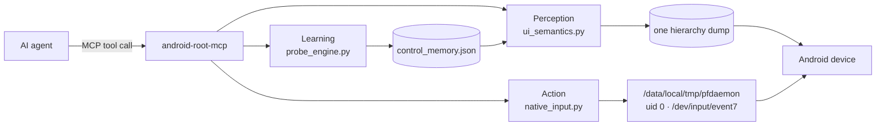

# android-root-mcp

**An MCP server that drives a rooted Android phone the way a person does: it reads what the operating system reports, and it remembers what happened the last time it touched something.**

Not a screenshot pipeline. Not OCR. Not a blind coordinate tapper.




---

## Why this exists

Every agent that touches Android hits the same wall, and it is not a latency wall. It is an **information** wall.

We audited how much the operating system actually tells a controller, across five real apps — 889 hierarchy nodes, every app foreground-verified before dumping:

| app | tappable nodes | named by the OS | bare |
|---|---:|---:|---:|
| launcher (`com.miui.home`) | 15 | 93.3 % | 6.7 % |
| notes (`com.miui.notes`) | 7 | 100 % | 0 % |
| browser (`com.quark.browser`) | 24 | 41.7 % | 58.3 % |
| settings (`com.android.settings`) | 14 | 21.4 % | 78.6 % |
| taobao (`com.taobao.taobao`) | 44 | 25.0 % | 75.0 % |
| **WeChat (`com.tencent.mm`)** | **0** | — | **100 %** |

- Only **43.3 %** of tappable controls carry any OS label. **56.7 % carry none.**
- **WeChat reports 44 hierarchy nodes with zero `clickable="true"`.** It draws custom views and handles touch in `onTouchEvent` without ever calling `setClickable(true)`. Any agent that enumerates controls by the `clickable` flag sees WeChat as an empty screen — and reports it confidently.
- Six richer accessibility fields never reach the dump on this ROM: `tooltip-text`, `state-description`, `pane-title`, `actions` / `action-list`, `input-type`, `important-for-accessibility`. `hint` appeared twice in 889 nodes.
- `dumpsys activity top` yields no view ids and no text on this ROM (verified: `mID=`, `mText`, `android:text` all zero lines).

An agent built on "screenshot → guess → tap" is therefore guessing on more than half the screen. This server takes the three positions that remain available: **read what the OS did say**, **watch what a control actually does**, and **say "unknown" when it is unknown**.

---

## What it costs

Measured through the real tool paths on a Xiaomi 2210132C (HyperOS 3.0.310, Android 16 / SDK 36, 1080×2400, KernelSU).

| operation | before | after |
|---|---|---|
| tap | 95–114 ms (`adb shell input tap`) | **40.8 ms** |
| swipe (300 ms gesture) | 664 ms | **310.9 ms** — 300 ms gesture + 11 ms overhead |
| key event | 75–114 ms | **16.5–41 ms** |
| 5-step workflow, no UI return | 663 ms | **215.9 ms** |
| 5-step workflow with UI return | 1028 ms | **597.4 ms** |
| `act` + observe, one round trip | — | **231 ms** |
| full hierarchy snapshot | — | ~330 ms |
| `screencap -p` end to end | 1895 ms | raw path **615 ms**, host decode 0.00 ms |

The "before" column is the ordinary path: `adb shell input tap` starts a JVM on every single call. The "after" column comes from a resident daemon that writes packed `input_event` structs straight to the touchscreen node.

---

## Architecture

### 1. Perception — `src/ui_semantics.py`

One hierarchy dump becomes typed, addressable controls:

| field | meaning |
|---|---|
| `role` | `button` / `icon_button` / `text_input` / `search` / `password_input` / `toggle` / `tab` / `list_item` / `nav_back` / `nav_close` / `slider` / `container` … |
| `label` + `label_source` | best human name, and **where it came from**: `text` \| `desc` \| `hint` \| `resource_name` |
| `actions` | only capabilities the OS actually reported for that node |
| `semantic_key` | stable identity — **contains no coordinates**: `com.miui.home\|button\|系统工具` |
| `region` | `top_bar` / `bottom_nav` / `dialog` / `content` / `floating` / `system_bar` / `left_rail` |
| `interactive_source` | `flag` (the OS said so) vs `inferred` (deduced from geometry, class, hierarchy) |

`interactive_mode="inferred"` recovers the controls the `clickable` flag loses — the WeChat case — while excluding full-viewport containers and sub-pixel dots. Inferred candidates are marked `needs_probe` and confidence-capped, so a caller can always tell a system fact from a deduction.

Cost: **51.1 ms for 2000 nodes**, deterministic to the byte across runs.

### 2. Action — `src/native_input.py` + `native/pfdaemon`

A resident root daemon (`app_process`, uid 0, `setsid`) writes packed `input_event` bursts to `/dev/input/event7`. ABS maxima are read from the hardware at startup (`maxX=14399`, `maxY=31999`, 13.333× scale) — not hardcoded. Fallback chain: `injectInputEvent` (binds as UID 2000, no root needed) → uiautomator2 → `adb input`.

The agent-facing verb returns the interaction **and** its consequence in one round trip:

```python
act(action="tap", selector={"semantic_key": "com.miui.home|button|天气"})
# -> {"success": true,
#     "effect": "opened a different screen (activity changed to ...)",
#     "snapshot_id": "...", "current_package": "..."}
```

Observation reuses the snapshot already cached from the caller's last look, so reporting what changed costs **one** capture, not two. There is no separate "now perceive again" step to forget.

### 3. Learning — `src/probe_engine.py` + `src/control_memory.py`

This is the answer to the 56.7 %. For a control the OS refuses to name, the server does what a person does: it touches the thing once and remembers.

1. Pick the highest-value unknown control on screen (unlabeled, not yet learned, content and bottom bars before system chrome).
2. Refuse anything destructive or financial — 删除 / 支付 / 退出登录 / uninstall / password fields — and **record the refusal** rather than pressing.
3. Tap it, diff the screen, persist the observed effect per `(package, activity, control identity)`.
4. Later `ui_describe` calls surface it as `learned_effect`.

`diff_screens` classifies `navigation` / `dialog_appeared` / `dialog_dismissed` / `scrolled` / `selection_changed` / `content_changed` / `no_visual_change`. Any node added or removed is always reported, so `no_visual_change` strictly means nothing detectable differs — and it is never treated as proof that a control is inert.

Cost: **9.45 ms** diffing 2000 × 2000 nodes.

---

## Quick start

### Requirements

- `adb` on `PATH` (or `ADB_PATH` pointing at it)
- A **rooted** device — KernelSU or Magisk. Root is a design requirement, not a convenience.
- Python **3.10+** (developed and measured on 3.12)
- Android SDK build-tools (`d8` + `android.jar`) — only to build the native daemon

### Install

```powershell
git clone https://github.com/<you>/android-root-mcp.git
cd android-root-mcp
python -m pip install -e .
.\install.ps1          # optional helper: checks adb, root, python, SDK
```

### Start the native input daemon

```powershell
# build, push, and start as root; prints the pidfile and the forwarded port
python native\run.py start
python native\verify.py ping          # -> uid 0, route "devnode", touch /dev/input/event7
```

If you skip this step the server still works — every gesture falls back to uiautomator2 and `adb input` — it is simply slower. Speed is the only thing you lose.

### Point your MCP client at it

```json
{
  "mcpServers": {
    "android-root": {
      "command": "android-root-mcp",
      "args": []
    }
  }
}
```

`pip install -e .` puts that console script on your `PATH`. If your client cannot launch a
console script, point it at your checkout instead:

```json
{
  "mcpServers": {
    "android-root": {
      "command": "python",
      "args": ["/absolute/path/to/your/checkout/src/server.py"]
    }
  }
}
```

Two environment variables are optional and only needed when the defaults do not fit:
`ADB_PATH` (when `adb` is not on `PATH`) and `ANDROID_MCP_STATE_DIR` (defaults to
`~/.android-root-mcp`).

### First three calls

**Perceive.** Ask the OS what is on screen. This is the call that replaces screenshots.

```json
{"name": "ui_describe", "arguments": {"max_controls": 40}}
```

Returns a one-line summary, an ordered control list carrying `role` / `label` / `actions` / `semantic_key` / `interactive_source`, the screen structure (top bar, ordered bottom-nav labels, dialogs, scroll containers, primary action), and a `coverage` block telling you how much the OS actually named.

**Act.** Address a control by identity, not by pixel. The response tells you what happened.

```json
{"name": "act", "arguments": {
  "action": "tap",
  "selector": {"semantic_key": "com.miui.home|button|天气"}
}}
```

```json
{ "success": true,
  "effect": "opened a different screen (activity changed to ...)",
  "effect_detail": { "classification": "navigation" },
  "snapshot_id": "…", "current_package": "…" }
```

**Learn.** Teach it the controls the OS will not name.

```json
{"name": "learn", "arguments": {"budget": 2}}
```

```json
{ "success": true,
  "rounds": [
    { "label": "天气",
      "effect": "opened a different screen (activity changed to ...)",
      "kind": "navigation" }
  ],
  "memory": { "screens": 1, "controls": 1 } }
```

Those learned effects are annotations on the next `ui_describe` — the same screen, now partly understood.

---

## How this differs

| | screenshot + OCR + blind tap | `uiautomator dump` only | **android-root-mcp** |
|---|---|---|---|
| How a control is identified | pixels | accessibility text | OS-reported role, label **with provenance**, stable `semantic_key` |
| When the OS has no label | OCR guess, often wrong | reports nothing | `label: ""` + `needs_probe`, then **learned by probing** |
| Apps that never set `clickable` | works, slowly | **sees an empty screen** | `interactive_mode="inferred"` recovers the candidates |
| Latency per tap | 1–2 s round trip | ~95–114 ms | **40.8 ms** |
| What a new screen costs | a screenshot into context | ~330 ms dump | one dump, typed, delta-addressable |
| Persistent knowledge | none | none | per-app control memory on disk |
| Fabrication | whatever the model infers | none | **none — unlabeled stays unlabeled** |

The distinction that matters: this server will tell you **"I don't know what this control is, here is where it is, and here is what happened when I tapped it."** That is more useful than a confident hallucination, and it is the only honest answer available for 56.7 % of real controls.

---

## Safety design

- **No OCR, no template matching, no vision.** Ever. Every semantic claim traces to a system-reported attribute or an observed consequence.
- **Nothing is fabricated.** A control with no name gets `label: ""`. There is no "unknown button 3".
- **Provenance is mandatory.** `label_source` and `interactive_source` let any caller separate a system fact from an inference, per field, per control.
- **`learn` refuses dangerous targets** — delete, pay, log out, uninstall, password fields — and records the refusal instead of pressing. Absence of a `clickable` flag is never grounds for refusal; that is the condition it exists to resolve.
- **Learned effects are observations, not claims** — stored with `observed_at` and the before/after snapshot ids they were derived from.

---

## Honest limitations

These are real and you should read them before adopting this.

- **Unicode text does not go through the native daemon.** HyperOS rejects key injection via `injectInputEvent`, the touchscreen node carries no keyboard usage codes, and there is no root clipboard CLI on this ROM. Text uses uiautomator2 `set_text`. Gestures are native; typing is not.
- **Controls without a `semantic_key` use a position-anchored geometric identity** (~43 px bucket). A list scrolled further than that will re-learn the row. Keying on document order instead would survive scrolling but mis-attribute after any insertion — re-learning is the safer failure. Controls that do carry a `semantic_key` are unaffected.
- **Rotation other than 0 is implemented but unverified** on this device.
- **A planned LSPosed module is designed but not built.** It would read the live `View` object (including whether an `OnClickListener` is attached) — the only route to naming controls that are invisible to both the accessibility dump and behavioural probing. Not shipped.
- **The persistent adb-shell accelerator was measured slower than plain adb** on this host (106 ms vs 66 ms per command) and is therefore gated off by default: `ANDROID_MCP_FASTPATH=1` to enable.
- **Root is required by design.** This is not a sandboxed or user-consent automation tool.

---

## Repository layout

| path | contents |
|---|---|
| `src/server.py` | FastMCP entry point, tool registration, single-flight lock |
| `src/ui_semantics.py` | perception layer: roles, labels, provenance, `semantic_key`, regions |
| `src/automation.py` | snapshot cache, selector resolution, gestures, `act`, `learn`, workflows |
| `src/native_input.py` | client for the resident input daemon |
| `src/probe_engine.py` | screen diffing, probe selection, safety guard |
| `src/control_memory.py` | persistent per-app control knowledge, atomic and bounded |
| `src/transport.py` | the single adb subprocess primitive |
| `src/advanced_controller.py` | live controller: transport, device selection, u2 session |
| `src/data_ops.py` | root file / XML / SQLite / archive operations |
| `src/device_ops.py` | app lifecycle, intents, permissions, settings |
| `native/pfdaemon/` | the input daemon (`Daemon.java`, built jar) |
| `native/run.py`, `native/verify.py` | daemon lifecycle and the verification harness |
| `native/osbridge/` | binder bridge experiment (launch/focus/settings without JVM spawn) — **not wired in** |
| `native/fallback.py` | `sendevent` degraded path |
| `tests/` | pytest suites: transport, automation, data, settings, MCP, stdio |
| `docs/ADAPTIVE-SEMANTICS.md` | full architecture write-up with the measurements |
| `docs/tool-schema.json` | generated schema for all tools |
| `install.ps1`, `pyproject.toml` | install helpers and packaging |

Roughly **57 MCP tools** across perception, action, workflows, app control, root data access, and device diagnostics.

---

## Scope

This project automates **devices you own and control**. It requires root and it injects input at the kernel input-node level; treat it with the same care as any other privileged automation, and do not point it at hardware you are not authorised to operate.

---

## 中文简介

**android-root-mcp** 是一个 MCP 服务器，让 AI 真正"会用手机"：不是截图、OCR、盲点坐标，而是读系统上报的控件，再靠动手观察学会系统不肯命名的那些。

### 要解决的问题

在一个 889 个节点、5 个真实 App 的实测里（每个 App 都先确认在前台）：

| App | 可点节点 | 系统给出名字 | 无名 |
|---|---:|---:|---:|
| 桌面（com.miui.home） | 15 | 93.3 % | 6.7 % |
| 便签（com.miui.notes） | 7 | 100 % | 0 % |
| 夸克（com.quark.browser） | 24 | 41.7 % | 58.3 % |
| 设置（com.android.settings） | 14 | 21.4 % | 78.6 % |
| 淘宝 | 44 | 25.0 % | 75.0 % |
| **微信** | **0** | — | **100 %** |

- 只有 **43.3 %** 的可点控件带系统标签，**56.7 % 什么都没有**。
- **微信 44 个节点里 `clickable="true"` 是零**——它自绘 View、在 `onTouchEvent` 里处理触摸，从不 `setClickable(true)`。任何靠 clickable 标志枚举控件的方案，都会把微信报成一块空屏。
- 这台 ROM 上还有 6 个富字段根本进不了 dump：`tooltip-text`、`state-description`、`pane-title`、`actions`/`action-list`、`input-type`、`important-for-accessibility`。`hint` 在 889 个节点里只出现两次。
- `dumpsys activity top` 在这台机器上拿不到任何 view id 和文本（`mID=`、`mText`、`android:text` 全为 0 行）。

所以本项目的立场只有三条：**系统说了就照抄，能动手就观察，不知道就说不知道。**

### 实测性能

| 操作 | 改造前 | 改造后 |
|---|---|---|
| 点击 | 95–114 ms | **40.8 ms** |
| 滑动（300 ms 手势） | 664 ms | **310.9 ms**（手势 300 + 开销 11） |
| 按键 | 75–114 ms | **16.5–41 ms** |
| 5 步流水线（不返 UI） | 663 ms | **215.9 ms** |
| 5 步流水线（返 UI） | 1028 ms | **597.4 ms** |
| 一次 `act` + 观察结果 | — | **231 ms** |
| 一次完整层级快照 | — | ~330 ms |
| `screencap -p` 端到端 | 1895 ms | 原始路径 **615 ms** |

提速来源是一个常驻 root daemon：直接往 `/dev/input/event7` 写打包的 `input_event`，不再每次调用都启动一个 `input` 进程的 JVM。ABS 上限从硬件读（maxX=14399、maxY=31999，13.333 倍缩放），没有硬编码。回退链依次是 `injectInputEvent`（免 root，UID 2000）→ uiautomator2 → `adb input`。

### 三层结构

1. **感知** —— 一次 dump 变成有类型的控件：`role`、带来源标注的 `label`（`text`/`desc`/`hint`/`resource_name`）、`actions`、不含坐标的稳定身份 `semantic_key`、`region`，以及标明"这是系统说的还是我推的"的 `interactive_source`。2000 个节点 **51.1 ms**。
2. **行动** —— `act()` 一次往返就同时返回"做了什么"和"结果是什么"，观察复用上一帧缓存，只多花一次截图。
3. **学习** —— `learn()` 专门对付系统不肯命名的控件：挑最该学的一个，危险词（删除/支付/退出登录/卸载/密码框）直接拒绝并记录，点它、比对前后、按 `(包名, Activity, 控件身份)` 落盘。下次 `ui_describe` 就以 `learned_effect` 带出来。2000×2000 节点比对 **9.45 ms**。

### 安全与边界

不做 OCR、不做模板匹配、不做视觉猜测；没有名字的控件 `label` 就是空字符串，**绝不编造**；每个字段都带来源标注；学习过程拒绝破坏性和支付类控件。已知短板也写在文档里：中文输入走不了原生 daemon（HyperOS 拒绝按键注入），无 `semantic_key` 的控件身份依赖位置（滚动超过约 43 px 会重新学），非 0 旋转未验证，LSPosed 模块只做了设计。

**需要 root，面向你自己拥有并有权操作的设备。**

---

MIT licensed. Architecture details and every measurement: [`docs/ADAPTIVE-SEMANTICS.md`](docs/ADAPTIVE-SEMANTICS.md).
