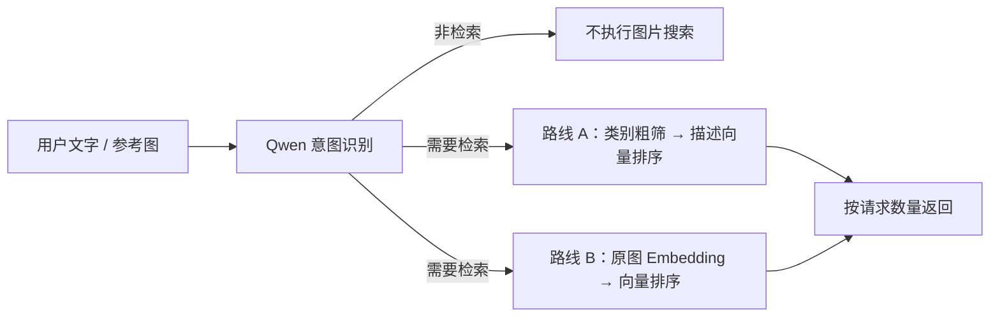

# 多模态检索实战：Qwen LoRA × Embedding 对比学习

[](https://github.com/liangjianshu/multimodal-image-retrieval/actions/workflows/tests.yml)
[](LICENSE)

[项目主页 / HTML 展示](https://liangjianshu.github.io/multimodal-image-retrieval/overview/) · [真实检索演示](https://liangjianshu.github.io/multimodal-image-retrieval/route-b/) · [学习路线](docs/LEARNING_PATH.md) · [实验报告](https://liangjianshu.github.io/multimodal-image-retrieval/study/) · [English](README.en.md)

**给一张图，找相似商品；写一句话，搜自己的图片库。** 从意图识别、Prompt 工程与 Qwen LoRA 微调，到 EmbeddingGemma 2 原图编码、多正样本 InfoNCE 对比学习，再到可复核的训练与评测。

这是一个适合学习**多模态检索、模型微调，以及 RAG / Agent 检索组件开发**的开源实践项目。可以先看结果，再换自己的数据，最后训练和验证模型。页面无需算力；自有数据接入与模型训练有独立指南。

[](https://liangjianshu.github.io/multimodal-image-retrieval/overview/)

## 从这里开始

| 你想做什么 | 入口 |
|---|---|
| 先看看项目能做什么 | [项目介绍与技术栈](https://liangjianshu.github.io/multimodal-image-retrieval/overview/) · [两张杯子的真实结果](https://liangjianshu.github.io/multimodal-image-retrieval/route-b/#explicit-two-cups) |
| 在自己电脑上打开演示 | [零模型依赖快速开始](docs/QUICKSTART.md)：含 12 张示例图，以及真实模型运行步骤 |
| 看清完整管线与训练分工 | [框架图与详细技术说明](docs/ARCHITECTURE.md) · [实验 / 上手分享图与 PDF](docs/social/README.md) |
| 系统地学习这些技术 | [学习路线：从演示到训练](docs/LEARNING_PATH.md) |
| 搜自己的商品图或素材库 | [换数据、建索引与检索](docs/CUSTOM_DATA.md) |
| 做 Qwen 微调或对比学习 | [Qwen SFT / LoRA](docs/TRAINING.md) · [Embedding 训练](docs/EMBEDDING_TRAINING.md) |
| 看模型真的提升了多少 | [固定图库报告](https://liangjianshu.github.io/multimodal-image-retrieval/study/) · [格式与类别消融](docs/QWEN_CONTROLS.md) |

### 本地打开演示：三条命令

```bash
git clone https://github.com/liangjianshu/multimodal-image-retrieval.git
cd multimodal-image-retrieval
python3 examples/quickstart.py
```

打开终端显示的网址。只需 Python 3.10+，无需 GPU、模型下载或 API Key；这是**已记录结果的交互回放**。想输入自己的请求、实际运行模型？继续看[快速开始第 2 步](docs/QUICKSTART.md#2-有模型运行环境用这-12-张图实际检索)。

## 技术栈：在这里能练到什么？

| 技术 | 本项目中的实践 |
|---|---|
| **多模态检索** | 支持文字、参考图及图文组合查询，对比语义描述与原图向量两条路线。 |
| **意图识别与路由** | Qwen 判断是否检索，提取主体、完整条件和返回数量；区分普通问答、图片描述与检索请求。 |
| **Prompt 工程** | 任务与字段定义、JSON 输出约束、示例引导；保留颜色／否定／修改条件，区分“返回几张”和“图里几个物体”，分别设计意图、类别与描述提示词。[实现与案例](docs/INTENT_AND_EMBEDDINGS.md#prompt-工程从自然语言到可执行查询) |
| **Qwen2.5-VL + LoRA / SFT** | 用正确类别 JSON 做监督微调；推理时生成类别与描述，构建语义索引。类别训练与描述生成的作用分别记录。 |
| **EmbeddingGemma 2** | 原图像素与查询直接编码，使用 768 维归一化向量与余弦相似度；具体模型和版本固定在配置中。 |
| **对比学习 / 多正样本 InfoNCE** | 文图／图图训练、困难负例、同类批内多正例；全参数微调与验证选参。 |
| **PyTorch / Transformers / PEFT** | 训练与推理、LoRA 适配器、混合精度、梯度检查点、模型保存与加载。 |
| **F1 / mAP + 消融实验** | 区分返回集合与排序质量，拆解格式恢复、类别筛选和描述排序带来的变化。 |
| **多模态 RAG / Agent 接入方向** | 已实现图片检索与意图路由，可作为检索组件或工具；回答生成、引用和完整 Agent 编排属于扩展方向。 |

当前不是完整的 RAG 问答系统。[这里解释如何从检索组件继续扩展](docs/LEARNING_PATH.md#多模态-rag-与-agent如何接上去)。作者微调权重尚未分发；默认配置可使用公开基座，复现微调版需要自行训练。

## 两条检索路线，共用 Qwen 意图识别

Qwen 先判断是否需要图片检索、提取需求和返回数量。知识问答、只描述图片等请求停止在意图阶段。两条路线的区别在检索部分：

| | 路线 A：Qwen 类别与描述 | 路线 B：原图 Embedding |
| --- | --- | --- |
| 意图识别 | Qwen | Qwen |
| 图库处理 | 新微调 Qwen 生成类别与描述，Taiyi 编码这些文字 | EmbeddingGemma 2 直接编码原图 |
| 检索 | 类别向量粗筛，再按描述向量排序 | 全图库原图向量直接排序，不做 Qwen 类别粗筛 |
| 参考图 | Qwen 提取目标描述；查询向量可融合 CLIP 参考图特征 | 参考图像素与完整文字联合编码 |
| 训练对象 | Qwen 类别 JSON 监督微调；描述为推理生成 | Embedding 的查询、正样本、困难负样本对比学习 |
| 当前展示 | 验证集选定的新 Qwen LoRA | **原始 2,000 张图库正式实验；保留微调前对照** |



两条路线都默认不设分数阈值。页面分别展示检索与非检索示例，保留实际分数、排序与失败案例；页面是已记录结果回放，不是实时模型服务。

[路线 A：类别与描述演示](https://liangjianshu.github.io/multimodal-image-retrieval/) · [路线 B：微调演示](https://liangjianshu.github.io/multimodal-image-retrieval/route-b/) · [路线 B：基座对照](https://liangjianshu.github.io/multimodal-image-retrieval/route-b-baseline/)

### 技术框架与代码导读

<a href="docs/ARCHITECTURE.md"></a>

[详细说明](docs/ARCHITECTURE.md)解释离线建库、在线查询、类别粗筛、向量融合、SFT 与 InfoNCE 的分工，并逐项链接到代码。框架图为逻辑概览；[Mermaid 源文件](docs/assets/retrieval-architecture.mmd)可编辑。

## 原始 2,000 张图库：正式测试结果

完成 **8 组配置、24 个验证检查点**，模型和阈值只通过验证集选择。训练／验证／测试分别为 4,500／1,000／2,000 张图片。以下统一使用五个重点类别的平均检索 **F1**；监督与评测均为类别相关性，不证明颜色、材质或同款商品匹配准确率。

| 检索版本（原始固定协议） | 文搜图 F1 | 图搜图 F1 |
|---|---:|---:|
| Qwen 基座链路 | 60.62% | 35.64% |
| 新 Qwen LoRA 链路 | **86.76%** | **81.86%** |
| 旧 Qwen LoRA 链路 | 51.59% | 28.92% |
| Embedding 基座 | 61.68% | 31.85% |
| 新 Embedding | **88.84%** | **83.40%** |

**Qwen 增益归因：**基座与微调模型已使用同一提示词、类别映射和生成参数，但严格 JSON 接口会把格式错误计为筛选失败。对两者统一做 JSON 结构归一化、重新仅在验证集校准阈值后，基座 F1 为 **76.07%／63.90%**，新微调仍为 **86.76%／81.86%**，对应 **+10.69／+17.96 个百分点**。这是冻结实验后的补充对照，不覆盖原始结果，也不等于纯视觉能力提升；固定类别筛选的进一步消融表明，本任务收益主要集中在类别筛选环节。[归因方法、全部对照及复现](docs/QWEN_CONTROLS.md)。

Embedding 原始固定协议下的 F1 增益为 **+27.16／+51.55 个百分点**，没有 Qwen JSON 筛选环节。两条路线的 mAP 同时保留在[完整报告与 CSV](https://liangjianshu.github.io/multimodal-image-retrieval/study/)中，避免混用 F1 和排序指标；单随机种子结果不作统计显著性声明。

**训练实现：**Qwen 采用正确类别 JSON 的 SFT，微调语言注意力 LoRA（`rank=64, alpha=128`），并对照联合训练视觉连接层；最佳为 `lr=1e-5, epoch=1, LLM LoRA`。Embedding 使用文图／图图查询、同类正例与其他类别负例，以**多正样本 InfoNCE** 全参数训练，将同类批内样本视为正例；最佳为 `lr=2e-6, temperature=0.1, epoch=1`。本轮联合训练 merger 未超过仅 LLM 的最佳验证配置。[数据恢复、协议与限制](docs/RESTORED_STUDY.md)。

**意图识别前期实测：**文本／图文准确率 **95%／91%**，沿用作者前期独立意图实验记录；本轮固定类别检索评测不包含意图识别，不能将这些数字视为本轮端到端复测结果。历史检索 F1 85%／81% 与 +6／+7 个百分点仅保留在[历史实验记录](docs/EXPERIMENTS.md)，不与本轮混算。

## 为什么路线 A 使用 Qwen

原始项目让 Qwen 同时生成物品类别和颜色、材质、形状、场景等描述，把图像内容变成可检索的显式语义。类别向量用于粗筛，描述向量用于排序；原始代码见 [类别与描述提示词](legacy/project_one/search_qwen.py) 和 [两阶段检索](legacy/project_three/multimodel_search.py)。

历史项目曾围绕易混淆类别构造 Qwen 微调数据；复核时发现，保留的数据生成脚本将部分负例的错误类别写成了 SFT 目标回答。这不能作为有效的类别区分训练证据，旧权重与当时数据版本的对应关系也尚未完全核实。当前支持的训练入口要求难例保留正确答案。向量相似不保证类别一致，类别粗筛可以排除部分跨类别候选，但收益需独立消融，不能归因于这批历史负例。

路线 B 直接学习检索向量，避免先转描述造成的信息损失。[Embedding 微调入口](docs/EMBEDDING_TRAINING.md)使用查询级相关性监督；是否优于路线 A，要由同一测试集决定。已有 Qwen 权重与训练经验保留在路线 A，路线 B 的训练进度与结果独立记录。

## 可以用在哪些场景

| 应用场景 | 用户怎么搜 | 接入自己的什么数据 |
| --- | --- | --- |
| **电商图搜商品 / 相似款发现** | 上传一张椅子或鞋子的图片，找外观相近的款式 | 商品图片、商品 ID、类别和属性描述 |
| **文字搜商品** | “红色木质椅子”“白色陶瓷咖啡杯” | 商品图片、类别与可见属性；商品标题可整理进描述 |
| **图片素材库 / 设计参考图检索** | “客厅里的红色沙发”，或上传参考图寻找相似素材 | 摄影图库、设计素材、家居参考图及描述 |
| **企业私有图片资料库** | 用自然语言找产品展示图、样品图和历史素材 | 自有图片目录及人工整理的类别/描述 |
| **业务数据库中的图片资产检索** | 先找到图片，再按结果 ID 查看对应商品或业务记录 | 将数据库里的图片 ID、文件路径和描述导出为 JSONL；结果按 ID 回查 |

这些是可适配的应用方向，当前提供命令行检索原型。找“视觉相似款”与严格识别“同品牌、同型号的同款”需要不同的数据和评测，后者尚未在本项目中验证。数据库场景采用**导出图片清单 → 检索 → 按 ID 关联业务记录**的接入方式，原生数据库连接器与业务界面需要自行集成。

## 安装与接入数据

Python 3.10+。模型推理与 Embedding 训练使用独立环境；先安装适配硬件的 PyTorch，再安装：

```bash
pip install -e '.[hybrid]'
python -m mmretrieval prepare --image-root data/images --output data/catalog.jsonl
```

图片清单采用 JSONL，一行一张图：

```json
{"id":"cup-001","file_path":"cups/001.jpg","categories":["杯子"],"description":"红色陶瓷杯"}
```

`file_path` 相对于图片根目录。路线 A 建库时由 Qwen 生成独立的检索类别/描述，人工标签用于训练或评测；路线 B 的检索不读取类别字段。原图与权重不会上传到外部推理 API。更多格式见[自有数据指南](docs/CUSTOM_DATA.md)。

## 运行路线 A（默认）

```bash
python -m mmretrieval --config configs/route-a-qwen-semantic.json index   --manifest data/catalog.jsonl --image-root data/images --output artifacts/index-a
python -m mmretrieval --config configs/route-a-qwen-semantic.json search   --index artifacts/index-a --image-root data/images --text '找两张红色椅子的图片'
```

`configs/default.json` 同样选择路线 A。公开配置使用 Qwen 基座；复现作者微调版本需在 `adapter` 中设置原 LoRA 路径。权重未随仓库分发。新入口将 Qwen 识别的目标类别用于粗筛，将完整文字/参考图用于描述排序；历史脚本曾用同一个查询向量做两阶段匹配，结果不应混记。

## 运行路线 B

```bash
python -m mmretrieval --config configs/route-b-embedding.json index   --manifest data/catalog.jsonl --image-root data/images --output artifacts/index-b
python -m mmretrieval --config configs/route-b-embedding.json search   --index artifacts/index-b --image-root data/images --text '找两张红色椅子的图片'
```

无需 `--intent`，两条路线每次查询都由 Qwen 解析。可添加 `--image queries/reference.jpg`。路线 B 建库不调用 Qwen，查询时的 Qwen 判断不用于类别过滤。

默认配置仍加载公开基座；作者训练权重未随仓库分发。[试训报告](docs/EMBEDDING_EXPERIMENT.md)记录了固定 297 张测试图库上的前后对照，不能当作细粒度条件检索收益。

**路线 B 微调：** 按 [训练指南](docs/EMBEDDING_TRAINING.md)准备三元组后运行 `train-embedding`，加载保存的 `inference-config.json` 并重建索引。微调分支与未微调基线明确区分，不把基线展示标成训练收益。

## 路线 A 的 Qwen 微调

如果只想接入自己的图片库，**不必先微调**。以下训练针对历史 Qwen 语义建库分支，使用独立 `.[models]` 环境；不是 EmbeddingGemma 2 的微调接口，也不会直接更新新编码器。

```bash
python -m mmretrieval make-sft \
  --manifest data/catalog.jsonl --image-root data/images \
  --hard-negatives examples/hard_negatives.json \
  --output data/sft --val-ratio 0.2 --seed 42

python -m mmretrieval --config configs/taiyi-clip.json train \
  --train data/sft/train.jsonl --val data/sft/val.jsonl \
  --image-root data/images --output checkpoints/mlp-llm \
  --mode mlp-llm --rank 64 --alpha 128 --epochs 0.5 --grad-accum 4
```

MLP 指视觉连接模块 `visual.merger`，不是所有 Transformer MLP。`mlp-llm` 对语言注意力做 LoRA，同时训练并保存 merger。每设备 batch size 为 1，通过梯度累积扩大有效 batch。

**难负例仍必须给出正确答案**：例如杯子图被问“主要物体是碗吗”，目标答案应为“否”。本项目构造的是监督问答难例，不是 InfoNCE 对比学习。生成问答前按图片内容哈希划分训练/验证，避免同图不同问法泄漏。

三种训练范围、适配器加载、完整视觉微调模型加载与注意事项见 **[训练指南](docs/TRAINING.md)**。

## 评测与复现

`evaluate` 接受包含 `id`、`text`/`image`、`relevant_ids` 的 JSONL 查询清单。固定测试数据、排除参考图自身、保持相同的 Qwen 意图和返回数量，比较检索指标、漏召回、跨类别错误和延迟。模型生成描述不等于人工真值。

- [演示与实跑记录](docs/DEMO.md)：12 张 CC0 图片、10 条请求，两条路线共用同一批 Qwen 意图输出。
- [Qwen 历史实验](docs/EXPERIMENTS.md)：作者报告的历史结果与现存权重验证边界。
- [验证记录](docs/VERIFICATION.md)：代码、真实模型和浏览器检查。
- [先前混合版记录](docs/demo/baseline-hybrid/results.json)：Qwen 类别筛选 + 未微调原图 Embedding，作为独立实验归档。

原 `taiyi-clip`、纯 `embeddinggemma2` 与 `qwen-gemma2` 配置仍可运行。当前两条路线分别是 `qwen-semantic`、`qwen-embedding`。索引不跨路线混用，更换 Embedding 权重必须重新编码图库。

```bash
pip install -e '.[models,dev]'  # 独立的历史训练/测试环境
pytest -q
python -m mmretrieval demo --output artifacts/demo
```

`demo` 使用合成向量，只验证程序连接。当前没有在线推理服务、增量索引、生产并发或独立向量数据库。`legacy/` 保存已清理凭据的历史代码；模型权重、COCO/ImageNet 原图和个人训练数据未公开。

## 来源与许可

个人多模态检索实践，未与淘宝或阿里建立关联。“商品图搜图”是应用场景，不代表其线上实现。项目代码使用 [MIT](LICENSE)，第三方代码及模型适用各自许可，详见 [来源](docs/PROVENANCE.md) 与 [第三方说明](THIRD_PARTY_NOTICES.md)。

## 交流与贡献

如果项目帮你理解了多模态检索或模型训练，欢迎 **Star 留作学习索引**。欢迎通过 [Issues](https://github.com/liangjianshu/multimodal-image-retrieval/issues) 分享可复现的失败案例、数据接入问题和带对照实验的改进；建议附上模型版本、请求、预期与实际结果。
