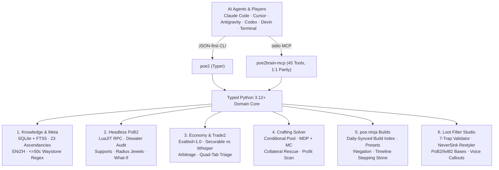

<div align="center">


<br/>

[](https://github.com/lifan-builds/poe2brain/actions/workflows/ci.yml)
[](#benchmark-how-accurate-is-poe2brain)
[](https://github.com/lifan-builds/poe2brain)
[-38bdf8?style=flat-square)](#11-mcp-tool--cli-command-reference)
[](#60-second-quickstart)
[](pyproject.toml)
[](LICENSE)

<h3>
  Give Claude Code, Cursor, Antigravity, Codex, or Cherry Studio<br/>
  real Path of Exile 2 (<code>0.5.5</code>) math — zero PoE1 hallucinations, zero <code>POESESSID</code>.
</h3>

<p>
  <a href="README.md"><strong>English</strong></a> ·
  <a href="README_ZH.md"><strong>简体中文</strong></a> ·
  <a href="docs/zh/QUICKSTART_WINDOWS.md">Windows 保姆安装</a> ·
  <a href="docs/zh/AGENT_SETUP.md">AI 助手接入与提示词</a> ·
  <a href="docs/zh/PLAYBOOKS.md">六大实战工作流</a>
</p>

</div>

> **中文玩家请直接点这里：** [**简体中文完整说明 (`README_ZH.md`)**](README_ZH.md) ｜ [**Windows 零编译保姆安装**](docs/zh/QUICKSTART_WINDOWS.md) ｜ [**AI 客户端接入与提示词**](docs/zh/AGENT_SETUP.md)
>
> **不会命令行？** 直接把仓库地址 `https://github.com/lifan-builds/poe2brain` 发给你的 AI 助手（Claude Code / Cursor / Codex / Antigravity），说一句 *「帮我把 poe2brain 克隆下来并按 README_ZH.md 装好依赖、初始化 PoB2 并接入 MCP」* 即可全自动完成！
>
> **Inspiration & Shoutout:** Inspired by **[流放降临-某雷](https://space.bilibili.com/2132384)** and [`exilemoulei/pob4agents`](https://github.com/exilemoulei/pob4agents) for pioneering agentic *Path of Exile 1* workflows. `poe2brain` is an independent clean-room engine built from the ground up specifically for **Path of Exile 2 (`0.5.5`)** — if you play PoE1, go check out [`pob4agents`](https://github.com/exilemoulei/pob4agents)!

---

## Why `poe2brain`?

General-purpose LLMs constantly hallucinate **Path of Exile 1** mechanics onto **Path of Exile 2** — quoting `75%` Block caps, Scouring Orbs, Crafting Bench mods, removed `0.4` Homogenising Omens, or fake PoB-warrior DPS inflated by unsustainable flasks and 100% Shock.

**`poe2brain`** replaces guesswork with a single typed Python 3.12+ engine exposing **45 MCP tools** (`poe2brain-mcp`) and **1:1 JSON CLI commands** (`poe2 ... --json`) backed by live headless **PathOfBuilding-PoE2**, an offline Patch `0.5.5` SQLite + FTS5 database, official `trade2` pricing, exact crafting probability solvers, and a self-validating loot filter studio.

| Problem Players & AI Agents Hit | Generic LLM / Ad-Hoc Scripts | `poe2brain` (`Patch 0.5.5`) |
| :--- | :--- | :--- |
| **PoE1 vs PoE2 Mechanics** | Hallucinates 75% Block, Scouring/Alt, Bench, PoE1 bases | **SQLite + FTS5 truth**: 769 GGG popups, 54 `0.5.5` anti-hallucination rules, 23 Ascendancies, EN + `zh-CN`/`zh-TW` |
| **Fake PoB-Warrior Numbers** | Trusts inflated 100% Shock / flask-up tooltip DPS | **Headless LuaJIT PoB2** (`GetMiscCalculator()`) with automatic **dewatering audits** + top-5 upgrade `bottlenecks` |
| **Finding Hidden Builds** | Scrapes stale guides or top-1 meta mirror builds | **Daily-synced PoB2-audited build index** (GitHub Actions rolling release + SQLite cache): `--preset sleeper` ranks real DPS × move speed × rarity in `<1s` |
| **Trade Price-Fixers & Traps** | Blends fake 1-Exalt whisper spam with real buyouts | Splits **Instant Buyout (`securable`, Gold fee)** vs **Whisper**, deduplicates fixers, and normalizes `+20%` Quality + Runes |
| **Crafting Cost Guessing** | Eyeballs odds or recommends removed `0.4` Omens / `0.5` Recombinators | **Exact conditional mod-pool MDP + Monte Carlo** (`p50`/`p80`/`p95`) with mid-craft collateral brick protection |
| **Loot Filter Clutter & Crashes** | Hand-written `.filter` rules crash PoE2 or miss `ilvl 82` / Exceptional bases | **7-trap `0.5.5` compiler, NeverSink restyler & Filter Doctor**: live economy tiers, PoB2 + Exceptional (`21%+`/`3-socket`) crafting bases, EN/ZH voice callouts |
| **Account Safety & Windows Setup** | Asks for `POESESSID` cookies or breaks compiling C/Lua on Windows | **Zero `POESESSID`** (Local PoB2 sync + official GGG OAuth 2.1 PKCE); **zero C compiler needed on Windows** |

---

## Benchmark: How Accurate Is `poe2brain`?

To measure accuracy objectively, we built **[`PoE2Bench-0.5.5`](benchmarks/README.md)** — a reproducible **22-question, 75-check** offline benchmark spanning all 6 pillars (Patch `0.5.5` Mechanics, EN/`zh-CN` Roster & Bases, Exact Conditional Crafting Math, Atlas & Waystone Regex, Headless PoB2 Auditing/Swaps/HC/Runes/What-If, and Loot Filter Validation). Both arms ran the **exact same frontier model (`gpt-6.2-astra`)** with zero web search and identical decoded plain-text `.xml` PoB2, `.filter`, and clipboard fixture files:

| Metric (`gpt-6.2-astra`, same model, 0 web search) | Without `poe2brain` | With `poe2brain` | Improvement |
| :--- | :---: | :---: | :---: |
| **Exact Task Pass Rate** | 6 / 22 (`27.3%`) | **22 / 22 (`100.0%`)** | **+72.7 pp (`3.7×`)** |
| **Sub-Check Factual Accuracy** | 38 / 75 (`50.7%`) | **75 / 75 (`100.0%`)** | **+49.3 pp** |
| **PoE1 / Stale-Patch Hallucinations** | 4 / 22 (`18.2%`) | **0 / 22 (`0.0%`)** | **Zero hallucinations** |

### Sample Benchmark Questions (Without vs. With `poe2brain`)

| # | Real Player Question (`Patch 0.5.5`) | Without `poe2brain` | With `poe2brain` |
| :--- | :--- | :--- | :--- |
| **Q02** | Base passive Block cap, `Glancing Blows` keystone effect, and `Deflection` mitigation % & cap? | ❌ Hallucinated PoE1 `75%` Block cap & PoE1 rules | ✅ **`50%` Block cap**, **Evade Unlucky / Deflect Lucky**, **`40%` / `95%` cap** |
| **Q09** | On an `ilvl 82` Rare `Warmonger Bow`, compare `Greater` vs. `Perfect Exalted Orb` odds to hit T1 `% Physical Damage` (weight 25) | ❌ Cannot compute `0.5.5` affix pool weights (symbolic formula only) | ✅ **Exact pool math:** `40,482` weight (`0.0618%`, `1,619.3` tries) vs. `24,782` weight (`0.1009%`, `991.3` tries — `1.634×`) |
| **Q10** | `0/2/4/6`-mod Waystone revives, Tablet placement, 3 Patch `0.5` Atlas Masters, and `0.5.5` Sacred Blooms | ❌ Wrong `6` revives on 0-mod; couldn't name Atlas Masters or Sacred Blooms | ✅ **`5/4/2/0` revives**, Map Device Tablets, **`Jado / Hilda / Doryani`** (1 active), **Viridian Wildwood / Azmeri Wisps** |
| **Q12** | Compile a `<=50`-char PoE2 negated stash regex hiding all 6 CI/ES (`es_ci`) brick Waystone hazards | ❌ Put `!` inside quotes (`"!m player r\|..."`, broken PoE2 syntax) | ✅ **`!"buil\|ever\|of l\|pene\|weak\|player r"`** (**36 chars**, 6/6 hazards, `0` FP/FN) |
| **Q17** | Legal 6-link dewatered support swap (`--best-swap --dewater`) on 5/5-filled Amazon Ice Shot + verify `Elemental Focus` Int req | ❌ Could not find weakest support, legal swap DPS, or recalculated Int requirement | ✅ Auto-replaced weakest #4 **`Stoicism II`** with **`Hit and Run`** (`121,674 → 170,344`, **`+40.0%`**); #2 `Elemental Focus` (`+23.98%`, `attributes_met_after = true`) |
| **Q19** | Balanced Rune & Soul Core optimization (`--offline-prices`) preserving Socket-bound augments + true net PoB2 swap delta | ❌ Used stale `+7%` Tacati value (wasting 7 cores instead of 3); could not compute net DPS/EHP delta | ✅ Preserved locked **`Kolr's Hunt`** (`11/12` sockets), **3 `Soul Core of Tacati`** (`21% → 60%` Chaos), true net **`-43,108 DPS / +2,017 EHP`**, offline cost `null` |
| **Q22** | Exact `what-if` (`multiplierRage=0` only) DPS drop + offline quad-tab triage (`--no-live-trade`) | ❌ Mental math divided by `1.30` (`183,020`, `-23.1%` — off by ~9.5 pp!) | ✅ Exact **`237,993 → 160,418 (-32.6%)`**; offline triage: Normal `ilvl 82` wand `3P/3S` open, ring `salvage_or_vendor` |

> Full 22-question suite, per-pillar breakdown, archived raw transcripts ([`benchmarks/results/codex_0_5_5.json`](benchmarks/results/codex_0_5_5.json)), and reproduction instructions: **[`benchmarks/README.md`](benchmarks/README.md)**. Re-score deterministically in 1 second:
> ```bash
> uv run python benchmarks/run_benchmark.py score benchmarks/results/codex_0_5_5.json
> ```

---

## Real Output Showcase

### 1. Find Underrated High-DPS, High-Mobility Builds in 1 Command

```bash
uv run poe2 ninja search --preset sleeper --limit 5
```

```text
     poe.ninja Builds — Forbidden Rites (matched 59/345 | preset=sleeper | sort=sleeper)
┏━━━━━━━━━━━━━━━━━━┳━━━━━━━━━━━━━━━━━━━━┳━━━━━┳━━━━━━━━━━━━━━━━━━━┳━━━━━━━━━━━━┳━━━━━━━━┳━━━━━━━┓
┃ Character        ┃ Ascendancy         ┃  Lv ┃ Main Skill        ┃        DPS ┃    EHP ┃  Move ┃
┡━━━━━━━━━━━━━━━━━━╇━━━━━━━━━━━━━━━━━━━━╇━━━━━╇━━━━━━━━━━━━━━━━━━━╇━━━━━━━━━━━━╇━━━━━━━━╇━━━━━━━┩
│ popyj            │ Pathfinder         │ 100 │ Ice Shot          │ 15,150,400 │ 29,631 │ 1.99x │
│ 一阿克一         │ Pathfinder         │  99 │ Ice Shot          │ 15,093,062 │ 23,467 │ 2.04x │
│ Noxious_Fu...    │ Acolyte of Chayula │ 100 │ Poisonburst Arrow │  5,652,710 │ 36,369 │ 1.71x │
│ EightChall...    │ Shaman             │ 100 │ Spark             │  7,113,825 │ 24,586 │ 1.98x │
│ 风枪锐眼         │ Pathfinder         │ 100 │ Ice Shot          │  3,979,867 │ 21,084 │ 2.17x │
└──────────────────┴────────────────────┴─────┴───────────────────┴────────────┴────────┴───────┘
```

### 2. Everyday Power Commands (Fewer Flags, Smarter Defaults)

```bash
# Dewatering audit + automatic top-5 bottleneck diagnosis + mobility & CI immunity
uv run poe2 pob audit --slot main

# Exact PoB2 formula provenance, Tier I-III + Lineage support sweep, and Controlled Metamorphosis rings
uv run poe2 pob calc-breakdown EnergyShield --slot main
uv run poe2 pob supports --slot main --max-tier 2 --no-lineage
uv run poe2 pob radius-jewels --jewel "Controlled Metamorphosis" --slot main

# Live trade2 Instant Buyout upgrades ranked by real PoB2 gain (auto-simulating +20% Quality & Runes)
uv run poe2 trade upgrades --equip-slot "Weapon 1" --max-exalted 50 --securable-only --slot main

# Unified capital/Gold arbitrage scan (accepts '500' Exalted or '5d' Divines) & profitable craft scanner
uv run poe2 econ arbitrage --budget 5d --gold 50000
uv run poe2 craft profit --budget mid

# PoB2-aware <=50-char Waystone & Precursor Tablet stash regexes (with 0..6 mod revive schedule)
uv run poe2 wiki regex --slot main

# PoB2-tailored 0.5.5 loot filter (live economy, ilvl 82/Exceptional bases, EN/ZH voice callouts)
uv run poe2 filter generate --slot main --strictness strict \
  --look "obsidian gold voice callout" --out my_build.filter --install
```

---

## Architecture & Six Pillars



<details>
<summary><strong>Deep Dive: What's Inside Each of the Six Pillars</strong></summary>

1. **Knowledge, Ascendancies & Live Ladder Meta (`poe2brain.knowledge`)** — Read-only SQLite + FTS5 index (`data/poe2_0.5.5.sqlite`) over **769** official GGG `KeywordPopups`, **54** Patch `0.5.5` anti-hallucination rules & formulas, **1,711** gems, **435** uniques, **3,219** live PoE2 bases (catching PoE1 / stale `0.1` `Expert ` base traps), **313** socketable augments, **293** crafting levers, and **882** Verisium/Kalguuran runeforge recipes, plus `MetaService` (`TreeData/0_5` **8 playable classes & 23 Ascendancies**, `Abyssal Lich` inheritance, choice notables, bilingual `zh-CN`/`zh-TW` aliases, and live SC/HC/SSF/HCSSF ladder shares).
2. **Headless Path of Building 2 (`poe2brain.pob`)** — Persistent native `LuaJIT` + `PathOfBuilding-PoE2` (`tree 0_5`) JSON-RPC 2.0 daemon supporting multi-slot builds (`main`, `ref`, `candidate`), `eN...` / `poe.ninja` / `poe2db.tw` / `maxroll.gg` / `pobb.in` / XML / GGG `.build` JSON I/O, **dewatering audits with automatic upgrade bottlenecks**, `explain_calc` formula provenance, `rank_support_gems`, `rank_radius_jewels`, transactional `what_if` sandboxing, `<10ms` `GetMiscCalculator()` item sweeps, and marginal `trade2` stat weights.
3. **Live Economy, Arbitrage & Official Trade2 (`poe2brain.trade`)** — 3-tier pricing router normalized to **`Exalted Orb = 1.0`** combining `api.poe2scout.com` + `poe.ninja` exchange overviews with unauthenticated `pathofexile.com/api/trade2` (`GGGRateLimiter` + `1.0s` buffer), `ArbitrageScanner` (`--budget`/`--gold`, `profit_ex_per_10k_gold`, compounding ladders, trap filters), `Exiled-Exchange-2`-backed EN/ZH `Ctrl+C` / `Ctrl+Alt+C` item parsing, **Instant Buyout (`securable` Gold fee) vs Whisper** splitting, and multi-item quad-tab triage.
4. **Exact Crafting Odds, Policy & Profit Scanner (`poe2brain.crafting`)** — Conditional `ModPoolEngine` (`display_tier = 1` best, tiered orb `min_mod_level` floors, family mutual exclusion, dynamic elemental tag-blocking, 3-draw without-replacement Well of Souls unveil, `Omen of Whittling`, cross-pool `Crystallisation`, blocking removed `0.4` Homogenising Omens & `0.5` Recombinators) + sunk-cost-disciplined `CraftingPlanner` (`4-mod Fracturing Orb`, `p50`/`p80`/`p95` Monte Carlo, buy-vs-craft) + `CraftProfitScanner` with automatic `competition_level` & `niche_score`.
5. **PoE Ninja Builds Discovery & Live Character Import (`poe2brain.ninja`)** — Live `poe.ninja` `build-index-state` & `snapshot-versions` telemetry across SC/HC/SSF/HCSSF, pure-stdlib `SearchResult` protobuf + `NDIC\x02` decoder, `<2ms` `<PathOfBuilding2>` XML inspector, multi-facet search with **5 intent presets**, **`!Term` negation**, and a **runtime SQLite `BuildStore`** (`~/.cache/poe2brain/builds.sqlite`) synced via ETag from the daily GitHub Actions rolling `build-index` release (plus write-through caching on live imports and time-machine budget stepping-stone discovery).
6. **PoB2-Aware Loot Filter, NeverSink Restyler & Voice Callout Studio (`poe2brain.filters`)** — Self-validating PoE2 `0.5.5` `.filter` compiler & `FilterValidator` enforcing all 7 client-crash traps, live economy tiering, PoB2 build-priority + Exceptional (`21%+` quality / `3+` sockets) + `ilvl 81/82` jewellery & weapon crafting bases, clean endgame Uncut Gem / Flask / Charm clutter pruning, **8 WCAG-verified visual presets** (plus optional CVD-safe & night-mode modifiers), pure-stdlib `44.1 kHz` `16-bit` stereo `.wav`/`.mp3` synth + bilingual EN/ZH `voice_callout` packs, `NeverSink` `0.10.4a` auto-healing & restyling, Filter Doctor (`poe2 filter heal`), and interactive HTML drop previews.

</details>

---

## 60-Second Quickstart

**Requirements:** Python `3.12+` and [`uv`](https://docs.astral.sh/uv/getting-started/installation/).

```bash
git clone https://github.com/lifan-builds/poe2brain.git
cd poe2brain
uv sync

# Bootstrap headless PathOfBuilding-PoE2 runtime into ~/.cache/poe2brain/pob2
# • Windows: zero C compiler needed (auto-reuses local PoB2 or pulls MIT x64 lua51.dll)
# • macOS / Linux: compiles LuaJIT 2.1 + luautf8 automatically
uv run poe2 bootstrap pob2

# Verify engine, SQLite 0.5.5 gamedata DB, and PoB2 runtime readiness
uv run poe2 version --json
```

> **Windows 中文用户？** 请直接查看保姆级图文命令指南：[docs/zh/QUICKSTART_WINDOWS.md](docs/zh/QUICKSTART_WINDOWS.md)
>
> **Optional web preview:** A lightweight browser playground is also hosted at [poe2brain.clifan.com](https://poe2brain.clifan.com/) (hosted overseas; local CLI/MCP above provides the full offline/headless PoB2 feature set).

### Importing Your Character (Day-1 Friendly, Zero `POESESSID`)

- **Option 1 — Zero-Auth Local PoB2 Sync (Works Immediately):** Auto-discovers builds saved in your desktop Path of Building (PoE2) folder:
  ```bash
  uv run poe2 pob import-local --list
  uv run poe2 pob import-local --slot main
  ```
- **Option 2 — Official GGG OAuth 2.1 PKCE (Same Official Flow as PoB2):**
  ```bash
  uv run poe2 auth login
  uv run poe2 pob import-character --list
  uv run poe2 pob import-character "<CharacterName>" --slot main
  ```
- **Option 3 — `poe.ninja` Character URL or Any PoB2 Share Code (`poe2db` / `maxroll` / `pobb.in`):**
  ```bash
  uv run poe2 ninja character "<poe.ninja_url>" --load-pob --slot main
  uv run poe2 pob load "<eN..._code_or_pobb.in_url>" --slot main
  ```

---

## Connecting to Your AI Assistant

`poe2brain` ships ready-to-use manifests across major agent harnesses out of the box:

- **Claude Code / Cursor:** Open this repo directly (uses [.mcp.json](.mcp.json)), or add globally via the snippet below.
- **Antigravity:** Ready-to-load plugin manifest in [plugin.json](plugin.json), workspace MCP config in [.agents/mcp_config.json](.agents/mcp_config.json), and skill in [.agents/skills/poe2brain/SKILL.md](.agents/skills/poe2brain/SKILL.md).
- **Devin:** Workspace MCP config in [.devin/mcp_config.json](.devin/mcp_config.json).
- **Codex CLI / Shell Agents:** Invoke `uv --directory /path/to/poe2brain run poe2 ... --json` directly.

<details>
<summary><strong>Copy-Paste MCP Config (Claude Desktop / Cursor / Cherry Studio / Generic MCP)</strong></summary>

```json
{
  "mcpServers": {
    "poe2brain": {
      "command": "uv",
      "args": ["--directory", "/ABSOLUTE/PATH/TO/poe2brain", "run", "poe2brain-mcp"]
    }
  }
}
```

Manual stdio launch:

```bash
uv run poe2brain-mcp
```

</details>

---

## 1:1 MCP Tool & CLI Command Reference

Every single MCP tool maps 1:1 to a `poe2 ... --json` CLI command over the exact same typed domain services (**45 tools total**):

<details open>
<summary><strong>Expand / Collapse Full 45-Tool Reference Table</strong></summary>

| Pillar | MCP Tool (`poe2brain`) | CLI Command (`uv run ...`) | Purpose |
| :--- | :--- | :--- | :--- |
| **Health** | `poe2_status` | `poe2 version --json` | Verify patch (`0.5.5`), default league (`Forbidden Rites`), SQLite DB, and headless PoB2 readiness. |
| **Knowledge** | `poe2_search_knowledge` | `poe2 wiki search "<query>" [--category <cat>] [--limit 12] --json` | FTS5 + exact search across 769 GGG `KeywordPopups`, 54 anti-hallucination rules, 1,711 gems, 435 uniques, 3,219 live bases, 313 augments, 293 levers, and 882 runeforge recipes. |
| **Knowledge** | `poe2_explain_mechanic` | `poe2 wiki mechanic "<topic>" --json` | Authoritative `MechanicFact` (`poe1_trap`, `poe2_live_rule`, `formula_expr`) + official GGG keyword popups. |
| **Knowledge** | `poe2_inspect_gem` | `poe2 wiki gem "<name>" --json` | Active, Spirit, Meta, Tiered Support (`I`/`II`/`III`), and `lineage_support` (`max_copies_per_char=1`) gem inspection. |
| **Knowledge** | `poe2_inspect_base` | `poe2 wiki base "<name>" [--ilvl 82] --json` | Base properties, implicits, `display_tier=1` affixes at `ilvl`, and PoE1 / stale `Expert ` trap warnings. |
| **Knowledge** | `poe2_inspect_unique` | `poe2 wiki unique "<name>" --json` | Unique base type, implicits, explicits, and `is_chanceable` status. |
| **Knowledge** | `poe2_inspect_augment` | `poe2 wiki augment "<query>" --json` | Runes, Soul Cores, Azmeri Idols, Shaman `Bonded:` bonuses, and Verisium / Kalguuran Remnant recipes. |
| **Knowledge** | `poe2_inspect_ascendancy` | `poe2 wiki ascendancy ["<name_or_class>"] [--class <cls>] --json` | List all 23 PoE2 `0.5.5` Ascendancies (8 classes) or inspect notables, choice nodes, and PoE1/`1.0` traps. |
| **Knowledge** | `poe2_meta_ladder` | `poe2 wiki meta [--league "Forbidden Rites"] --json` | Live SC/HC/SSF/HCSSF ladder shares, Ascendancy tier rankings, and liquid chase item demand signals. |
| **Knowledge** | `poe2_waystone_regex` | `poe2 wiki regex [--slot <slot>] [--archetype <csv>] [--avoid <csv>] [--want <csv>] [--tablet-want <csv>] [--min-waystone-drop 120] [--min-pack-size 20] [--item-text "<ctrl_c>"] --json` | Compile verified `<=50`-char PoE2 Waystone brick/safe/juicing & Precursor Tablet stash regexes + `0..6` mod revive schedule. |
| **PoB2** | `poe2_pob_load` | `poe2 pob load <code_url_or_file> [--slot main] --json` | Load `eN...` share code, `poe.ninja` / `poe2db.tw` / `maxroll.gg` / `pobb.in` URL, PoB XML, or GGG `.build` JSON into a persistent named slot. |
| **PoB2** | `poe2_pob_stats` | `poe2 pob stats [--slot main] --json` | Extract `FullDPS`, `TotalEHP`, `Life`, `ES`, `Mana`, `Spirit`, resists, `chaos_immune`, Max Hits, `movement_speed_mod`, `attack_cast_speed`, crit, `Block`, `Deflection`, `Evasion`, `Armour`. |
| **PoB2** | `poe2_pob_audit` | `poe2 pob audit [<code_url_or_file>] [--slot main] --json` | **Dewatering audit**: strip PoB-warrior config inflation and return sustainable Pinnacle stats, culprits, and actionable `bottlenecks`. |
| **PoB2** | `poe2_pob_compare` | `poe2 pob compare [--slot-a early] [--slot-b main] [--dewater] --json` | Compare two persisted PoB2 slots across DPS/EHP, gear/uniques, skills, passives, and exact `0.5.5` Gold respec cost. |
| **PoB2** | `poe2_pob_hc_audit` | `poe2 pob hc-audit [<code_url_or_file>] [--slot main] [--top-nodes 5] --json` | Audit HC Pinnacle Boss Max Hits, Bleed/Poison ES bypass, Chaos `2x` ES vulnerability, Charms, and top defensive EHP respecs. |
| **PoB2** | `poe2_pob_eval_item` | `poe2 pob eval-item --equip-slot "<slot>" --item-text "<text>" [--slot main] --json` | Non-destructive `GetMiscCalculator()` item swap returning `ItemUpgradeDiff` (`full_dps_delta`, `total_ehp_delta`, `spirit_unreserved_delta`). |
| **PoB2** | `poe2_pob_stat_weights` | `poe2 pob weights --equip-slot "<slot>" [--objective balanced\|dps\|ehp] [--slot main] --json` | Compute marginal PoB2 stat weights (`SlotStatWeights`) and unauthenticated-safe `trade2` filter JSON. |
| **PoB2** | `poe2_pob_suggest_nodes` | `poe2 pob nodes [--mode perPoint\|total\|anoint\|megalomaniac] [--slot main] [--top 10] --json` | Rank reachable passive notables (`perPoint`/`total`), Amulet anoints (`anoint`), or `Megalomaniac` 2–3 notable combos + clickable `trade2` URL (`megalomaniac`). |
| **PoB2** | `poe2_pob_optimize_runes` | `poe2 pob runes [--slot main] [--objective balanced\|dps\|ehp\|spirit\|rarity] [--max-budget <ex>] --json` | Solve Armour/Weapon Rune & Soul Core Resist Tetris & socket optimization using SQLite `0.5.5` slot effects and transactional PoB2 DPS/EHP/Resist verification. |
| **PoB2** | `poe2_pob_calc_breakdown` | `poe2 pob calc-breakdown "<query>" [--slot main] [--skill-group <idx>] [--max-mods 40] --json` | Inspect exact PoB2 calculation formulas & `BASE`/`INC`/`MORE`/`FLAG` modifier provenance grouped by source (`CalcBreakdownReport`). |
| **PoB2** | `poe2_pob_supports` | `poe2 pob supports [--slot main] [--group <idx>] [--replace-slot <n>] [--replace-gem "<name>"] [--max-tier <1..3>] [--lineage/--no-lineage] [--top 15] --json` | Rank all compatible PoE2 `0.5.5` Support Gems (Tier `I`–`III` + Lineage) by DPS/EHP delta, Mana sustain, Spirit overflow, and Lineage `max_copies=1` conflicts. |
| **PoB2** | `poe2_pob_radius_jewels` | `poe2 pob radius-jewels [--jewel "<jewel>"] [--slot main] [--stat FullDPS] [--max-dist 10] [--top 10] --json` | Rank Passive Tree Jewel Sockets × radius rings (`Controlled Metamorphosis` / `Against the Darkness`) by per-point gain & travel points saved. |
| **PoB2** | `poe2_pob_what_if` | `poe2 pob what-if [--slot main] [--equip "Slot=TextOrPath"] [--edit-slot "<slot>" --add-mod "<line>" --remove-mod "<sub>" --set-quality 20] [--alloc-node <id>] [--dealloc-node <id>] [--config k=v] [--borrow-from <ref> --borrow-slot "<slot>"] [--scenario-matrix] [--apply] --json` | Transactional multi-change PoB2 hypothesis sandbox (`WhatIfReport`) with per-piece attribution, 3-scenario matrix, and automatic rollback. |
| **PoB2** | `poe2_pob_import_local` | `poe2 pob import-local [<name_or_path>] [--dir <builds_dir>] [--slot main] [--list] --json` | Discover or load saved local Path of Building (PoE2) `.xml` builds directly (zero-auth Day-1 sync on Windows/macOS/Linux). |
| **PoB2** | `poe2_pob_import_character` | `poe2 pob import-character [<character_name>] [--realm poe2] [--slot main] [--list] --json` | List or import private/Day-1 PoE2 characters via official GGG OAuth 2.1 PKCE (`poe2 auth login`, zero `POESESSID`). |
| **Economy** | `poe2_currency_price` | `poe2 econ price "<query>" [--league "Forbidden Rites"] --json` | Live `CurrencyQuote` normalized to `{exalted, chaos, divine}` (`Exalted = 1.0`) with 7d trend and volume. |
| **Economy** | `poe2_market_scan` | `poe2 econ scan [--category <cat>] [--min-volume-divine 5.0] [--league "Forbidden Rites"] --json` | High-liquidity exchange movers, numeraire-normalized cross-source spreads, and chanceable Uniques. |
| **Economy** | `poe2_boss_ev` | `poe2 econ bosses [--encounter <id>] [--league "Forbidden Rites"] --json` | Live Pinnacle Boss & Trial entry costs vs chase unique drops (Arbiter, Xesht, Simulacrum, King in the Mists, Olroth, Sekhema, Trialmaster) with jackpot ratios & variable-roll notes. |
| **Economy** | `poe2_farming_strategy` | `poe2 econ farming [--stage day1\|early\|mid\|endgame] [--budget 100\|5d] [--focus balanced\|steady\|jackpot\|speed] [--slot main] --json` | Rank Patch `0.5.5` league-start & Atlas farming loops (Fortress Rush, Expedition, Ritual+Wildwood, Breach, Sekhema, Chaos, Delirium, Boss Rush, Negative-IIR) with live prices, Atlas Masters (`Jado`/`Hilda`/`Doryani`), Tablets, IIR guidance, and optional PoB2 build-fit scoring. |
| **Economy** | `poe2_scan_arbitrage` | `poe2 econ arbitrage [--budget 500\|5d] [--gold <g>] [--ladder-target-divine <d>] [--min-volume-divine 2.0] [--live-books/--no-live-books] --json` | Executable `0.5.5` conversions, Alva spreads, order books, `profit_ex_per_10k_gold`, trap warnings, or multi-rung capital & Gold compounding ladder. |
| **Trade** | `poe2_parse_item` | `poe2 trade parse [--file <path> \| --text "<ctrl_c>"] --json` | Parse PoE2 `Ctrl+C` / `Ctrl+Alt+C` text into `ParsedItem` and PoB2 `Item.lua` text. |
| **Trade** | `poe2_price_check` | `poe2 trade check [--file <path> \| --text "<ctrl_c>"] [--securable-only] [--league "Forbidden Rites"] --json` | 3-tier price check splitting **Instant Buyout (`securable`, Gold `fee`)** vs **In-Person (`whisper`)** with fixer warnings. |
| **Trade** | `poe2_triage_dump` | `poe2 trade triage [--file <path> \| --text "<multi_item_dump>"] [--min-exalted 5.0] [--securable-only] [--live-trade/--no-live-trade] --json` | Batch price-check & classify multi-item `Ctrl+C` dumps into `sell_instant`, `craft_finish_ev`, `high_variance_id_or_unveil`, and `salvage_or_vendor`. |
| **Trade** | `poe2_find_upgrades` | `poe2 trade upgrades --equip-slot "<slot>" [--max-exalted 50] [--min-spirit 0] [--securable-only] [--normalize-topoff/--no-normalize-topoff] [--slot main] --json` | Query live `trade2` for slot upgrades, evaluate raw & craft-topped-off (`20%` Quality + Greater Runes) stats in PoB2, and rank by true all-in ROI. |
| **Crafting** | `poe2_craft_odds` | `poe2 craft odds --base "<base>" --ilvl 82 [--lever "<lever>"] [--target "<mod>"] [--omen "<omen>"] [--item-text "<ctrl_c>"] [--protect-existing/--no-protect-existing] --json` | Exact conditional mod-pool hit odds (`CraftActionEval`) with live currency pricing and mid-craft collateral protection. |
| **Crafting** | `poe2_craft_plan` | `poe2 craft plan --base "<base>" --ilvl 82 --target "<mod>"... [--buy-exalted <p>] [--sims 3000] --json` | Optimal state-conditional policy + Monte Carlo cost (`expected_cost_exalted`, `p50`/`p80`/`p95`) + `trade_vs_craft`. |
| **Crafting** | `poe2_scan_craft_profit` | `poe2 craft profit [--budget all\|low\|mid\|high] [--live-trade/--no-live-trade] [--league "Forbidden Rites"] --json` | Rank profitable `0.5.5` crafts with sanitized live inputs, `p50`/`p80` drawdowns, live `securable` exits, `competition_level`, and `niche_score`. |
| **Ninja** | `poe2_ninja_snapshots` | `poe2 ninja snapshots [--league "Forbidden Rites"] --json` | Live `poe.ninja` PoE2 `build-index-state` & `snapshot-versions` across SC/HC/SSF/HCSSF modes and time-machine labels. |
| **Ninja** | `poe2_ninja_search` | `poe2 ninja search [--preset sleeper\|zoom_mapper\|league_start\|boss_killer\|hc_tank] [--ascendancy <csv_or_!neg>] [--skill <sk>] [--unique <u_or_!neg>] [--sort dps\|ehp\|level\|es\|life\|sleeper\|mobility] --json` | Multi-facet `Forbidden Rites` build search with intent presets, `!Term` negation, pre-audited `dewatered_dps`, `movement_speed_mod`, and `sleeper_score`. |
| **Ninja** | `poe2_ninja_character` | `poe2 ninja character <account_or_url> [--name <char>] [--league "Forbidden Rites"] [--timemachine <lbl>] [--probe-timeline] [--load-pob] [--slot main] [--audit] --json` | Import live `poe.ninja` character or PoB2 share URL, binary-search time-machine stepping stones (`--probe-timeline`), or load + audit in PoB2. |
| **Filter** | `poe2_filter_presets` | `poe2 filter presets --json` | List all 8 WCAG visual theme presets, 6 strictness tiers, 6 custom soundpack styles + musical keys/scales, and local PoE2 filter dir. |
| **Filter** | `poe2_filter_generate` | `poe2 filter generate [--strictness semi_strict] [--theme <id>] [--look "<theme/cvd/2am/sound prompt>"] [--pob <code>] [--slot <slot>] [--slots <s1,s2>] [--out <path>] [--preview-html <html_path>] [--install] --json` | Compile a validated `0.5.5` `.filter` with live economy, solo/co-op `--slots` PoB2 context, inline `--look` theme/CVD/2am/sound intent, `.wav`/`.mp3` soundpack, and HTML preview. |
| **Filter** | `poe2_filter_restyle` | `poe2 filter restyle <source_path_or_neversink_strictness> [--theme <preset>] [--look "<theme/cvd/2am/sound prompt>"] [--pob <code>] [--slot <slot>] [--slots <s1,s2>] [--out <path>] [--preview-html <html_path>] [--install] --json` | Auto-heal `0.5.5` stale `BaseType`s on local or MIT NeverSink `.filter` files, inject economy/co-op PoB2 overrides, and restyle look & sounds. |
| **Filter** | `poe2_filter_validate` | `poe2 filter validate <filter_file_or_text> [--sound-dir <dir>] --json` | Validate any `.filter` file or text against PoE2 `0.5.5` `ItemClasses`, `BaseItemTypes`, grammar bounds, and custom sound files. |
| **Filter** | `poe2_filter_heal` | `poe2 filter heal <filter_file_or_text> [--out <path>] [--sound-dir <dir>] --json` | **Filter Doctor**: auto-heal broken PoE1 / PoE2 `0.1` `.filter` syntax, stale `Expert ` prefixes, singular classes, and dead conditions to `0` errors. |

</details>

<details>
<summary><strong>Additional CLI Utility Subcommands & Developer Commands</strong></summary>

- `poe2 wiki runeforge "<query>" [--limit 12] --json` — Search Verisium Anvil base transforms and Kalguuran Remnant rune recipes directly.
- `poe2 pob export [--format code|xml|ggg_json] [--out <path>] [--slot main] --json` — Export a persisted build slot to share code, XML, or official GGG `.build` JSON.
- `poe2 pob equip --equip-slot "<slot>" [--item-text "<text>" | --file <path>] [--slot main] --json` — Persistently equip an item into a saved PoB2 slot.
- `poe2 pob slots [--create <slot> --class <cls> --ascendancy <asc>] [--clone-from <a> --clone-to <b>] [--delete <slot>] [--gems "<links>"] [--config key=val] [--custom-mods "<mods>"] --json` — Manage and mutate persisted CLI PoB2 slots (`~/.cache/poe2brain/pob_slots`).
- `poe2 econ rates [--league "Forbidden Rites"] --json` — Inspect live `Exalted : Chaos : Divine` reference rates and active PoE2 leagues.
- `poe2 sync gamedata [--out <path>] --json` — Deterministically rebuild `data/poe2_0.5.5.sqlite` from MIT upstream sources and bundled weights.
- `poe2 bootstrap pob2 [--force] --json` — Seed or compile the local `LuaJIT` + `PathOfBuilding-PoE2` runtime.

```bash
# Rebuild deterministic Patch 0.5.5 SQLite + FTS5 database & PoB2-enriched poe.ninja corpus
uv run python scripts/sync_gamedata.py
uv run python scripts/sync_ninja_corpus.py --enrich-existing

# Lint & run offline unit + headless PoB2 integration suites (tested on Windows + macOS CI)
uv run ruff check . scripts
uv run pytest -v -k "not test_live_"

# Include live Forbidden Rites network round-trip tests
POE2_LIVE_TESTS=1 uv run pytest -v
```

</details>

---

## Upstream Attribution & GGG ToS Boundary

- **Clean-Room Upstream Data Attribution**: Bundled lookup data in `data/` derives strictly from permissive MIT-licensed upstream projects (`PathOfBuildingCommunity/PathOfBuilding-PoE2`, `Kvan7/Exiled-Exchange-2` in [data/ee2/LICENSE.Exiled-Exchange-2](data/ee2/LICENSE.Exiled-Exchange-2), `ackness/pobr` in [data/ninja/LICENSE.pobr](data/ninja/LICENSE.pobr), `repoe-fork/poe2` & `thmsndk/vscode.poe2-filter` in [data/filter/LICENSE.filter-data](data/filter/LICENSE.filter-data), plus optional MIT `NeverSinkDev/NeverSink-Filter-for-PoE2` base filter healing), with original upstream MIT notices preserved.
- **Strictly Out-of-Game & ToS-Compliant**: `poe2brain` never reads `POESESSID` or auth cookies, never calls Cloudflare-gated `/api/protected/` routes, never inspects game memory or screen frames, never injects inputs into the Path of Exile 2 client, uses official GGG OAuth 2.1 PKCE for private character imports, and paces all public `trade2` requests through `GGGRateLimiter`.

## License

Open source under [GPL-3.0-only](https://github.com/lifan-builds/poe2brain/blob/main/LICENSE), with the Section 7 attribution terms in [ATTRIBUTION.md](https://github.com/lifan-builds/poe2brain/blob/main/ATTRIBUTION.md). Copies, integrations, and modified versions must stay under `GPL-3.0`, keep this credit in their README / credits (and `--version` or About output for standalone forks), mark their changes, and may not use the poe2brain name:

> Based on poe2brain by lifan-builds (https://github.com/lifan-builds/poe2brain)

Copyright © 2026 [lifan-builds](https://github.com/lifan-builds). Pull requests are welcome under [CONTRIBUTING.md](https://github.com/lifan-builds/poe2brain/blob/main/CONTRIBUTING.md) with a one-time [CLA](https://github.com/lifan-builds/poe2brain/blob/main/CLA.md). For licensing outside GPL, open an issue.
