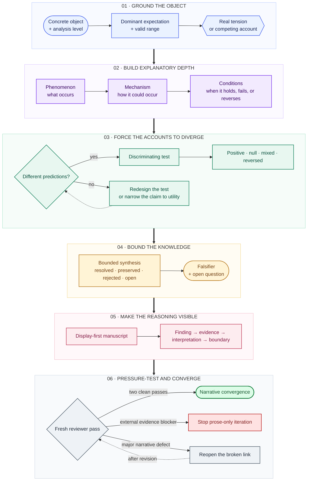

<p align="center">
  
</p>

# Dialectical Paper Writing

<p align="center"><strong>A Codex Skill for academic writing, research reasoning, experiment design, and peer review.</strong></p>

<p align="center"><strong>Stop asking AI to polish weak research. Make it find where the argument breaks.</strong></p>

<p align="center">
  <a href="https://github.com/lijinyang439-arch/dialectical-paper-writing/actions/workflows/tests.yml"></a>
  <a href="LICENSE"></a>
  
  
</p>

English · [简体中文](README.zh-CN.md)

Most AI writing tools ask, “How can this paragraph sound stronger?” This Skill asks the prior question: **does the evidence actually support the claim?** It diagnoses the broken link before it rewrites the prose.

## What it does

- **Diagnoses research logic** across the question, mechanism, method, evidence, and conclusion.
- **Turns claims into discriminating experiments** instead of defaulting to more ablations.
- **Reconstructs complete sections** from Introduction through Discussion, not sentence-by-sentence synonyms.
- **Runs fresh peer-review cycles** until the narrative converges or missing evidence becomes the blocker.
- **Translates Chinese and English manuscripts** with proposition-, scope-, terminology-, and LaTeX-level fidelity.
- **Prevents unsupported AI claims** by tracking provenance and evidence status separately.

## Installation: 30-second quick start

1. Clone the repository:

   ```bash
   git clone https://github.com/lijinyang439-arch/dialectical-paper-writing.git
   cd dialectical-paper-writing
   ```

2. Copy the Skill into Codex.

   **PowerShell**

   ```powershell
   Copy-Item -Recurse -Force `
     .\skills\dialectical-paper-writing `
     "$HOME\.codex\skills\dialectical-paper-writing"
   ```

   **macOS or Linux**

   ```bash
   cp -R skills/dialectical-paper-writing ~/.codex/skills/dialectical-paper-writing
   ```

3. Start a new Codex task and try:

   ```text
   Use $dialectical-paper-writing to diagnose the broken links between this paper's
   research question, mechanism, experiments, results, and conclusion before rewriting it.
   ```

## Before → After

The example below is an **illustrative reasoning blueprint**, not a claim about completed experiments.

### Without this Skill

```text
Problem: Existing methods generalize poorly.
Gap: Few studies examine physiological profiles.
Therefore: We propose a new model for cross-dataset transfer.
```

The paragraph sounds plausible, but it never establishes what was observed, which explanations compete, or what result could distinguish them.

### With Dialectical Paper Writing

```text
Observation
Transfer performance varies across physiological profiles, even within one dataset.

Competing explanations
A. Dataset identity drives the transfer failures.
B. Incomplete coverage of physiological variation drives the transfer failures.

Testable prediction
If B adds explanatory value, profile similarity should predict transfer variation
beyond what dataset identity alone predicts.

Discriminating evidence
Compare the accounts under identical splits, information access, and tuning budgets.

Bounded conclusion
Claim a profile-related mechanism only if B adds evidence beyond A;
otherwise report empirical utility without a mechanism claim.
```

It does not merely rewrite the paragraph. **It reconstructs the scientific argument behind it.** See the complete [input → diagnosis → output example](examples/01_problem_diagnosis/README.md).

## Try it on your paper

| Your task | Ask the Skill to |
|---|---|
| Weak motivation | Recover the observation, dominant expectation, and real research tension. |
| Unclear method contribution | Map every component to its pressure, mechanism, alternative, risk, and test. |
| Experiment planning | Build the smallest fair test that separates competing explanations. |
| Full-paper revision | Align Introduction promises, Methods, Results, Discussion, and conclusion boundaries. |
| Reviewer response | Classify each issue, revise the affected text, and draft an evidence-bounded reply. |
| Chinese ↔ English | Translate and back-check every proposition, qualifier, term, citation, and LaTeX command. |

Copy-ready prompts are available in [examples/prompts.md](examples/prompts.md).

## Why it is different

| Typical academic-writing prompt | Dialectical Paper Writing |
|---|---|
| Optimizes fluency and confidence | Tests whether the argument deserves the claim strength |
| Treats the paragraph as the unit of work | Treats the claim–evidence relationship as the unit of work |
| Suggests more experiments | Selects the smallest experiment that distinguishes explanations |
| Converts gains into contribution language | Separates empirical utility from mechanism evidence |
| Adds generic limitations | Predicts where the proposed account should weaken, fail, or reverse |
| Produces one polished draft | Reviews fresh versions until convergence or an external blocker |

## What problem it solves

Many manuscripts are locally fluent and globally disconnected. The Introduction names one gap, the method solves another problem, the experiments report aggregate performance, and the conclusion claims a mechanism that was never tested. More polished sentences cannot repair that structure.

This Skill changes the unit of work from the sentence to the **claim–evidence relationship**. It asks what concrete observation makes the research necessary, what serious alternative could explain it, which result would distinguish the accounts, and what conclusion the available evidence permits. Those answers become the paper's spine; language, section order, experiments, and reviewer responses must follow it.

## The core logic chain

**Six movements. Two decision gates. One feedback loop.**

<p align="center"><strong>GROUND · EXPLAIN · DISCRIMINATE · BOUND · DISPLAY · CONVERGE</strong></p>



The diagram is a control system, not a one-way content conveyor. The first decision gate asks whether serious accounts can produce discriminating evidence by predicting different observations. If they cannot, the test must change or the claim must be narrowed to empirical utility. The second gate separates a repairable narrative defect from an evidence or implementation blocker.

### Five gates against shallow writing

| Gate | Passage criterion | Failure signal |
|---|---|---|
| Grounding | The concrete object, analysis level, dominant expectation, and real tension are explicit. | The paper has a topic or module, but no researchable problem. |
| Explanation | Phenomenon, mechanism, and conditions form a testable process. | A component name or “better features” is standing in for a mechanism. |
| Discrimination | Competing accounts imply different observable outcomes and receive a fair test. | The evidence shows only that performance changed. |
| Boundary | The synthesis names what is resolved, preserved, rejected, open, and falsifiable. | The conclusion becomes a compromise sentence or exceeds the design. |
| Convergence | Fresh reviews recover the same spine; remaining blockers are classified correctly. | More rewriting merely rotates synonyms around missing evidence. |

### The depth kernel: a three-layer onion

The sequence **phenomenon → mechanism → conditions** is the explanatory kernel inside the larger system.

| Layer | It must reveal | It fails when |
|---|---|---|
| **Phenomenon** | A measurable pattern relative to a comparator or expectation | The paper names a broad topic but no specific observation. |
| **Mechanism** | An intermediate process that could produce the pattern | A method component is presented as its own explanation. |
| **Conditions** | Where the process strengthens, weakens, disappears, or reverses | Limitations are listed without changing a prediction. |

Depth does not come from adding conceptual layers. It comes from making each layer observable, contestable, and connected to a test.

## Dialectics without theatrical opposition

Here, dialectics is an evidence-producing method—not a decorative thesis–antithesis–synthesis formula.

Two accounts may genuinely conflict, but they may also be complementary, operate at different levels, describe different stages, hold under different conditions, or expose a trade-off. The Skill classifies that relationship before attempting a synthesis. If no contradiction exists, it does not invent one.

A valid synthesis is therefore not a compromise sentence. It states:

1. what the dominant account still explains;
2. what the tension or counterevidence changes;
3. which mechanism can accommodate the observed pattern;
4. which condition determines the applicable account;
5. what remains unresolved and what evidence would decide it.

## Scientific integrity: two ledgers, not one

Every consequential proposition is tracked along two independent axes.

### Provenance

| Label | Origin | Rule |
|---|---|---|
| `R` | Reference paper or supplied external material | Learn its logic; do not present it as the user's contribution. |
| `U` | User draft, notes, code, data, or explicit instruction | Preserve authorship and technical meaning. |
| `S` | Structure synthesized from reference and user material | Present it as synthesis, not as an established result. |
| `A` | New AI proposal | Mark it as proposed, unverified, or requiring a test. |

### Evidence status

| Status | Meaning | Allowed treatment |
|---|---|---|
| `recorded` | Directly locatable in supplied text, code, table, figure, or log | Report within the recorded scope. |
| `externally verified` | Checked against a reliable primary or official source | Preserve the verification source. |
| `inferred` | A reasonable interpretation not directly established | Use bounded interpretive language. |
| `untested` | A candidate mechanism, condition, method, or prediction | Keep it visibly hypothetical or planned. |

These ledgers prevent a common authorship error: a user idea can be untested, while a published result can be real yet inapplicable to the user's setting. Source and truth status are never interchangeable.

## One argument, carried through the whole paper

The Skill rebuilds sections by their scientific function rather than editing them as isolated blocks.

| Section | Weak default | Target move |
|---|---|---|
| Title and Abstract | Announce a method and broad benefit | Name the object, problem pressure, response, principal evidence, and tested scope. |
| Introduction | Start from a generic literature gap | Begin with an expectation and a concrete puzzle; end with testable promises. |
| Related Work | List who did what | Stage a dialogue among explanations, assumptions, levels, and conditions. |
| Methods | Describe components in implementation order | Explain the pressure behind each choice, its mechanism, alternatives, cost, and test. |
| Experiments | Accumulate datasets, baselines, and ablations | Assign every experiment to a claim or competing prediction. |
| Results | Paraphrase tables or declare hypotheses supported | Show the question, comparison, numbers or pattern, interpretation, and boundary. |
| Discussion | Repeat gains and append limitations | Return to the opening tension, evaluate alternatives, and form the bounded synthesis. |
| Conclusion | Expand local findings into a general claim | State only what was verified and where it applies. |

This alignment creates a closed loop:

```text
research background
-> real problem
-> research gap
-> testable hypothesis
-> method design
-> experimental test
-> result interpretation
-> conclusion boundary
```

If any arrow breaks, the Skill reports the break before rewriting the affected section.

## Methods and experiments as tests of the argument

For every major design choice, the Skill asks for:

```text
problem pressure
-> design response
-> proposed mechanism
-> simpler alternative
-> cost or new risk
-> positive prediction
-> failure or reversal prediction
-> discriminating experiment
```

An additional module is not automatically a contribution. A performance improvement establishes empirical utility under the evaluated setting; it does not by itself prove why the improvement occurred.

An experiment enters the plan only with an interpretation contract:

| Field | Question |
|---|---|
| Claim | Which statement is this experiment meant to test? |
| Variables | What changes, and what remains controlled? |
| Comparator | Which baseline or competing account receives a fair test? |
| Metric | Can the measurement support the intended conclusion? |
| Positive result | What would it support—and what would it still not establish? |
| Null, mixed, or reversed result | Which assumption or mechanism would need revision? |
| Failure region | Where should the method stop helping or begin to hurt? |

The default is the **smallest discriminating test**, not “more experiments.”

### Evidence controls are part of the claim

An experiment can answer the intended question only when its information and comparison conditions are valid. The Skill therefore audits:

- data partitioning, preprocessing, normalization, and model-selection paths for leakage;
- information available during training, validation, adaptation, testing, and inference as separate conditions;
- baseline access to data, labels, compute, tuning budgets, and auxiliary resources for fairness;
- random seeds, restart counts, hyperparameter search, stopping rules, aggregation, and statistical procedures for reproducibility.

A polished narrative cannot rescue an invalid split or an unfair baseline. Implementation–paper disagreement is treated as a scientific blocker.

## Review that converges instead of circling

Deep revision uses fresh draft–review–revision cycles. Each review reads the current manuscript before consulting the previous verdict, then checks the strongest version of the claim against the strongest credible objection.

Issues are separated into:

- `FATAL`: the central claim is invalid, contradicted, leaked, or unsupported;
- `MAJOR`: a decision-relevant defect in logic, evidence, fairness, reproducibility, or scope;
- `MINOR`: a local reporting or clarity problem;
- `EXPRESSION`: the meaning is valid but obscured by wording or organization;
- `EXTERNAL-EVIDENCE`: prose cannot solve the missing experiment, implementation, source, policy, or author decision.

Three verdicts remain independent:

- **Narrative verdict:** can a reviewer recover the puzzle, mechanism, conditions, evidence, and bounded conclusion?
- **Submission verdict:** do verified experiments, implementation, reproducibility, ethics, and venue requirements support submission?
- **Translation verdict:** does the target language preserve the approved meaning while reading naturally?

Iteration stops when two fresh reviews find no unresolved fatal or major narrative defect, or when another prose pass would only rearrange sentences around a missing external input. Persuasive wording never upgrades empirical readiness.

## Display the research; do not defend it

Final prose follows a display-first order when the section permits:

```text
core finding -> direct evidence -> bounded interpretation -> necessary applicability boundary
```

The final cleanup removes self-defense, repeated disclaimers, empty metadiscourse, generic warnings, and stacked hedges that contribute no scientific proposition. It keeps one precise qualifier whenever probability, causality, universality, evidence status, or safety would otherwise change.

The goal is neither aggressive certainty nor ritual caution. It is calibrated visibility: readers should see the result, its support, and its limit without excavating them from rhetorical padding.

## Bilingual academic writing

Chinese–English work is part of the same research chain, not an afterthought. The source language remains the semantic authority unless the user explicitly approves a newer target-language claim.

The translation route preserves:

- every proposition and technical dependency;
- negation, comparison, contrast, condition, exception, and progression;
- causal strength and the distinction between observation, mechanism, and interpretation;
- dataset-, subject-, group-, and model-level conclusions;
- average versus universal claims;
- training-, validation-, test-, adaptation-, and inference-time information conditions;
- terminology, numbers, citations, symbols, labels, equations, and LaTeX commands.

The English pass removes literal Chinese syntax, promotional wording, empty connectors, noun stacking, and generated-language templates. A final back-check compares the cleaned English with the Chinese source—not with the first translation draft.

## What the Skill can do

| Route | Typical task | Primary output |
|---|---|---|
| `diagnose` | Test whether a research problem and motivation are real | Argument diagnosis and broken-link map |
| `idea-fusion` | Integrate reference papers with the user's prior ideas | Provenance-controlled synthesis and similarity risks |
| `method-design` | Design or audit a method architecture | Component rationale, alternatives, risks, and predictions |
| `experiment-design` | Build main, control, ablation, robustness, or generalization tests | Claim–test matrix and minimum evidence plan |
| `section-rewrite` | Rebuild an Abstract, Introduction, Methods, Results, or Discussion section | Complete replacement text based on a section blueprint |
| `full-paper` | Reconstruct a manuscript and review it repeatedly | Auditable writing package and converged narrative |
| `review-only` | Simulate a strict, fair peer review | Location-specific report with severity classes |
| `review-response` | Analyze comments and draft responses | Action ledger, revised text, and evidence-bounded reply |
| `translate` | Translate or audit Chinese–English research text | Natural target text plus fidelity controls |
| `code-latex` | Check research code, figures, reproducibility, or LaTeX | Verified implementation or complete file-level revision |

### Good fit

- The manuscript is fluent but its motivation, experiments, and conclusion do not align.
- Reference papers must inform the research without contaminating originality or authorship.
- A mechanism claim needs a serious alternative and a discriminating test.
- The user wants a complete paragraph or section rewrite rather than synonym replacement.
- Multiple reviewer cycles are needed to expose structural defects and converge.
- Chinese research content must become restrained, natural academic English without semantic drift.

### Not a substitute for

- missing data, unrun experiments, inaccessible implementation details, or author decisions;
- domain-specific statistical, clinical, legal, or ethical review where qualified expertise is required;
- current venue rules that have not been checked against official sources;
- evidence for novelty, causality, safety, or generalization that the study did not establish.

## Auditable long-form work

Short tasks keep their maps internal. Full-paper, multi-round, or bilingual projects can create `research_writing_output/` with:

- `source_ledger.md`
- `dialectical_argument_map.md`
- `claim_evidence_matrix.md`
- `section_blueprints.md`
- `rewrite_matrix.md`
- `review_cycles/`
- `translation/term_ledger.md`
- `translation/fidelity_audit.md`
- `final_audit.md`

Validate a complete package with:

```bash
python skills/dialectical-paper-writing/scripts/validate_work_product.py \
  research_writing_output --route full --min-review-rounds 2
```

Add `--translation` when bilingual artifacts are required.

## Repository map

```text
.
├── README.md
├── README.zh-CN.md
├── CONTRIBUTING.md
├── LICENSE
├── .github/workflows/tests.yml
├── assets/
│   ├── social-preview.svg
│   └── social-preview.png
├── examples/
│   ├── README.md
│   ├── prompts.md
│   └── 01_problem_diagnosis/
│       ├── input.md
│       ├── analysis.md
│       └── output.md
├── skills/
│   └── dialectical-paper-writing/
│       ├── SKILL.md
│       ├── agents/openai.yaml
│       ├── references/
│       │   ├── artifact-templates.md
│       │   ├── dialectical-core.md
│       │   ├── evidence-and-experiments.md
│       │   ├── review-and-convergence.md
│       │   ├── section-playbook.md
│       │   └── translation-and-language.md
│       └── scripts/
│           └── validate_work_product.py
└── tests/
```

The main `SKILL.md` holds the controlling workflow. Detailed protocols load only for the active route, keeping the Skill usable without flattening complex research work into generic advice.

## Validation

```bash
python -m unittest discover -s tests -v
```

The test suite verifies the required Skill files, frontmatter, UI metadata, local Markdown links, reference structure, bilingual README contract, and long-form work-product validator. GitHub Actions runs the same checks on pushes and pull requests.

## Contributing

Read [CONTRIBUTING.md](CONTRIBUTING.md). A useful contribution must change observable agent behavior, preserve source and evidence boundaries, and avoid duplicating guidance already owned by another file.

## License

Released under the [MIT License](LICENSE).
