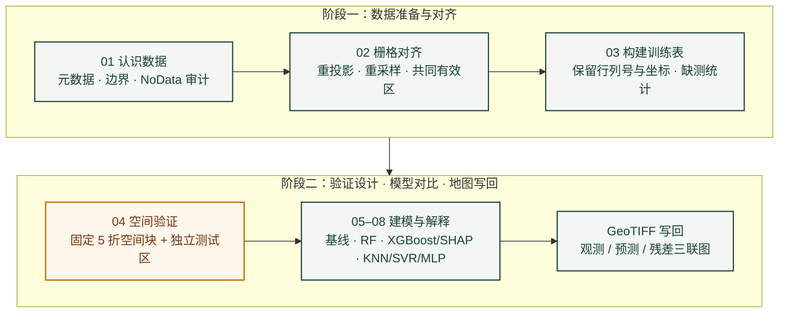

<div align="center">


# Geo-ML｜地理人的机器学习课

**用多源遥感与地理栅格，走一遍「认数据 → 对齐 → 建模 → 空间验证 → 写回地图」的完整实战流程**

[](environment.yml)
[](notebooks/)
[](LICENSE)
[](requirements.txt)

[中文](README.md) · [English](README.en.md)

[课程目录](#课程目录) · [核心主线](#核心主线) · [快速开始](#快速开始) · [数据准备](docs/DATA.md) · [环境配置](docs/ENVIRONMENT.md)

</div>

---

这是一套面向**地理、GIS、遥感方向**读者的中文开源实战教程。你不需要先啃完机器学习理论：只要有基础 Python 语法，能看懂经纬度、投影、栅格与像元，就可以跟着 8 个循序渐进的 Jupyter Notebook 完成从原始 GeoTIFF 检查到空间预测制图的全流程。

教程不追求“把模型指标刷到最高”。它更关心地理空间建模中最容易踩、却最少被系统讲透的真实问题：

- **多源异构对齐**：26.7 m UTM 高程、250 m NDVI、5–10 km 气象/土壤水分，如何严谨对齐到同一参考网格？
- **缺测与填充陷阱**：未声明 NoData 的边界零值、边缘缺测像元，为什么不能在划分前全局填补？
- **空间自相关泄漏**：为什么随机交叉验证的 R² 往往虚高，而空间分块验证才是真实的外推考场？
- **可解释性的边界**：变量高度共线、观测时间不同步时，SHAP 值能说明什么、不能说明什么？

> ⭐ **求职中的真诚请求**：目前我正处于求职阶段，如果这套开源教程对你的学习或研究有一点帮助，欢迎顺手点一个 **Star**！你的每一次认可，都会成为我简历和开源作品集上非常实在的加分项，也是我继续打磨内容的最大动力。感谢支持！

---

## 全书工作流



---

## 课程目录

> 每章聚焦一个核心地理建模问题，包含代码实现、误差分析、常见误区与课后练习。

| 章节 | Notebook | 核心问题 | 关键方法与交付 |
|:---:|---|---|---|
| **01** | [认识数据](notebooks/01_认识数据.ipynb) | 多源栅格能不能直接放在一起建模？ | `rasterio` 元数据审计、行政边界核对、NoData 与零值诊断 |
| **02** | [栅格对齐](notebooks/02_栅格对齐.ipynb) | 不同分辨率与坐标系如何对齐到同一底纸？ | 重投影、双线性 vs 最近邻重采样、共同有效区与 GeoTIFF 写回 |
| **03** | [构建训练表](notebooks/03_构建训练表.ipynb) | 怎样把二维栅格变成结构化样本表？ | 保留 `row/col/x/y` 定位、缺测统计、防泄漏 `Pipeline` 思想 |
| **04** | [空间验证](notebooks/04_空间验证.ipynb) | 为什么随机划分的评分常常过于乐观？ | 四邻接空间自相关诊断、空间分块 5 折 + 留出连续测试区 |
| **05** | [回归基线](notebooks/05_回归基线.ipynb) | 最朴素的线性基线能做到什么程度？ | 均值基线、线性回归、岭回归、空间三联图（观测/预测/残差） |
| **06** | [决策树与随机森林](notebooks/06_决策树与随机森林.ipynb) | 一棵树为什么容易过拟合，森林强在哪？ | 树深过拟合曲线、随机森林空间 CV、树模型外推局限 |
| **07** | [XGBoost 与 SHAP](notebooks/07_XGBoost与SHAP.ipynb) | 梯度提升与 SHAP 能多告诉我们什么？ | 空间 CV 调参、Beeswarm / Waterfall 拆解、共线变量归因边界 |
| **08** | [KNN / SVR / MLP](notebooks/08_KNN_SVR_MLP.ipynb) | 距离、核函数与神经网络各自表现如何？ | RBF-SVR 参数热图、四模型同尺对比、训练耗时与残差制图 |

---

## 核心主线

1. **空间验证贯穿全书**：第 04 章固定一套「5 个空间训练折 + 1 个中南连续测试区」，第 05–08 章严格复用同一把尺子。所有调参与模型筛选只在训练区空间折内完成，测试区仅在定稿后打开一次。
2. **模型对比看“退化幅度”而不只看单点排名**：单棵深树在训练区拟合极好，但迁移到留出空间块时误差急剧恶化；随机森林与 XGBoost 的核心优势在于跨区迁移时退化更慢、稳定性更高。
3. **重采样不等于增加细节**：5 km 降水与 10 km 土壤水分重采样到 1 km 网格后，粗像元内部仍是常值块，只能提供区域背景信息，不能被解读为像元尺度的局地机制。
4. **预测必须回到地图上检查**：除了 RMSE、MAE 和 R²，教程统一使用观测/预测同色标、残差以 0 为中心的三联图，把误差的空间聚集性直接暴露出来。

---

## 快速开始

### 1. 创建环境

地理空间依赖（GDAL、Rasterio、GeoPandas、PROJ）强烈建议通过 Conda 安装，避免单独 `pip install` 引发二进制依赖冲突：

```bash
git clone https://github.com/limi124/Geo-ML.git
cd Geo-ML

# 创建并激活环境（若本机已有同名 geoml 环境可直接跳过）
conda env create -f environment.yml
```

> 详细依赖说明与已验证版本见 [docs/ENVIRONMENT.md](docs/ENVIRONMENT.md) 与 [requirements.txt](requirements.txt)。

### 2. 准备数据

为了保持 Git 仓库轻量，原始栅格与边界矢量未直接托管在 GitHub 仓库内。你可以任选以下方式准备 `data/raw/`：

- **方式 A（推荐，下载完整案例数据）**：通过百度网盘获取甘南县多源栅格与边界数据，解压后放入 `data/raw/` 即可完整复现全书结果与图件：
  - 百度网盘链接：https://pan.baidu.com/s/14DApydGCLS6j1u2LkQDnaw?pwd=npxd
  - 提取码：`npxd`

- **方式 B（免下载，一键生成合成示例）**：如果不想下载网盘数据，可运行脚本生成一套纯数学合成的多分辨率示例栅格，直接跑通全部 8 章代码与制图流程：

  ```bash
  conda run -n geoml python tools/make_demo_data.py
  ```

- **方式 C（自有数据）**：按 [docs/DATA.md](docs/DATA.md) 放置同结构的 6 张 GeoTIFF 与行政区边界文件至 `data/raw/`。

### 3. 注册内核并运行

```powershell
# 1) 生成项目局部 Jupyter kernelspec（兼容 Windows / macOS / Linux，仅需一次）
conda run -n geoml python tools/prepare_kernel.py

# 2) 设置局部 JUPYTER_PATH
# Windows PowerShell:
$env:JUPYTER_PATH = "$PWD\.jupyter"
# macOS / Linux:
# export JUPYTER_PATH="$PWD/.jupyter"

# 3) 运行单章或全部 8 章 Notebook
conda run --no-capture-output -n geoml python tools/run_notebook.py 01_认识数据.ipynb

conda run --no-capture-output -n geoml python tools/run_notebook.py `
  01_认识数据.ipynb 02_栅格对齐.ipynb 03_构建训练表.ipynb 04_空间验证.ipynb `
  05_回归基线.ipynb 06_决策树与随机森林.ipynb 07_XGBoost与SHAP.ipynb 08_KNN_SVR_MLP.ipynb
```

运行完成后，生成的图件、指标表与预测 GeoTIFF 将保存在 `outputs/` 目录下；交付或提交前可执行 `conda run -n geoml python tools/check_notebooks.py` 检查仓库整洁度。

---

## 项目结构

```text
Geo-ML/
├── assets/                 # 封面与社交预览图
├── notebooks/              # 8 个章节 Notebook（公开版已清空输出）
├── src/
│   ├── geoml_data.py       # 栅格读取、对齐、训练表、空间划分与写回
│   ├── geoml_models.py     # 模型工厂、空间 CV 与评估指标
│   └── geoml_style.py      # 中文制图样式、空间三联图与对比图
├── tools/
│   ├── make_demo_data.py   # 一键生成可运行的合成多源栅格示例
│   ├── prepare_kernel.py   # 生成跨平台项目局部 kernelspec
│   ├── run_notebook.py     # 无界面批量执行 Notebook
│   └── check_notebooks.py  # 仓库结构与净版自检
├── data/raw/               # 本地数据目录（仅含说明，数据文件已忽略）
├── docs/
│   ├── DATA.md             # 数据准备与许可说明
│   └── ENVIRONMENT.md      # 环境配置与内核说明
├── environment.yml         # Conda 环境定义
└── requirements.txt        # 已验证的核心包版本记录
```

---

## 数据与许可

- **代码与教程文字**：采用 [MIT License](LICENSE) 开源。
- **数据与派生结果**：案例区域为黑龙江省齐齐哈尔市甘南县（约 122.90–124.47°E、47.59–48.53°N），配套示例数据通过百度网盘提供，**仅限学习与方法演示使用**，不在 MIT 许可覆盖范围内；GitHub 仓库本身不直接分发原始栅格与运行输出。

---

## 为什么写这个教程

学地理与遥感时，我常常想找一份能从栅格数据开始、一步步做到模型验证的中文教程。资料并不少，但能跟着实际操作、又把空间验证和数据处理讲清楚的内容不太容易找，有些课程还需要付费。

所以我把自己整理的学习路线和练习，慢慢做成了这 8 章 Notebook。它还在完善中，也不打算用高分结果包装机器学习；我更希望后来想学的地理人，能从数据整理、栅格对齐开始，亲手走完一遍建模和空间验证。

如果你也在学 GIS、遥感或机器学习，欢迎拿它练习。遇到问题、看不懂的地方，或觉得哪一章值得补充，都欢迎开 Issue 告诉我。深度学习方向的内容整理在另一个仓库：[遥感深度学习笔记 (remote_sensing_dl_notes)](https://github.com/limi124/remote_sensing_dl_notes)。

**如果这份教程对你有帮助，欢迎给仓库点一个 Star 支持**——这不只是一个数字，也是继续整理和完善它的鼓励。
