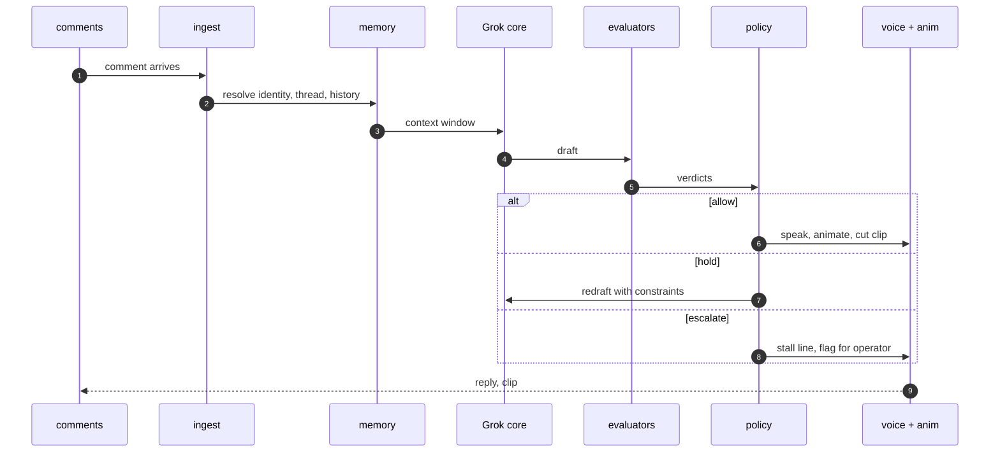
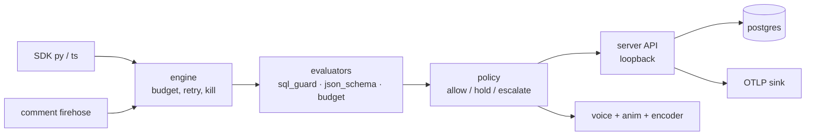

<div align="center">

<a href="https://github.com/limxdynamics"></a>

<p align="center">
  <picture>
    <source media="(prefers-color-scheme: dark)" srcset="https://raw.githubusercontent.com/limxdynamics/limxdynamics/main/doc/logo-white-theme.png">
    <source media="(prefers-color-scheme: light)" srcset="https://raw.githubusercontent.com/limxdynamics/limxdynamics/main/doc/logo-black-theme.png">
    
  </picture>
</p>

# XBot

**A humanoid that hosts a live show, twenty-four hours a day.**

Built by LimX Dynamics. Reasoning on Grok. Inference on Tesla silicon. Uplink over Starlink.
This repository is the control plane that keeps it on the air.
</div>

<p align="center">
  <a href="https://github.com/limxdynamics"></a>&nbsp;
  <a href="https://huggingface.co/limxdynamics"></a>&nbsp;
  <a href="mailto:opensource@limxdynamics.com"></a>
</p>

<p align="center">
  
  
  
  
</p>

---

<div align="center">

### Live now

control steps today `38,412` · median answer `780 ms` · evaluators loaded `6`


</div>

## What XBot is

XBot is not a chatbot with a face bolted on. It is a host with a body, a voice, a memory and a schedule.

It streams continuously. It reads the replies under its own broadcast, answers them out loud, and when nobody is asking anything it picks the topic itself and runs with it. Composed, dry, occasionally funny in a way an assistant never manages. It argues. It has opinions. It remembers what you said yesterday and brings it back at the wrong moment.

The camera is always on. The show does not wait for a prompt.

## Why a repository

One answer is not one inference call.

It is a control step: open a budget, pull the comment, resolve identity and conversation memory, draft against the current topic, evaluate the draft against a guard, decide allow, hold or escalate, synthesize voice, push frames to the encoder, close the step, write telemetry.

At full time that is roughly forty thousand control steps a day, and every one of them can fail. This repository is the runtime for those steps. The robot is the output device. The control plane is what makes the output survivable.

<div align="center">


<br>
<sub><code>agents</code> · live roster, attached controls, policy binding, last evaluation latency</sub>

</div>

## The live loop

Every step is budgeted, evaluated and recorded. Nothing reaches the encoder unevaluated.



If the queue empties, the engine opens its own topic instead of going quiet. Dead air is treated as a failure state.

## Stack

| Layer | What it carries | Where it lives |
| :--- | :--- | :--- |
| **Grok core** | Personality, reasoning, tool use, long-horizon memory. The same model family the platform runs on. | `engine/src/xbot_engine` |
| **Tesla silicon** | Inference on Dojo-derived and FSD-style accelerators. Quantized draft path, fp8 hot weights, pinned KV. | `engine/` runtime, `telemetry/` |
| **GrokBot layer** | Background agents: trend sweep, draft pool, poll ops, clip cutting, collab scheduling. Runs while the face stays on stream. | `evaluators/`, `server/src/xbot_server/services` |
| **Starlink** | Global low-latency uplink. Ingress priority for the comment firehose, redundant encoder paths. | `telemetry/src/xbot_telemetry/trace_context.py` |
| **Stream loop** | Live video, chat, clips. Reacts to the feed, triggers platform features, keeps output on stream. | `sdks/`, `server/src/xbot_server/endpoints` |

## Quickstart

```bash
git clone https://github.com/limxdynamics-online-robotics/xbot.git
cd xbot
cp .env.example .env
docker compose up -d
xbot check
```

The control plane binds loopback only. The model and the uplink are remote; the decisions are not.

```bash
$ xbot check
endpoint    http://127.0.0.1:8080   ok  12 ms
auth        runtime token           ok
postgres    xbot@localhost:5432     ok   8 ms
evaluators  6 loaded                ok
policy      guard_strict            ok
READY
```

<div align="center">


<br>
<sub>cold start, readiness gate</sub>

</div>

## Controls

A control is a named, budgeted unit of behaviour. It declares what the robot may do, how long it may take, and what happens when it runs out.

| Control | Budget | On timeout | Policy |
| :--- | ---: | :--- | :--- |
| `stream.open` | 400 ms | retry ×2 | `guard_strict` |
| `comment.ingest` | 250 ms | drop, log | `guard_strict` |
| `answer.draft` | 1200 ms | hold → redraft | `guard_strict` |
| `voice.synth` | 900 ms | fallback voice | `guard_loose` |
| `clip.cut` | 5000 ms | defer to GrokBot | `guard_loose` |
| `poll.open` | 300 ms | retry ×1 | `guard_loose` |
| `collab.invite` | 2000 ms | escalate | `guard_strict` |
| `topic.self` | 1500 ms | escalate | `guard_loose` |

Budgets are enforced by the engine, not by the callee. A control that overruns is killed and its slot is released.

## Evaluators

Drafts pass through the chain before the encoder sees them. Each evaluator returns a verdict and a reason string, and the reason is what the operator reads at 3 a.m.

| Evaluator | Checks |
| :--- | :--- |
| `sql_guard` | AST-level statement shape against the memory store, single statement, table and column allowlist |
| `json_schema` | Draft envelope against the active reply schema, versioned |
| `regex` | Claim patterns, ticker and handle formats, forbidden constructions |
| `list` | Banned and required phrase sets |
| `budget` | Per-step and per-window spend, rolling |
| `galileo.llm` | LLM-as-judge on tone, factuality and persona drift |
| `cisco.ai_defense` | External content inspection on quoted material |
| `defenseclaw.opa` | OPA policy packs for jurisdiction and sponsorship rules |

<div align="center">


<br>
<sub>one control step, evaluator chain, policy verdict <code>ALLOW</code>, 226 ms end to end</sub>

</div>

## SDK

Controls are declared, not hand-wired. The decorator attaches budget, policy and evaluators at definition time, so the call site stays readable.

```python
from xbot import XBot, control

bot = XBot(agent="atlas-01", endpoint="http://127.0.0.1:8080")

@control(name="answer.draft", policy="guard_strict", budget_ms=1200)
async def draft_reply(comment_id: str, topic: str) -> dict:
    ctx = await bot.memory(comment_id)
    return await bot.draft(ctx=ctx, topic=topic, persona="xbot.v3")

@control(name="clip.cut", policy="guard_loose", budget_ms=5000)
async def cut_highlight(step_id: str) -> dict:
    return await bot.clip(step_id, window_ms=9000, captions=True)
```

<div align="center">


<br>
<sub><code>@control</code> binding, schema fetch, guarded query</sub>

</div>

TypeScript mirror, same surface:

```ts
import { XBot, control } from "@xbot/sdk";

const bot = new XBot({ agent: "atlas-01", endpoint: "http://127.0.0.1:8080" });

export const draftReply = control(
  { name: "answer.draft", policy: "guard_strict", budgetMs: 1200 },
  async (commentId: string, topic: string) => {
    const ctx = await bot.memory(commentId);
    return bot.draft({ ctx, topic, persona: "xbot.v3" });
  },
);
```

## Architecture



<div align="center">


<br>
<sub>control flow and evaluation boundary, loopback only</sub>

</div>

The server never holds a control open while it waits on a model. Steps are durable rows, resumable after a restart, and every state transition is written before it is acted on.

## Telemetry

Every step emits a span with the agent, control, budget, verdicts and elapsed time. Sinks are pluggable: OTLP, JSONL, or none.

```bash
XBOT_OTLP_ENDPOINT=http://127.0.0.1:4318 xbot serve
```

Trace context survives the GrokBot handoff, so a clip cut three minutes after the answer still points at the step that produced it.

## Repository layout

```
engine/        control runtime, budgets, selectors
evaluators/    builtin chain + contrib packs
models/        schemas, envelopes, verdicts
server/        API, auth, persistence, services
sdks/          python and typescript clients
telemetry/     spans, sinks, trace context
ui/            operator console
docs/          diagrams, brand, deployment notes
```

## Status

| Area | State |
| :--- | :--- |
| Live loop | shipping |
| Voice path | shipping |
| GrokBot background agents | shipping |
| Clip feedback loop | beta |
| Chat presence | beta |
| Orbital segment | planned |

## Principles

**Loopback decisions.** The control plane decides locally. Model calls go out, verdicts never depend on a round trip.

**Budget over hope.** Every control has a ceiling and a defined death. Nothing hangs on stream.

**Persona is a schema.** Tone drift is an evaluator failure, not a vibe check.

**Everything is a span.** If it is not recorded, it did not happen.

<div align="center">

<a href="https://github.com/limxdynamics"></a>

<sub>Apache-2.0 · issues and PRs welcome</sub>

</div>
