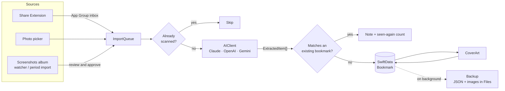

<p align="center">
  
</p>

<h1 align="center">Dragon Lair</h1>

<p align="center">
  <b>Screenshot it, and it's saved.</b><br>
  Dragon Lair turns screenshots of things you want to read, watch, visit or buy into bookmarks.
</p>

<p align="center">
  
  
  
  
</p>

<p align="center">
  
  
  
  
</p>

---

## Contents

- [The idea](#the-idea)
- [Features](#features)
- [How it works](#how-it-works)
- [Architecture](#architecture)
- [Privacy](#privacy)
- [Building](#building)
- [Project layout](#project-layout)
- [Credits](#credits)
- [License](#license)

## The idea

Most people save things to come back to by taking a screenshot: a book on TikTok, a café on Instagram, a "top 10 manhwa" list, a serum someone recommended. Then the screenshots get lost in the camera roll among thousands of others.

Dragon Lair is a personal hoard for those finds. It reads the screenshots for you. An AI vision model works out what each one shows, and the app saves it as a proper bookmark: title, author or brand, year, summary, tags, and an official cover found online. Then you can delete the screenshots from Photos.

A few rules shaped the design:

- **Screenshots are the only input.** You never type anything in. Pick screenshots, share them from any app, or let the app watch your Screenshots album.
- **Nothing is ever forgotten.** If you start something or change your mind about it, the bookmark goes to the archive instead of being deleted. That way a screenshot of the same thing a year later is recognised, not added again.
- **Your device, your keys.** There's no server or account. You bring an API key for the AI provider you prefer.

## Features

### Capture
- **Three ways in.** Use the in-app photo picker (up to 50 at a time), the system **Share Extension** from any app, or **watch the Screenshots album** so new screenshots are offered for review the next time you open the app.
- **Period import.** Import every screenshot taken between two dates.
- **Several items per screenshot.** A list of five cafés becomes five bookmarks.
- **Imports keep running in the background.** On iOS 26+ an import is a *continued processing task* with a system progress indicator, so you can leave the app and it keeps going.

### Understand
- **Seven categories:** books, manhwa (including manga, manhua and webtoons), movies & shows, sites, places, products, and other.
- **Choose your AI:** Claude, OpenAI or Gemini, with your own model choice. Answers come back as strict JSON that matches a schema.
- **Reads the hints in a screenshot.** Captions, hashtags, comments and search bars count, such as TikTok's "Search · *title*" bar under a video. A series is saved as its first instalment.
- **Handles other languages.** Korean, Japanese and Chinese titles are shown under their official English name and keep the original title. Russian titles stay as written. English manhwa titles are checked against AniList instead of trusting a model's translation.

### Covers
- **Official artwork found automatically**, chosen by category:

  | Category | Sources, in order |
  | --- | --- |
  | Books | Apple Books, Hardcover¹, Open Library, Google Books¹, Litnet (for Cyrillic titles), Bookcover API (Goodreads), Wikipedia |
  | Manhwa | AniList (English, then original title), Wikipedia |
  | Movies & shows | TMDB¹, Wikipedia, TVmaze, AniList (anime) |
  | Places | Apple Maps → the place's own website, Wikipedia |
  | Products | The product page's preview image, Open Beauty Facts, Open Food Facts |
  | Sites | The site's `og:image` preview |

  ¹ Optional. Needs a free personal key, added in Settings. Every other source works without one.

- **Fallbacks for anything no catalogue has.** With Gemini as the provider, Google Search grounding finds pages about the item, for example an upcoming book. If that finds nothing, the app crops the item's own picture out of the screenshot. The AI gives its bounding box, or for places on-device **Vision** finds the main subject.
- **Every match is checked.** Titles must match closely, the year must be within two years, and Wikipedia pages must be the right kind of thing. Searches that find nothing are tried again a week later.

### Organise
- **Tracker:** swipe right for *started* (Started reading / Started watching / Been there / Bought it), swipe left for *changed my mind*. Both send the bookmark to the archive.
- **Duplicate detection:** a new item is compared with everything ever saved, archived bookmarks included. The comparison ignores case, accents, punctuation, a leading "the", bracketed extras, and whether the title is the original or the English one. The app tells you when and why something wasn't added again, and counts how often it has turned up.
- **Quick actions:** long-press a row and slide onto an icon to act on it.
- **Search** across titles, authors and tags. The archive is searchable too.
- **Re-read:** send a bookmark's screenshot to the AI again with the current instructions if it was read wrong.

### Housekeeping
- **Photos clean-up:** move imported originals to Recently Deleted in one step. Only screenshots whose contents are already saved can be deleted, and each bookmark keeps its own copy.
- **Backups** to any folder in Files, such as iCloud Drive. A backup is a JSON file plus screenshots named by content hash. It runs automatically whenever the app goes to the background. Restoring is additive: running it twice never creates duplicates.
- **Never pays twice:** every image sent to the AI is remembered by hash, including ones where nothing was found. Watching and period imports never send the same screenshot again.

## How it works



1. **Collect.** A screenshot enters from the picker, the Share Extension, or the Photos library. The Share Extension doesn't call the AI. It only writes the image into a shared App Group folder (`SharedInbox`), and the main app picks it up when it next becomes active. That keeps the extension inside its tight memory and time limits.
2. **Deduplicate the image.** The image's SHA-256 is checked against the `ScannedImage` table and existing bookmarks, so the same image is never paid for twice.
3. **Extract.** The image is scaled down to 1568 px on its long side, encoded as JPEG and sent to the chosen provider with one system prompt and a JSON schema. The same schema works for Anthropic structured outputs and OpenAI strict mode. Gemini gets a version without `additionalProperties`. Requests that fail because the provider is overloaded, or that time out, are retried. A Gemini model that's overloaded falls back to Flash Lite.
4. **Deduplicate the items.** Each item gets a `matchKey` (category plus normalised title), which is compared with the shown, original and English titles of every saved bookmark.
5. **Save.** New bookmarks go into SwiftData. Screenshots and covers use external storage.
6. **Find covers.** `CoverArt.find` searches under the English name first, then the original title, then the web, then the screenshot itself. Up to four bookmarks are searched at once, with progress saved every five.
7. **Back up.** When the app goes to the background, the library is written to the backup folder you chose, if one is set.

## Architecture

The app is a single SwiftUI target plus a Share Extension, with no third-party dependencies. Only Apple frameworks are used: SwiftUI, SwiftData, Photos, PhotosUI, BackgroundTasks, MapKit, Vision, CryptoKit and Security.

### Layers

| Layer | Types | Responsibility |
| --- | --- | --- |
| **App** | `DragonLairApp` | Sets up the SwiftData container and injects one `ImportQueue` into the environment. |
| **Views** | `LibraryView`, `BookmarkDetailView`, `ArchiveView`, `ImportListView`, `ReviewScreenshotsView`, `ScreenshotFolderView`, `OriginalsView`, `BackupView`, `SettingsView`, `QuickActions` | SwiftUI screens. `LibraryView` also handles the app lifecycle: when the app becomes active it drains the inbox, refreshes watching, resumes stopped imports and starts the cover search; when it goes to the background it writes a backup. |
| **Orchestration** | `ImportQueue` (`@Observable`, `@MainActor`) | The single source of truth for import jobs and their states (`done`, `skipped`, `nothingFound`, `failed`). It also handles screenshots waiting for review, deleting originals, re-reading and the cover search. |
| **Services** | `AIClient`, `CoverArt`, `ScreenshotLibrary` / `ScreenshotWatcher`, `BackgroundImport`, `Backup`, `AppSettings` / `Keychain` | Stateless or small helpers, each wrapping one outside system. |
| **Model** | `Bookmark`, `ScannedImage`, `BookmarkCategory`, `BookmarkStatus` | SwiftData models and the rules for duplicates, archiving and English names. |
| **Shared** | `SharedInbox` | Code compiled into both targets: a file-based handoff through the App Group container. |

### Key design decisions

- **One provider-neutral AI client.** `AIClient` turns a single `Ask` (instructions, message, optional image, JSON schema) into each provider's own API format. Adding a provider means writing one `call…` method.
- **Archive, don't delete.** `BookmarkStatus` has only `saved`, `started` and `dropped`. Any status other than `saved` counts as archived. The archive is what makes duplicate detection work over time.
- **Two levels of deduplication.** The image hash (`ScannedImage`) stops repeat AI calls. The title key (`matchKey`) stops repeat bookmarks when the same thing turns up in a different screenshot.
- **The extension stays small.** The Share Extension only stores files. All the heavy work runs in the main app, where it can use background tasks.
- **Covers are best effort and checked.** Every source must pass title and year checks before its image is used, and an empty result is remembered with a timestamp so it's retried later rather than on every launch.
- **Old data is migrated when it's read.** Older status names (`inProgress`, `done`) map to `started`. New fields have defaults, and bookmarks saved before a feature existed get English names and covers filled in later.
- **No iCloud entitlement needed.** Backups use a security-scoped bookmark to a folder you pick in Files, so they work with a free developer account.

## Privacy

There is no server, analytics or account.

- Bookmarks stay on the device in SwiftData.
- API keys are stored in the **Keychain**. Provider and model choices are stored in `UserDefaults`.
- A screenshot is sent to your chosen AI provider only when it's imported. Watching only collects new screenshots for you to review, and nothing is sent until you approve them.
- Cover lookups send the bookmark's title, creator and year to public catalogues. Screenshots are never sent to them.
- For sites, places and products, and with Gemini's web search, the app also opens the bookmarked website or the pages found, to read their preview image. Those sites see an ordinary visit from your phone's IP address. Addresses on your local network are never contacted.
- Backups are plain files: a JSON file and copies of your screenshots. In iCloud Drive they're protected by your Apple Account, but they aren't encrypted by the app, so anything visible in a screenshot is in the backup too.
- Logs from Release builds hide titles and site addresses.
- Deleting from Photos always goes through iOS's own confirmation, and photos go to Recently Deleted.

### What a screenshot can do

Anyone can put text into an image, and the AI reads all of it. The worst a screenshot written to fool the AI can do is save a wrong bookmark or point a cover search at a site of its choosing. **Open website** opens only `http` and `https` links, never another app's URL, and downloads are size-limited and decoded at a small size.

## Building

**Requirements:** Xcode with the iOS 18 SDK or later. iOS 26 is needed for imports to keep running in the background.

1. Set up signing. Copy the example config and fill in your Team ID and a bundle ID of your own:

   ```bash
   cp Config/Local.example.xcconfig Config/Local.xcconfig
   ```

   `Local.xcconfig` isn't committed. The share extension, tests, App Group, background task and Keychain service are all derived from `APP_ID`, so nothing else needs changing. Without the file, the project still builds for the simulator, just unsigned.
2. Open `DragonLair.xcodeproj`.
3. Run on a device or simulator.
4. On first launch the app walks you through adding an API key for one AI provider (later, it's in **Settings**). Optionally add TMDB, Hardcover or Google Books keys in Settings to find more covers.

The Xcode project is generated from [`project.yml`](project.yml) with [XcodeGen](https://github.com/yonaskolb/XcodeGen). After changing targets or settings there, regenerate it:

```bash
xcodegen generate
```

Debug builds accept two launch arguments:

- `-seedSamples` fills an empty library with a few made-up bookmarks with drawn covers. The README screenshots use it.
- `-stubAI` answers imports with made-up bookmarks after a few seconds, so you can try importing without an API key or network.
- `-showOnboarding` opens the first-run screens on every launch. With `-stubAI`, any key in the right format passes the key check.

The app logs to the system log under the subsystem `com.lirriel.dragonlair`, with the categories `import`, `covers`, `photos`, `keychain` and `ui`. View them in Xcode's console or Console.app. Release builds hide titles and site addresses in these logs.

Run the unit tests with:

```bash
xcodebuild test -scheme DragonLair -destination 'platform=iOS Simulator,name=<an iPhone simulator you have>'
```

## Project layout

```
DragonLair/
├── DragonLairApp.swift        App entry, SwiftData container
├── SampleData.swift           Debug-only sample library (-seedSamples)
├── PrivacyInfo.xcprivacy      Privacy manifest
├── Models/
│   ├── Bookmark.swift         Bookmark, ScannedImage, categories, statuses, match keys
│   └── LibrarySchema.swift    Versioned SwiftData schema and migration plan
├── Services/
│   ├── AIClient.swift         Prompt, JSON schema, Claude / OpenAI / Gemini clients, retries
│   ├── ImportQueue.swift      Import pipeline, review, re-read, cover search
│   ├── CoverArt.swift         Cover sources, matching, screenshot crops
│   ├── ScreenshotLibrary.swift  Photos access, Screenshots album, watcher, deletion
│   ├── BackgroundImport.swift Continued processing tasks (iOS 26+)
│   ├── Backup.swift           JSON + image backup and additive restore
│   └── Settings.swift         AppSettings, cover services, Keychain
└── Views/                     SwiftUI screens
DragonLairTests/               Unit tests (Swift Testing)
ShareExtension/                Share sheet target → SharedInbox
Shared/
├── SharedInbox.swift          App Group file handoff used by both targets
└── AppID.swift                Base identifier the App Group and other names are built from
Config/
├── Base.xcconfig              Shared settings: APP_ID, team (empty)
└── Local.example.xcconfig     Template for your uncommitted Local.xcconfig
Design/                        App icon and its source; earlier concepts in Design/explorations
docs/                          README images
project.yml                    XcodeGen spec
```

## Credits

Dragon Lair finds covers through public catalogues. It isn't affiliated with or endorsed by any of them, and cover art belongs to its publishers and creators.

- **TMDB:** This product uses the TMDB API but is not endorsed or certified by TMDB. ([themoviedb.org](https://www.themoviedb.org))
- **Open Food Facts** and **Open Beauty Facts:** product data available under the [Open Database License (ODbL)](https://opendatacommons.org/licenses/odbl/1-0/).
- **Apple Books** (iTunes Search API), **Open Library**, **AniList**, **TVmaze**, **Wikipedia**, **Hardcover**, **Google Books** and the **Bookcover API** are queried through their public APIs.
- **Litnet** has no public API. For Cyrillic book titles only, the app loads Litnet's search page and up to three book pages, and reads the cover from each page's preview image. This happens at most once per bookmark.

The same credits are shown in the app under **Settings → Cover sources**.

## License

Dragon Lair is source-available under the [PolyForm Strict License 1.0.0](LICENSE.md).

- **You may** read the code and build the app to use yourself, for any noncommercial purpose.
- **You may not** sell it, use it commercially, publish modified versions, or redistribute copies, including free ones.
- The name "Dragon Lair" and the app icon aren't covered by the license.

If you'd like to contribute or use it some other way, open an issue and ask.
