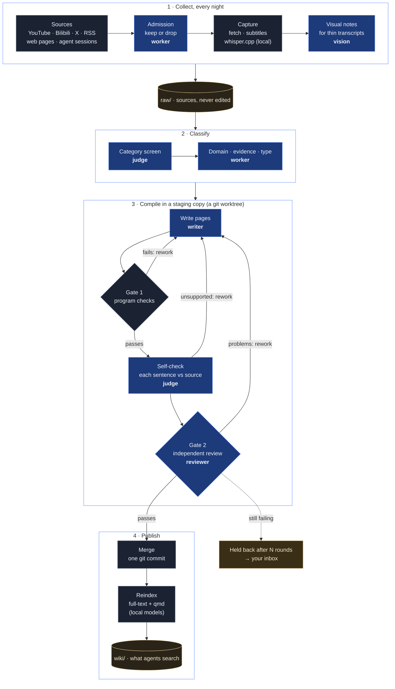
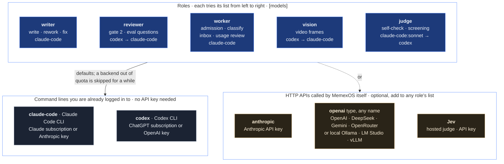

<div align="center">


# A memory OS for you and your agents

**What you read, watch, save and discuss with your AI agents becomes a reviewed, linked wiki that any agent can
search. Nothing you or your agents learn is lost when a conversation ends.**

[](https://github.com/liushengyu/memexos/actions/workflows/ci.yml)
[](LICENSE)
[](pyproject.toml)
[](#give-your-agents-the-memory)
[](https://github.com/liushengyu/memexos/stargazers)

[Install](#install) · [How it works](#how-it-works) · [Models](#models) · [Architecture](docs/architecture.md) · [Contributing](CONTRIBUTING.md) · [中文](README.zh-CN.md)

</div>

## From an idea to a system

MemexOS grew out of Andrej Karpathy's [LLM Wiki](https://gist.github.com/karpathy/442a6bf555914893e9891c11519de94f):
instead of searching raw documents again for every question, let a language model read each source once and
*compile* it into a persistent wiki of linked markdown pages, keep an index and a log, and maintain the wiki with three
operations: ingest, query and lint. In the gist's words, "the wiki is a persistent, compounding artifact". People
abandon wikis because the bookkeeping grows faster than the value, and bookkeeping is exactly what a model does not
get tired of.

We took the idea and asked what it needs to run by itself for months, for one person and every agent they use,
without drifting from its sources. MemexOS is our answer:

| The LLM Wiki idea | What MemexOS builds on it |
|---|---|
| Raw sources stay unchanged | `raw/` is append-only; every page lists the sources it rests on; claims are worded by the strength of their evidence |
| The model writes and maintains the wiki | A writer agent compiles in a staging copy; program checks, a self-check and an independent reviewer from another model family stand between a draft and the wiki |
| You curate the sources | Collectors gather what you already save (YouTube, Bilibili, X, RSS, links) and what you work out with your agents, every night; an admission agent keeps what is worth keeping |
| Ingest, query, lint | `memex ingest`; `memex search` and `memex get` for any agent; a weekly lint; and fixes driven by how agents actually use the knowledge |
| A schema file guides the model | `AGENTS.md` rules, a taxonomy that grows with your interests, an inbox for what only you can decide, and a console that shows every step |

The name comes from Vannevar Bush's 1945 *memex*, a desk that would store and link everything its owner read.


<sub>Screenshots show generated demo data (`tools/make_demo.py`), not anyone's real knowledge base.</sub>

## What it does

- **Learns on its own, across platforms.** Every night it collects what you saved: YouTube likes, watch-later and
  playlists, Bilibili favorites, X bookmarks and likes, RSS feeds, and links you send it. An admission agent decides
  what is worth keeping; videos without subtitles are transcribed on your machine.
- **Remembers across conversations.** It reads your Claude Code and Codex sessions and keeps what lasts (decisions,
  conclusions, measured results, mistakes not to repeat), so the next session, in any agent, can look them up.
- **Evolves itself.** It watches how agents use the knowledge (what they searched for, opened, cited, and whether it
  helped), turns wrong or missing answers into corrections, lints itself weekly, proposes new categories as your
  interests shift, and measures its own retrieval quality with a question bank it maintains.
- **Publishes nothing unreviewed.** Each compile happens in a staging copy and passes program checks, a self-check and an
  independent review by a second model that compares every sentence with its source. Failures go back for rework;
  every change is a git commit you can roll back.
- **Works with any agent and any model.** Agents use one command line (`memex search`, `memex get`). The writing runs on
  Claude Code, Codex, the Anthropic API, any OpenAI-compatible API, or a local model (Ollama, LM Studio, vLLM), mixed
  per role.
- **Asks you only to decide.** What agents cannot settle lands in an inbox as a question with options and a
  recommendation; the rest they research, check and fix themselves.
- **Shows you everything.** A local console shows the knowledge, every pipeline step as it runs, the inbox, how agents
  use the knowledge, review quality and spending.

| | |
|---|---|
|  |  |
| **Every run, step by step.** The review flagged two sentences; the writer fixed them; the re-check passed. | **You decide, agents do the rest.** |
|  |  |
| **Does the knowledge help?** Measured from real agent sessions. | **Can it be trusted, and what does it cost?** |

## How it works


Every step that needs judgment runs on a model **role**; everything else is a program. Here is the path a source
takes, with the role at each step in bold (which model fills each role is up to you, see [Models](#models)):



Nothing reaches `wiki/` without passing both gates. Gate 1 is code, not a model; gate 2 is a different model family
from the writer, so the writer's blind spots are not reviewed by the same blind spots.

## Install

You need macOS or Linux (on Windows, use WSL), git and curl. The installer sets up everything else:

```sh
curl -fsSL https://raw.githubusercontent.com/liushengyu/memexos/main/install.sh | sh
```

**Always installed**, because MemexOS does not work fully without them:

1. **MemexOS** itself, with [uv](https://docs.astral.sh/uv) (which brings its own Python).
2. **Node.js 22+ and [qmd](https://github.com/tobi/qmd)**, the local search engine (vector search and reranking, all on
   your machine).
3. **A model command line you are logged in to**: Claude Code or Codex. If you have neither, it installs one and
   opens the login page in your browser. **No API key is needed**; see [Models](#models).
4. **`memex setup`**: a few questions, then your knowledge base (with sample content if you like) and the search
   models (about 1 GB, downloaded once; Qwen3-Embedding for a Chinese knowledge base).

**Optional**, you pick from a list (or pass `--with a,b,c`):

| | What it adds | Installs |
|---|---|---|
| `second-cli` (recommended) | writing and reviewing by different model families | the other of Claude Code / Codex, logged in |
| `video` | videos and podcasts, also without subtitles | yt-dlp, ffmpeg, whisper.cpp, a speech model (~550 MB) |
| `pdf` | PDFs | poppler |
| `social` | what you save on X, YouTube and Bilibili | twitter-cli, yt-dlp, and a browser for the one-time logins if you have no Chrome, Chromium, Edge or Brave |
| `deep-search` | `memex search --mode deep` (query expansion) | qmd's expansion model (~1.3 GB) |

Prefer to have your agent do it? Give Claude Code or Codex the prompt in [docs/install-prompt.md](docs/install-prompt.md).
`sh install.sh --help` lists the options; it can be run again at any time and skips what is installed.
`memex doctor` checks everything and says how to fix what is missing.

## Quick start

```sh
memex setup                            # or: memex init --sample   (a knowledge base in ~/memex)
memex search "how often should I review flashcards"
memex get "Spaced repetition"
memex console                          # http://127.0.0.1:8765
```

Add a source and compile it (this calls your models):

```sh
memex add-url https://example.com/some-article
memex ingest                           # write, check, review, publish
memex status
```

Run unattended:

```sh
memex schedule install                 # nightly collection, hourly compiling, reindexing, the console
```

## Give your agents the memory

Add a few lines to your agent's global instructions (`~/.claude/CLAUDE.md`, `~/.codex/AGENTS.md`, …):

```md
## Knowledge base
I keep a personal knowledge base. When a question touches something I have read, done or decided, run
`memex help` once and follow it: search with `memex search`, say which pages you used, and say so when the
knowledge base has nothing.
```

## Models

**No API key needed.** MemexOS runs its model work through the **Claude Code or Codex command line you are already
logged in to**, with your subscription (Claude Pro/Max, ChatGPT Plus/Pro) or whatever those tools are logged in with.
`memex setup` puts them first. API keys (Anthropic, OpenAI, DeepSeek, …) and local model servers (Ollama, LM Studio,
vLLM) are optional extras you can add to any role.

Work is split into roles. Each role has a list of backends and uses the first one that is available; when one runs out
of quota, the next takes over for a while. `memex setup` detects what you have and proposes the lists; `memex doctor`
shows them.



**Codex or an OpenAI API key?** Both can reach OpenAI's models, in different ways:

| | `codex` backend | `openai`-type backend |
|---|---|---|
| What runs | the Codex command line, which does the agent work itself | MemexOS calls a Chat Completions API over HTTP and runs the agent loop and its sandboxed file tools itself |
| Login | whatever Codex is logged in with: a ChatGPT subscription (no API key) or an OpenAI API key | an API key (`api_key_env`), or nothing for a local server |
| Billing | counts against your ChatGPT plan, or your API usage | per token with the provider; free for a local model |
| Models | the models Codex offers | any provider with that API: OpenAI, DeepSeek, Gemini, OpenRouter, Qwen, Kimi…, or Ollama, LM Studio, vLLM on your machine |
| Use it when | you have ChatGPT or Codex already | you have an API key from some provider, or want a local model |

The same split holds for Anthropic: the `claude-code` backend uses your Claude Code login (a Claude subscription
works), the `anthropic` backend uses an API key.

Setting up the HTTP backends:

- **Anthropic API**: `memex secret set ANTHROPIC_API_KEY` (stored in the system keychain, never in a file).
- **Any OpenAI-compatible API**, hosted or local, under any name:

  ```toml
  # ~/.config/memexos/config.toml
  [backends.local]
  type = "openai"
  base_url = "http://127.0.0.1:11434/v1"     # Ollama; or LM Studio, vLLM, OpenAI, DeepSeek, Gemini, OpenRouter…
  model = "qwen3:14b"
  api_key_env = ""                           # local servers need no key; hosted ones: the variable that holds it

  [models]
  worker = ["local", "claude-code"]
  ```

  Small local models are fine for the worker and judge roles; writing and reviewing need a strong model.
- **Jev** for the judge role (optional, hosted, returns calibrated probabilities): `memex secret set JEV_API_KEY`, then
  `[judge] backend = "jev"`. It sends the sentences being judged to that service.

## What it costs

MemexOS itself is free. The model calls are what cost money, and only if you pay per call:

- With **Claude Code or Codex logged in to a subscription**, the work counts against your plan's usage limits and there is
  no separate bill. The console still shows what the same work would cost at API list prices, so you can see where
  the effort goes.
- With **API keys**, you pay per token. Compiling one long article with Opus as the writer comes to a few dollars at list
  prices (writing, the self-check and the review together); short pages cost less, and a nightly run costs what it
  collected. Set a cheaper `model` in `[backends.claude-code]` (or another backend for the writer role) to pay less.
- **Local models** cost nothing per call but are slower, and weaker as writers and reviewers.
- Search, the console, scheduling, transcription and the retrieval evaluation (L1) run locally and cost nothing.

The Quality & cost page shows spending per day and per role; `memex pause` stops compiling at any time.

## Logins for X, YouTube and Bilibili

Collecting what you save on those sites needs your login. MemexOS keeps a **browser profile of its own** for this
(not your everyday browser): `memex login x` opens a window at the site's login page, you log in once, and the window
closes by itself. From then on MemexOS keeps the login alive without you: before a collector runs, it opens the site
in that profile without a window, lets the site renew its cookies, and hands them to the tools. Scheduled jobs and
agents can do this (`memex cookies refresh`), because nothing has to read your everyday browser.

When a site really ends the session, MemexOS does not fail quietly: `memex status` and the console show it, and you
get one desktop notification. `memex login <site>` (or **Log in** in the console's command palette) opens the window
again. On a machine without a screen, `memex login x --cookies cookies.txt` takes a cookie file exported elsewhere,
and `--from-browser chrome` copies the login from an everyday browser once.

## Scheduling

`memex schedule install` installs per-user jobs (launchd on macOS, systemd user units on Linux, cron elsewhere):
collection and the nightly chain at 03:17, compiling every hour, reindexing every 15 minutes, a weekly lint, and the
console. Jobs record the PATH they need and take locks so only one writes at a time. `memex schedule list` shows
them; `memex schedule remove` takes them out. Times and steps are in `[schedule]`.

## Commands

| | |
|---|---|
| Read | `search`, `get`, `catalog`, `help` |
| Add | `add-url`, `add-video`, `feedback` |
| Compile | `ingest`, `fix`, `correct`, `lint`, `pause`, `resume` |
| Collect | `intake`, `sessions`, `login`, `cookies` (plugins) |
| Decide | `inbox`, `console` |
| Watch | `status`, `usage`, `eval` |
| Set up | `setup`, `init`, `doctor`, `config`, `secret`, `schedule`, `models`, `reindex` |

## Configuration

Settings are layered: built-in defaults < the knowledge base's `.memex/config.toml` < `~/.config/memexos/config.toml`
< environment variables (`MEMEX_<SECTION>__<KEY>`). Every option is documented in
[`default_config.toml`](src/memexos/default_config.toml). Keys come from environment variables or the system keychain.
The interface, rules, prompts and logs come in English and Chinese (`memex init --lang zh`).

## What leaves your computer

- Text sent to the model backends you configure, as those tools always do.
- Optional services, only when you turn them on: a reader service for hard-to-fetch pages, the Jev judge.
- Downloads: the search models (once, from Hugging Face) and the pages and videos you collect.
- Nothing else. The console listens on 127.0.0.1 only. Collectors that need your logins (X, Bilibili, YouTube) are
  plugins, off until you enable them; their logins stay in MemexOS's browser profile and cookie files on your
  computer (readable only by you, and not by the agents MemexOS runs).

## Documentation

- [Architecture](docs/architecture.md): the knowledge base, the pipeline, the two gates, models, the event log, scheduling
- [Evaluations](docs/evals.md): retrieval quality and review calibration
- [Console](docs/console.md): where its data comes from, safety, design
- [Install prompt](docs/install-prompt.md): let an agent install and set it up
- [Contributing](CONTRIBUTING.md): how changes get in, development setup, what CI checks
- [Security policy](SECURITY.md): how to report a vulnerability privately

## Contributing

Contributions are welcome. `main` is protected: every change, the maintainer's included, goes through a pull request
that must pass CI (tests on Linux and macOS, lint, the leak scan, an install from scratch and the retrieval evaluation)
and, from outside contributors, a maintainer's review. Start with [CONTRIBUTING.md](CONTRIBUTING.md); report security
problems privately as described in [SECURITY.md](SECURITY.md).

## Status

Early (0.1.0.dev0): interfaces may still change.

## Acknowledgements

Andrej Karpathy's LLM Wiki for the idea; [qmd](https://github.com/tobi/qmd) for local search;
[whisper.cpp](https://github.com/ggml-org/whisper.cpp) and [yt-dlp](https://github.com/yt-dlp/yt-dlp) for video.

## License

MIT. The console's bundled fonts are under the SIL Open Font License 1.1 (`src/memexos/console/static/fonts/OFL.txt`).
