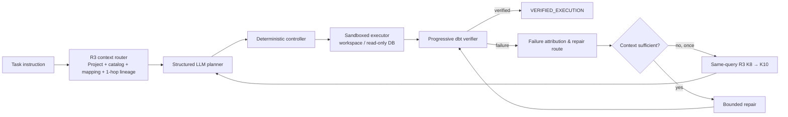

# DataPilot

**A Plan-and-Verify LLM Agent for Repository-Level Data Engineering**

DataPilot is a repository-level LLM agent for real-world data engineering tasks. It combines project structure, physical database metadata, and data lineage to ground planning; executes actions through a sandboxed runtime; verifies dbt projects deterministically; and performs bounded, error-routed repair when execution fails.

**Tech Stack:** Python · Qwen3-8B-AWQ · vLLM · dbt · DuckDB · BM25 · Pydantic · Pytest · Spider2-DBT

## Architecture

<p align="center">
  
</p>

### Highlights

- 🔍 **Lineage-Grounded Context** — Project graph, runtime catalog, deterministic mapping, and direct lineage.
- 🛡 **Controlled Execution** — Structured plans, evidence grounding, budgets, and sandboxed tools.
- ✅ **Progressive Verification** — Preflight → parse → compile → run → test → materialization sanity.
- 🔧 **Error-Routed Repair** — Failure attribution, bounded repair, reverification, and rollback.

<details>
<summary>Text / Mermaid architecture</summary>

<br>

DataPilot separates probabilistic proposal from deterministic control. The planner can propose a structured action, but the controller, sandbox, verifier, and repair state machine decide whether that action may run and what its result means.



</details>

## Why DataPilot?

Traditional Text-to-SQL is often `question → schema → SQL`. Repository-level data engineering is `task instruction → repository understanding → dbt change → execution → verification → diagnosis and repair`.

A useful agent must connect the task to a dbt repository, its live database schema, model dependencies, and the evidence needed to make a safe change. It must also distinguish an agent-caused regression from an existing project failure—and distinguish a successful execution from benchmark correctness.

DataPilot is built around those boundaries: grounded context, typed actions, deterministic verification, and bounded repair.

## Key Ideas

### 1. Lineage-grounded context

The frozen context router uses **BM25 task retrieval + catalog grounding + deterministic mapping + direct one-hop lineage**. It joins a project graph with the runtime database catalog, aligns catalog entities to project entities deterministically, and adds only direct lineage neighbors.

The default is **R3 / K=8**. A single expansion to **K=10** is allowed only when the exact evidence required for a repair has been proven missing. DataPilot does not claim embedding-based or semantic retrieval.

### 2. Structured plan and execute

The execution model is simple: **LLM proposes; deterministic components control execution.** A planner emits a typed plan, then a deterministic controller enforces action validation, evidence grounding, policy constraints, and budgets before a sandboxed executor runs it.

Supported actions include `LIST_FILES`, `READ_FILE`, `SEARCH_TEXT`, `QUERY_DB`, `EDIT_FILE`, and `RUN_DBT`. There is no unrestricted shell: `QUERY_DB` is read-only, and `EDIT_FILE` is limited to the task workspace.

### 3. Progressive verification

Completion is checked through deterministic gates: preflight, `dbt parse`, compile, run, test, and materialization sanity checks. Agent completion is only a procedural signal: DataPilot does not trust the model's own claim that a task is complete.

`VERIFIED_EXECUTION != official benchmark correctness`.

### 4. Error-routed, bounded repair

When verification fails, DataPilot follows a controlled loop:

`Verification failure → Failure attribution → Repair routing → Context sufficiency → Bounded repair → Reverification`

For example, compile resolution failures route to dependency inspection, schema mismatches route to schema inspection, and dbt test failures route to test diagnosis. The controller records progress states such as stage advancement, error changes, no progress, worsening, rollback, stall, and exhaustion. Repair is bounded to at most 3 rounds, 8 actions per round, 2 edits, and 3 database queries.

## Example Workflow: Evidence-Grounded Schema Repair

Consider a dbt model that selects `customer_name`, followed by a dbt failure classified as `MISSING_COLUMN`.

1. The verifier attributes the failure as a schema mismatch and routes it to `SCHEMA_INSPECTION`.
2. The agent reads the model and performs a read-only `QUERY_DB` against the runtime schema.
3. The query establishes that `raw_customers` has `(id, name)`.
4. Only after that evidence is available may the controller permit the exact edit `customer_name → name`.
5. The project is reverified on a fresh database copy.

The agent is not allowed to guess a replacement column. Schema evidence is required before the edit can be proposed and executed.

## Demo

**Evidence-Grounded Schema Repair**

```bash
python scripts/run_recruiter_demo_schema_repair.py --check
```

The check validates the local dbt, DuckDB, and OpenAI-compatible model endpoint prerequisites. The demo runs a real `SCHEMA_MISMATCH` repair: DataPilot queries the database schema before authorizing an edit, then performs full deterministic reverification. It uses a controlled synthetic fixture; no Spider2 data, Gold data, or evaluator resource is included in this repository.

## Evaluation

### Controlled engineering validation

Controlled fixtures exercise compile, schema, and test repair; context insufficiency and the K8→K10 gate; evidence consumption; rollback; stage advancement; error changes; stalls; and exhaustion. These cases validate the transition:

`VERIFICATION_FAILED → bounded repair → VERIFIED_EXECUTION`

They demonstrate controlled repair behavior, not that DataPilot repairs Spider2 tasks end-to-end.

### Frozen Spider2-DBT run

The frozen operational run covers 67 canonical runnable tasks. Its terminal outcomes were:

| Terminal outcome | Tasks |
| --- | ---: |
| `STEP_LIMIT` | 49 |
| `PLANNER_OUTPUT_INVALID` | 11 |
| `ACTION_FAILED` | 5 |
| `CONTROLLER_ERROR` | 2 |
| `AGENT_COMPLETE` | 0 |
| Entered verifier / repair | 0 / 0 |

The **Pinned `cafb867` Public-Gold Self-Eval** covered 61 of the 67 tasks and found **7 correct predictions (11.48%)**. This is an exact self-evaluation against the public-Gold subset, **not** an official full-68 leaderboard score.

### What the full run revealed

The primary bottleneck is the normal planner reaching and recognizing completion, not the repair controller: 43 step-limit tasks were evaluable and 7 were correct (16.28%). Notably, seven public-Gold-correct tasks still terminated with `STEP_LIMIT`, exposing a gap between reaching a correct repository state and recognizing completion.

> **Doing the task and knowing that the task is done are different problems.**

See the compact [evaluation summary](docs/EVALUATION_SUMMARY.md) for the frozen, non-Gold release record.

## Engineering Highlights

- Local `Qwen/Qwen3-8B-AWQ` planning served through a vLLM OpenAI-compatible API.
- Pydantic contracts for plans, actions, evidence, verification, and repair state.
- Isolated task workspaces with observed-path grounding and constrained file edits.
- Read-only DuckDB inspection and a fresh database copy for every repair verification round.
- Rollback on worsened repairs, plus deterministic stop conditions for no-progress, repeated strategy, stalls, and exhaustion.
- SHA-256 prediction sealing with immutable protocol and configuration fingerprints.
- A portable canonical test suite for the standalone release.

## Quick Start

From the DataPilot repository root:

```bash
python3 -m venv .venv-datapilot
source .venv-datapilot/bin/activate
python -m pip install -r requirements.txt
python -m pytest -q
```

`Spider2-DBT` is an external benchmark dependency. It is not bundled here. To run benchmark-oriented workflows, obtain the benchmark, its task inputs, and any evaluator resources separately under their applicable terms.

For local planner experiments, serve `Qwen/Qwen3-8B-AWQ` behind an OpenAI-compatible vLLM endpoint, then configure the client:

```bash
export DATAPILOT_LLM_BASE_URL=http://127.0.0.1:18080/v1
export DATAPILOT_LLM_API_KEY=local
export DATAPILOT_LLM_MODEL=datapilot-qwen3-8b-awq
```

The controlled runtime and planner entry points are in [`scripts/`](scripts/). Model weights are downloaded separately and are not included in this repository.

## Repository Structure

```text
DataPilot-public/
├── datapilot/
│   ├── agent/          # planner, controller, runtime, verifier integration
│   ├── catalog/        # runtime database catalog extraction and mapping
│   ├── context/        # project and task context preparation
│   ├── retrieval/      # frozen R3 router and retrieval accounting
│   ├── repair/         # bounded repair policies and orchestration
│   ├── tools/          # sandboxed filesystem, DB, and dbt tool contracts
│   ├── verifier/       # progressive, baseline-aware verification
│   ├── evaluation/     # sealed prediction and evaluation protocol support
│   └── schemas/        # Pydantic data contracts
├── scripts/            # controlled smoke and evaluation entry points
└── tests/              # canonical test suite
```

Release documentation and the sanitized controlled example live under [`docs/`](docs/) and [`examples/`](examples/). Raw runs, databases, evaluator resources, Gold, and benchmark copies are intentionally excluded.

## Reproducibility

The frozen evaluation configuration records:

- Spider2 source commit: `cafb867313aab4e674652054198f383cf4018943`
- Local model: `Qwen/Qwen3-8B-AWQ` revision `4da05a8edb55c6046cce958586c33b61da07bb79`
- Evaluation protocol SHA-256: `20cf70fd838335077c5e61fafc7a103beaff380862bed8a3f38c03b22f12cc52`
- Evaluation configuration fingerprint: `c8e5fa05c20b917be4bb77a8a655f525fb78c39e2bb814904fe3744643b63da8`
- Sealed prediction-set SHA-256: `c69b297d662f04545e1ba9b7286efd529022a8f17b23b278e83e6803bdbadbcc`

The compact [evaluation summary](docs/EVALUATION_SUMMARY.md) records the public release claims without bundling predictions, databases, Gold, or evaluator files.

## Current Limitations

- The normal local planner frequently reaches its action budget before emitting `AGENT_COMPLETE`.
- Repair has been validated in controlled fixtures, but was not activated in the frozen 67-task primary run because no task reached `AGENT_COMPLETE` and initial verification.
- The reported 11.48% result is an exact Public-Gold Self-Eval on 61 tasks, not an official full-68 benchmark result.

## Development Documentation

The public release documents are:

- [Evaluation summary](docs/EVALUATION_SUMMARY.md)
- [Third-party audit](docs/THIRD_PARTY_AUDIT.md)
- [Release manifest](RELEASE_MANIFEST.md)
