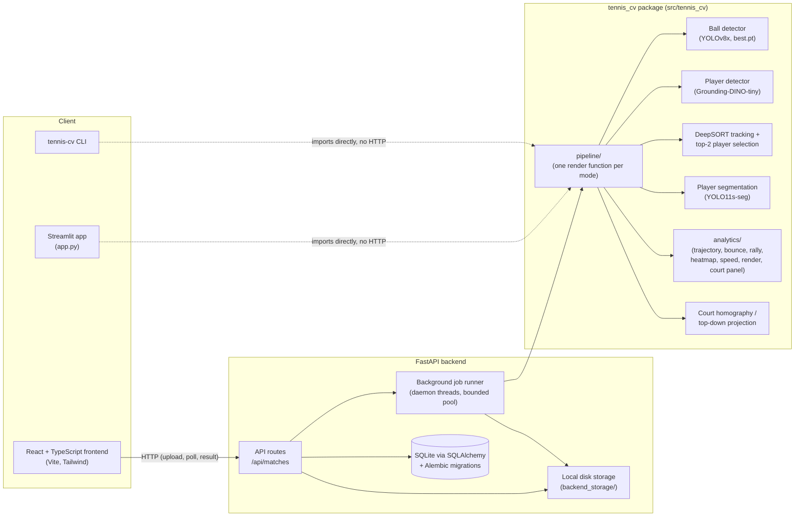

# CourtVision AI

**Tennis match video analysis with object detection, multi-object tracking, instance segmentation, temporal analytics, and homography-based court projection.**

CourtVision AI takes a broadcast-style tennis clip and renders an annotated output video: ball detection, zero-shot player detection, DeepSORT player tracking, player instance masks, a ball trajectory trail, movement heatmaps, bounce and rally candidates, ball speed, and — when a trusted court calibration is available — a top-down court view placed next to the video. The core computer-vision package (`src/tennis_cv/`) works on its own. A FastAPI backend with a React web UI, a Streamlit app, and a `tennis-cv` CLI all call the same pipeline functions.


*Project overview illustration, not a live application screenshot.*

## Contents

- [Overview](#overview)
- [Key features](#key-features)
- [How the computer vision pipeline works](#how-the-computer-vision-pipeline-works)
- [Advanced analytics](#advanced-analytics)
- [Homography and top-down court view](#homography-and-top-down-court-view)
- [Screenshots](#screenshots)
- [Architecture](#architecture)
- [Technology stack](#technology-stack)
- [Project structure](#project-structure)
- [Prerequisites and hardware](#prerequisites-and-hardware)
- [Model weights](#model-weights)
- [Installation](#installation)
- [Running the application](#running-the-application)
- [CLI reference](#cli-reference)
- [Configuration](#configuration)
- [API reference](#api-reference)
- [Testing](#testing)
- [Limitations](#limitations)
- [Troubleshooting](#troubleshooting)
- [Roadmap](#roadmap)
- [Contributing](#contributing) · [License](#license) · [Acknowledgments](#acknowledgments)

## Overview

The project turns a set of tennis computer-vision notebooks into a reusable Python package and wraps it in three interfaces. Its goals:

- Detect and follow the ball and the two players in a singles match video.
- Derive temporal analytics from those detections (trajectory, bounce candidates, rallies, speed, heatmaps) without inventing data the detectors did not see.
- Project positions onto a top-down court where a trusted calibration exists, and say clearly when it does not.
- Produce a browser-playable annotated video and, for the analytics mode, a JSON summary.

Typical flow through the web app:

1. Upload a clip (`.mp4`, `.mov`, `.avi`, `.mkv`, up to 500 MB) through the web UI or the API.
2. Choose an analysis mode: ball detection, player detection, player tracking, full analysis, or advanced analytics.
3. The backend runs the matching `tennis_cv` pipeline in a background thread and reports frame-based progress.
4. The UI polls for status until the job completes or fails.
5. View or download the output video. The API serves it with HTTP Range support, so the browser player can seek.
6. Review past matches on the dashboard, or delete one along with its stored files.

## Key features

| Feature | Implementation |
|---|---|
| Ball detection | Custom-trained YOLOv8x model (`best.pt`) with static court-mark suppression, so a fixed court marking is not reported as the ball on every frame. |
| Player detection | Zero-shot, prompt-based detection with Grounding-DINO-tiny (prompt: `"tennis player"`). No player-specific training. |
| Player tracking | Grounding-DINO detections fed into DeepSORT; the two tracks that moved the most are kept as the players, filtering out crowd and ball-kid detections. |
| Full analysis | Tracking plus ball detection, with a top-down court mini-map drawn onto the frame through a fixed reference homography. |
| Player instance segmentation | COCO-pretrained YOLO11s-seg (person class only). Masks are matched to DeepSORT track IDs by box IoU. This is pixel-level segmentation, **not** pose estimation: no keypoints or skeletons are produced. |
| Ball trajectory | Detected ball centres with short-gap interpolation, long-gap breaks, single-frame spike rejection, and resets at rally starts. |
| Movement heatmaps | Per-player ground-contact accumulation over the whole video, the current rally, or a recent time window. |
| Bounce candidates | Down-to-up reversals in image space, filtered by speed, turn angle, and proximity to a player. Labelled as unvalidated. |
| Rally segmentation | Ball-visibility spans with gap bridging and splitting; "confirmed" rallies require direction reversals and active players. |
| Ball speed | Image-space px/s between adjacent detections; with reference calibration, an additional ground-speed estimate between consecutive bounce candidates. |
| Top-down court panel | Optional panel composed to the right of the video showing projected players, ball, bounce candidates, and a court-space heatmap. Requires reference calibration. |
| Analytics summary | `output_analytics_summary.json` with rallies, bounce candidates, calibration status, segmentation status, warnings, and measured timings. |
| Court-keypoints training | Optional, separate workflow (`scripts/train_court_keypoints.py`) for a YOLO11-pose court-keypoints model. Not connected to the projection pipeline. |
| Three interfaces | React + FastAPI web app, Streamlit app (`app.py`), and `tennis-cv` CLI, all calling the same `tennis_cv` pipeline functions. |

## How the computer vision pipeline works

Each analysis mode is one render function in `src/tennis_cv/pipeline/`:

| Mode | CLI command | Pipeline | What it runs |
|---|---|---|---|
| Ball | `detect-ball` | `ball_pipeline.py` | YOLOv8x ball detector per frame, boxes drawn on the video. |
| Players | `detect-players` | `player_pipeline.py` | Grounding-DINO-tiny per frame, player boxes drawn. |
| Tracking | `track-players` | `tracking_pipeline.py` | Grounding-DINO → DeepSORT, then top-2 player selection by movement. |
| Full | `analyze` | `full_pipeline.py` | Tracking + ball detection, with a mini-map drawn through the reference homography. |
| Analytics | `analytics` | `analytics_pipeline.py` | Two-pass analytics pipeline described below. |

### Analytics mode: two passes

```mermaid
flowchart LR
    V[Input video] --> P1

    subgraph P1["Pass 1: one decode, all inference"]
        D1["Grounding-DINO → DeepSORT\n(player tracks)"]
        D2["YOLOv8x best.pt\n(ball detections)"]
        D3["YOLO11s-seg\n(person masks, optional)"]
        TS["Decoder timestamps\n(CAP_PROP_POS_MSEC)"]
    end

    P1 --> A

    subgraph A["Offline analysis (no models, no I/O)"]
        A1[Top-2 player selection]
        A2[Mask → track association]
        A3[Ball trajectory]
        A4[Reversals and bounce candidates]
        A5[Rally segmentation]
        A6[Heatmaps]
        A7[Speed]
        H{{"Reference homography\n(only if court_calibration=reference\nand it fits the frame)"}}
    end

    A --> P2

    subgraph P2["Pass 2: fresh decode, render"]
        R1[OverlayRenderer]
        R2["CourtPanel\n(optional, right side)"]
    end

    P2 --> O1[Annotated MP4]
    P2 --> O2[output_analytics_summary.json]
```



1. **Pass 1** decodes the video once and runs every model per frame: the same Grounding-DINO + DeepSORT step as the tracking mode, the same ball detector as the ball mode, and, if enabled, player instance segmentation. Real per-frame timestamps come from the decoder; if they are unusable, the pipeline falls back to `frame / fps`.
2. **Offline analysis** is a pure function over the pass-1 data (`analyze_frames`). It selects the two players, associates masks with track IDs, builds the trajectory, detects reversals and bounce candidates, segments rallies, then rebuilds the trajectory with rally starts as boundaries and re-derives events. It also accumulates heatmaps and computes speeds. The reference homography is used only when explicitly requested and when it passes the checks described in [Homography and top-down court view](#homography-and-top-down-court-view).
3. **Pass 2** decodes the video again, draws the enabled layers in a fixed order (heatmap → player masks → ball box → trail → bounce candidates → speed → rally HUD → legend), optionally composes the court panel on the right, writes a browser-playable MP4, and writes the JSON summary.

## Advanced analytics

Presets set the default layers; any individual option can be overridden on top:

| Preset | Layers enabled |
|---|---|
| `clean` (default) | Player masks + contours, ball box, trajectory trail, rally HUD |
| `detailed` | Everything in `clean`, plus heatmap, bounce candidates, speed, track IDs, legend |

The court panel is off in both presets and must be enabled explicitly.

| Overlay | What it actually is | What it does **not** claim |
|---|---|---|
| Player masks | Per-pixel person masks (`retina_masks`, frame-resolution polygons), matched to DeepSORT track IDs by box IoU; translucent fill and thin contour. Masks that fill ≥97% of their box are rejected as box-like. Frames without a usable mask show a small ground-point ellipse, never a filled box. | No pose, skeletons, or keypoints. |
| Ball trail | Detected ball centres; short gaps (≤3 frames by default) linearly interpolated and drawn dotted; longer gaps break the line; single-frame spikes inconsistent with both neighbours are rejected (shown as grey "ball? (rejected)"); resets at rally starts. | Interpolated points are estimates, not detections. |
| Heatmap | Ground-contact (bounding-box bottom-centre) samples per track, one per frame. Window = entire video, current rally, or recent N seconds, with no look-ahead. **Image-space by default and labelled so.** | Not court-space unless `court_calibration=reference`. |
| Possible bounce | Down-to-up image-space reversal with ≥3 contiguous real detections on each side, a minimum vertical speed and turn angle, and not inside a player box (likely a hit). With reference calibration, the candidate must also project onto the court. | Not validated on labelled bounce footage; hits, lobs, and deflections can trigger it. |
| Rallies | Ball-visibility spans; gaps ≤1.5 s bridged, ≥3 s split, in between bridged only if both players are moving. "Confirmed" needs ≥2 direction reversals **and** active players. Only trajectory segments with ≥3 real detections can start or end a rally. | No serve, fault, point-winner, or score inference. |
| Speed | px/s between adjacent real detections using decoder timestamps. With `court_calibration=reference` only: average ground speed between two consecutive bounce candidates with no hit between, labelled "est.". | Never km/h from raw pixels; a ground homography cannot measure a ball in flight. |

**Output files** (in the output directory): the annotated video written by the codec fallback chain (see [Troubleshooting](#troubleshooting)), `output_analytics_audio.mp4` when `ffmpeg` is available to copy the source audio back in, and `output_analytics_summary.json`. The summary records the full option set, video metadata, calibration status, ball point counts by kind (detected / interpolated / outlier), segmentation status, rallies, bounce candidates, ground-speed estimates, warnings, and measured timings for that run (`total_s`, `throughput_fps`, `peak_rss_mb`). These timings describe a single run on the machine that produced it; they are not published benchmarks.

**Segmentation failure cases.** Motion blur on fast swings (thin or missing limbs), the racket sometimes included in or cut out of the mask, overlapping people (players near the umpire or ball kids) merging or swapping, and very small far-court players falling below the confidence or area gates on some frames. If the segmentation weights are missing or fail to load, the job still runs without masks and records a warning.

## Homography and top-down court view

### The reference calibration

The project has exactly one homography. It is built in `src/tennis_cv/court/projection.py` with `cv2.findHomography` from four hand-picked court corners (`PITCH` in `src/tennis_cv/config.py`) to a top-down court board (`PROJS`). Those reference points were measured on a 1920×1080 frame of one specific camera framing, the project's reference video `video_tennis.mp4`. That video is used locally during development and is not committed (it is listed in `.gitignore`).

The calibration is **camera-specific**. On footage from a different camera position or court, projected positions will be wrong, even though raw-frame detection and tracking remain meaningful.

### Full-analysis mini-map

The `full` / `analyze` mode always applies the reference homography and draws a top-down mini-map onto the right-hand side of the frame, with the two players and the ball. It performs no calibration check. The web UI and the Streamlit app show a warning about this when "Full Analysis" is selected.

### Analytics court panel

In analytics mode, the court panel (`src/tennis_cv/analytics/court_panel.py`) is drawn as a separate panel **to the right of** the annotated video. The output video becomes wider; the original frame keeps its size and aspect ratio.

Requirements, as enforced by the current code:

1. `court_panel` must be enabled (`--court-panel` on the CLI, or `"court_panel": true` in API options).
2. `court_calibration` must be `reference`. It defaults to `none`.
3. The pipeline must accept the calibration: it is disabled with a warning if the homography matrix is degenerate or non-finite, or if any reference point lies outside the input frame (the reference points reach x = 1909 and y = 601, so smaller videos are rejected).

If the panel is enabled without an accepted calibration, it still appears, but it shows a "Homography unavailable: no trusted court calibration" notice instead of positions, and a warning is added to the run.

With an accepted calibration, the panel shows:

| Element | Source | Notes |
|---|---|---|
| Court and run-off | `COURT_LINES` board geometry | Net line drawn thicker; visible run-off around the court. |
| Players P1/P2 | Bottom-centre of each selected player's tracked box | Current position plus a 2-second fading trail. Trails only connect samples ≤3 frames apart, so tracking gaps stay visible. |
| Ball | Trajectory points (detected or interpolated; rejected outliers never drawn) | A ground homography is only exact on the ground, so an airborne ball is an approximate ground-plane projection. The panel legend says so. |
| Bounce candidates | Bounce candidates from the analytics pass | Labelled "unvalidated". Recent ones and those in the current rally are highlighted. |
| Heatmap | Court-space accumulator of player ground points | Shown when `heatmap` is also enabled. In this case the video itself keeps its image-space heatmap. |
| Footer | Legend and `frame N/M, t = …s` | |

Projected points that are non-finite or fall outside the visible run-off are skipped, never clamped onto the court. The panel is 600 px wide at 1080p and scales with frame height. The summary JSON gains a `court_panel` block with the output size, panel width, calibration flag, and counts of projected and skipped player, ball, and bounce points.

**Interface support:** the court panel and `court_calibration` are available through the CLI and through the API's `options` JSON. The React UI's analytics form and the Streamlit app do not currently expose them.

## Screenshots

| Dashboard | New analysis | Completed match |
|---|---|---|
|  |  |  |

Screenshots of the running frontend (`npm run dev`) against a local backend, including a completed ball-detection analysis submitted through the API. They predate the analytics mode and court panel.

## Architecture



The backend wraps the existing `tennis_cv` pipelines without modifying them. The Streamlit app and CLI call the same pipeline functions in-process, with no HTTP involved. Analytics options are validated in one place, `AnalyticsOptions.from_dict()`, which the CLI, Streamlit, and backend all use. There is no queue, cache, or external database beyond local SQLite and local disk.

## Technology stack

| Layer | Technologies |
|---|---|
| Computer vision | Python ≥ 3.10, [Ultralytics YOLO](https://github.com/ultralytics/ultralytics) (YOLOv8 ball detector, YOLO11-seg player masks, YOLO11-pose for the optional keypoints workflow), [Hugging Face Transformers](https://github.com/huggingface/transformers) + Grounding-DINO-tiny, [deep-sort-realtime](https://github.com/levan92/deep_sort_realtime), PyTorch / torchvision, OpenCV, NumPy, Pillow |
| Backend | FastAPI, Uvicorn, SQLAlchemy + Alembic (SQLite by default), Pydantic / pydantic-settings |
| Frontend | React 19, TypeScript (strict), Vite, React Router, Axios, Zustand (toast queue only), Tailwind CSS v4, Vitest + Testing Library, oxlint |
| Other interfaces | Streamlit (`app.py`), `tennis-cv` CLI (`src/tennis_cv/cli.py`, registered in `pyproject.toml`) |
| Optional tooling | `ffmpeg` on `PATH` for H.264 re-encoding and audio muxing |

## Project structure

```
app.py                         Streamlit UI; imports from tennis_cv, no CV logic of its own
src/tennis_cv/
├── config.py                  Constants, reference homography points, env-driven paths
├── cli.py                     `tennis-cv` command-line entry point
├── analytics/
│   ├── options.py             AnalyticsOptions: presets, toggles, validation
│   ├── trajectory.py          Ball trajectory: gaps, interpolation, spike rejection
│   ├── bounce.py              Direction reversals and bounce candidates
│   ├── rally.py               Rally segmentation
│   ├── heatmap.py             Image- or court-space heatmap accumulator
│   ├── speed.py               Image-space and ground-speed estimates
│   ├── segmentation.py        Player segmenter and mask → track association
│   ├── render.py              OverlayRenderer: draws all video overlays
│   └── court_panel.py         Top-down court panel composed to the right of the video
├── detection/                 Ball detector (YOLO), player detector (Grounding-DINO), segmentation model loader
├── tracking/                  DeepSORT tracking pass and top-2 player selection
├── court/                     Homography / projection drawing and keypoint dataset conversion
├── pipeline/                  One render function per analysis mode
├── video/                     Video I/O, playable-codec writer, audio mux, run directories
└── utils/                     Device selection (cuda/mps/cpu) and logging
backend/                       FastAPI app
├── app/
│   ├── api/routes/            /api/matches endpoints
│   ├── models/, schemas/      SQLAlchemy models, Pydantic schemas
│   ├── services/              Upload storage, background job runner, model loading
│   └── config.py              Env-driven settings
└── alembic/                   Database migrations
frontend/                      React + TypeScript web UI
└── src/
    ├── pages/                 Dashboard, New analysis, Match detail
    └── components/, hooks/, api/, lib/, store/
scripts/
└── train_court_keypoints.py   Dataset conversion, training, and prediction for court keypoints
tests/                         Unit and lightweight integration tests for tennis_cv
data/README.md                 Court-keypoints dataset requirements
docs/assets/                   README images
```

Component-level documentation: [backend/README.md](backend/README.md), [frontend/README.md](frontend/README.md), [data/README.md](data/README.md).

## Prerequisites and hardware

- **Python ≥ 3.10** for the CV package and backend.
- **Node.js and npm** for the frontend. See `frontend/package.json` for the dependency versions used in development.
- **Ball-detection weights** `best.pt` (not included; see [Model weights](#model-weights)).
- **Optional:** `ffmpeg` on `PATH`, for re-encoding to H.264 when OpenCV lacks a browser-playable codec, and for preserving audio in analytics mode.

No GPU is required. `get_device()` picks CUDA, then Apple Silicon MPS, then CPU. The project was developed and tested on Apple Silicon (MPS); it has not been verified on CUDA. In analytics mode, the segmentation model's device is set by `device` (default `auto`) and the ball model's by `ball_device` (default `cpu`, matching the other modes). Processing time depends on video length, resolution, selected mode, and hardware. No performance benchmarks are published.

## Model weights

| Model | Used by | Location | How to obtain |
|---|---|---|---|
| `best.pt` (YOLOv8x ball detector) | `ball`, `full`, `analytics` | `<repo root>/best.pt`, or `TENNIS_CV_BEST_PT_PATH`, or the CLI's `--weights` | Not committed (it exceeds GitHub's 100 MB file limit). Obtain or train your own. Missing weights raise a clear `FileNotFoundError`. |
| `yolo11s-seg.pt` (Ultralytics, COCO-pretrained, ~20 MB) | `analytics` with segmentation enabled | `<repo root>/models/yolo11s-seg.pt` (git-ignored), or `TENNIS_CV_SEG_WEIGHTS`, or the CLI's `--seg-weights` | Never downloaded implicitly. Download it yourself, or set `TENNIS_CV_SEG_AUTO_DOWNLOAD=1` to fetch the official Ultralytics release asset. |
| `IDEA-Research/grounding-dino-tiny` | `players`, `tracking`, `full`, `analytics` | Hugging Face cache | Downloaded automatically from the Hugging Face Hub on first use of a mode that needs it, not at app startup. |

If the segmentation weights are missing or fail to load, analytics jobs still run without masks and report a warning. `best.pt` is never modified.

## Installation

### Core CV package

```bash
pip install -r requirements.txt
pip install -e .
```

`pyproject.toml` declares runtime dependencies with loose (`>=`) constraints. `requirements.txt` pins the exact versions from the development machine (Apple Silicon, Python 3.13) and may need adjusting for your platform. For test dependencies: `pip install -e ".[dev]"`.

### Backend

```bash
cd backend
pip install -r requirements.txt
alembic upgrade head          # creates backend/tennis_cv.db with the matches table
uvicorn app.main:app --reload --port 8000
```

Backend base URL: `http://localhost:8000`. Interactive API docs: `http://localhost:8000/docs`.

### Frontend

```bash
cd frontend
npm install
cp .env.example .env          # edit VITE_API_URL if the backend isn't on localhost:8000
npm run dev
```

Frontend URL: `http://localhost:5173`. Start the backend first; the dev server boots without it, but API calls fail until it is up. The backend's CORS configuration allows `localhost:5173`, `localhost:3000`, and `localhost:8501`.

## Running the application

| Interface | Command | Notes |
|---|---|---|
| Web app | Backend + frontend as above | All five modes; analytics options form exposes presets, overlay toggles, heatmap window, and trail length. |
| Streamlit | `streamlit run app.py` | `.mp4` upload only. Outputs are written per run under `streamlit_runs/<run id>/` (git-ignored). |
| CLI | `tennis-cv <command> ...` | Full access to analytics options, including the court panel and calibration. |

## CLI reference

```bash
tennis-cv --help
tennis-cv detect-ball    --input video.mp4 --output-dir ./out
tennis-cv detect-players --input video.mp4 --output-dir ./out
tennis-cv track-players  --input video.mp4 --output-dir ./out
tennis-cv analyze        --input video.mp4 --output-dir ./out
tennis-cv analytics      --input video.mp4 --output-dir ./out --preset detailed
tennis-cv analytics      --input video.mp4 --output-dir ./out --no-segmentation   # no masks, skips the seg model

# Court panel: only meaningful for footage from the reference camera framing
tennis-cv analytics      --input video.mp4 --output-dir ./out --preset detailed \
                         --court-panel --court-calibration reference
```

All commands take `--input` (required) and `--output-dir` (default `./cli_outputs`). `detect-ball`, `analyze`, and `analytics` accept `--weights` to override the `best.pt` location.

`analytics` options:

| Flag | Values | Effect |
|---|---|---|
| `--preset` | `clean` (default), `detailed` | Base layer set |
| `--segmentation` / `--no-segmentation` | | Player masks |
| `--trajectory` / `--no-trajectory` | | Ball trail |
| `--ball-box` / `--no-ball-box` | | Ball bounding box |
| `--heatmap` / `--no-heatmap` | | Movement heatmap |
| `--bounces` / `--no-bounces` | | Bounce candidates |
| `--rallies` / `--no-rallies` | | Rally HUD |
| `--speed` / `--no-speed` | | Ball speed label |
| `--track-ids` / `--no-track-ids` | | Track ID labels |
| `--legend` / `--no-legend` | | Legend box |
| `--court-panel` / `--no-court-panel` | | Top-down court panel on the right |
| `--court-calibration` | `none` (default), `reference` | Trust the built-in reference homography |
| `--heatmap-window` | `video`, `rally`, `recent` | Heatmap accumulation window |
| `--heatmap-recent-s` | seconds | Window length for `recent` |
| `--trail-length` | 2–300 frames | Ball trail length |
| `--ball-conf`, `--seg-conf` | 0–1 | Detection confidence thresholds |
| `--mask-opacity`, `--heatmap-opacity` | 0–1 | Overlay opacity |
| `--device` | `auto`, `cpu`, `mps`, `cuda` | Segmentation model device |
| `--ball-device` | `cpu` (default), `auto`, `mps`, `cuda` | Ball model device; non-CPU runs use a private copy of the model |
| `--seg-weights` | path | Segmentation weights override |

Exit codes: `0` on success, `1` for missing files, fewer than two confirmed player tracks (`track-players`, `analyze`), or unexpected runtime errors, and `2` for invalid analytics options.

## Configuration

### Environment variables

| Variable | Where | Purpose | Default |
|---|---|---|---|
| `VITE_API_URL` | `frontend/.env` | Backend base URL the frontend calls | `http://localhost:8000` |
| `TENNIS_CV_BEST_PT_PATH` | shell env | Ball-detection weights path | `<repo root>/best.pt` |
| `TENNIS_CV_SEG_WEIGHTS` | shell env | Player segmentation weights (analytics mode) | `<repo root>/models/yolo11s-seg.pt` |
| `TENNIS_CV_SEG_AUTO_DOWNLOAD` | shell env | Allow downloading the official segmentation weights if missing (`1` to opt in) | `0` |
| `TENNIS_CV_RUNS_DIR` | shell env | Streamlit per-run output directory | `<repo root>/streamlit_runs` |
| `TENNIS_CV_BACKEND_DATABASE_URL` | shell env | Backend database connection string | SQLite file `backend/tennis_cv.db` |
| `TENNIS_CV_BACKEND_STORAGE_DIR` | shell env | Uploaded and output video storage | `<repo root>/backend_storage` |
| `TENNIS_CV_BACKEND_MAX_UPLOAD_SIZE_MB` | shell env | Upload size limit | `500` |
| `TENNIS_CV_BACKEND_MAX_CONCURRENT_JOBS` | shell env | Maximum simultaneous background jobs | `2` |

`frontend/.env.example` documents the frontend variable with a placeholder. Copy it to `.env`; real `.env` files are excluded from version control.

### Analytics options

`AnalyticsOptions` in `src/tennis_cv/analytics/options.py` is the single source of truth. Unknown keys and out-of-range values are rejected rather than ignored. Besides the CLI flags above, it defines tunables for trajectory gaps (`max_gap_frames`, `max_interp_gap`, `max_jump_px_per_s`), segmentation (`seg_min_area`, `seg_max_box_fill`, `assoc_iou`), bounce detection (`bounce_min_side_points`, `bounce_min_vy_px_s`, `bounce_min_angle_deg`), and rally segmentation (`rally_gap_s`, `rally_split_s`, `rally_min_duration_s`, `rally_min_detections`, `rally_confirm_min_reversals`, `rally_min_segment_points`). These extra tunables can be set through the API's `options` JSON; the CLI exposes only the flags listed above.

## API reference

Base URL: `http://localhost:8000`. Swagger UI at `/docs` once the backend is running.

| Method and path | Purpose |
|---|---|
| `GET /health` | Liveness check; returns `{"status": "ok"}` |
| `POST /api/matches?mode=<ball\|players\|tracking\|full\|analytics>` | Multipart upload (`file`: video; optional `options`: JSON object, **analytics mode only**, validated by `AnalyticsOptions`; `422` on unknown keys or invalid values). Creates a match and starts background analysis. |
| `GET /api/matches?page=&page_size=` | Paginated list of matches, newest first |
| `GET /api/matches/{id}` | Status and progress; poll this while a job runs |
| `GET /api/matches/{id}/result` | Output video (`404` until `status == completed`); supports HTTP Range requests |
| `GET /api/matches/{id}/analytics` | Analytics summary JSON; `404` for non-analytics matches |
| `DELETE /api/matches/{id}` | Deletes the match and its stored files (`409` while it is processing) |

A match's `status` moves through `pending` → `processing` → `completed` or `failed`. Progress is a frame-count percentage from the pipeline's progress callback, not a time estimate.

Example: an analytics job with the court panel, through the API:

```bash
curl -X POST "http://localhost:8000/api/matches?mode=analytics" \
  -F "file=@video.mp4" \
  -F 'options={"preset": "detailed", "court_panel": true, "court_calibration": "reference"}'
```

## Testing

**Core CV package**

```bash
pip install -e ".[dev]"
python -m pytest tests/
```

Most tests are fast and deterministic and need no model weights or network access. That includes the analytics tests (`tests/test_analytics_*.py`), which cover options, trajectory, bounce, rally, heatmap, speed, segmentation association, and rendering. `test_analytics_pipeline.py` runs the analytics pipeline end to end on a tiny synthetic video with fake models. `test_analytics_bounce_real.py` checks bounce behaviour against recorded `best.pt` detections embedded as fixtures; it checks algorithm behaviour, not accuracy. `test_ball_detector.py` needs `best.pt` at the repository root and skips otherwise. `test_player_detector.py` uses the bundled `test_image.png` and downloads Grounding-DINO-tiny on first run if it is not cached.

**Backend**

```bash
cd backend
pytest
```

Runs offline against a fake pipeline function (no model download or inference). Covers upload validation, analytics option validation, job state transitions, storage, and the API contract.

**Frontend**

```bash
cd frontend
npm run lint
npm test -- --run
npm run build
```

Tests mock the API client (no real HTTP calls or inference). Lint runs oxlint.

The test suites were not re-run as part of this README update, so no current pass counts are given here. Run the commands above to verify on your machine.

## Limitations

- **Court calibration is camera-specific.** The only homography is hand-calibrated for the reference video's camera framing. On other footage the full-analysis mini-map is wrong, and analytics-mode projection should not be enabled. In analytics mode, `court_calibration` defaults to `none` and `reference` is an explicit opt-in.
- **Projected positions depend on detections and calibration.** The court panel only shows positions the detectors produced and the homography can map into the visible area; missed detections, tracking gaps, and out-of-bounds projections appear as gaps, not estimates. Ball positions in flight are approximate ground-plane projections.
- **The full-analysis mode does not check calibration.** It always draws the mini-map through the reference homography.
- **The court-keypoints workflow is not connected to projection.** Training a keypoints model does not make the homography self-calibrating.
- **The court panel is CLI- and API-only.** The React and Streamlit analytics forms do not expose `court_panel` or `court_calibration`.
- **Ball detection is limited by the trained model.** `best.pt` can miss blurred, occluded, or very small, fast balls.
- **Player tracking assumes exactly two players.** Top-2-by-movement selection suits singles footage; it is not a general multi-player tracker. Doubles is not supported.
- **Analytics are heuristics.** Bounce candidates and rallies are not validated against labelled data; there is no serve, fault, point, or score detection, and no pose estimation.
- **No authentication.** Every uploaded match is visible to anyone who can reach the API. Suitable for local, single-user use only.
- **SQLite, single backend instance.** Not suited to multiple concurrent writer processes.
- **No job cancellation.** A running analysis runs to completion or failure.
- **No accuracy metrics or benchmarks.** None have been measured.

## Troubleshooting

| Symptom | Cause and fix |
|---|---|
| `FileNotFoundError` mentioning `best.pt` | Place the weights at the repository root, set `TENNIS_CV_BEST_PT_PATH`, or pass `--weights`. |
| Analytics run warns that segmentation is unavailable | `yolo11s-seg.pt` is missing or failed to load. Put it at `models/yolo11s-seg.pt`, set `TENNIS_CV_SEG_WEIGHTS`, or set `TENNIS_CV_SEG_AUTO_DOWNLOAD=1`. Use `--no-segmentation` to skip it. |
| "Only N player track(s) were confirmed (need at least 2)" | Tracking needs two confirmed players. `track-players` and `analyze` exit with code 1; analytics continues without player masks, heatmap, and rally confirmation. Try a longer or clearer singles clip. |
| Court panel shows "Homography unavailable" | Either `--court-calibration reference` was not set, or the calibration was rejected because the video is smaller than the reference points require or the matrix is degenerate. Check the run's warnings and the summary's `calibration` block. |
| Projected positions look wrong on the court panel or mini-map | The video was not shot from the reference camera framing. The calibration cannot be reused for other cameras. |
| Output video does not play in the browser | OpenCV fell back to the `mp4v` codec and `ffmpeg` is not installed, so it could not re-encode to H.264. Install `ffmpeg`, or download the file and open it in a native player. |
| Analytics output has no audio | OpenCV writes video only. Install `ffmpeg` so the source audio is muxed into `output_analytics_audio.mp4`. |
| `422` from `POST /api/matches` | `options` was sent for a non-analytics mode, was not a JSON object, or contained an unknown key or invalid value. The response detail names the problem. |
| Frontend loads but API calls fail | Start the backend, and check `VITE_API_URL` in `frontend/.env`. |

## Roadmap

Planned, not implemented. Listed to make the current scope clear, not as a commitment:

- Self-calibrating court projection using the trained keypoints model, so projection works beyond the reference camera.
- Exposing the court panel and calibration options in the web and Streamlit interfaces.
- Authentication and per-user ownership of matches.
- Job cancellation and retry.

## Contributing

Issues and pull requests are welcome. Before opening a PR, run the core, backend, and frontend test suites above. Keep changes to the three interfaces (web app, Streamlit, CLI) additive to the shared `tennis_cv` pipeline rather than duplicating detection, tracking, projection, or analytics logic, and route new analytics options through `AnalyticsOptions`.

## License

This repository's own source code is licensed under the [MIT License](LICENSE). It depends on third-party libraries under their own licenses, notably [Ultralytics YOLO](https://github.com/ultralytics/ultralytics) (AGPL-3.0), used for ball detection, player segmentation, and the optional court-keypoints model. Review each dependency's license before redistributing a derivative that bundles their code, particularly Ultralytics' AGPL-3.0 terms.

## Acknowledgments

- [Ultralytics YOLO](https://github.com/ultralytics/ultralytics) (AGPL-3.0): ball detection (YOLOv8), player segmentation (YOLO11-seg), and court keypoints (YOLO11-pose).
- [IDEA-Research Grounding-DINO](https://github.com/IDEA-Research/GroundingDINO) (Apache-2.0; `IDEA-Research/grounding-dino-tiny` via Hugging Face Transformers): zero-shot player detection.
- [deep-sort-realtime](https://github.com/levan92/deep_sort_realtime) (MIT): player tracking.
- Originally developed in the Neuralearn.ai tennis computer vision course notebooks, since migrated into this package (`src/tennis_cv/`) with behavior verified against the notebooks' outputs.
- Some backend and frontend patterns (upload validation mechanics, threaded job-runner shape, pagination helper, API client structure, a few UI components, and the design-token palette) are adapted from the author's earlier project, SentinelCam. See `backend/README.md` and `frontend/README.md` for per-file notes.
