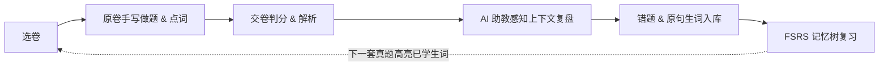

<div align="center"><a name="readme-top"></a>


# 英语之道 · CETPath

**把真题做透，把生词记牢。**

AI 驱动的四六级与考研英语真题研习工作台：<br>
在原卷上做题、查词、手写批注，让感知全局上下文的 **AI 助教**伴读复盘，卷中生词带着原句入库**记忆树**。

<p>
  <a href="https://yingyu-preview.vercel.app">
    
  </a>
  <a href="https://github.com/luohui1/CETPath/releases/tag/data-v1">
    
  </a>
</p>

<sub>免登录体验四级、六级、考研各一套完整样卷；可在「设置 → Agent 模型」填入自己的 OpenAI 兼容 Key 体验 AI 助教（仅存本地浏览器）。</sub>

[在线预览](https://yingyu-preview.vercel.app) · [核心亮点](#核心亮点) · [功能详解](#功能详解) · [快速开始](#快速开始) · [数据准备](#数据准备) · [技术架构](#技术架构) · [常见问题](#常见问题)

[](#ai-助教) [](https://react.dev) [](https://www.typescriptlang.org) [](https://vite.dev) [](https://tailwindcss.com) [](https://vite-pwa-org.netlify.app) [](https://github.com/open-spaced-repetition/ts-fsrs) [](https://mozilla.github.io/pdf.js/) [](LICENSE) [](https://linux.do)

</div>

<p align="center">
  
</p>

## 核心亮点

<table>
<tr>
<td width="33%" valign="top">

**🤖 全卷感知的 AI 助教**<br>
免复制粘贴，直接读取卷面文章、作答、耗时与笔记。按「读题 → 定位 → 定位句 → 排除」嵌入式卡片讲题，读写生词本与错题本，具备长期记忆。

</td>
<td width="33%" valign="top">

**📄 原版 PDF 卷面做题**<br>
原卷加文字层渲染：点词还原词形出卡，手写笔压感圈画，荧光笔高亮，每题自带深度解析，听力音频与原文逐句同步。

</td>
<td width="33%" valign="top">

**🌳 记忆树 + FSRS 背词**<br>
生词带着真题原句入库。同根、短语、易混三枝串联，FSRS 算法动态调度复习，支持一天多轮与晚间自测速览表。

</td>
</tr>
<tr>
<td valign="top">

**🎯 题型专项与错题闭环**<br>
从任意真题按听力、阅读、翻译或写作单独截取计分，错题自动归档并支持交卷后一键呼叫 AI 复盘。

</td>
<td valign="top">

**🧩 AI 长难句结构拆解**<br>
主干、从句、修饰成分分色拆解；既有一键预置卡片，也可在卷面框选任意句子交由 AI 实时剖析语法结构。

</td>
<td valign="top">

**📴 本地优先 · PWA 离线**<br>
作答、笔记、生词与 AI 学习档案均存于本地 IndexedDB；安装 PWA 后无网亦可刷卷背词，支持备份导入与云端同步。

</td>
</tr>
</table>

## 设计理念：围绕一套真题的 AI 闭环

传统备考把「刷题、背词、问 AI」割裂在三个工具里。**CETPath（英语之道）** 将三者收束于同一张原卷：



- **原卷即工作台**：保留原版 PDF 排版，点词查词、点题号作答、手写笔圈画批注。
- **AI 懂你的上下文**：AI 助教实时感知当前文章、选项、你的正误与耗时，还能在卷面直接高亮长难句、替你管理生词本与解题思路库。
- **真题语境生根**：卷中查过的词自动绑定真题原句进入词书，并在后续试卷中自动高亮重现。

---

## 功能详解

### AI 助教


在卷面旁分屏开启，无需复制题目即可直接提问（如「第 47 题怎么做」），回答内直接嵌入交互式结构卡片：

1. **读题 → 定位 → 定位句 → 排除**：四步卡片逐级展开，理清解题逻辑；
2. **嵌入式可视化**：回答内直接渲染**句子成分结构图**（点色块看语法作用）、**定位句与选项对照图**、**词汇卡**与**即时小测**；
3. **随手沉淀**：回答中选中任意词句可一键收入生词本或「解题思路库」。


**全局工具调用与长期记忆**：

| 感知与操作域 | AI 助教能力 |
|---|---|
| **试卷与卷面** | 读取文章、题目、你的作答、正误、单题用时与手写笔记；可在卷面直接标注与拆解长难句 |
| **生词与错题** | 查词、增删改生词本、标记已掌握；归档错题并按题型诊断薄弱项 |
| **解题思路库** | 将复盘提炼的技巧按题型归类沉淀，供考前速查 |
| **学习者档案** | 每次对话后自动融合更新你的目标、语法弱项与偏好讲法，结合实时刷题统计持续进化 |

> 后端仅依赖 Python 标准库，可对接任意 OpenAI 兼容接口（DeepSeek、Gemini 等），API 密钥仅保存在服务端。

### 原卷做题与听力同步


- **点词即查**：自动词形还原（如 `studies → study`），展示音标、真人发音、词根拆解；框选多词可查短语或整句翻译。
- **生词跨卷高亮**：生词本中的词汇与短语会在后续每一套真题卷面自动标出。
- **防误触手写**：手指滑动翻页、手写笔压感落墨（支持荧光笔、下划线、便签、套索与撤销）。
- **双模式与深度解析**：支持「练习模式」与「全真计时模拟」（按四六级官方规则折算分值），每题附带信号词、定位句、逐项排除与译文。


- **听力逐句同步**：支持倍速、按段跳转与单句循环；原文同步高亮，答案句以荧光笔与题号标出，点击题号即刻跳回卷面对应题目。

### 专项训练与错题本


- **题型拆解训练**：从任意真题中单独抽取听力、选词填空、长篇/仔细阅读、翻译或写作独立练习计分。
- **交卷复盘单**：汇总得分、耗时与错题分布，支持「只重做错题」或一键召唤 AI 助教逐题复盘。

### 长难句结构解析


默认留白供自己分析；开启右侧「长难句」后，卷面句首浮现编号，点开即可查看**主谓宾主干、从句与修饰关系的分色拆解卡**，亦可框选卷面任意句子让 AI 现场剖析。

### 背单词：记忆树


- **三维记忆树**：以词根为干、前缀为叉、同根词为叶，节点颜色映射记忆深度；同步串联**同根词、短语搭配、易混词辨析**三根枝。
- **FSRS 算法与提示阶梯**：基于 [ts-fsrs](https://github.com/open-spaced-repetition/ts-fsrs) 划分 5 级记忆状态；遗忘时先给「词根拆法」一级提示，再给「分块释义」二级提示。
- **多轮复习与晚间速览**：支持早中晚多轮快刷，晚间自动生成同根/易混/后缀速览表供遮挡自测；内置四级、六级、考研大纲词表与离线真人发音。

### 全景页面与平板适配


- **全流程页面**：涵盖今日推荐首页、按年份归档的真题库、学习统计看板、生词本及独立 AI 助教页。
- **平板横屏优先**：专为平板手写刷题优化（笔墨与手势分离），支持安装为桌面/平板 PWA 离线使用。

<div align="right"><a href="#readme-top">↑ 回到顶部</a></div>

---

## 技术架构

```
浏览器端 (Local-First PWA)
├── React 19 + TypeScript 5.8 + Tailwind CSS 4
├── PDF.js           原卷渲染与文字层坐标映射（点词查词、长难句精准定位）
├── Dexie/IndexedDB  本地存储作答、笔迹、生词、FSRS 卡片与 AI 学习档案
├── ts-fsrs          FSRS 间隔重复调度算法
├── Workbox          离线缓存（应用外壳、词典分片、已打开试卷）
└── Grasso           自研设计系统 (src/grasso/)

服务端 (可选，仅 AI 助教与云同步需要)
├── nginx            静态托管 + 反向代理 (/api/agent/、/admin)
└── server/agent_server.py   Python 标准库轻量服务，对接任意 OpenAI 兼容模型并自带管理后台
```

---

## 快速开始

环境要求：Node.js 20+（不部署 Python 后端也可完整使用原卷做题、听力与记忆树背词）。

```bash
git clone https://github.com/luohui1/CETPath.git
cd CETPath
npm install
npm run dev
```

> [!TIP]
> 为保持 Git 仓库轻量，真题试卷、离线词典与听力音频打包在 **[GitHub Releases (`data-v1`)](https://github.com/luohui1/CETPath/releases/tag/data-v1)** 中，下载解压到 `public/` 目录即可直接刷题。

### 数据准备

#### 方式一：直接下载数据包（推荐）

前往 [Releases · data-v1](https://github.com/luohui1/CETPath/releases/tag/data-v1) 下载所需压缩包，解压至项目 `public/` 目录即可：

| 压缩包 | 解压路径 | 内容说明 |
| --- | --- | --- |
| `cetpath-papers.tar.gz` | `public/papers/` | 137 套完整试卷（四级 68 套、六级 68 套、考研英语一 1 套，含原版 PDF、题目 JSON、解析、译文与长难句） |
| `cetpath-dict.tar.gz` | `public/dict/` | 离线词典（ECDICT）、词根词缀（OpenEtymology）与易混词数据（Lexkite） |
| `cetpath-audio.tar.gz` | `public/audio/` | 四六级真题听力音频（可选下载；不含单词真人发音，背词默认使用浏览器语音） |

命令行一键解压示例：

```bash
# 下载压缩包后在项目根目录执行
tar -xzf cetpath-papers.tar.gz -C public
tar -xzf cetpath-dict.tar.gz -C public
tar -xzf cetpath-audio.tar.gz -C public   # 可选，需要听力音频时解压
```

#### 方式二：从原始资料自行构建

| 数据模块 | 目标路径 | 构建方式 |
| --- | --- | --- |
| **词典** | `public/dict/` | 下载 [ECDICT](https://github.com/skywind3000/ECDICT) 的 `ecdict.csv` 至 `data/raw/ecdict/`，运行 `npm run build:dict` |
| **词根词缀** | `public/dict/roots/` | 将 [OpenEtymology](https://github.com/openetymology/OpenEtymology) EPUB 放入 `data/raw/openetymology/`，运行 `npm run build:roots` |
| **真题试卷** | `public/papers/` | 使用导入脚本将**有权使用**的真题 PDF 转为原卷数据（格式见 [`docs/试卷数据格式.md`](docs/试卷数据格式.md)） |
| **听力与发音** | `public/audio/` | 听力随 `npm run import:cet` 导入；单词发音通过 `npm run fetch:word-audio` 获取 |

<details>
<summary><b>常用构建与数据导入命令（点击展开）</b></summary>

| 命令 | 说明 |
| --- | --- |
| `npm run dev` / `npm run dev:lan` | 启动本地开发服务器 / 暴露局域网供平板访问 |
| `npm run build` / `npm run preview` | 类型检查并打包至 `dist/` / 本地预览构建结果 |
| `npm run organize:cet` | 整理四六级资料包为按考试与年月归档的标准目录 |
| `npm run import:cet` | 导入整理好的四六级真题、解析与听力为原卷数据 |
| `npm run import:kaoyan -- 2019` | 导入考研英语（一）真题与答案 PDF（去水印、定位题号与单词） |
| `npm run import:sample` | 导入四级官方样卷（六级使用 `python -I scripts/import_neea_sample.py cet6`） |
| `npm run inspect:pdf -- 文件.pdf` | 检查 PDF 文字层完整性与试卷类型 |
| `npm run check:papers` / `npm run thumbs` | 校验试卷 JSON 并生成 `index.json` / 生成试卷首页缩略图 |
| `npm run polish:explain` / `npm run align:transcripts` | 整理解析至 `public/papers/explain/` / 听力原文逐句对齐音频 |
| `npm run build:dict` / `npm run build:roots` | 生成按首字母分片的词典数据 / 生成词根词缀与同根词树 |

</details>

### 部署 AI 助教（可选）

```bash
python3 server/agent_server.py set-password   # 首次运行：设置 /admin 管理后台密码
python3 server/agent_server.py serve          # 启动服务（默认监听 127.0.0.1:8787）
```

通过 Nginx 将 `/api/agent/`、`/api/admin/`、`/admin` 反向代理至 `127.0.0.1:8787`（参考 [`deploy/nginx.conf`](deploy/nginx.conf) 与 [`deploy/yingyu-agent.service`](deploy/yingyu-agent.service)），访问 `/admin` 填入 OpenAI 兼容接口地址、模型名（如 DeepSeek、Gemini）与密钥即可。

> [!WARNING]
> 公网部署时请务必在 `/admin` 中设置**激活码**或在 Nginx 层限制访问，防止接口额度被未授权调用。

---

## 目录结构

```
src/
  pages/        应用页面（首页、真题库、做题、背词、生词本、记忆树、统计、设置…）
  exam/         原卷工作台（PDF 卷面、答题卡、手写笔记、长难句、AI 助教分屏）
  review/       拼写卡片与真题原句语境复习
  components/   通用组件（查词卡、听力播放器、记忆树可视化…）
  lib/          核心逻辑（IndexedDB、词典、FSRS、词根树、AI Agent 接口）
  grasso/       Grasso 设计系统
server/         AI 助教轻量后端（Python 标准库）
scripts/        数据导入、对齐、词典构建与校验脚本
deploy/         Nginx 与 systemd 部署配置示例
docs/           架构设计文档、试卷数据格式规范与宣传截图
```

## 常见问题

<details>
<summary><b>1. clone 下来为什么没有真题卷子？</b></summary>

为了保持 Git 仓库轻量、避免大体积 PDF 和音频拖慢 `git clone`，真题试卷、离线词典和听力音频统一打包在 [GitHub Releases (`data-v1`)](https://github.com/luohui1/CETPath/releases/tag/data-v1) 中。下载解压到 `public/` 目录即可直接使用，也可以按 [数据准备](#数据准备) 自行导入其他卷子。
</details>

<details>
<summary><b>2. 不配置 AI 后端可以用吗？支持哪些大模型？</b></summary>

可以。原卷做题、点词查词、手写笔记、听力同步与记忆树背词均在浏览器本地运行；配置后端后可接入 DeepSeek、Gemini、OpenAI 等任意 OpenAI 兼容接口开启 AI 助教与实时长难句剖析。
</details>

<details>
<summary><b>3. 学习数据存在哪里？如何跨设备同步？</b></summary>

默认存储在浏览器本地 `IndexedDB` 中，可在设置页导出/导入备份文件；若部署了后端服务，登录账号即可自动云端同步。
</details>

## 数据来源、版权与致谢

- **开源数据致谢**：词典释义与音标来自 [ECDICT](https://github.com/skywind3000/ECDICT) (MIT)；词根词缀与词源来自 [OpenEtymology](https://github.com/openetymology/OpenEtymology) (CC BY-SA 4.0)；易混词辨析（82 组）来自 [Lexkite confused-words-dataset](https://github.com/lexkiteapp/confused-words-dataset) (CC BY 4.0)。
- **核心依赖致谢**：[ts-fsrs](https://github.com/open-spaced-repetition/ts-fsrs)、[PDF.js](https://github.com/mozilla/pdf.js)、[Dexie.js](https://github.com/dexie/Dexie.js)、[Workbox](https://github.com/GoogleChrome/workbox)。
- **社区致谢**：[LINUX DO](https://linux.do) 社区。
- **开源协议**：本仓库应用源码采用 [MIT License](LICENSE) 开源。
- **版权与合规声明**：Releases 数据包中的真题原卷、音频与解析版权仍归原权利人所有，仅供个人学习参考，不包含在 MIT 开源授权内；公开部署或二次分发前请取得相应授权。

<div align="right"><a href="#readme-top">↑ 回到顶部</a></div>
