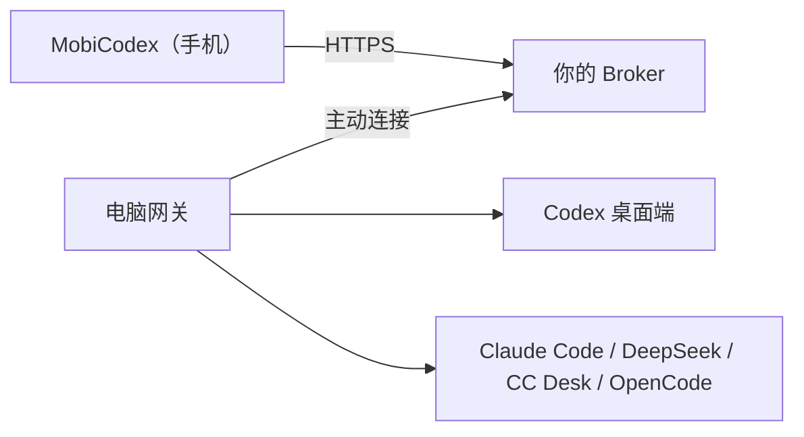

<div align="center">


# MobiCodex

**人离开电脑，Agent 照样能接着干。**
在手机上跟进、回复、审批电脑上的 Codex、Claude Code、DeepSeek、CC Desk 和 OpenCode 会话。

[](#下载)
[](CHANGELOG.md)
[](LICENSE)

[下载](#下载) · [三步上手](#三步上手) · [支持的 Agent](#支持的-agent) · [更新说明](CHANGELOG.md) · [反馈问题](#反馈问题)

</div>

<p align="center">
  
  
  
</p>

## 为什么用它

Agent 一跑就是几十分钟，中间常常要你点一下审批、回答一个问题，或者看一眼结果再决定下一步。人不在电脑前，它就只能干等。MobiCodex 让这些事在手机上就能做完。

- **会话跟着你走**：电脑上正在跑的会话，在手机上按项目找到，实时看输出，接着发文字、图片和语音。
- **需要你时才提醒**：任务完成、等你审批或回答时，手机弹出通知，点开直接进入那条会话。
- **用嘴派活**：语音最长 10 分钟，边说边转文字，还能先整理成提示词再发出去。
- **把活交出去，回来验收**：用「事项」把工作交给指定的 Agent，进度自动回写成进行中、待验证，由你验收或退回。
- **额度用完不断档**：Codex 额度用完，在原线程里换个渠道接着做，上下文不丢。
- **不用同一个 Wi-Fi**：电脑网关主动连接你自己的 HTTPS Broker，手机在哪都能连，消息不经过第三方服务。

<p align="center">
  
  
  
</p>

## 支持的 Agent

所有 Agent 共用同一套会话界面：输入框、附件、语音、草稿和运行中的操作都一样，按钮按各通道实际支持的能力显示。

| Agent | 在手机上能做什么 |
| --- | --- |
| Codex 桌面端 | 查看并继续电脑上的会话；文字、图片、语音；审批、回答提问、停止；额度用完原线程换渠道 |
| Claude Code | 打开已加载插件的会话，看输出、排队输入、审批、回答提问、中断 |
| Claude CLI | 在网关配置里允许的目录中，查看、继续或新建电脑上的 Claude Code 会话：看输出、排队或追加、审批、回答提问、切换权限模式和模型、中断 |
| DeepSeek Harness | 查看电脑上的会话和历史，继续原线程，回答提问 |
| CC Desk | 查看 CC Desk 会话，发消息、审批、中断 |
| OpenCode | 打开现有会话，看输出、回答提问 |

新的 Agent 只要实现标准的 SessionAdapter，就能直接用上这套界面，见[其他 Agent 接入](docs/agent-gateway.md)。

## 下载

| 文件 | 说明 |
| --- | --- |
| [Android APK 0.4.5（下载页）](https://zyzlz.xin/mobile-codex/releases/android/preview/index.html) | Android 6.0+，可直接覆盖安装旧版 |
| [GitHub Release](https://github.com/luoz76070-art/MobiCodex/releases/tag/mobicodex-v0.4.5) | 同一份源码由 GitHub Actions 构建，附校验值 |
| [版本说明](releases/android/mobicodex/0.4.5/) | 本版内容、签名说明和安装步骤 |

装好以后在「设置 → 应用更新」检查更新。只改界面的更新会在后台下载，下次打开时生效，不用重装。

> 从 Kelivo 整合版（0.1.x）换过来：两者是不同的应用，可以同时安装。按下面的步骤重新配对一次，确认正常后再卸载旧版。Kelivo 里的 AI 聊天记录和手机上保存的语音转写记录不会迁移。

## 三步上手

电脑上需要运行 Codex 桌面端和本项目的网关；手机不在同一个 Wi-Fi 时，还需要一台你自己的 HTTPS Broker（[部署说明](docs/remote-broker.md)）。

**1. 在电脑上装好网关**

```sh
git clone https://github.com/luoz76070-art/MobiCodex.git
cd MobiCodex
corepack pnpm install --frozen-lockfile
corepack pnpm build:plugin
node dist-plugin/mobile-codex/scripts/mobile-codex.mjs init --workspace /absolute/path/to/your/project
```

**2. 填好 Broker 配置后启动，生成配对信息**（配置项见[网关说明](plugins/mobile-codex/README.md)）

```sh
node dist-plugin/mobile-codex/scripts/mobile-codex.mjs start
node dist-plugin/mobile-codex/scripts/mobile-codex.mjs pair
```

**3. 在手机 App 的「设置」里粘贴配对信息**，连上后选择会话即可。`pair` 只生成短期有效的配对信息，不调用模型。

已经配置过的电脑，先运行 `mobile-codex.mjs status`，沿用原来的配置和工作目录。要接 CC Desk，见 [CC Desk 接入](integrations/cc-desk/README.md)。

## 工作原理



网关跑在你的电脑上，主动连到 Broker，电脑不用开放端口。手机经 Broker 和网关通信，配对后才能访问；本地图片也要经过网关鉴权才能取到。

## 反馈问题

遇到问题请提到 [GitHub Issues](https://github.com/luoz76070-art/MobiCodex/issues)，写清手机型号、App 版本和复现步骤。

也可以在 App 的「设置 → 反馈问题」或长按消息选「反馈这条」。反馈默认存到你电脑上的网关；网关配置了 GitHub 仓库的话（见[网关说明](plugins/mobile-codex/README.md)），可以在手机上选仓库、预览后直接提交成 issue，提交前会隐藏本机路径、用户名、邮箱、网址、IP 地址和密钥。反馈只收文字，不带截图；处理完的反馈 7 天后从电脑上自动清理。

## 开发与构建

| 目录 | 职责 |
| --- | --- |
| `apps/mobile` | MobiCodex Android App：React 页面 + Capacitor 原生壳（录音、更新、凭据、系统栏与取色） |
| `apps/relay` | Fastify：电脑网关、各 Agent 适配器、Codex Desktop IPC、Broker 与 Tunnel |
| `plugins` | 电脑网关及其他 Agent 的接入包 |
| `integrations/cc-desk` | CC Desk 的补丁副本与本机控制 |
| `docs` | 文档，入口是 [docs/project-index.md](docs/project-index.md)，目录结构见 [docs/project-layout.md](docs/project-layout.md) |

Node.js 22+、pnpm 10.20.0；Android 构建需要 Android SDK 35 与 JDK 21+（lint 用 JDK 17）。

```sh
corepack pnpm install --frozen-lockfile
corepack pnpm verify
corepack pnpm --filter @mobile-codex/mobile build
corepack pnpm --filter @mobile-codex/mobile exec cap sync android
gradle --project-dir apps/mobile/android :app:assembleRelease
```

构建前在 `apps/mobile/.env.production.local` 配置 App 内更新与界面更新的清单地址（见 `apps/mobile/scripts/check-update-sources.mjs`）。发布由推送 `mobicodex-v<版本>` 标签触发 [Android 发布工作流](.github/workflows/release-android.yml)。自己的构建签名与下载页的预览证书不同，不能覆盖安装下载页的版本。

## 致谢与许可

MobiCodex App 与电脑网关源自 Codex To Phone，按 [MIT 许可](LICENSE) 发行。App 内置 `@material/material-color-utilities` 的一小部分（Apache-2.0，见 `apps/mobile/src/vendor/material-color-utilities`），用于和系统动态取色保持一致。各依赖沿用其原许可。

0.1.x 整合版的 AI 部分来自 [Chevey339/Kelivo](https://github.com/Chevey339/kelivo)（固定 v1.3.4 / `4a7da9b6`），按随附 [GNU AGPL v3](https://github.com/luoz76070-art/MobiCodex/blob/archive/pre-cleanup-2026-11/apps/kelivo/LICENSE) 发行；这些历史版本的源码、来源与修改清单保存在归档 tag [`archive/pre-cleanup-2026-11`](https://github.com/luoz76070-art/MobiCodex/tree/archive/pre-cleanup-2026-11/integrations/kelivo)，各版本的 GitHub Release 也附有对应源码包。感谢 Kelivo 及其贡献者。
