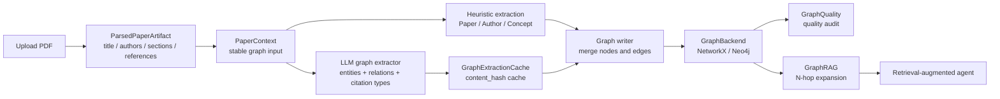
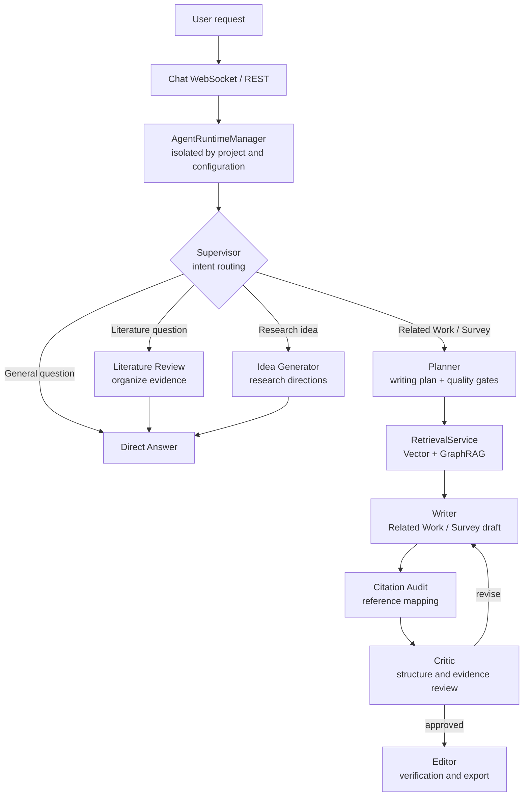

<div align="center">
  <h1>📚 Related Works Agent</h1>
  <p><strong>A local-first AI research assistant that turns papers into evidence-backed Related Work sections and Survey drafts.</strong></p>
  <p>
    <strong>English</strong>
    ·
    <a href="README.zh-CN.md">简体中文</a>
  </p>
  <p>
    <a href="#quick-start">Quick Start</a>
    ·
    <a href="#export-preview">Export Preview</a>
    ·
    <a href="#architecture">Architecture</a>
    ·
    <a href="docs/local-deployment.md">Local Deployment</a>
    ·
    <a href="CHANGELOG.md">Changelog</a>
  </p>
  <p>
    
    
    
    
    
    
    
  </p>
</div>

---

Related Works Agent is a local-first workspace for literature review and evidence-aware academic writing. Create a research project, upload PDF papers, and generate either a focused **Related Work** section or a complete **Survey** draft. Every generated draft keeps its supporting citations visible so you can verify the evidence before exporting to Word or LaTeX.

Project records, generated artifacts, and the ChromaDB retrieval index stay on your machine. By default, uploaded PDFs are sent to MinerU's official API for parsing; extracted literature passages are sent to Alibaba Cloud Model Studio for embedding and reranking; writing requests are sent to the AI provider you configure. PyMuPDF, local retrieval models, and Ollama remain available as explicit advanced options.

> This project is an early open-source preview for local deployment, evaluation, and contribution. Read [CONTRIBUTING.md](CONTRIBUTING.md) before contributing, [SECURITY.md](SECURITY.md) for privacy guidance, and [SUPPORT.md](SUPPORT.md) when reporting a problem.
>
> First-time users should begin with the [local deployment guide](docs/local-deployment.md). Before publishing or redistributing a deployment, use the [open-source release checklist](docs/open-source-release-checklist.md). Current capabilities and known boundaries are documented in [CHANGELOG.md](CHANGELOG.md).

## Export Preview

The example below is the first page of an IEEE LaTeX/PDF Survey exported by Related Works Agent. It shows the final path from uploaded literature and agent-assisted writing to a deliverable paper draft.

<p align="center">
  
</p>

## Features

- **Two focused writing modes:** generate a Related Work section or a complete Survey from the same paper collection.
- **Project-based workspace:** keep papers, conversations, and drafts isolated by research topic.
- **PDF literature pipeline:** organize uploaded papers into searchable, citable writing material.
- **Evidence-aware writing:** inspect mapped citation sources and unresolved references alongside generated text.
- **Review and export:** revise drafts in the editor, follow review suggestions, and export to Word or LaTeX/PDF.
- **Local-first storage:** use SQLite, local files, and the default local relationship backend without a central server.
- **Flexible model providers:** connect OpenAI, Anthropic, DeepSeek, Kimi, Qwen, GLM, MiniMax, Ollama, and compatible APIs.
- **Optional GraphRAG:** combine vector retrieval with paper relationships; switch to Neo4j only when needed.

## Architecture

### PDF to Vector Retrieval

```mermaid
flowchart LR
    Upload["Upload PDF"] --> Artifact["ParsedPaperArtifact<br/>normalized parsing output"]
    Artifact --> Chunker["section-aware-v2<br/>section-aware chunks"]
    Chunker --> Metadata["chunk metadata<br/>project_id / content_hash / parser_version"]
    Metadata --> Embed["Alibaba Cloud Model Studio<br/>qwen3.7-text-embedding"]
    Embed --> Chroma["Local embedded ChromaDB<br/>model/version-scoped index"]
    Chroma --> Manifest["VectorIndexManifest<br/>active index"]
    Manifest --> Retriever["RetrievalService<br/>project-isolated retrieval"]
    Retriever --> Rerank["Alibaba Cloud Model Studio<br/>qwen3-rerank"]
    Rerank --> Agent["Writer / Survey Agent<br/>citation evidence"]
```



### PDF to Literature Relationship Graph



### Agent Runtime



## Requirements

- Python 3.10+
- Node.js 18+ and npm
- MinerU Token for the default PDF parsing service
- Alibaba Cloud Model Studio API Key and Workspace ID for the default literature retrieval service
- An AI provider API Key for writing, unless you explicitly use Ollama
- Optional: CUDA GPU or Apple Silicon MPS for the advanced local retrieval mode
- Optional: local retrieval dependencies and cached Hugging Face models:
  - `BAAI/bge-m3`
  - `cross-encoder/ms-marco-MiniLM-L-6-v2`

The default setup does not install PyTorch or Hugging Face models and does not need a local GPU. ChromaDB remains embedded in the local backend and requires no separate database service. Local models are installed only when you explicitly enable the advanced local mode.

## Quick Start

```bash
git clone https://github.com/lylelllll/RelatedWorksAgent.git
cd RelatedWorksAgent
```

The `.env` file only needs the credentials for the services you use. You can also skip creating it and configure an AI provider, MinerU, and Alibaba Cloud Model Studio from the application Settings page. `.env`, uploaded papers, runtime data, and exports are excluded from Git by default.

The startup scripts run a local deployment preflight, install dependencies, and launch the frontend and backend. Resolve every `[ERR]` reported by the preflight before continuing.

### macOS / Linux

```bash
cp .env.example .env
chmod +x start.sh
./start.sh
```

### Windows

```cmd
copy .env.example .env
start.bat
```

After startup, open:

- Frontend: `http://localhost:5173`
- Backend: `http://localhost:8000`

See the [local deployment guide](docs/local-deployment.md) for setup details and troubleshooting.

## Manual Setup

### Backend

```bash
python3 -m venv .venv
source .venv/bin/activate
pip install -r backend/requirements.txt

cd backend
uvicorn main:app --reload --host 0.0.0.0 --port 8000
```

On Windows, activate the environment with:

```cmd
.venv\Scripts\activate.bat
```

### Frontend

```bash
cd frontend
npm install
npm run dev
```

## Typical Workflow

1. Open **Settings** and configure an AI provider under **AI Model**.
2. Save a MinerU Token under **Literature Parsing Service**.
3. Under **Embedding and Retrieval**, keep **Alibaba Cloud Model Studio** selected and save its API Key and Workspace ID.
4. Open **Chat** and create or select a research project.
5. Open **Literature** and upload PDF references for the current project.
6. Return to **Chat**, choose **Generate Related Work** or **Generate Survey**, and add your writing requirements.
7. Open **Editor** to verify the draft, citation sources, and review suggestions.
8. Export the reviewed result as Word or LaTeX/PDF.

## Capability Boundaries

- **Open the application:** requires Python 3.10+, Node.js 18+, npm, and the backend dependencies.
- **Use AI writing:** requires at least one configured AI service; Ollama can run locally.
- **Retrieve uploaded literature and map citation evidence:** uses Alibaba Cloud Model Studio embedding and reranking by default; no local GPU is required.
- **PDF parsing:** uses MinerU's official online API by default; the local PyMuPDF parser can be selected explicitly for offline or sensitive documents.
- **Run without a central application server:** projects, conversations, drafts, the ChromaDB index, and relationship data stay local; MinerU, Alibaba Cloud Model Studio retrieval, and the configured AI provider are external services by default.
- **Run without Neo4j:** the default local backend works without a separate database; Neo4j is optional.

## Local Data and Privacy

Project data, conversations, drafts, uploaded PDF copies, retrieval data, relationship data, and exports remain in local directories that are excluded in `.gitignore`:

- `data/`
- `backend/data/`
- `outputs/`
- `.env`

API keys and the MinerU Token saved through Settings are encrypted in the local database and are never displayed in plaintext. With the default configuration, uploaded PDFs are transmitted to MinerU for parsing, and extracted passages plus retrieval candidates are transmitted to Alibaba Cloud Model Studio for embedding and reranking. Writing prompts and evidence are sent to the configured AI provider. Use PyMuPDF and the advanced local retrieval mode for documents that must not leave the machine. Do not commit `.env`, runtime directories, uploaded papers, or export files.

## Optional Configuration

### AI Providers

The Settings page is the recommended configuration surface. You can also define provider credentials in `.env`:

```bash
OPENAI_API_KEY=
ANTHROPIC_API_KEY=
DEEPSEEK_API_KEY=
KIMI_API_KEY=
DASHSCOPE_API_KEY=
GLM_API_KEY=
MINIMAX_API_KEY=
MINERU_API_TOKEN=
```

Kimi also accepts `MOONSHOT_API_KEY`, Qwen accepts `QWEN_API_KEY`, and GLM accepts `ZHIPUAI_API_KEY`. Ollama does not require an API key.

### Embedding and Retrieval

The default mode uses `qwen3.7-text-embedding` and `qwen3-rerank` through Alibaba Cloud Model Studio while keeping ChromaDB local. Configure the service in **Settings > Embedding and Retrieval**, or set:

```bash
DASHSCOPE_API_KEY=
DASHSCOPE_WORKSPACE_ID=
# DASHSCOPE_REGION=cn-beijing
```

The Model Studio API Key is independent from the writing-model credential saved in the application, although both may use `DASHSCOPE_API_KEY` as an environment fallback. Changing retrieval mode creates a separate model-scoped ChromaDB directory and requires existing papers to be reorganized.

To use local retrieval models, select **Local Models** in Settings, then install and verify the optional dependencies:

```bash
CHECK_MODELS=1 ./start.sh
```

This mode uses `BAAI/bge-m3` and `cross-encoder/ms-marco-MiniLM-L-6-v2`, requires CUDA or Apple MPS, and does not silently fall back to CPU.

### Relationship Backend

The default `networkx` backend requires no separate database. It is configured in `config.yaml`:

```yaml
knowledge_graph:
  backend: "networkx"
```

To use Neo4j instead:

```yaml
knowledge_graph:
  backend: "neo4j"
```

Then configure:

```bash
NEO4J_URI=bolt://localhost:7687
NEO4J_USERNAME=neo4j
NEO4J_PASSWORD=your_password_here
NEO4J_DATABASE=neo4j
```

### PDF Parsing

The default `mineru_api` backend uses MinerU's official [online API](https://mineru.net/apiManage/docs) with model version `vlm`. Configure the Token in **Settings > Literature Parsing Service** or set `MINERU_API_TOKEN` in `.env`. Parsing runs as a background job after upload, and a remote failure is reported without silently changing parsers.

To keep PDF parsing entirely local, explicitly select PyMuPDF in `config.yaml`:

```yaml
ingestion:
  parser_backend: "pymupdf"
```

## FAQ

**What if I want to use local retrieval models?**

The default cloud mode does not need Hugging Face models. Select **Local Models** in Settings and run:

```bash
CHECK_MODELS=1 ./start.sh
```

On Windows:

```cmd
set CHECK_MODELS=1
start.bat
```

The script installs `backend/requirements-local-models.txt` and checks CUDA/MPS plus the local caches for `BAAI/bge-m3` and `cross-encoder/ms-marco-MiniLM-L-6-v2`. Cache them first or temporarily disable Hugging Face offline mode to download them.

**How do I check my local environment before startup?**

```bash
python3 scripts/check_local_setup.py
```

When ports 8000 or 5173 are already in use, a standalone preflight reports `[WARN]`; the startup scripts treat occupied ports as `[ERR]`. Open the running application if it is yours, otherwise stop the conflicting process.

**Can I use the application without a GPU or Apple MPS?**

Yes. The default Alibaba Cloud Model Studio retrieval mode does not use the local GPU. CUDA or Apple MPS is required only when you explicitly select local retrieval models.

**Is Neo4j required?**

No. The default local relationship backend works without Neo4j.

**Are API keys sent to a server operated by the project author?**

No. The project has no central application server. Your local backend sends requests directly to MinerU, Alibaba Cloud Model Studio, and the AI provider you configure, according to the selected processing modes.

**What should I check before publishing a deployment or release?**

Run:

```bash
python3 scripts/check_open_source_release.py
```

This checks public entry files, tracked runtime data, secrets, and local links. See the [open-source release checklist](docs/open-source-release-checklist.md) for the full process.

## Project Structure

```text
RelatedWorksAgent/
├── backend/               # FastAPI backend
├── frontend/              # React + Vite frontend
├── CHANGELOG.md           # Open-source preview notes
├── data/                  # Local application data, generated at runtime
├── backend/data/          # Uploads, retrieval data, and task records
├── docs/
│   ├── local-deployment.md
│   └── open-source-release-checklist.md
├── outputs/               # Generated exports
├── scripts/
│   ├── check_local_setup.py
│   └── check_open_source_release.py
├── config.yaml
├── start.sh               # macOS/Linux startup
└── start.bat              # Windows startup
```

## Development

```bash
cd frontend
npm run lint
npm run test:run
npm run build
```

```bash
python -m pytest
```

See [CONTRIBUTING.md](CONTRIBUTING.md) for contribution guidelines and [SUPPORT.md](SUPPORT.md) before filing a support request.

## License

Licensed under the [MIT License](LICENSE).
