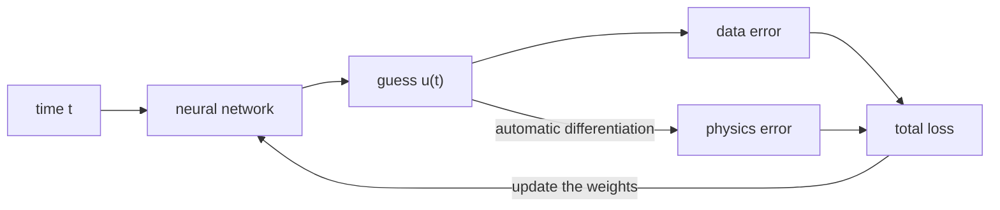

<p align="center"></p>

<p align="center">
  
  
  
</p>

A normal neural network sees 12 noisy measurements of a damped spring and has no idea what comes next. Give the same network the spring's equation and it predicts the rest of the motion to about 1% error.

This is the demo from the video *Physics-Informed Neural Networks Explained in 9 Minutes*.

<p align="center"></p>

## The idea

A physics-informed neural network has two teachers. The data says how far the network is from the measurements. The equation says how badly its output breaks the physics, and it can check that anywhere, including places nobody measured.



The spring follows this equation, with damping $d$ and natural frequency $\omega$:

$$u'' + 2d\,u' + \omega^2 u = 0$$

The loss adds the two errors together:

$$\mathcal{L} = \underbrace{\frac{1}{N}\sum_i \big(u_\theta(t_i) - u_i\big)^2}_{\text{data}} + \underbrace{\frac{1}{M}\sum_j \Big(\frac{u_\theta'' + 2d\,u_\theta' + \omega^2 u_\theta}{\omega^2}\Big)^2_{t_j}}_{\text{physics}}$$

## Results

All three runs use the same network and the same 12 points, which stop before one full swing. Measured over 4 random seeds:

| Run | What it knows | Result |
|---|---|---|
| Data only | the 12 points | 65% to 228% error |
| Data + physics | the 12 points and the equation | 0.4% to 1.0% error |
| Inverse problem | the 12 points, with the damping hidden | learned 1.477 to 1.533 (true value 1.5) |

This is a small toy problem. It shows the idea and proves nothing about real systems.

## Run it backwards

Hide the damping from the network, make it a trainable number, and start it at a wrong guess of 0.2. It finds the true value while it learns the motion.

<p align="center"></p>

## Try it

```bash
git clone https://github.com/maghasemi/pinn-spring-demo.git
cd pinn-spring-demo
pip install -r requirements.txt
python train_demo.py
python render_demo.py
```

`train_demo.py` trains the three networks on the CPU, which takes a few minutes, and prints the error of each. `render_demo.py` turns the training runs into videos in `out/`. It needs [ffmpeg](https://ffmpeg.org).

Change the equation, take away some points, and try to break it.

## Further reading

- Raissi, Perdikaris, Karniadakis (2019). [Physics-informed neural networks](https://doi.org/10.1016/j.jcp.2018.10.045). *Journal of Computational Physics*.
- Wang et al. (2023). [An Expert's Guide to Training Physics-informed Neural Networks](https://arxiv.org/abs/2308.08468).
- Krishnapriyan et al. (2021). [Characterizing possible failure modes in physics-informed neural networks](https://arxiv.org/abs/2109.01050).

## License

[MIT](LICENSE)
