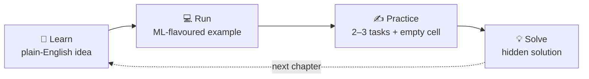

<div align="center">


# 🐍 Python for ML Researchers

### Every core Python concept for Machine Learning & Deep Learning, in 2–3 hours.

A single, hands-on Jupyter notebook. Plain-English explanations, real ML examples,<br>
and a practice cell after every lesson so you actually *use* what you just read.

<br>

<a href="https://colab.research.google.com/github/mahfuzswe/python-for-ml-researchers/blob/main/Python_Recap_for_ML_Researchers.ipynb"></a>&nbsp;
<a href="https://nbviewer.org/github/mahfuzswe/python-for-ml-researchers/blob/main/Python_Recap_for_ML_Researchers.ipynb"></a>


**[Quick start](#-quick-start)** &nbsp;·&nbsp;
**[Course map](#%EF%B8%8F-course-map)** &nbsp;·&nbsp;
**[3-hour plan](#%EF%B8%8F-a-3-hour-study-plan)**

</div>

<br>

## 💡 Why this exists

Most ML researchers learned Python **in pieces**: a bit of NumPy for one project, some Pandas for another,
a PyTorch tutorial that used `__getitem__` without ever explaining it. It works, until a
`ValueError: shapes (32,3) and (4,) not aligned` eats your afternoon.

This notebook puts the pieces back together. It walks through **every core concept in one sitting**, and
every example comes from the work you already do: training loops, configs, datasets, metrics and experiment logs.

<br>

## ✨ What makes it different

<table>
<tr>
<td width="50%" valign="top">

### 🎯 Built for ML/DL people
No toy "shopping cart" examples. You'll check **train/test leakage with sets**, store **configs in dicts**,
write a **PyTorch-style `Dataset` class**, implement **softmax by hand** and plot **training curves**.

</td>
<td width="50%" valign="top">

### 🗣️ Plain-English explanations
Short sentences, small tables and one idea at a time.
Easy enough to skim as a recap, solid enough to learn from scratch.

</td>
</tr>
<tr>
<td width="50%" valign="top">

### ✍️ Practice after every lesson
Each chapter ends with 2–3 tasks and an **empty code cell**.
Solutions are folded under **💡 Show solution**, so you try first and peek later.

</td>
<td width="50%" valign="top">

### 🏁 A real capstone
Finish by building **logistic regression from scratch in NumPy**, with gradient descent,
metrics, a confusion matrix and a decision-boundary plot (test accuracy **0.975**).

</td>
</tr>
</table>

<br>

## 🔁 How every chapter works



<br>

## 🚀 Quick start

**Option 1: zero setup (recommended).** Click **[Open in Colab](https://colab.research.google.com/github/mahfuzswe/python-for-ml-researchers/blob/main/Python_Recap_for_ML_Researchers.ipynb)**, then press <kbd>Shift</kbd> + <kbd>Enter</kbd> to run cells top to bottom.

**Option 2: run it locally.**

```bash
git clone https://github.com/mahfuzswe/python-for-ml-researchers.git
cd python-for-ml-researchers

python -m venv .venv
source .venv/bin/activate          # Windows: .venv\Scripts\activate
pip install -r requirements.txt

jupyter lab Python_Recap_for_ML_Researchers.ipynb
```

> [!TIP]
> Already know the basics? Jump straight to **Part D** (NumPy, Pandas, classes) and the **capstone**.
> Each chapter stands on its own.

<br>

## 🗺️ Course map

26 chapters in 5 parts. Time estimates are for reading, running and practising.

| | Chapter | What you'll learn | ML angle | ⏱️ |
|:-:|---|---|---|:-:|
| | **A · Foundations** | | | **~45 min** |
| 01 | Python basics | syntax, comments, core data types | why most ML bugs are type/shape bugs | 4 |
| 02 | Variables & built-ins | naming, casting, `len` `sum` `round` | steps per epoch, ceiling division | 5 |
| 03 | Operators | arithmetic, comparison, logic, membership | "log every N steps", never `==` on floats | 5 |
| 04 | Strings | slicing, methods, **f-strings** | clean training logs, parsing checkpoint names | 6 |
| 05 | Lists | methods, slicing, unpacking, the copy trap | collecting metrics per epoch | 6 |
| 06 | Tuples | immutability, unpacking, `divmod` | tensor shapes like `(32, 3, 224, 224)` | 4 |
| 07 | Sets | union, intersection, difference | **catching data leakage** between splits | 4 |
| 08 | Dictionaries | `get`, `update`, merge, `Counter`, `defaultdict` | configs, label maps, history | 6 |
| | **B · Logic & functions** | | | **~40 min** |
| 09 | Conditionals | `if/elif/else`, truthiness, `match` | early stopping, thresholds | 5 |
| 10 | Loops | `range`, `enumerate`, `zip`, `while` | **your first gradient-descent training loop** | 8 |
| 11 | Functions | defaults, `*args`, `**kwargs`, type hints | clean, testable metric functions | 8 |
| 12 | Modules & imports | stdlib, your own module, `__main__` | `seed_everything()` for reproducibility | 5 |
| 13 | Comprehensions | list, dict, set, generator expressions | one-hot encoding, vocab maps | 5 |
| 14 | Higher-order functions | `lambda`, `map`, `sorted(key=)`, closures, decorators | LR schedulers, `@timer` | 7 |
| | **C · Robust code** | | | **~30 min** |
| 15 | Reading errors | tracebacks, the common error types | debugging shape and key errors fast | 4 |
| 16 | Date & time | `datetime`, `timedelta`, `perf_counter` | run IDs, training ETA | 4 |
| 17 | Exception handling | `try/except/else/finally`, `raise`, `assert` | skipping corrupt samples, config validation | 6 |
| 18 | Regular expressions | patterns, groups, `sub`, `findall` | parsing logs, NLP text cleaning | 6 |
| 19 | File handling | `pathlib`, text, JSON, CSV, pickle | saving configs and results | 7 |
| 20 | Packages & environments | pip, venv, conda, `requirements.txt` | reproducible environments for papers | 4 |
| | **D · OOP & the data stack** | | | **~40 min** |
| 21 | Classes & objects | `__init__`, dunder methods, inheritance, `@dataclass` | **PyTorch-style `Dataset` and `nn.Module`** | 10 |
| 22 | NumPy & statistics | shapes, broadcasting, `axis`, `@`, RNG | softmax, standardisation, one-hot | 14 |
| 23 | Pandas | `loc/iloc`, filtering, `groupby`, missing values | cleaning a patient cohort, avoiding leakage | 12 |
| 24 | Web data & APIs | JSON, `requests`, scraping, FastAPI | pulling model metadata, serving a model | 5 |
| | **E · Research toolkit** | | | **~25 min** |
| 25 | Power tools | generators, context managers, logging, `%timeit`, matplotlib | a mini DataLoader, training curves | 10 |
| 26 | 🏁 Capstone | logistic regression from scratch | gradient descent, metrics, decision boundary | 12 |

<br>

## ⏱️ A 3-hour study plan

| Session | Chapters | Time | Break |
|---|---|:-:|---|
| **1 · Warm-up** | Part A (1–8) | 45 min | ☕ 10 min |
| **2 · Thinking in code** | Part B (9–14) | 40 min | 🚶 5 min |
| **3 · Make it robust** | Part C (15–20) | 30 min | ☕ 10 min |
| **4 · The ML stack** | Part D (21–24) + Part E (25–26) | 65 min | 🎉 done |

<br>

## 🔬 A taste of the capstone

<table>
<tr>
<td width="55%" valign="top">

```python
class LogisticRegression:
    def fit(self, X, y):
        n, d = X.shape
        self.w, self.b = np.zeros(d), 0.0
        for epoch in range(1, self.epochs + 1):
            p = self._sigmoid(X @ self.w + self.b)   # forward
            grad_w = X.T @ (p - y) / n               # backward
            grad_b = np.mean(p - y)
            self.w -= self.lr * grad_w               # update
            self.b -= self.lr * grad_b
        return self
```

The same **forward → backward → update** loop that trains every neural network,
written in 10 lines you fully understand.

</td>
<td width="45%" valign="top">


</td>
</tr>
</table>

<br>

## 👥 Who is this for?

- 🎓 **Students** starting ML/DL coursework or a thesis
- 🔬 **Researchers** who want to close the gaps in Python they picked up on the go
- 🧑‍🏫 **Teachers** looking for a ready-made lab or bootcamp notebook
- 💼 **Engineers** moving into ML who want the Python idioms the field uses

**Prerequisites:** none beyond curiosity. If you have written any code before, you'll move fast.

<br>

## 📦 Requirements

| Package | Used for |
|---|---|
| Python **3.10+** | `match` statements and modern syntax |
| `numpy` | arrays, broadcasting, the capstone |
| `pandas` | DataFrames (Chapter 23) |
| `matplotlib` | training curves and plots |
| `jupyterlab` or `notebook` | running the notebook locally |
| `requests` *(optional)* | the API examples in Chapter 24 |

Google Colab already has all of these installed.

<br>

## 📁 Repository structure

```
python-for-ml-researchers/
├── Python_Recap_for_ML_Researchers.ipynb   # the notebook: 26 chapters
├── requirements.txt                        # pip install -r requirements.txt
├── assets/
│   ├── readme_preview.gif                  # animated preview (top of this page)
│   ├── thumbnail.png                       # social preview image
│   └── tvc_16x9.mp4                        # 40-second trailer
├── LICENSE
└── README.md
```

<br>

## 🤝 Contributing

Found a typo, a clearer explanation or a better ML example? Contributions are very welcome.

1. Fork the repo and create a branch: `git checkout -b improve-chapter-13`
2. Make your change and **run the notebook top to bottom** so every cell still works
3. Open a pull request describing what you changed and why

Ideas, questions and chapter requests go in [Issues](https://github.com/mahfuzswe/python-for-ml-researchers/issues).

<br>

## 🙏 Acknowledgements

The chapter structure is inspired by Asabeneh Yetayeh's open-source
[**30 Days of Python**](https://github.com/Asabeneh/30-Days-Of-Python), reshaped and condensed for ML/DL researchers.

<br>

## 📝 Citation

If this notebook helps your teaching or research, you can cite it:

```bibtex
@misc{rahman2026pythonml,
  author       = {Rahman, Md Mahfuzur},
  title        = {Python for ML Researchers: A 2--3 Hour Hands-on Python Recap for Machine Learning and Deep Learning},
  year         = {2026},
  howpublished = {\url{https://github.com/mahfuzswe/python-for-ml-researchers}}
}
```

<br>

## 👤 Author

**Md Mahfuzur Rahman Shanto**<br>
Lecturer, Department of Software Engineering, Daffodil International University<br>
Research interests: explainable and trustworthy AI, healthcare ML

[](https://github.com/mahfuzswe)

<br>

## 📄 License

Released under the [MIT License](LICENSE). Use it in your classes, labs and bootcamps; a link back is appreciated.

<br>

<div align="center">

## ⭐ Star history

<a href="https://star-history.com/#mahfuzswe/python-for-ml-researchers&Date">
  
</a>

<br><br>

**If this saved you an afternoon of debugging, give it a ⭐. It helps other researchers find it.**

</div>
