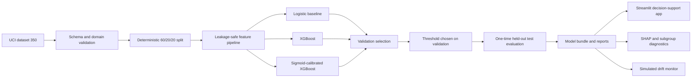

# Credit Risk Decision System

An end-to-end credit default modelling project exploring how ranking performance, probability quality, explanations and decision thresholds interact in a lending-risk setting.

[](https://github.com/makhulumei/credit-risk-decision-system/actions/workflows/ci.yml)
[](https://www.python.org/)
[](LICENSE)

**[Open the live decision-support app](https://credit-risk-decision-system.streamlit.app/)**

> **Decision-support research only.** This is a portfolio demonstration using historical public data. It is not a lending policy, approval system or production credit model.

## Results at a glance

| Item | Measured result |
|---|---:|
| Dataset | 30,000 customers, 23 predictors |
| Observed next-month default rate | 22.12% |
| Selected model | XGBoost |
| Five-fold training CV ROC-AUC | 0.788 ± 0.003 |
| Five-fold training CV PR-AUC | 0.563 ± 0.015 |
| Held-out test ROC-AUC | 0.782 |
| Held-out test PR-AUC | 0.564 |
| Held-out test Brier score | 0.134 |
| Illustrative review threshold | 0.15 |
| Default capture at that threshold | 77.9% |

The 0.15 operating point comes from a validation-only threshold search where a false negative carries five times the relative cost of a false positive. Those cost units are assumptions for demonstrating trade-offs; they are not money, expected loss or ROI.


## What the project demonstrates

- Reproducible UCI data acquisition and structural/domain validation.
- Leakage-safe row features, train-fit imputation, clipping, encoding and scaling.
- Logistic regression baseline, XGBoost challenger and sigmoid-calibrated XGBoost candidate.
- Stratified five-fold stability checks plus separate validation and untouched test splits.
- PR-AUC, ROC-AUC, Brier score, log loss and threshold-level operating metrics.
- Global and local SHAP explanations with explicit interpretation limits.
- Configurable false-positive/false-negative costs and threshold analysis.
- Subgroup diagnostics with protected fields excluded from model inputs.
- Feature and prediction drift demonstration using a documented synthetic shift.
- Tested Python package, Streamlit application, Docker image and GitHub Actions CI.

## Architecture



## Dataset

The project uses **Default of Credit Card Clients**, published by I-Cheng Yeh through the UCI Machine Learning Repository.

- Source: [UCI dataset page](https://archive.ics.uci.edu/dataset/350/default+of+credit+card+clients)
- DOI: [10.24432/C55S3H](https://doi.org/10.24432/C55S3H)
- Licence: CC BY 4.0
- Scope: 30,000 Taiwanese credit-card clients observed in 2005
- Target: whether the client defaulted the following month
- Missing values reported/observed: 0

The data is useful for demonstrating model-development decisions but is old, geographically narrow and unsuitable for present-day lending decisions. See the [data card](docs/data-card.md).

## Validation design

The split is deterministic and stratified:

- 60% training: fitting pipelines and models
- 20% validation: model selection and threshold selection
- 20% test: final reporting only

The logistic and XGBoost candidates also receive five-fold stratified cross-validation on the training split. Every fold refits feature processing from its own training partition. Model selection keeps candidates within 0.01 validation PR-AUC of the leader, then chooses the lowest Brier score with log loss as the tie-breaker.

Sigmoid calibration was tested rather than assumed to help. It produced similar ranking but a slightly worse validation Brier score (0.1343 versus 0.1336), so the raw XGBoost candidate was selected. This is an example of retaining a simpler result when calibration adds no measured benefit.

## Feature pipeline

The raw payment history is supplemented with row-level features that can be computed at scoring time:

- average and maximum credit utilisation
- average bill and payment amounts
- total and recent payment-to-bill ratios
- delinquency count and maximum delinquency
- recent balance change
- credit limit per year of age

Numeric imputation and 1st/99th percentile clipping are learned only from training data. Education is consolidated from documented and rare/unknown source codes, then one-hot encoded. `SEX` and `MARRIAGE` are retained only for audit reporting and never enter the model.

## Evaluation and decision threshold


The selected 0.15 threshold captures 77.9% of defaults on the test set while leaving 51.6% of records below the review threshold. It produces 1,870 false positives and 293 false negatives in 6,000 held-out records under the demonstration setup.

This threshold is not presented as a lending recommendation. A real policy needs institution-specific loss estimates, affordability and regulatory rules, independent validation, override controls and documented human accountability.

## Explainability


The app exposes global mean absolute SHAP values and a local explanation for an entered profile. SHAP explains how this fitted XGBoost model formed its score; it does not establish causality or provide a sufficient reason for an adverse decision.

## Monitoring demonstration


The monitoring module applies a declared synthetic shift to 35% of the held-out portfolio, then reports feature PSI and prediction-distribution PSI. It shows the mechanics of drift detection without claiming that a real production population drifted. A deployed system would also need delayed-label performance, calibration, data-quality alerts, ownership and retraining/retirement criteria.

## Run locally

Python 3.12 is recommended.

```bash
python -m venv .venv
source .venv/bin/activate
python -m pip install --upgrade pip
pip install -e ".[dev]"
python scripts/fetch_data.py
python scripts/train.py
streamlit run app/app.py
```

On macOS, XGBoost may require `brew install libomp`. Linux packages needed by Streamlit Community Cloud are listed in `packages.txt`.

## Test and lint

```bash
ruff check .
pytest
```

Current local verification: **25 tests passed, 90% statement/branch-aware coverage on the measured package modules**. Training orchestration is excluded from the coverage denominator; its outputs are verified by the reproducible training and application smoke checks.

## Docker

```bash
docker build -t credit-risk-decision-system .
docker run --rm -p 8501:8501 credit-risk-decision-system
```

Open `http://localhost:8501` and check `/_stcore/health` for the container health endpoint.

## Repository structure

```text
.
├── app/                    # Streamlit analytical product
├── artifacts/              # Versioned inference bundle and reference profile
├── data/raw/               # Public UCI data used by the deployed demo
├── docs/                   # Data, model, architecture and release documentation
├── linkedin/               # Draft build journal; nothing auto-published
├── reports/                # Metrics, diagnostics and decision-focused figures
├── scripts/                # Data acquisition and training entry points
├── src/credit_risk/        # Reusable package code
├── tests/                  # Unit and integration-level component tests
├── Dockerfile
├── pyproject.toml
└── requirements.txt
```

## Further documentation

- [Model card](docs/model-card.md)
- [Data card](docs/data-card.md)
- [Reproducibility](docs/reproducibility.md)
- [Architecture and design decisions](docs/architecture.md)
- [Security and privacy](docs/security-and-privacy.md)
- [Research notes](docs/research.md)

## Licence and attribution

Project code is released under the [MIT License](LICENSE). The source dataset remains available under CC BY 4.0 and is attributed to I-Cheng Yeh and the UCI Machine Learning Repository.
