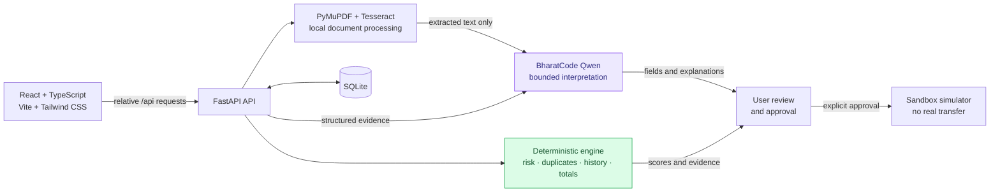
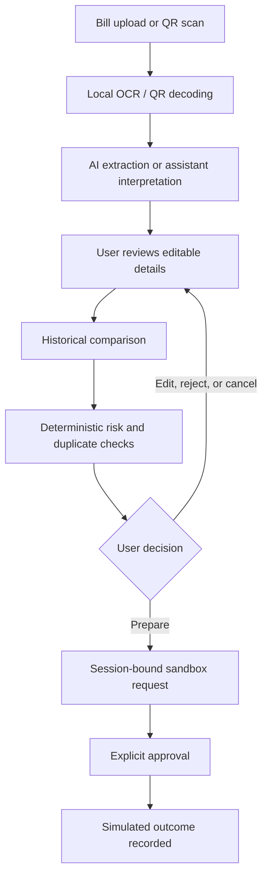

<div align="center">

# PayGuard AI

### Your payments. Smarter, safer, simpler.

**An explainable payment-safety workspace for reviewing bills, QR payments, payment history, and sandbox actions before approval.**

<p>
  
  
  
  
  
  
  
  
  
  
</p>

</div>

> **The one-line pitch:** PayGuard turns payment intent into a reviewable decision — extracting context, checking history, explaining risk, and requiring explicit approval before a sandbox-only outcome.

> **Safety boundary:** No real bank, UPI network, card processor, merchant, or live payment gateway is connected. The application records simulated sandbox outcomes only.

## Live demo

**Render deployment:** [https://payguard-vqu7.onrender.com](https://payguard-vqu7.onrender.com/)

The public deployment is a single-user, fictional hackathon demonstration. Use `/docs` to inspect the FastAPI API surface.

## Why this matters

Payment interfaces are optimized for speed. Safety decisions need the opposite: context, comparison, and a clear moment to stop.

PayGuard is designed around that missing review layer:

| Before PayGuard | With PayGuard |
| --- | --- |
| A bill is a document to pay | A bill becomes structured, editable evidence |
| A QR code is an opaque payment trigger | QR content is decoded locally and reviewed |
| A risk label is hard to trust | Deterministic signals are shown alongside the label |
| An assistant can feel overpowered | AI proposes and explains; the user confirms |
| “Success” can be confused with real settlement | Every outcome is explicitly sandbox-only |

## The product in one view


PayGuard combines **local processing**, **bounded AI interpretation**, **deterministic safety checks**, and **human approval**. The design intentionally does not let the language model become the payment authority.

## Architecture


The React/Vite frontend is built into the Docker image and served by FastAPI. FastAPI owns SQLite access, deterministic risk checks, sandbox payment state, local PDF/OCR processing, and the approval workflow. BharatCode receives bounded, extracted text or structured evidence for interpretation; it does not receive unrestricted document or payment authority.

## What makes the AI useful — and safe


### 1. AI Bill Intelligence

1. A user uploads a PDF, JPG, or PNG.
2. PyMuPDF and Tesseract process the document locally.
3. Only extracted text is sent to BharatCode Qwen for structured field interpretation.
4. Pydantic validation checks the returned fields.
5. The user reviews and edits the result before saving it.

The AI can identify bill context such as provider, amount, due date, invoice number, account reference, billing period, and payment purpose. It does not silently save a bill or initiate a payment.

### 2. Grounded Payment Risk Explanations

PayGuard calculates risk evidence in backend logic. BharatCode receives structured evidence — not raw bill images or raw QR images — and turns the signals into an understandable explanation.

Typical evidence can include:

- New or unverified recipient
- Unusual amount compared with saved history
- Duplicate invoice or payment reference
- Insufficient history for a reliable baseline
- Recipient or account details needing confirmation

The score and level remain deterministic. AI explains the evidence; it does not invent an authoritative fraud probability.

### 3. Constrained AI Payment Assistant

The assistant can interpret requests about:

- Upcoming payments and saved payment history
- Suspicious or risky payments
- Duplicate transactions
- Bill reminders and recurring payment rules
- Spending by category or subscription
- Preparing a payment proposal

Read-only questions can return evidence-backed answers. State-changing requests become server-side proposals with exact parameters, session binding, expiration, one-time confirmation, and replay protection. A proposal is not an approval.

### 4. AI Financial Insights

The Expenses view aggregates saved sandbox records, categories, budgets, and trends. BharatCode can turn this validated aggregate evidence into concise observations. It does not receive raw documents, raw images, or unrestricted financial history.

### 5. QR Payment Analysis

QR decoding happens in the browser. PayGuard strictly parses `upi://pay` data, shows the recipient and amount for review, compares saved recipient information, and checks duplicate references before a sandbox request can be prepared.

## AI boundary: interpretation, not authority

| AI-assisted interpretation | Deterministic application authority |
| --- | --- |
| Extract bill fields from OCR text | Validate request shape and required fields |
| Explain supplied risk evidence | Calculate risk score and Low/Medium/High level |
| Understand assistant intent | Detect duplicates and historical anomalies |
| Summarize aggregate spending | Calculate totals, budgets, and payment state |
| Suggest a reminder, rule, or payment proposal | Bind, expire, confirm, approve, cancel, or refund sandbox requests |


## Implemented capabilities

| Capability | Product behavior |
| --- | --- |
| **AI Bill Intelligence** | Local OCR, BharatCode structured extraction, editable review, duplicate comparison, and explicit save. |
| **Duplicate Payment Detection** | Exact and possible bill matching, duplicate payment checks, and QR reference comparison. |
| **Payment Risk Intelligence** | Explainable deterministic 0–100 heuristic scoring with Low, Medium, and High levels. |
| **QR Payment Analysis** | Browser-local QR decoding, strict UPI parsing, recipient comparison, and review before preparation. |
| **AI Financial Assistant** | Saved-history queries, risky-payment queries, duplicate queries, reminders, limits, rules, and confirmation-gated proposals. |
| **Spending Analytics** | Successful sandbox transaction aggregation, category totals, merchant totals, budgets, trends, and optional insights. |
| **Historical Anomaly Detection** | Median, amount, frequency, subscription-change, new-recipient, and insufficient-history signals. |
| **Approval-based Sandbox Workflow** | Prepare → review evidence → explicitly approve or cancel → record simulated provider outcome. |

## A judge-friendly walkthrough

### Step 1 — Upload and understand

Open **Bills**, upload a synthetic bill, and let local OCR make the content searchable. BharatCode proposes structured details, but the original document stays visible for user review.

### Step 2 — Correct before persistence

The user checks provider, amount, dates, invoice number, account reference, and purpose. The reviewed record is then saved for future comparison.

### Step 3 — Compare against history

PayGuard checks saved bills and payment requests for duplicate identifiers, matching amounts, new recipients, unusual amounts, frequency changes, and insufficient history.

### Step 4 — Explain every important signal

The **Security** view exposes evidence across bills, recipients, and universal payment requests. A BharatCode explanation can make the evidence readable, while the deterministic result remains the source of truth.

### Step 5 — Review QR and assistant proposals

The user can decode a QR locally or ask the assistant for a payment-related action. Both paths lead to a visible review state rather than an invisible execution.

### Step 6 — Approve only the sandbox request

The user must explicitly approve a prepared request. The sandbox simulator records the result; no external payment provider is contacted.

### Step 7 — Learn from saved activity

Expenses and Transactions provide category totals, merchants, budgets, trends, filters, and evidence-backed aggregate insights.

## Architecture



### Data minimization by design

- Original bill files, image bytes, and raw QR images are not sent to BharatCode.
- Provider calls use JSON response mode, bounded timeouts, `store=false`, and request IDs.
- Prompts, response bodies, and credentials are not logged.
- Model output is validated before the backend uses it.

## Review workflow



## Risk model: readable signals, not a fraud oracle


PayGuard presents risk as review guidance:

| Level | Meaning |
| --- | --- |
| 🟢 **Low** | Few or no configured signals in the available evidence. |
| 🟡 **Medium** | Reviewable signals are present and deserve attention. |
| 🔴 **High** | Stronger configured signals require additional review or acknowledgement. |

> **Important:** These are heuristic assessments, not calibrated fraud probabilities, identity verification, bank verification, or a guarantee of safety.

## Technology stack

| Layer | Technologies |
| --- | --- |
| Frontend | React, TypeScript, Vite, Tailwind CSS, React Router |
| Backend | Python, FastAPI, Pydantic |
| AI | BharatCode OpenAI-compatible endpoint with Qwen |
| Document processing | PyMuPDF and Tesseract OCR |
| QR processing | Browser-local QR decoding with jsQR / BarcodeDetector |
| Persistence | SQLite |
| Testing | Vitest, Testing Library, pytest |

## Run locally

<details open>
<summary><strong>Install, configure, and start</strong></summary>

### Requirements

Node.js 20.19+ (or 22.12+), npm, Python 3.10+, and Tesseract for scanned-PDF or image OCR.

```powershell
npm install
py -m venv backend\.venv
backend\.venv\Scripts\python.exe -m pip install -r backend\requirements-dev.txt
Copy-Item backend\.env.example backend\.env
```

Set private values in `backend\.env`. Never commit this file:

```env
BHARATCODE_API_KEY=<your-private-key>
BHARATCODE_BASE_URL=https://bharatcode.ai/api/model/v1
BHARATCODE_MODEL=qwen-3.8-27b
TESSERACT_CMD=C:\Program Files\Tesseract-OCR\tesseract.exe
TESSERACT_LANG=eng
PAYGUARD_DATABASE_PATH=C:\path\to\payguard.sqlite3
PAYGUARD_CORS_ORIGINS=http://localhost:5173
PAYGUARD_COOKIE_SECURE=false
PAYGUARD_COOKIE_SAMESITE=lax
```

Run the backend and frontend in separate terminals:

```powershell
backend\.venv\Scripts\python.exe -m uvicorn main:app --app-dir backend --reload
npm run dev
```

Vite proxies `/api` to `http://127.0.0.1:8000`. The backend health check is `GET /api/health`.

</details>

<details>
<summary><strong>Tests and build</strong></summary>

```powershell
backend\.venv\Scripts\python.exe -m pytest -q
npm test -- --run
npm run build
```

Tests use temporary databases and mocked provider responses. They do not prove live BharatCode availability.

</details>

## Transparency and limitations

- Payments are simulated through the sandbox provider. No real bank or UPI transfer is performed.
- Risk scores are heuristic assessments, not calibrated fraud probabilities.
- The Render deployment uses one Docker web service and SQLite at `/tmp/payguard-demo.sqlite3`; it is intended only for a single-user hackathon demo.
- Render Free has limited compute (approximately 512 MB RAM and 0.1 CPU), so cold starts, OCR, and concurrent requests can be slow.
- The `/tmp` database is ephemeral on Render Free. A restart, redeploy, or instance replacement can remove records; fictional demo data is recreated only when `DEMO_MODE=true`.
- SQLite is not configured for multi-instance or production-scale concurrent traffic.
- Bill extraction first reads embedded PDF text locally; scanned PDFs fall back to Tesseract OCR and can take substantially longer or exceed the available memory for large documents.
- Structured bill extraction and AI explanations depend on the remote BharatCode service, its configured `qwen-3.8-27b` model, API availability, rate limits, and response latency.
- BharatCode credentials are supplied through Render environment variables and are never part of the repository.
- Anonymous sessions are not full user authentication or multi-user identity.
- Recipient confirmation is a local user attestation, not bank or account-ownership verification.
- “Successful” records mean sandbox simulator outcomes, not provider-confirmed settlement.
- Demo seed data is fictional and must remain isolated from personal or production data.

## Repository map

```text
src/
  App.tsx                 dashboard, security, expenses, transactions, routes
  BillRecognition.tsx     bill upload, extraction review, bill preparation
  ScanPay.tsx             browser-local QR analysis
  Assistant.tsx           constrained AI assistant and proposals
  Payments.tsx            payment rules and universal payment requests
backend/
  main.py                 FastAPI API, SQLite workflows, AI boundaries, risk logic
  seed_demo_data.py       isolated fictional demo dataset
docs/
  ai-features-map.svg     original AI capability illustration
  ai-responsibilities.svg AI vs deterministic responsibility split
  risk-signal-graph.svg   illustrative risk-band graphic
  trust-loop.svg          product trust-loop graphic
```

## The honest takeaway

PayGuard is not trying to replace a bank, fraud team, or human judgment. It demonstrates a safer pattern for AI-assisted payments:

> **AI makes the evidence understandable. Deterministic logic makes the checks repeatable. The user stays in control.**
