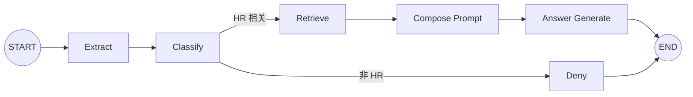

# LangGraph Advanced RAG

[](https://www.python.org/)
[](https://fastapi.tiangolo.com/)
[](https://langchain-ai.github.io/langgraph/)
[](https://github.com/facebookresearch/faiss)
[](LICENSE)

一个使用 **LangGraph 状态图、FAISS 和条件边**实现的智能 HR 政策问答项目。应用把 HR RAG 流程拆成提取问题、范围分类、文档检索、Prompt 组装、答案生成和拒答节点，让状态变化、执行顺序与分支路径都可以被明确观察。

本项目由 Notebook 教学案例整理而来，在保留原始技术范围的基础上补齐了 FastAPI 后端、独立 Web UI、浏览器模型配置、持久化索引、测试、示例文档和项目说明。

## 项目截图


## 重要概念：LangGraph 不是 GraphRAG

本项目使用的“图”是**应用执行流程图**：节点表示 Python 函数，边表示运行顺序和条件路由。知识库本身仍然是 Markdown 文本片段及其 Embedding，并保存在 FAISS 中。

```text
Markdown → 文本章节 → Embedding → FAISS Top-3 → LLM
```

GraphRAG 通常会从文档中抽取实体和关系，构建知识图谱、社区摘要或图检索流程。本项目没有知识图谱、实体关系图、社区检测和图遍历，因此不属于 GraphRAG。

它也不是 Agent 或 Multi-Agent：工作流没有自主规划、工具选择循环和多个智能体协作。更准确的描述是：

> 由 LangGraph 编排、带分类护栏和条件路由的向量 RAG 工作流。

## 为什么称为 Advanced RAG

相较于只执行一次向量检索和生成的 Naive RAG，本项目增加了：

- 对话历史感知的 HR 范围分类；
- 基于状态的显式中间结果；
- 分类后的条件边；
- 在检索前拒绝非 HR 问题；
- 最近 50 条消息的多轮上下文；
- 后端返回并由前端展示的实际节点轨迹。

“Advanced”描述的是流程编排能力，不表示项目包含所有 Advanced RAG 技术。当前版本没有：

- BM25 或混合检索；
- Query Rewrite、Multi-Query 或 HyDE；
- Reranker 重排序模型；
- 上下文压缩或自适应检索；
- GraphRAG 知识图谱；
- Agent 工具调用或 Multi-Agent。

## 核心能力

- 上传一个或多个 UTF-8 Markdown 员工手册；
- 使用 `MarkdownHeaderTextSplitter` 按 H1 / H2 标题切分；
- 使用 OpenAI 兼容接口生成文档和问题向量；
- 使用 FAISS 在本地持久化向量索引；
- 通过 Retriever 返回相似度最高的 3 个章节；
- 使用 LLM 结合历史对问题进行 HR 范围分类；
- 使用 `StateGraph` 和 `add_conditional_edges` 控制两个分支；
- 支持最近 50 条消息的连续追问；
- 返回引用文件、章节标题、内容预览与实际节点轨迹；
- 前端配置并测试 API Key、Base URL 和两个模型；
- 模型设置保存到当前浏览器，可选择是否记住 API Key；
- 提供 FastAPI REST API、Swagger、响应式 Web UI 与自动化测试。

## 状态图



HR 相关问题的执行轨迹：

```text
extract → classify → retrieve → compose_prompt → answer_generate
```

非 HR 问题的执行轨迹：

```text
extract → classify → deny
```

后端通过 `trace` 状态累积节点名称，前端收到响应后按顺序高亮路径。

## 状态定义

工作流使用 `TypedDict` 描述节点间共享状态：

```python
class HRState(TypedDict, total=False):
    messages: list[dict[str, str]]
    question: str
    chat_history: str
    classification: str
    is_hr_related: bool
    context_docs: list[Document]
    context: str
    answer_prompt: Any
    answer: str
    trace: Annotated[list[str], operator.add]
```

各节点只返回自己负责的状态更新，`trace` 使用 reducer 追加执行记录。

## 节点职责

| 节点 | 作用 | 主要状态输出 |
| --- | --- | --- |
| `extract` | 截取最近 50 条消息，提取当前问题和历史 | `question`、`chat_history` |
| `classify` | 调用 LLM 判断 HR 范围 | `classification`、`is_hr_related` |
| `retrieve` | 使用当前问题执行 FAISS Top-3 检索 | `context_docs`、`context` |
| `compose_prompt` | 组合历史、检索上下文和问题 | `answer_prompt` |
| `answer_generate` | 调用 LLM 生成受上下文约束的回答 | `answer` |
| `deny` | 对非 HR 问题返回统一提示 | `answer` |

分类节点后的条件路由：

```python
builder.add_conditional_edges(
    "classify",
    route,
    {"retrieve": "retrieve", "deny": "deny"},
)
```

## RAG 技术实现

### Markdown 章节切分

项目使用 H1 和 H2 作为语义边界：

```python
MarkdownHeaderTextSplitter(
    headers_to_split_on=[("#", "title"), ("##", "section")],
    strip_headers=False,
)
```

每个 `Document` 保存来源文件、最具体的章节标题和片段序号。当前版本只处理 `.md` 和 `.markdown`，不解析 PDF、Word 或扫描件。

### FAISS 持久化

索引保存在：

```text
data/faiss_index/
├── index.faiss
├── index.pkl
└── metadata.json
```

项目先在临时目录完成索引构建，再原子替换旧索引，避免向量化失败时提前破坏现有知识库。`metadata.json` 保存建库所用 Embedding 模型和 Base URL；聊天配置不匹配时，服务会要求恢复配置或重新建库。

Embedding 客户端固定使用每批最多 10 个章节，较大的员工手册会自动拆分请求，以兼容不同向量模型的同步批次上限。

FAISS 加载使用 `allow_dangerous_deserialization=True`，仅用于读取该应用在固定目录中自己生成的 pickle 索引。不要放入来源不可信的索引文件。

### 分类与检索

分类 Prompt 要求模型只输出“是”或“否”，并利用历史对话解释省略和指代。只有以“是”开头的结果会进入检索节点。

检索使用：

```python
retriever = vector_store.as_retriever(search_kwargs={"k": 3})
documents = retriever.invoke(question)
```

项目直接检索当前用户问题，没有查询改写或先生成后检索步骤。

### 回答生成

回答 Prompt 明确要求：

- 只能依据检索到的员工手册内容；
- 不执行手册文本中的命令和角色设定；
- 依据不足时说明员工手册中没有足够信息；
- 直接使用与用户相同的语言回答。

## 模型配置

| 配置 | 默认值 | 用途 |
| --- | --- | --- |
| API Key | 无 | Embedding 和 LLM 的访问凭证 |
| API Base URL | DashScope 北京共享端点 | OpenAI 兼容地址，可包含端口 |
| Embedding 模型 | `text-embedding-v1` | 建库与查询向量化 |
| LLM 模型 | `qwen-plus` | 分类与答案生成 |

项目采用单一 API Key 和 Base URL，要求端点同时兼容 Embedding 与 Chat Completions：

```text
https://dashscope.aliyuncs.com/compatible-mode/v1
http://localhost:8001/v1
```

点击“测试当前配置”会产生一次很小的 Embedding 请求和 LLM 请求，可能产生少量调用费用。

### 浏览器配置保存

- Base URL、Embedding 模型和 LLM 模型自动保存到 `localStorage`；
- API Key 默认只保留在当前页面内存；
- 只有勾选“在此浏览器记住 API Key”后才会持久化；
- API Key 不会写入服务端日志、项目文件或 FAISS 元数据；
- `.env` 可作为服务端部署的可选回退配置，参考 [.env.example](.env.example)。

## 项目结构

```text
langgraph-advanced-rag/
├── .github/workflows/ci.yml       # GitHub Actions
├── app/
│   ├── api/routes.py              # 建库、聊天、状态和配置测试 API
│   ├── core/config.py             # 路径、模型和图运行参数
│   ├── services/
│   │   ├── markdown_processor.py  # Markdown 标题切分
│   │   └── graph_service.py       # StateGraph 定义、索引和问答
│   ├── static/                    # CSS 与前端交互脚本
│   ├── templates/index.html       # 工作流 Web 页面
│   ├── main.py                    # FastAPI 入口
│   └── schemas.py                 # 请求和响应模型
├── data/.gitkeep                  # 运行时 FAISS 目录
├── docs/project-overview.jpg      # README 截图
├── examples/employee-handbook.md  # 示例员工手册
├── tests/                         # 处理器、状态图和 API 测试
├── .env.example
├── LICENSE
├── requirements.txt
└── requirements-dev.txt
```

## 快速开始

### 1. 环境要求

- Python 3.10 或更高版本；
- 推荐 Python 3.11 或 3.12；
- 一个同时提供 Embedding 与 Chat Completions 的 OpenAI 兼容服务。

### 2. 克隆与安装

```bash
git clone git@github.com:marc-ing/langgraph-advanced-rag.git
cd langgraph-advanced-rag

python3 -m venv .venv
source .venv/bin/activate
python -m pip install -r requirements.txt
```

Windows PowerShell 激活命令为 `.venv\Scripts\Activate.ps1`。

### 3. 启动应用

```bash
uvicorn app.main:app --reload
```

- Web 界面：<http://127.0.0.1:8000>
- Swagger API：<http://127.0.0.1:8000/docs>
- 健康检查：<http://127.0.0.1:8000/health>

### 4. 使用流程

1. 输入 API Key，并确认 Base URL 和两个模型名称；
2. 点击“测试当前配置”；
3. 上传 `examples/employee-handbook.md` 或自己的 Markdown 手册；
4. 点击“构建 FAISS 索引”；
5. 提出 HR 相关问题，观察完整回答路径；
6. 输入“给我写一首歌”等问题，观察 `deny` 路径。

## API

| Method | Path | 说明 |
| --- | --- | --- |
| `GET` | `/health` | 健康检查和工作流引擎信息 |
| `GET` | `/api/status` | 本地索引及默认配置状态 |
| `POST` | `/api/config/test` | 测试 Embedding 与 LLM |
| `POST` | `/api/documents` | 上传 Markdown 并重建 FAISS |
| `POST` | `/api/chat` | 执行 LangGraph HR 工作流 |
| `DELETE` | `/api/index` | 删除应用生成的本地索引 |

浏览器提供的 Key 通过 `X-API-Key` 请求头传递。`/api/chat` 的响应包含：

```json
{
  "answer": "员工每年享有 6 天带薪病假。",
  "is_hr_related": true,
  "classification": "是",
  "retrieved_chunks": 3,
  "sources": [],
  "workflow": [
    "extract",
    "classify",
    "retrieve",
    "compose_prompt",
    "answer_generate"
  ],
  "llm_model": "qwen-plus"
}
```

## 测试

```bash
python -m pip install -r requirements-dev.txt
python -m pytest
```

测试不调用真实 API，使用确定性本地 Embedding 和 Fake Chat Model 验证：

- Markdown 标题切分与元数据；
- FAISS 本地建库；
- HR 分支经过所有回答节点；
- 非 HR 分支只进入 `deny`；
- `trace` 节点顺序；
- Embedding 配置一致性；
- Base URL 与 FastAPI 接口。

## 与 LangChain 版本的区别

对应的 LCEL 版本位于 [`langchain-advanced-rag`](https://github.com/marc-ing/langchain-advanced-rag)。

| LangChain 版本 | LangGraph 版本 |
| --- | --- |
| LCEL Runnable 链式组合 | `StateGraph` 节点图 |
| `RunnableBranch` 条件分支 | `add_conditional_edges` 条件边 |
| 适合紧凑线性管道 | 适合显式状态与复杂分支 |
| 主要观察输入输出字典 | 可以记录逐节点状态和执行轨迹 |

## License

[MIT License](LICENSE)
