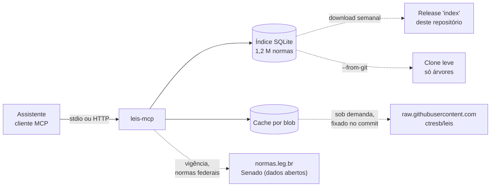

<div align="center">


### Busque e cite o texto oficial de mais de 1,2 milhão de normas brasileiras sem sair do seu assistente.

[](https://pypi.org/project/leis-mcp/)
[](https://github.com/mazulo/leis-mcp/actions/workflows/ci.yml)
[](https://www.python.org/)
[](https://modelcontextprotocol.io/)
[](https://github.com/ctresb/leis)
[](https://docs.astral.sh/uv/)
[](#docker)
[](https://github.com/mazulo/leis-mcp/blob/main/LICENSE)

[Início rápido](#início-rápido) · [Ferramentas](#ferramentas) · [Clientes](#clientes) · [Como funciona](#como-funciona) · [Limitações](#limitações)

<br>

<a href="https://gist.github.com/user-attachments/assets/d19cb5e2-fcf0-48f7-a5db-8e6663d1ac0f"></a>

<sub>Clique na imagem para ver a demonstração (25 s, com música).</sub>

</div>

<br>

<!-- mcp-name: io.github.mazulo/leis-mcp -->

**leis-mcp** é um servidor [MCP](https://modelcontextprotocol.io/) que dá ao Claude Code, ao Claude Desktop, ao Cursor, ao VS Code, ao Codex e a qualquer cliente MCP acesso à legislação brasileira do repositório público [ctresb/leis](https://github.com/ctresb/leis). Em vez de parafrasear de memória, o assistente busca a norma, lê o dispositivo e cita o texto exato, com a fonte oficial e os avisos de revogação.

```text
ler_artigo("8245/1991", "23", inciso="III")
→ "III - restituir o imóvel, finda a locação, no estado em que o recebeu, salvo as deteriorações decorrentes do seu uso normal;"
```

> [!IMPORTANT]
> O texto é convertido automaticamente das fontes oficiais e pode conter erros de conversão ou OCR. Ele não substitui a publicação no Diário Oficial. Toda resposta do servidor traz o link `fonte` e esse aviso.

## Destaques

- 📜 **Texto exato.** Artigo, parágrafo, inciso e alínea, com o caput como contexto e a citação pronta (`art. 23, III`).
- 🔗 **Sempre com fonte.** Cada resposta traz o link oficial (`normas.leg.br`, LexML) e o caminho no acervo.
- ⚖️ **Vigência e redação.** Cada resposta diz o que a fonte informa sobre a vigência da norma, se o texto é compilado ou original e de quando é a captura. Para normas federais, consulta o normas.leg.br e o Senado e traz as redações e alterações do dispositivo. Sem informação, diz que não sabe em vez de presumir vigência.
- ⚠️ **Avisos automáticos.** Norma revogada ou sem vigência, texto não compilado, dispositivo revogado ou vetado (com a lei que revogou), trecho tachado.
- 🗂️ **Acervo inteiro.** Normas federais, estaduais, municipais e de reguladores, com mais de 40 apelidos (`CLT`, `CDC`, `LGPD`, `lei do inquilinato`…).
- ⚡ **Rápido e local.** Índice SQLite pronto, atualizado toda semana, e conteúdo baixado sob demanda e conferido pelo hash do blob. O que está em cache funciona offline.
- 🔒 **Só leitura.** O repositório de origem nunca é alterado.

## Início rápido

> [!TIP]
> **Usa o Claude Desktop e não quer mexer no terminal?** Baixe o [**leis-mcp.mcpb**](https://github.com/mazulo/leis-mcp/releases/latest/download/leis-mcp.mcpb) e abra o arquivo. O Claude Desktop mostra a tela de instalação e cuida do resto, inclusive do Python.

Requisito: [uv](https://docs.astral.sh/uv/). O [ripgrep](https://github.com/BurntSushi/ripgrep) (`rg`) é recomendado.

```bash
uvx leis-mcp index                          # baixa o índice pronto (~100 MB, só na primeira vez)
claude mcp add leis -- uvx leis-mcp serve
```

Pronto. Pergunte ao Claude: *"O inquilino é obrigado a devolver o imóvel como recebeu? Cite a lei."*

> [!TIP]
> `uvx leis-mcp warm` pré-carrega as ~40 normas dos apelidos, para que `buscar_texto` sem `norma` já tenha onde procurar.

<details>
<summary><b>A partir do código-fonte</b></summary>

```bash
git clone https://github.com/mazulo/leis-mcp && cd leis-mcp
uv sync
uv run leis-mcp index
claude mcp add leis -- uv --directory "$PWD" run leis-mcp serve
```

</details>

## Ferramentas

| Ferramenta | Para quê |
|---|---|
| `buscar_norma(referencia?, numero?, ano?, tipo?, esfera?, uf?, limite)` | Acha a norma e devolve os metadados do cabeçalho (título, ementa, data), `vigencia`, `redacao`, o caminho, o link do GitHub e a `fonte`. Aceita `"8.245"`, `"8245/1991"`, `"Lei 8.245/91"`, `"Lei nº 8.245, de 18 de outubro de 1991"`, `"LC 123/2006"`, `"DL 5.452"` e apelidos. |
| `ler_artigo(norma, artigo, paragrafo?, inciso?, alinea?, bloco?)` | Devolve o texto exato do dispositivo, o caput como contexto, a citação, `vigencia`, `redacao`, a situação do dispositivo, `vigencia_online` (normas federais) e os avisos. |
| `buscar_texto(consulta, norma?, esfera?, tipo?, ano?, uf?, limite)` | Procura uma palavra ou trecho numa norma (baixada na hora) ou em todas as normas já em cache. Ignora acentos e maiúsculas e indica o artigo de cada ocorrência. |
| `listar_normas(esfera?, tipo?, ano?, uf?, municipio?, orgao?, limite, offset)` | Navegação em níveis: esfera, depois tipo, UF ou órgão, depois ano, depois a lista de normas. |
| Recurso `leis://apelidos` | Lista os apelidos aceitos. |

<details>
<summary><b>Exemplo de resposta</b> de <code>ler_artigo("8245/1991", "23", inciso="III")</code></summary>

```json
{
  "norma": {"titulo": "Lei nº 8.245 de 18/10/1991", "ementa": "Dispõe sobre as locações dos imóveis urbanos…",
            "revogada": false, "versao_texto": "compilada (texto vigente)",
            "caminho": "federal/leis-ordinarias/1991/lei-8245-1991-10-18.md"},
  "dispositivo": {"citacao": "art. 23, III",
                  "texto": "III - restituir o imóvel, finda a locação, no estado em que o recebeu, salvo as deteriorações decorrentes do seu uso normal;",
                  "caput": "**Art. 23.** O locatário é obrigado a:"},
  "vigencia": {"estado": "sem_revogacao_registrada",
               "resumo": "A fonte não registra revogação expressa. Isso não confirma vigência: pode haver revogação tácita, decisão judicial ou norma posterior.",
               "origem": "acervo ctresb/leis (cabeçalho e texto da norma)", "campos": {"revogada": false}},
  "redacao": {"versao_texto": "compilada (texto vigente)", "compilada": true, "capturada_em": "2026-10-13",
              "commit_acervo": "2dac3a272eed…", "resumo": "Texto compilado (redação vigente na data da captura), não a publicação original."},
  "vigencia_online": {"disponivel": true, "fontes": ["normas.leg.br", "Senado Federal (dados abertos)"],
                      "norma": {"forca_legal": null, "situacao_senado": null, "resumo": "As fontes online não marcam a norma como fora de vigor. (…)"},
                      "dispositivo": {"fonte": "Senado Federal (dados abertos)", "situacao": "sem eventos registrados no Senado"}},
  "avisos": [],
  "fonte": "https://normas.leg.br/?urn=urn:lex:br:federal:lei:1991-10-18;8245",
  "aviso_legal": "Texto convertido automaticamente das fontes oficiais (…). Não substitui a publicação no Diário Oficial."
}
```

</details>

<details>
<summary><b>Dispositivo revogado</b>: <code>ler_artigo("código civil", "3", inciso="I")</code></summary>

```json
{
  "dispositivo": {"citacao": "art. 3º, I",
                  "texto": "I - *(Revogado pela Lei nº 13.146, de 6/7/2015, publicada no DOU de 7/7/2015, em vigor 180 dias após a publicação)*",
                  "situacao": {"revogado": true, "vetado": false, "nota": "Revogado pela Lei nº 13.146, de 6/7/2015, (…)"}},
  "vigencia_online": {"dispositivo": {"fonte": "normas.leg.br", "situacao": "revogado", "versoes": [
    {"desde": "2002-01-10", "ate": "2015-07-05", "tipo": "redação original", "atual": false, "texto": "os menores de dezesseis anos;"},
    {"desde": "2015-07-06", "ate": null, "tipo": "revogação", "atual": true, "texto": "(Revogado)", "alterado_por": "Lei nº 13.146 de 06/07/2015"}]}},
  "avisos": ["ATENÇÃO: este dispositivo está REVOGADO segundo o próprio texto: Revogado pela Lei nº 13.146, (…).",
             "ATENÇÃO: o normas.leg.br registra este dispositivo como revogado pela Lei nº 13.146 de 06/07/2015."]
}
```

</details>

### Vigência e redação

O servidor não decide o direito aplicável. Ele mostra o que as fontes dizem e diz quando elas não dizem nada.

| Campo | De onde vem | O que significa |
|---|---|---|
| `vigencia.estado` | Cabeçalho da norma no acervo (`revogada`, `situacao`, `forca_legal_fonte`, `vigente_fonte`) e a nota de revogação antes dos artigos | `revogada`, `sem_vigencia_na_fonte`, `vigente_segundo_a_fonte`, `sem_revogacao_registrada`, `outra`, `nao_informada` ou `conflitante`. Os valores crus ficam em `campos`. |
| `redacao` | `versao_texto` e `baixado_em` do acervo | Se o texto é compilado ou a publicação original, a data da captura e o commit do acervo. |
| `dispositivo.situacao` | Nota no próprio texto, como `*(Revogado pela Lei nº 13.874, de 20/9/2019)*` | Dispositivo revogado ou vetado e a nota da fonte. |
| `vigencia_online` | [normas.leg.br](https://normas.leg.br) e [dados abertos do Senado](https://legis.senado.leg.br/dadosabertos), só para normas federais | Força legal e lei revogadora da norma. Para o Código Civil, o CPC, a LGPD, a Lei 14.133 e outras leis com compilação multivigente, todas as redações do dispositivo, com datas e a lei que alterou. Para as demais, como CLT, Código Penal e CDC, os eventos registrados pelo Senado: alteração, revogação, veto e decisões de constitucionalidade. |

- `sem_revogacao_registrada` e `nao_informada` **não** significam vigente. As fontes online também só marcam o que saiu de vigor.
- A consulta online envia só a URN da norma, guarda o resultado em `cache/online` por 7 dias (`LEIS_MCP_ONLINE_TTL_DAYS`) e pode ser desligada com `LEIS_MCP_OFFLINE=1`. Se a fonte falhar, a resposta diz que a consulta está indisponível e segue com os dados do acervo.
- Normas estaduais e municipais dependem do que a fonte de cada estado informa: MG, SP e DF trazem situação, a maioria dos outros estados não.

<details>
<summary><b>Apelidos aceitos</b></summary>

- **Constituição:** `constituição`/`CF`, `ADCT`
- **Códigos:** `código civil`/`CC`, `CPC`, `código penal`/`CP`, `CPP`, `CLT`, `CDC`, `CTN`, `CTB`, `código eleitoral`, `código florestal`
- **Estatutos:** `ECA`, `estatuto do idoso`, `estatuto da OAB`, `estatuto da cidade`, `estatuto do desarmamento`, `LBI`
- **Leis:** `lei do inquilinato`, `lei dos juizados`, `LGPD`, `marco civil da internet`, `maria da penha`, `nova lei de licitações`, `lei de improbidade administrativa`, `lei de drogas`, `LEP`, `lei de falências`, `LINDB`, `lei do mandado de segurança`, `lei da ação civil pública`, `LAI`, `LRF`, `simples nacional`, `lei anticorrupção`, `lei de arbitragem`, `lei de abuso de autoridade`

</details>

### Exemplos de perguntas

| Pergunta ao Claude | O que o servidor faz |
|---|---|
| "O inquilino é obrigado a devolver o imóvel como recebeu? Cite a lei." | `ler_artigo("lei do inquilinato", "23", inciso="III")` |
| "A caução do aluguel pode ficar em poupança?" | `ler_artigo("8245/1991", "38", paragrafo="2")` |
| "Serviço mal feito: o que o CDC garante?" | `ler_artigo("CDC", "20")` |
| "Preciso de advogado no juizado especial?" | `ler_artigo("9099/1995", "9")` |
| "O que diz o ADCT, art. 10?" | `ler_artigo("ADCT", "10")` |
| "Onde a CLT fala em grupo econômico?" | `buscar_texto("grupo econômico", norma="CLT")` |

## Clientes

Funciona em qualquer cliente MCP. Todos rodam o mesmo comando, `uvx leis-mcp serve`, depois de um `uvx leis-mcp index`. A maioria aceita esta configuração padrão:

```json
{
  "mcpServers": {
    "leis": {
      "command": "uvx",
      "args": ["leis-mcp", "serve"]
    }
  }
}
```

[](https://github.com/mazulo/leis-mcp/releases/latest/download/leis-mcp.mcpb)
[](https://cursor.com/en/install-mcp?name=leis&config=eyJjb21tYW5kIjoidXZ4IGxlaXMtbWNwIHNlcnZlIn0%3D)
[](https://insiders.vscode.dev/redirect?url=vscode%3Amcp%2Finstall%3F%257B%2522name%2522%253A%2522leis%2522%252C%2522command%2522%253A%2522uvx%2522%252C%2522args%2522%253A%255B%2522leis-mcp%2522%252C%2522serve%2522%255D%257D)
[](https://insiders.vscode.dev/redirect?url=vscode-insiders%3Amcp%2Finstall%3F%257B%2522name%2522%253A%2522leis%2522%252C%2522command%2522%253A%2522uvx%2522%252C%2522args%2522%253A%255B%2522leis-mcp%2522%252C%2522serve%2522%255D%257D)

> [!NOTE]
> Apps de interface gráfica no macOS (Claude Desktop, Cursor, Windsurf) nem sempre herdam o `PATH` do terminal. Se o cliente não achar o `uvx`, troque `"uvx"` pelo caminho absoluto que `which uvx` mostra.

<details open>
<summary><b>Claude Code</b></summary>

```bash
claude mcp add leis -- uvx leis-mcp serve
```

Use `-s user` para disponibilizar em todos os projetos e `-s project` para gravar em `.mcp.json`.

</details>

<details>
<summary><b>Claude Desktop</b></summary>

O jeito mais simples é a extensão: baixe o [**leis-mcp.mcpb**](https://github.com/mazulo/leis-mcp/releases/latest/download/leis-mcp.mcpb), abra o arquivo e clique em **Instalar**. Não precisa de terminal, uv nem Python: o Claude Desktop instala tudo. Na primeira pergunta ele baixa o índice (~100 MB), o que leva um ou dois minutos.

Para configurar à mão, use a configuração padrão em `claude_desktop_config.json` (macOS: `~/Library/Application Support/Claude/`, Windows: `%APPDATA%\Claude\`). O atalho é *Settings → Developer → Edit Config*. Reinicie o app depois de salvar.

</details>

<details>
<summary><b>Cursor</b></summary>

Clique no botão **Instalar no Cursor** acima, ou use a configuração padrão em `~/.cursor/mcp.json` (global) ou `.cursor/mcp.json` (no projeto).

</details>

<details>
<summary><b>VS Code (GitHub Copilot)</b></summary>

Clique no botão **Instalar no VS Code** acima, ou rode:

```bash
code --add-mcp '{"name":"leis","command":"uvx","args":["leis-mcp","serve"]}'
```

Para registrar só no projeto, crie `.vscode/mcp.json`. Repare que a chave aqui é `servers`:

```json
{
  "servers": {
    "leis": {
      "type": "stdio",
      "command": "uvx",
      "args": ["leis-mcp", "serve"]
    }
  }
}
```

</details>

<details>
<summary><b>Windsurf</b></summary>

Use a configuração padrão em `~/.codeium/windsurf/mcp_config.json`, ou pelo painel do Cascade em *MCP Servers → Configure*.

</details>

<details>
<summary><b>Codex (OpenAI)</b></summary>

```bash
codex mcp add leis -- uvx leis-mcp serve
```

Ou em `~/.codex/config.toml`:

```toml
[mcp_servers.leis]
command = "uvx"
args = ["leis-mcp", "serve"]
```

</details>

<details>
<summary><b>Gemini CLI</b></summary>

Use a configuração padrão em `~/.gemini/settings.json` (global) ou `.gemini/settings.json` (no projeto).

</details>

<details>
<summary><b>GitHub Copilot CLI</b></summary>

Rode `/mcp add` dentro do Copilot CLI, ou edite `~/.copilot/mcp-config.json`:

```json
{
  "mcpServers": {
    "leis": {
      "type": "local",
      "command": "uvx",
      "args": ["leis-mcp", "serve"],
      "tools": ["*"]
    }
  }
}
```

</details>

<details>
<summary><b>opencode</b></summary>

Em `~/.config/opencode/opencode.json`:

```json
{
  "$schema": "https://opencode.ai/config.json",
  "mcp": {
    "leis": {
      "type": "local",
      "command": ["uvx", "leis-mcp", "serve"],
      "enabled": true
    }
  }
}
```

</details>

<details>
<summary><b>Outros clientes</b></summary>

O leis-mcp é publicado no [MCP Registry](https://registry.modelcontextprotocol.io/) oficial como `io.github.mazulo/leis-mcp`, então clientes com busca de servidores, como a galeria de MCP do VS Code, o encontram pelo nome.

Cline, Kiro, Goose, Warp, Zed, LM Studio e outros aceitam servidores stdio. Cadastre o comando `uvx` com os argumentos `leis-mcp serve`, ou cole a configuração padrão onde o cliente pedir. Se o cliente só fala HTTP, veja [HTTP](#http).

</details>

### Docker

```bash
docker compose build
docker compose run --rm leis-mcp index
docker compose run --rm leis-mcp warm
docker compose run --rm -i leis-mcp serve                 # stdio
docker compose --profile http up leis-mcp-http            # HTTP: http://localhost:8000/mcp
```

Os dados ficam no volume `leis-data`. Para registrar no Claude Code:

```bash
claude mcp add leis -- docker compose -f /caminho/para/leis-mcp/docker-compose.yml run --rm -i leis-mcp serve
```

No Claude Desktop, troque o comando por `"command": "docker", "args": ["compose", "-f", "/caminho/para/leis-mcp/docker-compose.yml", "run", "--rm", "-i", "leis-mcp", "serve"]`.

### HTTP

```bash
uvx leis-mcp serve --transport streamable-http --port 8000      # servido em /mcp
claude mcp add --transport http leis http://localhost:8000/mcp
```

## Como funciona



| Peça | O que faz |
|---|---|
| Índice pronto | Toda segunda-feira o workflow [Index](.github/workflows/index.yml) monta o índice e publica no release [`index`](https://github.com/mazulo/leis-mcp/releases/tag/index) (~100 MB em gzip). `leis-mcp index` baixa esse arquivo e confere o sha256 e o commit, sem precisar de git. |
| Clone leve | Com `--from-git`, `git clone --depth 1 --filter=blob:none --sparse` baixa só as árvores (~250 MB), sem o conteúdo das normas. |
| Índice SQLite | `git ls-tree` sobre o commit gera uma tabela com caminho, blob, esfera, tipo, ano, número, data, UF, município e órgão (~1,2 M linhas em ~6 s, ~350 MB). |
| Primeira execução | Sem índice, `serve` responde ao cliente na hora e prepara o índice em segundo plano. Até terminar, as ferramentas pedem para tentar de novo em instantes. |
| Conteúdo sob demanda | Cada norma é baixada do `raw.githubusercontent.com` fixada no commit indexado (~0,4 s), conferida contra o hash do blob git e guardada em `cache/objects/<blob>`. Se a rede falhar e houver clone, o fallback é `git cat-file`, lento na primeira vez (~30 s). |
| Parser | Encontra artigos, parágrafos, incisos e alíneas e tolera as variações reais do acervo. |
| Vigência online | Para normas federais, `ler_artigo` consulta o normas.leg.br pela URN e, quando a lei não tem compilação multivigente, o Senado. O resumo fica em `cache/online` por 7 dias. Falhas não quebram a resposta. |
| Busca textual | Usa [ripgrep](https://github.com/BurntSushi/ripgrep) nos arquivos em cache, ou Python puro se o `rg` não estiver instalado. |

Os dados ficam em `~/.cache/leis-mcp`, configurável com `LEIS_MCP_HOME`.

<details>
<summary><b>Variações que o parser reconhece</b></summary>

- **Artigos:** `**Art. 1º**`, `Art. 1o`, `Art. 1.º`, `Art. 10.`, `Art. 1.000.`, `Art. 4º-A`, `Art. 359-M-A`, artigo sem negrito e `Art. l97.` (OCR que troca 1 por l).
- **Parágrafos:** `§ 2º`, `§ 2°`, `§2º`, `§ 3º-A`, `Parágrafo único`.
- **Incisos e alíneas:** incisos com `-`, `–`, `—` (com ou sem espaço) e alíneas `a)`.
- **Fim do artigo:** o artigo termina no próximo artigo, num título (`#`) ou na assinatura (`Brasília, ...`).
- **Numeração reiniciada:** quando a numeração recomeça na mesma norma (CF + ADCT, o decreto-lei que aprova a CLT), o texto é dividido em blocos. Por padrão vale o maior bloco, e `bloco="transitórias"` escolhe outro.

</details>

<details>
<summary><b>Estrutura do código</b></summary>

```
src/leis_mcp/
  config.py, models.py, errors.py, text.py
  messages.py        todo texto devolvido ao usuário (pt-BR)
  catalog/           GitRepository, PathParser, IndexBuilder / NormIndex (SQLite), IndexSnapshot
  references/        ReferenceParser + tabelas de apelidos
  content/           FrontMatterParser, ContentStore (cache por blob)
  legal_text/        labels (Art., §, inciso, alínea), DocumentParser, ProvisionExtractor, notices
  search/            AccentInsensitivePattern, RipgrepEngine / PythonEngine, TextSearch
  services/          NormResolver, NormLoader, NormPresenter, LegislationService (fachada), ServiceProvider
  server/            LeisServer: adaptador MCP (nomes de ferramentas e parâmetros em pt-BR)
  cli.py             Cli: serve, index, update, status, warm, read
```

O código é em inglês; só o que chega ao usuário (respostas, erros, descrições das ferramentas) é pt-BR.

</details>

## CLI

Rode com `uvx leis-mcp <comando>` ou, no código-fonte, com `uv run leis-mcp <comando>`:

```bash
leis-mcp index                         # baixa o índice pronto (usa git se o download falhar)
leis-mcp index --from-git              # clone leve + índice montado localmente
leis-mcp update                        # baixa o índice novo, se o commit mudou
leis-mcp update --from-git             # git fetch + reindexação
leis-mcp status                        # commit indexado, total, itens em cache
leis-mcp warm                          # pré-carrega as leis dos apelidos
leis-mcp warm --no-aliases --sphere federal --kind leis-complementares
leis-mcp read "Lei 8.245/91" 23 -c III # testa sem cliente MCP (-p parágrafo, -c inciso, -s alínea, -b bloco)
leis-mcp serve                         # stdio (padrão)
```

Se o índice não existir, `serve` inicia na hora e prepara o índice em segundo plano. Rodar `index` antes evita que as primeiras perguntas recebam o aviso de "preparando".

## Testes

```bash
uv run pytest -m "not integration"   # unitários, sem rede (fixtures pequenas)
uv run pytest                        # tudo, incluindo integração com conteúdo real e e2e MCP via stdio
LEIS_MCP_LIVE_TESTS=1 uv run pytest -k live   # consulta de verdade o normas.leg.br e o Senado
```

Os testes de integração usam o índice de `LEIS_MCP_HOME` e são pulados se ele não existir. Eles cobrem a Lei 8.245/91 (art. 23, III e art. 38, § 2º), o CDC (art. 20, I), o CC (arts. 422 e 1.000), a Lei 9.099/95 (art. 9º), a CLT, a CF e o ADCT, e todos os apelidos. O teste e2e sobe o servidor por stdio com o cliente MCP oficial e chama todas as ferramentas.

## Limitações

- **Busca textual sem o acervo inteiro:** `buscar_texto` sem `norma` procura só nas normas já em cache. Baixar as 1,2 M normas não é viável. Use `warm` para ampliar o cache. Não há busca semântica nem embeddings.
- **Ementas e títulos:** só aparecem para normas já baixadas. O índice tem apenas o que se deduz do caminho.
- **Referências ambíguas:** sem ano (por exemplo, `"decreto 5452"`), o servidor pede o ano. `buscar_norma` lista as opções.
- **Qualidade do texto:** a conversão automática e o OCR podem ter erros (por exemplo, `servir - se`). O texto é devolvido como está e o parser não o corrige.
- **Vigência:** nenhuma fonte usada afirma que uma norma está vigente por omissão. O histórico de redações por dispositivo só existe para leis federais com compilação multivigente no normas.leg.br; o Senado registra eventos, não o texto de cada redação. Revogação tácita e decisões judiciais fora desses registros não aparecem.
- **Metadados de normas não federais:** o número e a data de normas estaduais, municipais e de reguladores vêm de heurísticas sobre o nome do arquivo.
- **Rede:** o conteúdo vem do `raw.githubusercontent.com`, que pode impor limite de requisições. O que já está em cache funciona offline.

## Créditos

O acervo é o [ctresb/leis](https://github.com/ctresb/leis), que converte as normas das fontes oficiais para Markdown. O leis-mcp só lê esse repositório. A trilha do vídeo é *Intergalactic*, de Alex Jones / Xander Jones, da Biblioteca de áudio do YouTube.
