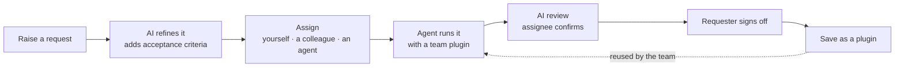

**English** · [简体中文](README.zh-CN.md)

> **中文文档入口：[文档目录](docs/README.zh-CN.md) · [安装与启动](docs/getting-started.md) · [开发指南](docs/development.md)**

<div align="center">


# SoduWork

## The AI-native engine for teams and their agents

**A chat ends with an answer. A SoduWork request ends when the person who asked signs off.**

**Multi-harness · Multi-agent · Self-hosted**

Works with Pi · OpenCode · DeepSeek Harness · Qwen Code · Kimi Code · Codex Harness · Codex · Claude Code · Google Harness²

```sh
git clone https://github.com/mdiri-ai/SoduWork
cd SoduWork
```

| Platform | Start command |
| --- | --- |
| macOS / Linux | `sh start.sh --desktop` |
| Windows PowerShell | `.\start.cmd --desktop` |
| Windows Command Prompt | `start.cmd --desktop` |

[Website](https://soduwork.ai) | [Live demo](https://soduwork.ai) | [Documentation](docs/README.md) | [Docs website](https://dev.soduwork.ai) | [Releases](https://github.com/mdiri-ai/SoduWork/releases) | [Discord](https://discord.gg/AXYNrAYHy)

[](LICENSE)
[](https://github.com/mdiri-ai/SoduWork/releases)
[](#quick-start)
[](https://discord.gg/AXYNrAYHy)

</div>

---

## What SoduWork can do for you

| | |
| --- | --- |
| **One harness does the work, another reviews it** | Pick Pi to do the work. OpenCode, on a different model, reviews it against the acceptance criteria. If the review fails, the work goes back with the reasons. |
| **Hand a request to a colleague's agent** | People and AI work together: you file a request, AI writes the acceptance criteria, and you assign it to yourself or a colleague. The assignee's agent does the work and reviews it, and a person signs off. Everyone on the request can see who did what. |
| **Turn one person's know-how into a team asset** | When you and AI get a task right, save the chat as a plugin. After review, anyone on the team can use it and contribute improvements, with access granted as needed. |

## Core ideas

<table>
<tr>
<td width="33%" valign="top">

**🔀 Smart dispatch**

**The right agent and model for each job.**

- Pick a harness for each step and switch mid-conversation
- Routine steps on cheap or local models, strong models where it matters
- Long tasks go to your own cloud runner

</td>
<td width="33%" valign="top">

**🛡️ Built-in governance**

**Your organization decides which AI does what, and where.**

- Plugins are reviewed before they are shared, granted to teams or people, and can be revoked
- Roles, usage, cost and an audit log
- Self-hosted

</td>
<td width="33%" valign="top">

**✅ Verified delivery**

**Set the bar first. Done means the requester signed off.**

- Every request carries its acceptance criteria
- A separate AI review checks each one
- A person makes the final call

</td>
</tr>
</table>

## Quick start

> SoduWork is in public beta. Try it and tell us what you think, and evaluate it before using it in production.

You need Python 3.12+, Node.js 22.19+ and Git.

From the cloned repository, run `sh start.sh --desktop` on macOS/Linux, `.\start.cmd --desktop` in Windows PowerShell, or `start.cmd --desktop` in Command Prompt.

The first run installs dependencies, then starts the Hub, the admin console and the desktop client on this computer. Set a password for the `admin` account (12–128 characters) when asked. Then add a model provider under **Model catalog** in the admin console, start a chat in the client and try a small task. Pi is built in.

### Already added an API key? Start here

1. **Add a chat model as well.** Under **Capabilities → Model catalog**, find the service you connected, choose **Add model**, enter the provider's exact model ID, select **Chat model**, and save. Saving a service credential alone does not create a selectable model.
2. **Open the desktop client and sign in to the same Hub.** Use `--desktop` when starting from source. The browser admin console configures the service; check that **Connection** on the desktop sign-in screen points to that same Hub.
3. **Choose New conversation, Pi, and the model you added.** Pi uses the SoduWork model catalog. Runtimes such as Codex and Claude Code use their own accounts and need their own sign-in; they do not automatically use this API key.
4. **Try a small task.** For example: “Turn these fictional meeting notes into an action table with owner and due date. Mark missing information as unconfirmed: Alex will organize the requirements by Friday; Sam will check the quotation.” Check the returned table against the notes.
5. **Create a requirement when you need assignment and acceptance.** Describe the goal, inputs and acceptance criteria, open **Arrange execution**, choose an Agent and model, and inspect the delivery before accepting it. A normal conversation does not require a project, plugin or automation first.

For the first message, use an **OpenAI-compatible chat model with Pi**. A successful connection probe does not guarantee a successful inference: balance, model permissions and protocol support still matter. If the Agent list is empty, check **Agent management** and the Runner connection. If the model list is empty, check that the model exists, is enabled, and both interfaces use the same Hub.

See [Run from source: send your first AI message](docs/getting-started.en.md#send-your-first-ai-message) for field-by-field setup and troubleshooting.

<details>
<summary><b>Try the live demo</b></summary>

Download the client from [Releases](https://github.com/mdiri-ai/SoduWork/releases), enter `https://soduwork.ai` under **Connection** on the sign-in screen, then sign up and sign in.

> The demo is for evaluation only. Don't upload real business data or anything sensitive.

</details>

<details>
<summary><b>Install the desktop client</b></summary>

| OS | Package |
| --- | --- |
| Windows | `SoduWork-<version>-Setup.exe` |
| macOS (Apple Silicon / Intel) | `SoduWork-<version>-mac-<arch>.dmg` |
| Linux | `SoduWork-<version>-linux.deb` / `.rpm` / `.tar.gz` |

Download from [Releases](https://github.com/mdiri-ai/SoduWork/releases). On first launch, enter your Hub address under **Connection**, then sign in. On macOS, if you see "cannot verify the developer", open **System Settings → Privacy & Security** and choose **Open Anyway**.

</details>

<details>
<summary><b>Deploy for a team with Docker</b></summary>

With Docker installed and running, from the repository root:

```bash
python3 ops/self-host/deploy.py up
python3 ops/self-host/deploy.py credentials   # show the initial admin password
```

This starts the Hub, the admin console and PostgreSQL on one server. Put an HTTPS reverse proxy in front of it to open it to your team. See [Deploy with Docker](https://dev.soduwork.ai/docs/get-started/docker) and [Deploy for a team](https://dev.soduwork.ai/docs/deploy).

</details>

Ports, data folders and troubleshooting are in [Run from source](https://dev.soduwork.ai/docs/get-started/run-from-source) and the [FAQ](https://dev.soduwork.ai/docs/get-started/faq).

## Why SoduWork

AI agents give everyone fast output. What no one gets for free is trust in that output — or a way to keep what worked. That's where individuals and teams get stuck alike:

| The problem | What SoduWork does |
| --- | --- |
| **Fast output, slow trust** — whether you work alone or in a team, the time AI saves goes back into checking what it produced | **The request is the spec.** Criteria set before work starts; a separate AI review checks each one; a person signs off |
| **What worked dies in a chat thread** — for one person, it's last month's perfect run you can't reproduce; for a team, it's one person's method nobody else can use | **Get it right once, keep it as a plugin.** Reuse it yourself or publish it for everyone — every improvement reaches everyone |
| **A drawer full of AI tools** — three subscriptions and no standard for which one does what | **One workbench, your playbook.** Your plugins run on every harness. Switch mid-conversation, keep your history and files |
| **Results that never enter the workflow** — output gets copy-pasted around, and every handoff re-explains the background | **Issues that carry the context.** People and agents pick up where it left off, with a full record of who did what |

## How it works

Requests, execution, review and reuse all happen in one shared issue pool:



| Role | Where they join |
| --- | --- |
| **Solo developer** | Puts requests in the pool, lets agents work through them, and only signs off |
| **Specialist** | Gets a task right with AI, saves the method as a plugin, and publishes it to the team |
| **Manager** | Drops in a request; AI fills in the criteria and routes it to a person or an agent; signs off at the end |
| **New team member** | Uses the plugins the organization has built up to do the work to team standards, and improves them when they find a gap |

Who asked, who did the work, which plugin ran and who approved it is always on record.

## Multi-harness · Multi-agent

A harness is the agent runtime that does the work. It is not the model. SoduWork connects every harness through one adapter interface, so issues, plugins and review don't depend on any single harness. Switch harnesses mid-conversation and keep the history and the working folder. Programs that support the Agent Client Protocol (ACP) can be added with a catalog declaration.

<details>
<summary>Supported harnesses (9)</summary>

| Harness | Models | How it connects |
| --- | --- | --- |
| Pi | Your SoduWork models | Built in |
| OpenCode | Your SoduWork models | Native adapter, installed on demand |
| DeepSeek Harness | Your SoduWork models, or your own DeepSeek key | ACP, installed on demand |
| Qwen Code | Your SoduWork models | ACP, installed on demand |
| Kimi Code | Your SoduWork models | ACP, installed on demand |
| Codex Harness | Your SoduWork models | ACP, installed on demand |
| Codex | Its own OpenAI account | Native adapter, installed on demand |
| Claude Code | Its own Anthropic account | ACP adapter, official installer |
| Google Harness² | Your SoduWork models | Native adapter; core bundled, prepared on first use |

</details>

Agents work together at several levels:

| Level | Who decides | Example |
| --- | --- | --- |
| Harness | The harness itself | OpenCode or Qwen Code starts its own subagents to explore the code or split a task |
| Single method | A Skill or plugin sets the method, process, rules and what counts as done | A review plugin tells the agent which checks to run and what evidence to attach |
| Combined methods | A plugin workflow picks the harness, Skill and model for each step | Pi drafts, Qwen Code checks the sources, and the run stops if the check fails |
| People and agents | The requester and the assignee or their agent | A request goes to a colleague, their agent does the work, the requester signs off |
| In parallel | The Hub | Different issues run on different agents at the same time, including on cloud runners |

Between steps and between people, work moves the way the plugin and the assignee say. Agents don't hand work to other agents on their own.

## Plugins and apps

A skill tells AI how to do something. An agent wraps AI into an assistant. SoduWork plugins and apps turn the way your team works into something that **runs, gets verified, improves and stays governed**.

| | Skill | Agent | SoduWork plugin | SoduWork app |
| --- | :---: | :---: | :---: | :---: |
| **What it is** | A method doc that AI reads and follows | Prompts, knowledge, tools or a platform flow | A versioned package: method, inputs, acceptance criteria, workflow | A plugin with its own UI<br/>and an AI chat panel |
| **Best for** | A single technique | One type of task | Standard team work, run by AI | Repeated work in a dedicated UI |
| **How you use it** | AI picks it up | Inside its platform | `/` in chat · on issues · in automations | Its own window + AI sidebar |
| **Step-by-step process** | ✗ | ◐ | ✓ | ✓ |
| **Choose and switch harness** | ✗ | ◐ | ✓ | ✓ |
| **Criteria, AI review, sign-off** | ✗ | ◐ | ✓ | ✓ |
| **Versioning** | ✗ | ◐ | ✓ | ✓ |
| **UI and interaction** | ✗ | ◐ Chat | ◐ Chat | ✓ |
| **Review, grant, revoke** | ◐ Configurable | ◐ Configurable | ✓ | ✓ |

<sub>✓ Supported　◐ Partial　✗ Not supported. "Agent" means an assistant built on a typical agent platform; capabilities vary by platform.</sub>

**From your chat to your playbook — yours or the team's**: create or save a plugin in chat → pre-check and try it locally → keep it for yourself, or submit it for review and publish it to the team catalog. Solo use stays light; team sharing adds review, grants and versioning.

<details>
<summary>Example: a weekly brief checked against its sources</summary>

```json
{
  "schemaVersion": 1,
  "key": "weekly-brief",
  "version": "1.0.0",
  "name": "Weekly brief",
  "workflow": {
    "nodes": [
      { "key": "draft", "type": "ai", "config": { "agentKind": "local:pi", "prompt": "Write deliverables/brief.md from this week's tasks." } },
      { "key": "check", "type": "ai_review", "dependsOn": ["draft"],
        "config": { "agentKind": "local:qwen", "prompt": "Check each claim against the sources. Block if any claim has no source." } },
      { "key": "done", "type": "publish", "dependsOn": ["check"] }
    ]
  }
}
```

</details>

You don't have to write this by hand: describe the work to Plugin Developer in a chat and it produces the file. See the [plugin guide](https://dev.soduwork.ai/docs/plugins) and [apps](https://dev.soduwork.ai/docs/apps).

## How SoduWork compares

- **vs. low-code agent builders**: no canvas, no wiring nodes. Finish a real task and save it as a plugin. Agents work directly on real files and projects, locally or in the cloud.
- **vs. coding agent harnesses**: SoduWork doesn't replace them. It runs them as harnesses inside a team workspace and adds what they don't have: issues that flow from request to execution to sign-off, independent AI review, plugin review and distribution, and access control with audit.
- **vs. multi-agent orchestrators**: people set the steps and checkpoints, and the requester accepts the delivery on evidence. Work moves between steps and people the way the plugin and the assignee say.
- **vs. AI office assistants**: know-how doesn't stay in one person's chat history. It becomes a reviewed, versioned plugin — reused by future you tomorrow, and by the whole team next month.

<details>
<summary>Comparison table</summary>

| | Low-code agent builders | Coding agent harnesses | Multi-agent orchestrators | AI office assistants | SoduWork |
| --- | :---: | :---: | :---: | :---: | :---: |
| Domain experts build and refine agents in chat | ◐ | — | — | ◐ | ✓ |
| Engineering and non-engineering work | ✓ | ◐ | ◐ | ✓ | ✓ |
| Mix harnesses and models as needed | ◐ | — | ✓ | — | ✓ |
| Acceptance criteria built into requests, sign-off on evidence | — | — | ◐ | — | ✓ |
| Plugin review, publishing and scoped access | ◐ | — | — | ◐ | ✓ |
| Enterprise-grade production and team collaboration | ◐ | ✓ | ◐ | ◐ | ✓ |
| Ready to use without building a business layer | — | ✓ | — | ✓ | ✓ |
| Hosted service | ✓ | ◐ | ◐ | ✓ | ◐ Self-hosted |

<sub>✓ Supported　◐ Partial or varies by product　— Not supported. Based on how each category typically works.</sub>

</details>

## Architecture

**The hard parts, handled:**

| Hard part | How SoduWork handles it |
| --- | --- |
| Clients disagreeing about facts | The Hub is the single source of truth: issues, workflows, approvals and evidence live in the Hub, so every client sees the same facts |
| Agents getting access they shouldn't have | Access is granted, not assumed: organization policy, runtime availability and the user's choices together decide what a session can use. Installing something doesn't authorize it |
| Lock-in to one harness | One adapter interface for every harness: higher layers never depend on a particular harness. Switch harnesses mid-conversation and keep the history and working folder |
| Methods that can't move | Method and environment are separate: plugins define the method; harness, model, runner and secrets are chosen when the plugin is bound. Plugin versions are immutable and portable |
| Work nobody can trace | Interaction and execution are separate: the client handles chat and approvals; the runtime and runners do the work — locally or remotely — and every run lands in the audit record |

<p align="center"></p>

<details>
<summary>Inside the runner</summary>

<p align="center"></p>

The runner connects to the Hub over a WebSocket. Every dispatch has an ID, so the same task is never taken twice. Each harness runs in its own subprocess. Events are saved on the execution host before they are sent, and are sent again after a disconnect.

</details>

<details>
<summary>Known limits</summary>

- **Cloud handoff moves context, not processes**: the working files, conversation and goal move to the cloud runner. Running processes and browser sessions don't, and you bring your own server.
- **A plugin isn't always a workflow**: a plugin can just provide a method or a tool. Workflows are for multi-step work, approval points and resuming after failures.
- **Runners and skills are not a general-purpose sandbox**: actual isolation depends on the harness and your environment. Only connect runners to a Hub you trust.

</details>

## Where does my data go?

- When you self-host, issues, plugins and chat history are stored in your own Hub, and tasks run in the folder you choose.
- Model requests go from the runner to the model provider you configure. Each run gets a short-lived credential; keys are not written to the harness's config files in plain text.
- Prompts and files sent to a model provider or connector you configure are visible to that service. With self-hosted models, inference can stay in your environment.

**Telemetry and updates.** This public source does not include a separate analytics or crash-reporting upload to MDiRi. The client defaults to `http://127.0.0.1:18989`; its operational requests go to the Hub selected under **Connection** on the sign-in screen. Selecting the public demo sends those requests to its operator. Selecting your own Hub keeps this traffic with your deployment.

- The selected Hub receives device/account authentication and the data required by the features you use. Usage accounting includes the conversation ID and title, Agent/model/provider identifiers, token and cost counters, and timestamps. Update attempts report version, progress, status and errors. These are operational records, not an optional analytics subscription.
- Installed clients check the selected Hub for updates at startup and periodically (every six hours). Checks include the current version, platform, CPU architecture and update channel, authenticated with the device session. Source-launched clients skip installer update checks. There is currently no separate setting to disable Hub accounting or installed-client update polling; use your own Hub to avoid sending this traffic to the demo service. Release-note requests also use the selected Hub.
- Hub request/database performance statistics are maintained within the Hub process; they are not automatically exported to MDiRi. Dependencies and optional Agent downloads contact their configured package registries or mirrors, and models/connectors contact the services you configure. Those services have their own data policies.

## FAQ

<details>
<summary><b>I work alone. Is SoduWork overkill for me?</b></summary>

Not if any of these hold: you re-check AI output yourself, you can't reproduce last month's perfect workflow, or you just want your AI tools to share one standard. Solo use needs no team setup — run it locally with SQLite in one command, and the organization features simply stay unused until you need them. Same plugins, same workbench, more people when you want them.

</details>

<details>
<summary><b>Is this just another agent platform or orchestrator?</b></summary>

SoduWork doesn't replace agent harnesses — it runs them inside a team workspace and adds the layer they don't have: one shared issue pool from request to sign-off, acceptance criteria built into every issue, an independent AI review step, plugin review with scoped grants, and an audit trail. People set the steps, checkpoints and approvals.

</details>

<details>
<summary><b>Is this actively maintained, or is it a demo?</b></summary>

It's an active public beta. Every release has release notes, and the release pipeline runs repository checks and test suites before a version is published. See the [Roadmap](#roadmap) for what's next, and [Contributing](#contributing) if you want to join.

</details>

<details>
<summary><b>Why do I need to sign in, and where is my data?</b></summary>

Accounts underpin organizations, permissions, collaboration and audit. When you self-host, you sign in to your own Hub and your data is stored there. See [Where does my data go?](#where-does-my-data-go)

</details>

More answers are in the [FAQ on the developer site](https://dev.soduwork.ai/docs/get-started/faq).

## Roadmap

| Status | Item |
| --- | --- |
| ✅ Shipped | Cloud runner (Personal Agent) support |
| In progress | Development kits for plugins and apps |
| In progress | Sandbox management for cloud runners |
| In progress | Web and mobile apps |
| Planned | Marketplace support for apps and plugins in enterprise and private deployments |

Ideas are welcome in [Discussions](https://github.com/mdiri-ai/SoduWork/discussions).

## Community

- **Chat**: [Discord](https://discord.gg/AXYNrAYHy)
- **Bugs and feature requests**: [GitHub Issues](https://github.com/mdiri-ai/SoduWork/issues)
- **Questions and ideas**: [GitHub Discussions](https://github.com/mdiri-ai/SoduWork/discussions)
- **Enterprise**: private deployment, integration and support. Email [soduwork@outlook.com](mailto:soduwork@outlook.com).

## Contributing

Issues, ideas, plugins, docs and code are all welcome.

1. Read the [contributing guide](CONTRIBUTING.md) for local setup and the checks to run before a pull request.
2. Fork, create a branch and commit your changes.
3. Open a pull request with a description of the change and how you tested it.

<details>
<summary>Developer guides</summary>

| Goal | Read |
| --- | --- |
| Build a plugin | [Plugin guide](https://dev.soduwork.ai/docs/plugins) |
| Build an app | [Apps](https://dev.soduwork.ai/docs/apps) |
| Add a harness | [Add an ACP harness](https://dev.soduwork.ai/docs/harnesses/add-acp-harness) |
| Deploy and operate | [Deploy for a team](https://dev.soduwork.ai/docs/deploy) |
| Commands and configuration | [Reference](https://dev.soduwork.ai/docs/reference/commands) |

</details>

### Contributors

<a href="https://github.com/mdiri-ai/SoduWork/graphs/contributors">
  
</a>

## Security

Please don't report security issues in public issues. Follow [SECURITY.md](SECURITY.md) to report them privately.

## License and acknowledgements

SoduWork's own code is copyright MDiRi and released under the [MIT License](LICENSE). Third-party code, fonts, graphics and bundled tools keep their own licenses; see [Third-party notices](https://dev.soduwork.ai/docs/reference/third-party). The SoduWork name and logo are trademarks of MDiRi and are not licensed under MIT.

Thanks to Electron, React, FastAPI, SQLAlchemy and the wider open-source ecosystem, and to the agent projects SoduWork runs. Being listed here doesn't mean a project endorses SoduWork.
