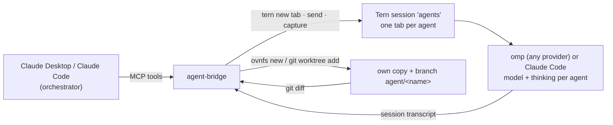

# agent-bridge — orchestrate parallel AI coding agents from Claude (MCP server)

**agent-bridge** is an MCP server that turns a Claude conversation (Claude Desktop or Claude Code) into an **orchestrator for parallel AI coding agents**. Each agent runs in its own [Tern](https://docs.stencil.so/tern) terminal tab, in its own **isolated copy of the repository** ([ovnfs](https://github.com/stencil-hq/ovnfs) checkout or git worktree) and branch. Agents can use **any model available on your machine** through [omp (oh-my-pi)](https://github.com/can1357/oh-my-pi), or run as Claude Code.

The orchestrator plans the work, starts the agents, follows their progress, reads their reports and diffs, and sends corrections. You don't copy-paste anything between the two.

[](https://github.com/merlinh0/agent-bridge/actions/workflows/ci.yml)
[](LICENSE)


[Français](README.fr.md)



## Features

- **Parallel coding agents, isolated.** Each agent gets its own copy of the repository and branch (`agent/<name>`), so agents never step on each other or on your checkout. With [ovnfs](https://github.com/stencil-hq/ovnfs) installed the copy is a copy-on-write checkout that opens in about a second and keeps the files git ignores (`node_modules`, `.env`, build caches), so agents can run the project without reinstalling anything; otherwise it is a git worktree.
- **Any model, any provider.** The default omp engine can use every model omp exposes on your machine: Anthropic, OpenAI / Codex, LiteLLM or other proxies, local models, and any other provider you configured. Claude Code is available as a second engine.
- **Model choice that stays current.** Set an exact model, or use `auto:fast`, `auto:balanced` or `auto:frontier`. The tiers are recomputed from the live model catalog, so a newly released model appears in them as soon as omp lists it. No vendor is favoured by default.
- **You decide which models are used.** Give the orchestrator rules such as "only use `openai-codex/*`" or "frontier = opus". It records them with `set_model_policy`, and the server enforces them on every start.
- **Thinking level per task.** Low reasoning for mechanical edits, high for design or hard bugs. You can switch an agent's model or thinking level mid-task; it keeps its full history.
- **Pick up existing sessions.** Discover omp and Claude Code sessions already running in any Tern window and drive them in place. Saved sessions can be reopened in a new tab with their full history.
- **Hands-off monitoring.** `wait_for_agents` returns when a turn ends. You get each agent's final report (a `## Report` section), its commits, and a full diff that includes uncommitted edits. The server warns you when an agent looks stuck on an approval or dialog.
- **Live view.** Every agent is a normal Tern tab: watch it work, or type into it yourself.

## Quick start

Requirements:
- macOS (what it is tested on; Linux should work wherever Tern and omp run, but is untested);
- [Tern](https://docs.stencil.so/tern), running;
- [omp](https://github.com/can1357/oh-my-pi), logged in to at least one provider;
- Claude Desktop, or Claude Code, as the orchestrator;
- git.

```sh
curl -LsSf https://raw.githubusercontent.com/merlinh0/agent-bridge/main/install.sh | sh
```

The installer:
1. installs [uv](https://docs.astral.sh/uv/) if needed;
2. installs the `agent-bridge` command;
3. registers it in Claude Desktop and Claude Code (backing up the Claude Desktop config first);
4. runs `agent-bridge doctor`.

Then quit and reopen Claude Desktop.

<details>
<summary>Manual install</summary>

```sh
uv tool install git+https://github.com/merlinh0/agent-bridge
agent-bridge install            # --no-desktop / --no-claude-code / --dry-run
agent-bridge doctor
```

Or register it yourself in `claude_desktop_config.json`:

```json
{ "mcpServers": { "agent-bridge": { "command": "/absolute/path/to/agent-bridge", "args": ["serve"] } } }
```
</details>

## Usage

Start a conversation in Claude Desktop and give it a goal:

```text
You orchestrate my coding agents (agent-bridge tools).
Repository: ~/code/my-app. Goal: add CSV export to the reports page, with tests.
Model rules: only use openai-codex/* and anthropic/claude-sonnet-*; frontier tier = openai-codex/gpt-6.1-sol.
Split the goal into independent tasks, show me the plan, then start one agent per task with the right
model tier. Loop on wait_for_agents → get_agent → get_diff, send corrections, and ask me before cleanup.
```

Other things you can ask:
- "List the omp sessions running in Tern and take over the one working on the API."
- "Reopen yesterday's session on the landing page and ask it to finish the tests."
- "Restart the `fix-cache` agent on the frontier tier with high thinking."

## Tools

| Tool | What it does |
|---|---|
| `start_agent(repo, task, name?, base?, engine?, model?, thinking?, auto_approve?, isolate?)` | Creates the agent's copy of the repository and branch `agent/<name>`, then starts the agent in a Tern tab |
| `discover_sessions(include_saved?, limit?)` | Lists omp / Claude Code sessions running in Tern (any window) and recent saved sessions |
| `adopt_session(block? \| session_file?, name?, base?)` | Takes over a live session in place, or reopens a saved one in a new tab |
| `list_agents()` / `get_agent(name, history?)` | Shows state, model, thinking level, last message (the report), commits and uncommitted changes |
| `get_diff(name, path?, stat_only?)` | Shows everything changed since the base commit: commits, uncommitted edits and new files |
| `send_message(name, message, model?, thinking?)` | Sends a follow-up or a correction. Passing `model` or `thinking` restarts the agent on that model, with its full history |
| `wait_for_agents(names?, timeout_s?)` | Blocks until an agent finishes its turn |
| `capture_screen(name)` / `press_keys(name, keys)` | Shows an agent's screen and answers approval prompts or dialogs |
| `stop_agent(name, cleanup?, force?)` | Closes the tab, and with `cleanup` removes the agent's copy and branch. Refuses if work is unmerged. An adopted session is only forgotten: nothing of it is closed or deleted |
| `list_models(engine?, filter?, refresh?)` | Lists every available model with its thinking levels and price, the current tiers, and whether each model is allowed |
| `get_model_policy()` / `set_model_policy(allowed_models?, tiers?)` | Reads or sets the model rules |

Agent states: `starting`, `working`, `idle` (turn finished, waiting for you), `exited`, `closed`.

## Model selection and policy

`model` accepts:
- an exact omp selector from `list_models`, such as `openai-codex/gpt-6.1-sol` or `anthropic/claude-sonnet-5-5`;
- for Claude Code, a Claude model or alias (`opus`, `sonnet`, `haiku`);
- an automatic tier: `auto:fast`, `auto:balanced` or `auto:frontier`.

`thinking` accepts `off`…`max` for omp, and `low`…`max` for Claude Code (passed as `--effort`). Levels a model doesn't support are rejected, and the error lists the valid ones.

**How tiers are computed.** The tiers come from the live catalog (`omp models --json`), so nothing is hard-coded:
1. Keep chat models that have a price.
2. Keep the newest version of each model family (an undated id wins over its dated copies).
3. Split by output price: the cheapest third is `fast`, the most expensive third is `frontier`, the rest is `balanced`.

Default thinking is `low`, `medium` and `high` respectively. Run `list_models(refresh=True)` or `agent-bridge models --refresh` to pick up a model that just launched. Free and local models are never auto-picked, but you can always select them by name.

**Policy.** The orchestrator calls `set_model_policy` when you state rules. They hold until the MCP server restarts, which usually means until you restart the app. For permanent defaults, put the same two keys in `~/.agent-bridge/config.json`:

```json
{
  "allowed_models": ["openai-codex/*", "anthropic/claude-sonnet-*", "claude-code/*"],
  "tiers": { "frontier": "openai-codex/gpt-6.1-sol" }
}
```

- `allowed_models` is a list of glob patterns. omp models match on their selector; Claude Code models match on `claude-code/<model>`. An empty list allows everything.
- `tiers` pins the model a tier stands for, instead of the automatic pick.
- With an allowlist, an agent started without a model gets `auto:balanced` from the allowed models instead of the engine's default.
- Disallowed models are refused when an agent starts, resumes or switches model.

## Notifications

The orchestrator learns that an agent finished through `wait_for_agents`, but only while it is waiting. To be told yourself, even when no conversation is following the agents, turn on desktop notifications:

```sh
agent-bridge notify on     # off to remove
```

This installs a small omp hook (`~/.omp/agent/hooks/post/agent-bridge-notify.ts`). Every omp session started afterwards, in Tern or not, with or without agent-bridge, shows a notification when it finishes a turn and waits for input (macOS; Linux uses `notify-send` when available). Subagents and `omp -p` runs stay silent.

## Configuration

| Environment variable | Default |
|---|---|
| `AGENT_BRIDGE_HOME` | `~/.agent-bridge` (tasks, worktrees, sessions, `config.json`) |
| `AGENT_BRIDGE_ISOLATION` | ovnfs when installed, else git worktrees; `worktree` forces git worktrees |
| `AGENT_BRIDGE_TERN_SESSION` | `agents` |
| `AGENT_BRIDGE_TERN` / `AGENT_BRIDGE_OMP` / `AGENT_BRIDGE_CLAUDE` / `AGENT_BRIDGE_OVNFS` | auto-detected |
| `AGENT_BRIDGE_OMP_SESSIONS` | `~/.omp/agent/sessions` |

## FAQ

**How do I run several Claude Code or AI coding agents in parallel without conflicts?**
Each agent works in its own copy of the repository on its own branch, so file edits and commits never collide. Merge the branches you accept (`git merge agent/<name>` or a PR), then call `stop_agent(cleanup=True)`. With ovnfs, an agent's commits stay in its checkout until you bring them in: `ovnfs apply agent-bridge-<name> --branch agent/<name>` (`get_agent` prints the exact command).

**Can agents use GPT, Codex, local or other non-Anthropic models?**
Yes. The omp engine uses every model omp exposes on your machine. `list_models` shows them all, and the auto tiers mix vendors by price.

**Does it work with claude.ai in the browser?**
No. claude.ai only reaches public HTTPS MCP servers, which would mean exposing control of your terminal to the internet. Use Claude Desktop or Claude Code.

**What about tool approvals?**
By default, agents follow your normal approval settings. When one is waiting, `capture_screen` shows it and `press_keys` answers it. `auto_approve=true` (`omp --auto-approve` / `claude --dangerously-skip-permissions`) removes the stops. It is refused until you run `agent-bridge auto-approve on` yourself; see [Security](#security).

**How is this different from Claude Code subagents?**
Subagents live inside one session and one checkout. agent-bridge agents are full, independent sessions you can watch and type into, each on its own branch and its own model, and they survive restarts. Existing sessions can be adopted.

**Claude Code asks "Do you trust this folder?"**
It asks once per repository. The agent stays in `starting` with a warning, and `press_keys(["Down", "Enter"])` answers yes.

## Security

The orchestrator reads text written by the agents (reports, diffs, terminal screens), so a hostile repository or web page could try to steer it through them. The server is built with that in mind:

- **Tool arguments are treated as untrusted.** Agent names are validated, session files must be real transcripts from the omp / Claude Code session stores, and nothing is passed through a shell or parsed as a command-line option.
- **`auto_approve` is off until you enable it** with `agent-bridge auto-approve on` in a terminal. No MCP tool can flip that switch.
- **Nothing is typed into a pane that no longer runs the agent.** If an adopted session exits and leaves your shell behind, the next message resumes the session in a new tab instead.
- **Cleanup never guesses.** `stop_agent(cleanup=True)` refuses when the agent's copy has uncommitted files or unmerged commits, or when it cannot check. Adopted sessions are never deleted.
- **State is private.** `~/.agent-bridge` is created with owner-only permissions.

What it does not protect against:

- **Agents run as you.** An agent can do whatever its engine's approval settings allow, in the repository you point it at. Only start agents on repositories you trust.
- **The model policy is a rule for the orchestrator, not a sandbox.** The orchestrator can change it with `set_model_policy`, and an adopted session keeps the model it already runs on.
- **Approving a prompt with `press_keys` runs that command.** Read the screen first.

Please report vulnerabilities privately through GitHub's "Report a vulnerability" button on the repository's Security tab.

## Limitations

- **ovnfs isolates files, not processes.** Like a git worktree, it is not a sandbox. Files git ignores, such as `.env`, are visible to the agent; what it writes there stays in its checkout.
- **Claude Code as an engine is less tested than omp.** Starting, reading state and sending keys were checked live; a full Claude Code turn was not.
- **A live Claude Code pane does not say which session it runs.** The bridge takes the session id from the command line when there is one, otherwise the most recent transcript of that directory, and refuses when several were active recently.
- **State is read from the transcript.** An agent waiting on a dialog stays `working`; the warning after 90 s without activity is the signal to look at its screen.
- **Auto tiers rank models by price.** Price is a proxy for capability, not a benchmark; pin a model per tier when you disagree.

## Troubleshooting

Run `agent-bridge doctor` first.

| Symptom | Fix |
|---|---|
| Tools missing in Claude Desktop | Quit (⌘Q) and reopen Claude Desktop; check `agent-bridge doctor` |
| `tern CLI not found` / Tern errors | Open Tern |
| Agent stuck in `starting` | `capture_screen`: a login, trust or startup dialog |
| Agent `working` with a warning | `capture_screen`: probably an approval, which `press_keys` answers |
| `not allowed by the model policy` | `get_model_policy`, then pick an allowed model or change the policy |
| `auto_approve is disabled` | Run `agent-bridge auto-approve on` in a terminal, if you want agents to run tools without asking |
| `wait_for_agents` timed out | Expected: it returns within the MCP call limit; call it again |

## Development

```sh
uv run --group dev pytest
uv run --group dev ruff check src tests
uv run agent-bridge serve      # stdio MCP server
```

Issues and pull requests are welcome.

## License

[MIT](LICENSE)
