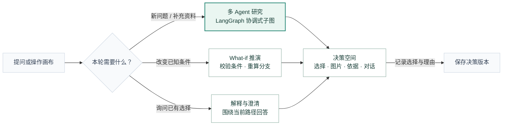
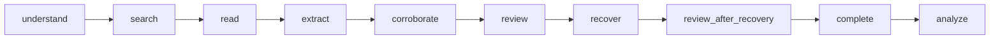

<div align="center">

**简体中文** · [English](docs/i18n/README.en.md)


# Prism

**让 Agent 找依据，让你推演每一个「如果」。**

多 Agent 协作查证，可交互的 What-if，留得下的判断。

[](https://github.com/mianwtt/prism/actions/workflows/check.yml) [](LICENSE) [](docs/MULTI-AGENT.md) [](.github/SECURITY.md) [](docs/ROADMAP.md)

[开始体验](#quick-start) · [核心功能](#features) · [使用场景](#examples) · [整体架构](#system-architecture) · [文档](#documentation)

</div>


电脑画面来自 Prism 的实际运行，使用历史苏宁商品观察及对应来源图片。五条分支是为展示设置的条件假设，保存的价格并非实时行情。

预算变了，多了一个要求，或者你想知道某个方案为什么被排除。Prism 把 Agent 的研究结果放进一张 **What-if 画布**，让你沿着不同条件比较选择，也能接着对话、补充资料，保留原来的判断依据。

<a id="quick-start"></a>

## 快速开始

克隆本仓库，使用 **Node.js 24** 和 npm 运行：

```sh
git clone https://github.com/mianwtt/prism.git
cd prism
npm ci
npm start
```

打开 **[localhost:4317](http://localhost:4317)**，选择笔记本或住房演示。先改一个条件，点击方案查看详情，再保存自己的判断。两种演示均使用虚构数据，无需模型或搜索 Key；当前界面为中文。

### 接上真实研究

1. 启动本机 Ollama 模型，或准备兼容 Chat Completions 的模型接口。
2. 使用无需商业搜索 Key 的方案时，安装 [uv](https://docs.astral.sh/uv/)，运行：

   ```sh
   npm run setup:search
   ```

3. 打开「研究设置」，选择 **tofu-search**，连接模型。本机 Ollama 地址填 `http://localhost:11434/v1`，模型名选择实际已安装的模型，密钥栏填 `ollama`。
4. 提出问题，之后从画布继续修改条件或请 Agent 查找更多方案。

[完整配置与故障排查 →](docs/SETUP.md)

<a id="features"></a>

## 核心功能

- **多 Agent 分工研究与核验。** 协调角色明确比较条件，研究角色搜索与读页，审查角色质疑有问题的依据，分析角色解释取舍。沿选定路径继续提问或补充资料。
- **每一个「如果」都有具体变化。** 点击条件或拖动滑杆，匹配方案立即更新。保留原始情况，联动继承条件的后续分支，也保留子分支单独修改过的要求。
- **点击方案，就能看到依据。** 图片、价格、参数、原文与来源链接在浮窗中展开；查看不同观察值，也能对比任意两条分支的进入与退出原因。
- **比较条件随问题生成。** Agent 从需求中提出数值、是非或分类维度。笔记本与住房使用同一张画布，各自呈现相应条件。
- **记住当时为什么这样选。** 保存选择、理由与原始条件；之后重新核对来源、比较版本，也能以 JSON 导出和导入决策。

### 选电脑：要求变了，看看哪些方案还能留下

先把预算放宽到 8,000 元，再比较「预算收紧到 5,000 元」「内存至少 24GB」「重量更轻」等路径。每条路径展示满足条件的全部方案；打开分支对比，可以看到哪些电脑退出，以及对应的价格原文。


图中的对比将 8 个可选方案收紧到 3 个。商品资料为历史采集记录，不代表当前跨平台实时价格。

### 选住房：月租变了，方案跟着变化


预算从 2,500 → 2,000 → 3,000 元，选定分支的匹配方案从 4 → 1 → 5 个变化。此处使用已保存依据实时重算，不会因为每次拖动而重新搜索。

<a id="examples"></a>

## 可以从这些问题开始

比较维度随问题生成：电脑可以关注价格、内存和重量，住房可以关注月租与面积。两类问题共用同一套多 Agent 研究流程、证据模型和 What-if 画布。

| 起点 | 继续探索 |
| --- | --- |
| 「选一台 7,000 元内、至少 16GB 内存的开发笔记本。」 | 「如果需要 32GB 呢？」·「为什么这个方案被排除了？」 |
| 「比较杭州 4,000 元/月内、至少 30㎡ 的整租房源，需要原页图片。」 | 「如果预算改成 2,500 元？」·「看看面积更大的选择。」 |
| 一次已经保存的判断 | 「保留这条路径，继续找其他方案。」·「重新核对这次判断的依据。」 |

想直接体验多条分支，可以导入[示例决策文件](examples/README.md)，无需连接模型。

**真实研究记录：** 使用本机 `qwen3.5:9b`、tofu 和 LangGraph，杭州与成都的新租房任务分别取得了 **6 套符合条件、带对应原页照片的房源**，输入没有房源链接。这些是有采集时间的网页观察，主要来自房天下；[完整记录](docs/reports/AGENT-RESEARCH-REPAIR-2026-11-15.md)包含中间失败和验证范围。

<a id="system-architecture"></a>

## 整体架构

Prism 由四部分组成：**决策工作区、决策服务、模型与资料、本地数据与缓存**。多 Agent 负责研究资料，确定性内核负责条件推演，两者共同支撑有依据、可回溯的决策。


改已知条件，直接复用已有依据重算；需要新资料，再由 Agent 继续研究。

图中实线表示主要交接与依赖，虚线表示按条件触发的补查、重算、恢复与缓存路径；浏览器画面为交互示意。

<details>
<summary>展开模块职责与数据边界</summary>

| 层次 | 组成与职责 |
| --- | --- |
| 浏览器工作区 | JavaScript / SVG 画布、统一对话、依据浮窗与决策记忆；localStorage 保留未提交草稿 |
| 本地服务 | Node.js HTTP API，管理请求分流、研究任务状态、版本读写、导入导出与删除 |
| 应用与决策 | 持续对话与上下文、LangGraph 四角色研究、证据与结构校验、共享 What-if 计算内核 |
| 模型与资料接入 | Ollama / 兼容 Chat Completions；tofu-search / Tavily；公开目录、详情页和原页图片读取 |
| 持久化与缓存 | JSON 保存决策版本与任务记录，SQLite 保存阶段检查点，可选 Redis 复用搜索结果 |

**已有条件在浏览器直接重算。** 浏览器与服务端复用同一个确定性计算内核；要求查找新资料时才创建研究任务。Redis 不作为会话记忆或任务队列，SQLite 检查点也不代替 JSON 决策版本。

</details>

<a id="agent-architecture"></a>

### 多 Agent 协作

研究子模块以四个专职子图完成需求规划、资料采集、证据审查和取舍分析。父图控制执行顺序、任务交接与补查预算，最终资格仍由程序规则决定。[实现与代码入口 →](docs/MULTI-AGENT.md)

<details>
<summary>展开四角色分工、内部流程与执行边界</summary>

Prism 将一次研究拆为 **协调、资料研究、证据审查、决策分析 4 种职责**，分别由独立的 LangGraph 子图承接。各角色只接收本轮所需的上下文和工具权限，通过结构化任务与结果交接。它们共用配置的模型服务、顺序执行；“4 类”指职责种类，不是 4 个模型，也不是固定的调用次数。


| 角色 | 负责什么 | 为什么单独划分 |
| --- | --- | --- |
| 协调 Agent | 把问题转成比较字段、明确条件和检索任务 | 先约定查什么，研究过程中不能自行放宽用户要求 |
| 资料研究 Agent | 调用搜索、公开目录与读页工具，提取绑定原文的观察 | 将事实采集与后续评价分开，缺失信息保留未知 |
| 证据审查 Agent | 独立核对来源依据，暂缓采用存在问题的字段 | 允许质疑研究结果；反馈必须带原文依据，不能编造替代数值 |
| 决策分析 Agent | 基于已评估候选解释选择与取舍 | 解释不能反过来改写事实、用户条件或资格结果 |

例如选电脑时，协调角色确认“预算 7,000 元、内存至少 16GB”；研究角色查找商品详情；审查角色检查报价是否需要领券、参数是否属于同一配置；程序据此评估资格，分析角色再解释可选方案的取舍。证据不足时按预算补查，**最多一轮反馈驱动补查、两次模型审查**；“一轮”不等于只搜索一次。审查不可用时明确记录降级，不能称为已完成独立审查。当前没有对照实验能够证明四角色必然优于单 Agent。

**为什么是四类？** 这是当前实现按“明确任务 → 采集事实 → 质疑证据 → 解释选择”划分的职责边界，不是 Agent 项目的固定标准。最终资格由程序规则决定；What-if 计算和缓存不是额外的 Agent。

</details>

### 对话与画布如何衔接

新问题、补充来源或新的关注点进入研究；修改已知条件直接重算 What-if；询问取舍则围绕当前路径解释已有依据。后续对话会保留当前条件和历史上下文。

<details>
<summary>展开三种交互路径</summary>



图中的三条路径是应用分流，不是三个独立 Agent。

</details>

**改条件不等于重新搜索。** 例如把预算改为 5,000 元，会先用当前分支已收集的资料重算；要求“继续找其他方案”或补充新的比较依据时，再进入研究。没有匹配结果，只表示现有资料中没有符合条件的选择。

<details>
<summary>展开真实 LangGraph 阶段与代码入口</summary>



这些是执行阶段，不是十个 Agent。`understand` 属于协调角色；`search / read / extract / corroborate / recover` 属于研究角色；两个审查阶段属于同一个审查角色，第二次仅在证据或观察变化后执行；`analyze` 属于分析角色。`complete` 是程序整理与评估阶段。

研究图：[general-research.mjs](src/general-research.mjs)。角色子图与权限：[specialist.mjs](src/agents/specialist.mjs)。证据审查：[evidence-review.mjs](src/agents/evidence-review.mjs)。[实现、测试与限制 →](docs/MULTI-AGENT.md)

</details>

[完整架构与信任边界 →](docs/ARCHITECTURE.md)

<a id="documentation"></a>

## 文档

| 指南 | 内容 |
| --- | --- |
| [文档索引](docs/README.md) | 使用指南、项目结构、素材来源与历史报告 |
| [安装与配置](docs/SETUP.md) | 本机启动、Ollama、搜索服务、配置与故障排查 |
| [使用工作区](docs/WORKSPACE.md) | 对话、条件、资料依据、判断记录、导入与删除 |
| [架构说明](docs/ARCHITECTURE.md) | Agent 图、计算、存储与信任边界 |
| [多 Agent 实现](docs/MULTI-AGENT.md) | 四角色分工、上下文与工具权限、审查补查、真实验证范围 |
| [技术实现报告](docs/TECHNICAL-REPORT.md) | 搜索与 BM25、Agent 执行、Redis 缓存、实现细节与测评 |
| [开发指南](docs/DEVELOPMENT.md) | 隔离测试、真实研究验证与 Docker 状态 |
| [GitHub 发布指南](docs/PUBLISHING.md) · [版本说明](docs/releases/v0.4.0.md) | 上传准备、仓库设置与公开预览版范围 |
| [验证记录](docs/reports/VERIFICATION.md) · [路线图](docs/ROADMAP.md) | 已测结果与后续发布工作 |

<a id="development-and-verification"></a>

## 开发与验证

```sh
npm run test:release
```

最近一次完整本地回归：**299 项单元／HTTP 测试、71 项 Edge 浏览器测试通过**。多 Agent 的真实模型／租房研究验证见[协作实现报告](docs/MULTI-AGENT.md)；此前的 **11 项真实服务连续操作检查**保留在[使用实测报告](docs/reports/USER-JOURNEY-2026-11-21.md)。受控回归与真实研究结果分开记录。此前的 **3 项真实 Redis 集成测试**及历史批次保留原有范围，见[质量报告](docs/reports/PREVIEW-QUALITY-2026-11-18.md)；分项命令见[开发指南](docs/DEVELOPMENT.md)。

`npm run check:project` 检查完整工作区源码；`npm run package:source` 生成排除本地配置、决策数据和实验目录的源码包。详见[项目结构与打包](docs/PROJECT-STRUCTURE.md)。

## 当前状态

Prism **0.4 是面向本机单用户的开发预览**。真实研究受模型、搜索引擎和公开网页可读性影响；保存引文表示可追溯到来源，不等于独立核实了发布者的说法。

已增加电脑、手机与不同城市租房的真实任务检查，[质量报告](docs/reports/PREVIEW-QUALITY-2026-11-18.md)按版本保留成功、失败及配置多样性边界；它们不是独立标注的泛化准确率。尚不支持 PDF／Word／Excel／图片资料导入。多 Agent 实现版本 `95b3e4b` 已通过 [GitHub CI](https://github.com/mianwtt/prism/actions/runs/45001301886)，包含 Node.js 22/24 多平台测试、浏览器、源码打包、Redis 和容器基础运行检查。Docker 的基础运行与完整真实研究能力分别验收。详见[发布工作](docs/ROADMAP.md)。

问题和决策历史保存在本机；外部模型、搜索和读页请求仍会传递相应数据。使用个人信息或分享导出文件前，请阅读[安全与隐私说明](.github/SECURITY.md)。

## 参与贡献

欢迎公开来源适配、可复现的数据质量案例与无障碍改进。请从 [CONTRIBUTING](.github/CONTRIBUTING.md) 开始。

项目源码采用 [MIT](LICENSE)；第三方内容和照片保留其原有权利。
