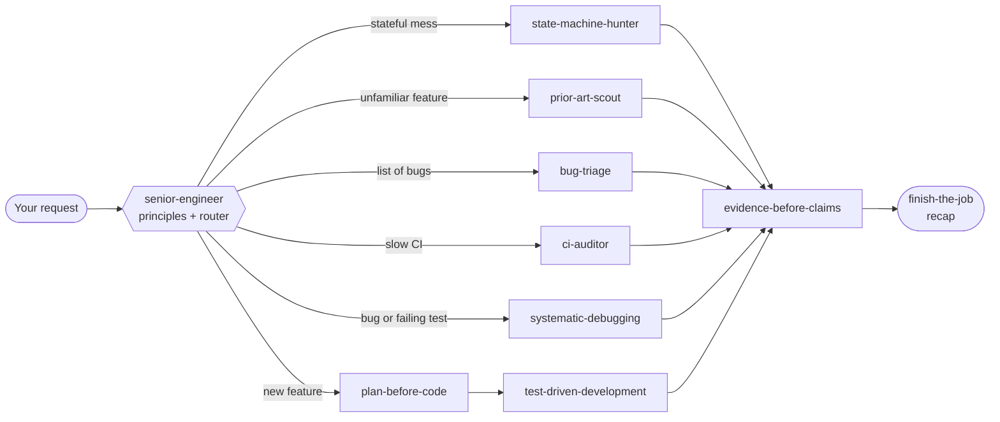

<div align="center">


<br>

### Your AI codes like a junior because you prompt it like one.

**15 [Agent Skills](https://agentskills.io) that give Claude Code, Codex, Cursor, Gemini CLI, and Copilot the judgment of a staff engineer:**<br>
**what to build, what to skip, when to keep going, and how to prove it works.**

<p>
  <a href="LICENSE"></a>
  <a href="#-all-15-skills"></a>
  <a href="https://agentskills.io"></a>
  <a href="https://www.npmjs.com/package/senior-skills"></a>
  <a href="#-quick-start"></a>
  <a href="https://github.com/milad-raeisi/senior-skills/actions/workflows/validate.yml"></a>
  <a href="https://github.com/milad-raeisi/senior-skills/stargazers"></a>
  <a href="CONTRIBUTING.md"></a>
</p>

[**Quick start**](#-quick-start) · [**The Senior Five**](#-the-senior-five) · [**All skills**](#-all-15-skills) · [**How it works**](#-how-it-works) · [**FAQ**](#-faq)

</div>

---

## The problem

You have access to one of the most capable programmers ever built, and you're handing it intern tickets:

> *"Find the bugs."* · *"Build this feature."* · *"Figure out why CI is so slow."*

So it does what an eager intern does. It "fixes" every edge case it can imagine and hands you a sprawling diff. It writes a retry library from memory instead of checking how mature projects handle jitter. It edits your CI config on a hunch. It migrates most of the call sites, then asks *"Want me to continue?"*

The model isn't the bottleneck. **The instructions are.** senior-skills replaces task-level prompts with the judgment calls senior engineers make without thinking, packaged as skills your agent loads automatically, exactly when they're relevant.

## What changes

| You say | A junior agent | With senior-skills |
|---|---|---|
| "Find the bugs" | Patches everything it can imagine; defensive code everywhere | Scores each bug **likelihood × severity**, fixes what matters with regression tests, files the rest as issues |
| "Add rate limiting" | Writes a token bucket from memory | Reads real open-source implementations and their bug trackers, picks the design that survives multiple instances, cites sources |
| "CI is slow" | Adds caching to everything | Measures 150 runs, splits every job into **queue · setup · run**, and reports first. Nothing changes until you approve |
| "Clean up this component" | Renames variables | Finds the booleans that form an implicit state machine and makes impossible states unrepresentable |
| "Migrate the API client" | Stops halfway: *"Shall I continue?"* | Finishes, verifies, **asks before deleting** the old client, ends with a recap anyone can follow |
| "Is it fixed?" | "Should work now!" | "The reproduction passes and the full suite is green. Not verified on Windows." |

## ⚡ Quick start

<p align="center">
  
</p>

> [!TIP]
> **Install** with one command. No clone, no fork, no account.
>
> ```bash
> npx senior-skills
> ```
>
> It finds the coding agents on your machine (Claude Code, Codex, Cursor, Gemini CLI, Copilot, OpenCode, Windsurf) and gives each one all 15 skills. Then restart your agent.

> [!IMPORTANT]
> **Update** whenever you like. New skills and improvements arrive with one command:
>
> ```bash
> npx senior-skills@latest update
> ```
>
> Keep the `@latest`: it makes `npx` fetch the newest release instead of reusing a copy it cached earlier.

<details>
<summary><b>👋 New to the terminal? A step-by-step guide (about 2 minutes)</b></summary>

<br>

**1. Open a terminal.** On macOS, open **Terminal** (press <kbd>⌘</kbd> + <kbd>Space</kbd> and type "Terminal"). On Windows, open **PowerShell**. On Linux, open your usual terminal.

**2. Check that Node.js is installed.** Type this and press <kbd>Enter</kbd>:

```bash
node --version
```

You should see `v20` or higher, for example `v22.11.0`. If you see `command not found` or a lower number, install the **LTS** version from [nodejs.org](https://nodejs.org), then close and reopen the terminal. `npx` comes with Node.js, so there's nothing else to install.

**3. Install the skills.**

```bash
npx senior-skills
```

The first time, npm may ask `Ok to proceed? (y)`. Press <kbd>Enter</kbd>. You'll see one line for each agent it found:

```text
senior-skills 1.2.0: installing 15 skill(s)

  ✓ Claude Code     ~/.claude/skills  (15 added)
  ✓ Cursor          ~/.cursor/skills  (15 added)
```

**4. Restart your agent.** Close and reopen Claude Code, Cursor, or whichever agent you use, so it loads the new skills.

**5. Try it.** Open a project and ask your agent something like *"Find the bugs that matter in this project"* or *"Audit this repo's CI"*. You don't need to name a skill; the right one loads by itself.

**6. Stay up to date.** Every now and then, run `npx senior-skills@latest update`.

</details>

<details>
<summary><b>🧭 All commands and options</b></summary>

<br>

| You want to | Run |
|---|---|
| Install for every agent on this machine | `npx senior-skills` |
| Update to the newest release | `npx senior-skills@latest update` |
| Install for one agent only | `npx senior-skills --agent claude`<br><sub>also `codex`, `cursor`, `gemini`, `copilot`, `opencode`, `windsurf`, or `all`</sub> |
| Install into a project, shared with your team through git | `npx senior-skills --dir ./.agents/skills` |
| Install only some skills | `npx senior-skills --only bug-triage,ci-auditor` |
| See which skills are included | `npx senior-skills list` |
| See every option | `npx senior-skills --help` |

</details>

<details>
<summary><b>🛡️ Is it safe? What it does to your files</b></summary>

<br>

- It only writes the 15 senior-skills folders into your agents' skills folders, such as `~/.claude/skills`. Your other skills are never modified.
- `install` never overwrites: if a skill is already there, it is kept.
- `update` replaces only copies that came from senior-skills. If you edited one yourself, your version is saved to `~/.senior-skills/backups/<time>/` first.
- A different skill that happens to have the same name is left alone unless you add `--force`.
- It has no dependencies, collects no data, and makes no network calls of its own; npm only downloads the package. The whole installer is one readable file: [`bin/senior-skills.mjs`](bin/senior-skills.mjs).

</details>

<details>
<summary><b>🧰 Troubleshooting</b></summary>

<br>

| You see | What to do |
|---|---|
| `command not found: npx` or `node` | Install Node.js 20 or newer from [nodejs.org](https://nodejs.org), then open a new terminal. |
| `could not determine executable to run` | An old copy is installed in the folder you're in, or in a folder above it. Run `npx senior-skills@latest`, which always uses the published version. |
| The skills don't show up in your agent | Restart the agent, then check that the folder the installer printed exists. |
| `Some installed skills differ from this version and were kept` | You already had an older or edited copy. Run `npx senior-skills@latest update`. |
| Something else | [Open an issue](https://github.com/milad-raeisi/senior-skills/issues/new/choose) with the command you ran and what you saw. |

</details>

**Prefer a Claude Code plugin?** Install from the marketplace and get updates through `/plugin`:

```text
/plugin marketplace add milad-raeisi/senior-skills
/plugin install senior-skills@senior-skills
```

<details>
<summary><b>More ways to install</b>: the open skills CLI, Gemini CLI extension, install script, no-install prompts</summary>

<br>

**The open [`skills`](https://github.com/vercel-labs/skills) CLI**, which supports many more agents:

```bash
npx skills add milad-raeisi/senior-skills
```

**Gemini CLI extension** (loads the senior-engineer principles into every session):

```bash
gemini extensions install https://github.com/milad-raeisi/senior-skills
```

**Install script**, for a local clone (add `--link` to symlink, so `git pull` keeps you updated):

```bash
git clone https://github.com/milad-raeisi/senior-skills && cd senior-skills
./scripts/install.sh --agent claude          # codex | cursor | gemini | copilot | opencode | windsurf | all
```

Or without Node.js: `curl -fsSL https://raw.githubusercontent.com/milad-raeisi/senior-skills/main/scripts/install.sh | bash -s -- --agent all`

**No agent at all?** Paste the prompts from [`prompts/the-senior-five.md`](prompts/the-senior-five.md) into any chat.

</details>

Then just work. Skills load on their own when your task matches. You can also call one by name: `/senior-skills:ci-auditor` in Claude Code, or *"use the bug-triage skill"* in any agent.

---

## 🖐️ The Senior Five

Five prompts that turn an agent from a task-taker into an engineer, each rebuilt as a full skill with a procedure, rubrics, report templates, and tooling.

### 1. 🔍 State Machine Hunter · [`skills/state-machine-hunter`](skills/state-machine-hunter/SKILL.md)

> *Find all of the implicit state machines in my app. Make the best decision that will elevate all three: the user experience (UX), developer experience (DX), and agent experience (AX), always, without breaking anything.*

Most "weird" bugs are states your types allow but nobody designed: loading *and* errored, submitted twice, an upload you can't cancel. The skill:

- **hunts the whole codebase** with ready-made `rg` recipes: boolean clusters, stringly typed status, check-and-set races, retry loops, status columns
- **maps every machine**: states, events, impossible combinations, missing exits, races, persistence
- **picks the least invasive fix** that removes impossible states: document → honest type → central transitions → state-chart library
- **pins behavior with characterization tests before refactoring**, and never rewrites persisted values without your approval
- ships patterns for **TypeScript/React, Python, Rust, Go, Kotlin, Swift, and SQL**

### 2. 🧭 Prior-Art Scout · [`skills/prior-art-scout`](skills/prior-art-scout/SKILL.md)

> *Don't write an unfamiliar feature from scratch. Search GitHub for open-source projects, compare their approaches, then start.*

- One test decides whether to scout: *can you name the top two ways this feature fails in production?*
- `gh search repos / code / issues` recipes that find **implementations and bug trackers**, not just READMEs
- A comparison matrix and an **adopt / adapt / build** decision table
- **License hygiene**: what you may copy from MIT, Apache, GPL, and unlicensed code (and what you may only learn from)
- The failure modes it finds become your test cases, and sources are cited in the PR

### 3. ⚖️ Bug Triage · [`skills/bug-triage`](skills/bug-triage/SKILL.md)

> *Rate each bug from 1 to 10 on how often it would happen and how bad it would be. If the two scores multiplied are below 5, just file it as an issue and leave the code alone. Do not design for rare or future cases nobody asked about.*

```text
score = likelihood (1-10) x severity (1-10)
score >= threshold  ->  fix it, highest first, with a regression test
score <  threshold  ->  file an issue, leave the code alone
```

- **Anchored 1–10 scales**, so a 6 means the same thing on every run
- **Tunable threshold**: put `bug-triage threshold: 12` in your `AGENTS.md` or `CLAUDE.md`; there are suggested values for payments, product, startup, and spike projects
- **Severity 9 or above is always surfaced**, even when it's rare, because catastrophic failures deserve human eyes
- Security bugs are scored by **reachability and attacker motivation**, not accident frequency
- Deduplicates, then files issues with `gh`, and refuses to build for hypotheticals

### 4. 🏁 Finish the Job · [`skills/finish-the-job`](skills/finish-the-job/SKILL.md)

> *Finish the whole job before you stop. Don't offer to continue: continue. Ask me before you delete anything. End with a recap for someone who saw none of the work: key points first, plain words.*

- A precise definition of **done**: every part handled, verified, no TODOs you introduced
- The **only legitimate reasons to pause**, and the rule to finish everything else first, then ask all questions in one batch
- A complete list of what counts as **deletion** (files, data, history, branches, dependencies, cloud resources) and how to ask: what, why, how to recover
- A **cold-reader recap** template: result, key points, what was verified, what wasn't, what needs you

### 5. ⏱️ CI Auditor · [`skills/ci-auditor`](skills/ci-auditor/SKILL.md)

> *Audit this repo's CI: use gh to pull the last 150 CI runs and split each job's time into three parts: waiting in the queue for a machine, setup (checkout, installing dependencies, restoring the cache), and actually running the task. List the 5 slowest jobs and how many seconds each part takes. Give me the report first. Don't change anything.*

Ships with [`ci_audit.py`](skills/ci-auditor/scripts/ci_audit.py): Python 3.9+ standard library plus `gh`, **GET requests only**, with retries for huge runs, matrix grouping, configurable step classification, and offline re-analysis. Real output against [astral-sh/uv](https://github.com/astral-sh/uv)'s public CI (4,301 jobs, abridged):

```text
$ python3 skills/ci-auditor/scripts/ci_audit.py --repo astral-sh/uv --min-runs 3
```

| Part | Job-time (sum) | Share |
|---|---:|---:|
| Queue: waiting for a runner | 7h 17m | 4% |
| Setup: checkout, toolchains, dependencies, cache | 32h 49m | 20% |
| Run: the actual task | 125h 40m | 76% |

| # | Workflow › Job | Runs | Queue s | Setup s | Run s | Total s | p90 s |
|---:|---|---:|---:|---:|---:|---:|---:|
| 1 | CI › build-release-artifacts / x86_64-unknown-linux-gnu | 11 | 2 | 9 | 1180 | 1190 | 1230 |
| 2 | CI › build-release-artifacts / riscv64gc-unknown-linux-gnu | 11 | 2 | 9 | 1067 | 1078 | 1106 |
| 3 | CI › build-release-artifacts / s390x-unknown-linux-gnu | 11 | 2 | 9 | 1025 | 1037 | 1089 |
| 4 | CI › bench / simulated | 44 | 2 | 164 | 846 | 1016 | 1153 |
| 5 | CI › build-release-artifacts / aarch64-unknown-linux-musl | 11 | 2 | 9 | 911 | 924 | 953 |

The skill then maps the dominant part to causes and candidate fixes, each with an estimated saving, and **waits for you to pick**.

---

## 📚 All 15 skills

| | Skill | Reach for it when |
|:-:|---|---|
| 🧠 | [`senior-engineer`](skills/senior-engineer/SKILL.md) | **Any non-trivial task.** Ten operating principles, the five-stage working loop, and a router to every other skill. |
| | **The Senior Five** | |
| 🔍 | [`state-machine-hunter`](skills/state-machine-hunter/SKILL.md) | Flag soup, impossible or stuck UI states, races, lifecycle logic |
| 🧭 | [`prior-art-scout`](skills/prior-art-scout/SKILL.md) | Building something unfamiliar or famously tricky |
| ⚖️ | [`bug-triage`](skills/bug-triage/SKILL.md) | A list of bugs or findings, or the urge to "harden" everything |
| 🏁 | [`finish-the-job`](skills/finish-the-job/SKILL.md) | Long, multi-step work; about to stop with work remaining |
| ⏱️ | [`ci-auditor`](skills/ci-auditor/SKILL.md) | CI is slow or expensive |
| | **Core craft** | |
| 🐛 | [`systematic-debugging`](skills/systematic-debugging/SKILL.md) | Any bug, crash, or failing or flaky test: root cause before fix, three-strikes rule |
| 🧪 | [`test-driven-development`](skills/test-driven-development/SKILL.md) | Testable behavior: vertical slices, tests at public seams, no mock theater |
| ✅ | [`evidence-before-claims`](skills/evidence-before-claims/SKILL.md) | About to say done, fixed, passing, or faster: fresh proof for every claim |
| 🗺️ | [`plan-before-code`](skills/plan-before-code/SKILL.md) | Fuzzy or multi-file requests: ask only what matters, design it twice, verifiable steps |
| 👀 | [`staff-review`](skills/staff-review/SKILL.md) | Giving or receiving review: verified findings with failure scenarios, ranked by severity |
| 🧱 | [`deep-modules`](skills/deep-modules/SKILL.md) | Designing or untangling code: small interfaces, information hiding, real seams |
| 🛡️ | [`security-audit`](skills/security-audit/SKILL.md) | Input, auth, secrets, money, LLM tool calls: source-to-sink tracing, exploitable findings only |
| 🤝 | [`parallel-agents`](skills/parallel-agents/SKILL.md) | Work that splits into independent parts: self-contained briefs, no collisions, verify instead of trust |
| 🤖 | [`agent-ready-repo`](skills/agent-ready-repo/SKILL.md) | Agents keep repeating mistakes in a repo: one-command feedback loops, a lean AGENTS.md, guardrails |

---

## 🧩 How it works

Skills use **progressive disclosure**. At startup your agent sees only each skill's name and description (about 2,100 tokens for all 15). When a task matches, it loads that one skill's instructions. Reference files and scripts load or run only when the skill calls for them. Fifteen skills cost you almost nothing until they're useful.



### Principles behind every skill

- **Judgment over checklists.** Each skill encodes a decision and the reasoning behind it, because models follow reasons better than rules.
- **Evidence over vibes.** Every claim needs fresh proof, and every report says what *wasn't* verified.
- **Read-only until it matters.** Audits report first. Deletions and irreversible actions wait for you.
- **Proportion.** Effort scales with risk. Hypotheticals get filed, not built.
- **UX, DX, and AX together.** Every change is judged for users, developers, and the next agent working in the repo.
- **Portable.** Plain Markdown on the open Agent Skills standard. No lock-in, no runtime.

---

## 🗂️ Repository layout

```text
senior-skills/
├── skills/
│   ├── senior-engineer/            # flagship: principles + router
│   ├── state-machine-hunter/       # + references/patterns.md (7 languages)
│   ├── prior-art-scout/
│   ├── bug-triage/
│   ├── finish-the-job/
│   ├── ci-auditor/                 # + scripts/ci_audit.py
│   └── ...                         # 9 core craft skills
├── bin/senior-skills.mjs           # the `npx senior-skills` installer (no dependencies)
├── prompts/the-senior-five.md      # copy-paste versions for any chat
├── scripts/install.sh              # the same installer in bash, for clones and curl
├── scripts/validate_skills.py      # frontmatter, links, manifests, routing
├── tests/                          # unit tests for ci_audit.py
├── .claude-plugin/                 # Claude Code plugin + marketplace
├── .codex-plugin/  .cursor-plugin/ # Codex and Cursor manifests
└── gemini-extension.json           # Gemini CLI extension
```

Every change is checked in CI: skill frontmatter and links, manifest versions, routing coverage, unit tests on Python 3.9 to 3.14, `shellcheck`, the npm package contents, and real `npx` and shell install runs.

---

## ❓ FAQ

<details>
<summary><b>Which agents and models does this work with?</b></summary>

<br>Any agent that supports the open [Agent Skills](https://agentskills.io) format: Claude Code, OpenAI Codex, Cursor, Gemini CLI, GitHub Copilot, OpenCode, Windsurf, and more. The skills are model-agnostic Markdown. The stronger the model, the more it gets out of judgment-level instructions instead of step-by-step ones.
</details>

<details>
<summary><b>Will 15 skills bloat my context?</b></summary>

<br>No. Only names and descriptions are always loaded (about 2,100 tokens in total). A skill's body loads only when the task matches it, and scripts run without being read into context at all.
</details>

<details>
<summary><b>How do I change the bug-triage threshold?</b></summary>

<br>Add a line like `bug-triage threshold: 12` to your project's `AGENTS.md` or `CLAUDE.md`, or just tell the agent. Lower it for payments and safety-critical code; raise it for prototypes.
</details>

<details>
<summary><b>Will ci-auditor change my workflows?</b></summary>

<br>No. The script only sends GET requests through `gh`, and the skill is explicitly report-first: it proposes changes with estimated savings and waits for you to choose.
</details>

<details>
<summary><b>How is this different from superpowers or mattpocock/skills?</b></summary>

<br>They're excellent, and they inspired parts of this repo (see below). senior-skills focuses on **judgment calls**: when to scout prior art, which bugs deserve code, when an agent may stop, how to split CI time, how to find implicit state machines. It pairs those with a compact core-craft set. If you install several libraries, keep one skill per topic (for example, one TDD skill) so they don't compete.
</details>

<details>
<summary><b>Can I use this without installing anything?</b></summary>

<br>Yes: copy the prompts from [`prompts/the-senior-five.md`](prompts/the-senior-five.md), including a one-paragraph "senior mode" for chat custom instructions.
</details>

---

## 🤝 Contributing

Skill ideas, real-world failure reports, and ports to more agents are all welcome. The bar: **each skill must encode a judgment call that measurably changes what an agent does.** Read [CONTRIBUTING.md](CONTRIBUTING.md), open a [skill request](https://github.com/milad-raeisi/senior-skills/issues/new?template=skill-request.yml), or send a PR.

```bash
python3 scripts/validate_skills.py && python3 -m unittest discover -s tests && node --test tests/cli.test.mjs
```

## 🙏 Standing on the shoulders of giants

senior-skills is written from scratch, but it learned from people who figured out how to teach agents good engineering habits. If these skills help you, go star theirs too.

| Project | What we learned from it |
|---|---|
| [obra/superpowers](https://github.com/obra/superpowers) | Root-cause debugging discipline and "evidence before claims" |
| [mattpocock/skills](https://github.com/mattpocock/skills) | Deep-module vocabulary, TDD at seams, writing for agents |
| [anthropics/skills](https://github.com/anthropics/skills) | The Agent Skills format and how to write skills that trigger |
| [garrytan/gstack](https://github.com/garrytan/gstack) | Role-based review workflows and safety guardrails |
| [affaan-m/ECC](https://github.com/affaan-m/ECC) | Agent-harness patterns and research-first development |
| [vercel-labs/skills](https://github.com/vercel-labs/skills) | The cross-agent `npx skills` installer |
| *A Philosophy of Software Design*, John Ousterhout | Deep modules and information hiding |
| *Working Effectively with Legacy Code*, Michael Feathers | Seams and characterization tests |

The Senior Five began as five prompts shared in the AI-engineering community; this repo turns them into complete skills.

## ⭐ Star history

<a href="https://star-history.com/#milad-raeisi/senior-skills&Date">
  <picture>
    <source media="(prefers-color-scheme: dark)" srcset="https://api.star-history.com/svg?repos=milad-raeisi/senior-skills&type=Date&theme=dark">
    
  </picture>
</a>

## License

[MIT](LICENSE) © 2026 Milad Raeisi

<div align="center">
<br>
<b>If senior-skills made your agent noticeably better, a ⭐ helps other developers find it.</b>
</div>
