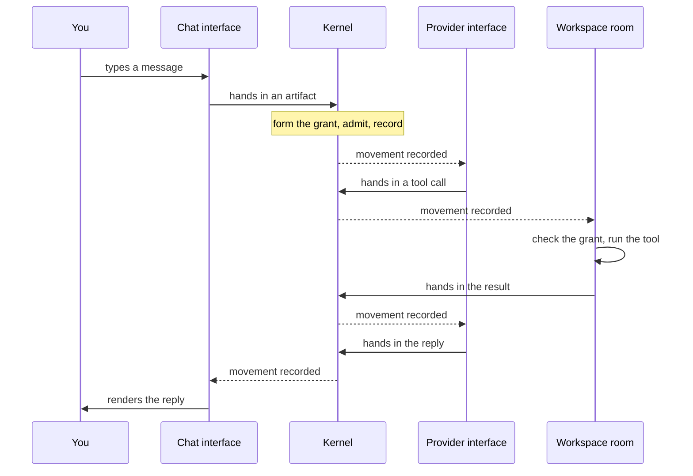

<p align="center">
  
</p>

<h1 align="center">Octopus Superintelligence OS</h1>

<p align="center">
  <b>A self-evolving agentic OS.</b><br>
  A new architecture for agent execution, built on operating-system principles, where agents can reshape their environment and the trajectory of their own work.
</p>

<p align="center">
  
  
  
  <a href="LICENSE"></a>
</p>


Octopus runs agents the way the well-known ones run: they read and write your files, drive a browser, use your desktop, call your apps and accounts. You talk to it by text or by voice. The difference is what they run on. You should never have to wonder whether it can do something. If it is allowed to, it can, and when it cannot yet, it can build itself the missing piece.

Underneath, its architecture gives an agent a structure to execute in and a picture of itself and of the world. Capabilities are not add-ons bolted onto a loop. They are contracts in that architecture, so the system can grow in any direction - connect something new, give itself a new sense, rewrite itself. Neither the model nor the agent loop sits at the center. The kernel is about 45,000 lines of Rust; everything else is ported onto it, starting with Codex: sign in with ChatGPT and Codex CLI runs as one interface of the system.

**Self-evolution** means shaping the conditions of future work. Under policy, an agent can create and revise goals, change interfaces (triggers), add tools, organize workers, and arrange context and execution environments. These changes persist across tasks and runs: they affect what it notices, when it acts, what it works on, and which capabilities it can use next. The agent changes its environment, and that environment shapes its subsequent behavior. **Self-improvement** remains the research aim: whether this process actually makes the system better.

> [!NOTE]
> This is a research preview. In our runs so far, today's models - GPT-6 included - do not take initiative on their own, and for an ordinary coding task Octopus gives you nothing that Codex CLI does not already give you. The research question is: **how can an architecture that lets agents reshape their execution environment help them take initiative and steer their own long-term development?** The project studies whether this process leads to useful autonomy and measurable self-improvement.

## What you get

<table>
<tr><td><b>Home</b></td><td>One continuous conversation with the system. Type or talk. It can put live widgets on the screen while it works.</td></tr>
<tr><td><b>Projects</b></td><td>A goal with its own context and permissions. What an agent may do in one project says nothing about another.</td></tr>
<tr><td><b>Agents</b></td><td>Set one up once: a model, a role, and what it may touch. Underneath, an agent is not a program but two JSON files, so you can run as many as you want.</td></tr>
<tr><td><b>Tasks</b></td><td>A piece of work you hand to an agent. Leave it running, come back later, pick up where it stopped.</td></tr>
<tr><td><b>Terminal client</b></td><td>Chat, tasks, tools, files, and results in your terminal. Shares the same Home, Projects, and Agents with the desktop client.</td></tr>
<tr><td><b>Applications</b></td><td>The outside world, plugged in: chat channels, MCP servers, other model providers.</td></tr>
<tr><td><b>Drivers</b></td><td>Where the work physically happens: a folder, a git worktree, a browser, your desktop, a container, a remote machine.</td></tr>
</table>

## Get started

You need macOS 14+, Node 24, stable Rust, and a ChatGPT account.

```sh
git clone https://github.com/miuuyy/Octopus-SI-OS.git
cd Octopus-SI-OS
npm ci --prefix app
```

Then package the app, open it, and sign in with ChatGPT. Press Enter in the embedded terminal to start the system, pick what you want it to have, and say something.

<details>
<summary><b>Package the app, step by step</b></summary>

<br>

The native build needs headers for Node 24.15.0, whatever Node runs npm:

```sh
mkdir -p app/build
curl -fL https://nodejs.org/download/release/v24.15.0/node-v24.15.0-headers.tar.gz \
  -o app/build/node-v24.15.0-headers.tar.gz
printf '%s  %s\n' \
  9a9250039fef572d0bcc110ac5e78055faf5604421211d2d5f578ebc5a34e703 \
  app/build/node-v24.15.0-headers.tar.gz | shasum -a 256 -c -
tar -xzf app/build/node-v24.15.0-headers.tar.gz -C app/build
```

Package and open:

```sh
OCTOPUS_NATIVE_NODE_HEADERS="$PWD/app/build/node-v24.15.0/include/node" \
  npm --prefix app run package:mac
open -n ./app/build/Octopus.app
```

Packaging builds the client, the release runtime, the capability executables, and the provider bridge, and bundles the managed Codex distribution. The result is `app/build/Octopus.app`, ad-hoc signed for this machine. It is not notarized, so Gatekeeper may warn.

</details>

<details>
<summary><b>First run</b></summary>

<br>

1. **Sign in with ChatGPT.** It opens the browser. There is no terminal login.
2. **Set a local password.** It guards the client on this machine.
3. **Start the system.** The embedded terminal prepares a command ending in `octopus up`. Press Enter and wait for the ready state.
4. **Pick a starting structure.** Projects, names, capabilities. Select **Set up Octopus**.
5. **Say something in Home.** A reply proves the connection. A task that uses its tools proves that task's setup.

For a new task, create an Agent first: choose a Project and a model, review its capabilities, then select it in the task composer.

Model availability and usage limits belong to your provider account. Voice and some applications ask for their own credentials and macOS permissions.

</details>

To use the terminal client, build it from the checkout and open Octopus:

```sh
npm --prefix app run build:cli
./octopus
```

See [Terminal client](docs/cli.md) for setup, keyboard controls, existing Home selection, and commands for scripts or other agents.

## How it works

Two words carry the picture. **System** is everything Octopus can act on. **World** is everything else. They meet only at declared interfaces; there is no other route.

Underneath, there are a few primitives and no orchestrator:

- **Interface** - a typed port. Providers, channels, sensors, tool rooms, and workers are all interfaces.
- **Artifact** - the only thing that crosses a boundary: a message, a diff, a tool call, a memory.
- **Run** - a durable execution record that parks and wakes on arriving artifacts. Data, not a process.
- **Execution environment** - a goal with a policy. Environments nest, and inner ones are narrower.
- **Worker** - what you would call an agent. Here it is a description, not a program: a role and a ceiling on what it may ever touch.
- **Worker environment** - the room where tools physically act.
- **Policy** - never stored; formed at every arrival from the worker, its environments, and its bindings.
- **Mark** - the proof that something happened, recorded only after a verifier passes.

<details>
<summary><b>One turn, end to end</b></summary>

<br>

You type a message in Home and Octopus reads a file to answer it.



The kernel never pushes anything and never decodes a payload. Each interface is a live process reading its own movements. The provider interface builds what the model sees; the room's door checks the tool against the grant and runs it. The turn continues while the model keeps asking for tools and ends when it replies.

Every "movement recorded" is one row in the ledger. A refusal is a row too - typed, never a silent drop.

</details>

## Extend it

Everything attaches the same way: a folder of JSON, plus a script or binary when it needs to run. None of it touches the kernel.

| You want | You add |
| --- | --- |
| A provider over an existing wire | One interface folder |
| A channel or a sensor | One interface folder, with a process if it must listen - any language |
| A worker (an agent) | A `system_worker_<name>/` folder: two JSON files |
| A tool | A `tool.json` over a room's executable |
| A check | A verifier folder: a descriptor and a script |

<details>
<summary><b>The system can do this to itself</b></summary>

<br>

A run asked for something it has no sense for - say, to look at you - cannot. So it authors a run for a coder, with the artifacts that run must prove. The coder writes a small camera driver and registers it by creating a new interface folder. A verifier passes it. The descriptor is picked up live.

The first time, that takes as long as a coder needs. The second time there is nothing to build. The system has a new input, and it got it by writing JSON and one script.

More in [Scenarios](docs/scenarios.md).

</details>

The cookbook is [Extending Octopus](docs/contracts/EXTENSION_SURFACES.md).

<details>
<summary><b>Desktop client — voice, tasks, and a view into the system</b></summary>

The optional **macOS 14+** client is inspired by the ChatGPT desktop app. It
brings together Home and voice calls, Projects and Tasks, split panes,
Applications, Drivers, client Extensions, and experimental gesture controls.
Topology and Movements expose the architecture behind the conversation.

The runtime works without this client; you can build your own. See the
[client guide](docs/client.md) for the screens, their roles, and setup.


</details>

## Documentation

- [Getting started](docs/getting-started.md) - build, first setup, local data.
- [Desktop client](docs/client.md) - Home, Tasks, voice, Extensions, and the package catalogs.
- [Architecture](docs/architecture.md) - System and World, the primitives, one turn end to end.
- [Scenarios](docs/scenarios.md) - what the primitives are meant to express.
- [Contracts](docs/contracts/README.md) - policy, artifacts, interfaces, workers, environments, tools, verifiers, the ledger.
- [Extending Octopus](docs/contracts/EXTENSION_SURFACES.md) - adding providers, channels, workers, tools, checks.
- [Security model](docs/security-model.md) - trust boundaries and known risks.
- [Glossary](docs/glossary.md) · [Development](docs/development.md) · [Troubleshooting](TROUBLESHOOTING.md)

---

Everything stays on your machine in `~/.octopus`. Tools run in a deny-by-default sandbox, and every action is checked against permissions and recorded - see the [security model](docs/security-model.md). A model with tools on your machine is still a model with tools on your machine: grant what you are comfortable granting.

Independent software, not affiliated with or endorsed by OpenAI. Stored formats may change between preview builds.

[MIT license](LICENSE) · [Security](SECURITY.md) · [Contributing](CONTRIBUTING.md)
