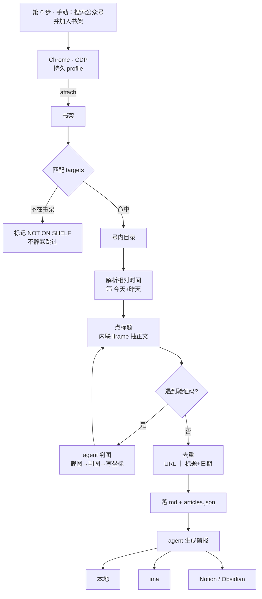

# weread2brief

> **把公众号书架，变成每天早上的一页纸。**
> One QR scan. Every morning, your WeChat subscriptions become a single page.

<p align="center">
  
  <br>
  <sub>↑ 12 个公众号 → 一页纸。点开有原文链接。</sub>
</p>

<p align="center">
  <a href="LICENSE"></a>
  
  
  <a href="references/pitfalls.md"></a>
</p>

**24 期连续运行 · 733 篇归档 · 405 万字 · 单轮 8 分钟**

> 前置只有一件事：**把你关注的号加进微信读书书架**（手动做一次，见下方「第 0 步」）。之后才是"一次扫码、每天自动"。

---

## 它解决什么问题

你关注了十几个公众号。每天它们推 10 篇左右，7 篇不看标题就知道是水文，剩下 3 篇里可能藏着你今天最需要的那条。

问题不是信息太多，是**筛选成本太高**——滑标题、点开、扫两眼、退出、下一个，20 分钟没了。

weread2brief 干的事：

```
每天早上
    ↓
打开你已登录的微信读书书架
    ↓
找到你关注的那几个号，取「今天 + 昨天」的新文
    ↓
抽全文 → 按 URL/标题+日期 去重 → 落成本地 Markdown
    ↓
agent 读一遍，生成一页纸：逐号要点 + 跨号共振 + 待跟踪
    ↓
你 3 分钟读完，要细节的点原文
```

**它不替你判断，它替你把材料摆好。**

---

## 为什么是 WorkBuddy Skill 形态

一开始我按"独立 CLI"设计过——自己维护 Playwright、自己实现验证码识别、自己处理环境依赖。做到一半发现两个死结：

| 死结 | CLI 方案 | Skill 方案 |
|---|---|---|
| **验证码要"看图"** | 得接视觉模型 API，或者让用户在终端手动输 `1 1`，体验割裂 | agent 本来就能看图，`截图 → 判图 → 点选` 是天然闭环 |
| **环境依赖地狱** | Chrome 路径、Playwright 版本、venv、Node…… 用户装到第三步就放弃了 | 宿主环境自带，`git clone` 完就能用 |

更关键的是：**这个项目的复杂度不在代码，在判断。**

比如"某个号目录是空的"——可能是验证码没解掉、可能是今天真没发文、可能是页面还没渲染、可能是改版了。这四种情况的处理方式完全不同，写成 `if/else` 会变成一坨永远修不完的分支。交给 agent 判断，只需要在 SKILL.md 里把判别方法写清楚。

**skill 不是"把代码打包"，是"把判断力打包"。**

> 如果你确实需要一个不依赖 agent 的纯 CLI 版本，见 [Roadmap](#roadmap)——不过说实话，先把 skill 跑起来更划算。

---

## 它做了什么

| 能力 | 说明 |
|---|---|
| **书架抓取** | 从微信读书书架取**你已加进书架**的号的最新文章，不用一个个点 |
| **全文抽取** | 从内联 iframe 取正文，不是摘要、不是标题 |
| **双键去重** | URL 或 (标题+日期)，同题跨日不误杀，同日重跑零副作用 |
| **验证码自解** | TCaptcha 图片点选，支持多阶段链式（最多 4 轮） |
| **断点续跑** | 中途失败不会重复抓，下次接着来 |
| **登录管理** | 一次扫码用数周，21 天安全线预警 |
| **简报生成** | 按模板产出结构化 Markdown，强制带发布日期与原文链接 |
| **多端同步** | 可选写入 ima / Notion / Obsidian / 纯本地 |
| **定时执行** | 配合 WorkBuddy 自动化，每天固定时间跑 |

---

## 第 0 步：先把你关注的公众号放进微信读书书架

> **这一步由人做，只需做一次。** 工具只读**书架里已经有**的号——它不会、也不能替你去关注新号。

微信读书把公众号当成"可订阅的书"来管理。所以顺序是：**先在微信读书里订阅，工具再去读。**

1. 手机上打开 **微信读书 App**（或电脑浏览器开 `weread.qq.com`），用你平时看书的账号登录
2. 搜索框输入公众号名称
3. 搜索结果里切到「**公众号**」分类，点进那个号
4. 点「**加入书架**」（部分版本显示为「关注」）
5. 对你想提炼的每个号重复第 2–4 步
6. 回到「**书架**」，能看到这些号就说明订阅成功

**怎么算成功**：书架里点开任一公众号，**能看到它最近几天的文章标题**。只看到一个空的号主页、点不出文章列表，说明还没真正加进书架。

> 搜不到某个号，通常是它没被微信读书收录（小众号、刚改名、已停更）。这种情况工具也救不了，不是你配错了。
>
> 加完之后**不要在这里取消关注**——工具每天早上都要从这个书架取数据。

---

## 第 1～3 步：装上并跑起来

```bash
# 1. 装到用户级 skill 目录
git clone https://github.com/mockxing/weread2brief.git ~/.workbuddy/skills/weread2brief

# 2. 建工作区 + 复制配置
mkdir -p ~/weread2brief
cp ~/.workbuddy/skills/weread2brief/assets/config.example.toml   ~/weread2brief/config.toml
cp ~/.workbuddy/skills/weread2brief/examples/targets.example.txt ~/weread2brief/targets.txt

# 3. 编辑 targets.txt，填你关注的公众号（先填 1-2 个跑通）
#    ⚠️ 名字必须和第 0 步书架里显示的一模一样（含「的评论区」这类后缀）
#    对不上不会静默失败，会出现在日志的 NOT ON SHELF 里
```

依赖只有三样，而且**都不需要你手动装**（宿主环境通常自带）：

| 依赖 | 用途 | 没有怎么办 |
|---|---|---|
| Google Chrome | 承载登录态 | 装一个 |
| `agent-browser` | 操作浏览器（CDP） | 设 `AGENT_BROWSER_EXE` 指向可执行文件 |
| Python 3.10+ | 跑采集脚本，**零第三方包** | 用系统自带即可 |

> 配置、选择器、验证码后端都在 `config.toml` 里，不必改代码。
> 验证码默认 `backend = "human"`（人直接点）——第一次跑先用这个，最容易成功。

然后在 WorkBuddy 里说一句：

> **帮我配置公众号每日简报**

agent 会读 `SKILL.md`，依次做：探测 Chrome → 起调试实例 → 让你扫码 → 校验 `wr_vid` → 跑第一个号验证。

### 加定时任务

配置好之后，说：

> **每天早上 8 点自动跑公众号简报**

agent 会创建一个 recurring automation，把完整流程写进 prompt，之后就不用管了。

---

## 输出长什么样

<details>
<summary><b>点开看一份真实简报（已脱敏）</b></summary>

```markdown
# 每日投资线索 · 2026-10-19

> 本期 7 篇 · 新归档 7 / 去重跳过 6 · 登录态有效（距上次成功 1 天）

## 一、逐号线索

### 1. 某财经号 —《最后20分钟，又托了一下》（2026-10-18）
🔗 [原文](https://mp.weixin.qq.com/s?...)

- 盘面：上午持续反弹，午后断电滑坠，作者复盘找不到突出利空
- 资金：收盘前 20 分钟约 160 亿买入两只宽基 ETF，周四规模近 500 亿
- 判断：这是"点刹"不是"底"，对跌幅容忍度高，只压波动烈度

**可交易映射**
| 方向 | 标的/板块 | 逻辑 |
|---|---|---|
| 利好（短期托底） | 宽基 ETF | 尾盘连续两日被动买入，下行有缓冲垫但非底 |

## 二、跨号共振的价值观点
**① 叙事主轴从"需求"切到"融资成本"** —— 三个号从不同角度指向同一件事…

## 三、待跟踪清单
1. 某某债收益率（当前约 15%）能否回落…

## 五、覆盖说明表
| 账号 | 篇数 | 来源类型 | 可信度 |
|---|---|---|---|
| 某财经号 | 1 | 微信读书内联渲染（非 mp_backend） | 高 |

---
> 仅供参考，不构成投资建议。
```

</details>

**几个刻意设计：**

- 小节标题**强制带发布日期**（取自归档文件名 `YYYY-MM-DD_` 前缀，不猜、不照抄简报日期），方便回查
- 每篇必有可点击原文链接，取不到就写"未获取到"，不编
- 覆盖说明表**排在正文之后**——先给结论，再给口径
- 明确列出"近 2 天零更新"的号，不拿旧文凑数

---

## 设计思路

### 核心洞察：微信读书是公众号的"合法阅读容器"

微信读书会把公众号文章渲染在一个**内联 iframe** 里，DOM 结构跟 mp 页面基本一致，但体验完全不同：

| 维度 | 直连 mp.weixin.qq.com | 走 weread 书架 |
|---|---|---|
| 风控 | 反爬 + 频繁验证码 | 正常阅读行为，风控低 |
| 付费文正文 | 只有摘要 | 阅读器里能看到多少就拿到多少 |
| 登录 | 手工喂 cookie，易失效 | 持久 profile，一次扫码用数周 |
| 时间信息 | 要自己解析发布时刻 | 目录直接给"3小时前""昨天" |
| 多账号 | 要维护多个 cookie | 书架天然聚合，一次全拿 |

一句话：**你不是在爬公众号，你是在自己已经登录的阅读器里做笔记。**

### 试过并放弃的四条路

| 方案 | 为什么放弃 |
|---|---|
| RSSHub / WeRSS 自建 | 实例要一直维护；公众号源经常被风控；付费文只有摘要 |
| 直接爬 mp 页面 | 反爬 + 验证码 + 手工喂 cookie；付费墙后拿不到正文 |
| 浏览器插件手动存档 | 10 个号点 10 次，等于没自动化 |
| 第三方 SaaS | 要钱、要授权、数据不在自己手里 |

选 weread 不是因为它完美，是因为它是**唯一能长期稳定跑下去的**。

### 五条设计原则

1. **不猜、不编、不装成功**
   登录失效就报 `NEED LOGIN` 并终止，绝不用昨天的文章冒充今天的。这是你敢把它挂上定时任务的前提。

2. **失败必须可见**
   每个号都有明确状态：`有新文 / 近2天零更新 / 不在书架 / 目录渲染失败`。
   静默漏抓是最恶劣的 bug——这个项目历史上栽过 3 次，现在每个分支都留日志。

3. **幂等**
   去重键 = `URL` 或 `(标题+日期)`。跑第二遍零副作用。

4. **绝不误杀用户进程**
   清理调试端口占用时，只 kill 确认是 `chrome.exe` 的 PID；读不出名字就跳过。
   **宁可本轮失败，也不 `taskkill /im chrome.exe /f`。**

5. **判断交给 agent，规则写进文档**
   能写成确定性代码的写成代码，需要"看情况"的写成判别方法。不硬编码死的分支树。

> 这五条不是洁癖，每一条都对应一次真实事故。完整根因：[references/pitfalls.md](references/pitfalls.md)

### 数据流



---

## 实战数据

一个真实在跑的实例（每日定时，无人工干预）：

| 指标 | 实测 |
|---|---|
| 连续运行 | **24 期**（2026-09-21 → 10-19） |
| 归档总量 | **733 篇 / 405 万字** |
| 书架内账号 | 12 个，近 20 轮 **100% 命中** |
| 日均新增 | 7–13 篇 |
| 单轮耗时 | **8–13 分钟**（含 1–2 次验证码） |
| 抽取完整率 | **~96%**（733 篇中 6 例需重抽，1 例为无正文存根） |
| 去重 | 0 误杀（同题跨日正确保留） |
| 验证码 | 累计 20+ 次，链式最多 2 级；最快 18s，最慢 141s |

> 口径纪律：能算的写精确，不能算的写范围。**没有"99% 准确率"这种东西**——你跑出一次漏抓就会来打脸。

**开源版自身的端到端验证**（2026-10-19，冷启动 Chrome，未改动任何代码分支）：

| 环节 | 结果 |
|---|---|
| 书架匹配 | 12/12 命中，`SHELF-EXTRA` 正确列出 11 个未在 `targets.txt` 的号 |
| 验证码 | 1 个 stage 通过，`catalog items = 19` |
| 两日窗口 | `recent(2d) = 1`（正确排除前天） |
| 正文抽取 | 1,916 字；与生产版同一篇的 2,203 字逐段比对内容一致 |
| 汇总 | `matched 1/1 \| NEW 1 \| DUP 0 \| incomplete 0 \| time_parse_failed 0` |
| 结束标志 | `=== done ===` |

所以这份代码不是"看起来能跑"，是**真在一个登录态的账号上跑完了**。

---

## 踩过的坑

完整版在 [references/pitfalls.md](references/pitfalls.md)（16 条根因分析）。挑六条最要命的：

| 症状 | 根因 | 修复 |
|---|---|---|
| 整号静默漏抓，日志无报错 | 验证码通过后 iframe 被移到 `-9999` 却仍在 DOM，尺寸还是 360×360 → 可见性判据恒真 | 判据叠加「在视口内」 |
| 目录恒 0，重试三次仍空 | TCaptcha **链式下发**多轮，只解一轮永远过不去 | 循环处理最多 4 个 stage |
| 归档只有 28 字 | 点开标题后 iframe 还没渲染，立刻读拿到空壳 | 重试 3–5 次取最长 + 字数下限 |
| 页面明明开了，脚本卡住几分钟 | `subprocess` 用管道收输出，孙进程继承句柄 → 永远等不到 EOF | 输出重定向到**文件** |
| 上午能跑，下午突然要扫码 | `wr_vid` 是 session cookie，强杀 Chrome 就没了 | 让 Chrome 自然退出，别 `kill -9` |
| 格子点对了，但它没提交 | 「确定」按钮位置靠经验值猜成"底部居中"，实际在**右下角** → 点了空白处，无任何报错 | 用 `points` 协议一次给全点位，别依赖经验常量 |

**这几条里任何一条没修，项目都跑不满一周。** 而且它们都不会在开发时暴露，只会在"某天早上你没收到简报"时暴露。

> 后三条是写这份开源版时现场踩出来的——原本以为"能跑 24 期"的代码不会有新坑了。
> 最后一条尤其阴：点选动作返回成功、日志显示"点选 2 处"、没有异常，只是验证码又发了一张新的。

---

## 局限

- ❌ 抓不到**没加进书架**的公众号——第 0 步没做，或号名对不上，都会判为 `NOT ON SHELF`（设计约束，不是 bug）
- ❌ 抓不到已删除 / 已违规的文章
- ❌ 后台回复型存根文（正文只有"回复关键词获取"）抽不到，会如实标记
- ❌ **不能云端无人值守**——扫码必须真人，GitHub Actions 这类纯云端跑不了
- ⚠️ 高频运行可能触发风控，建议**每日 1 次**
- ⚠️ 腾讯改版会失效，所有选择器集中在 `scripts/page_selectors.py`，改一处全局生效

---

## 合规声明

**这个工具是给你整理自己已经能看的内容用的。**

- ✅ 归档**你自己关注、自己登录后本可见**的文章，供个人阅读与研究
- ❌ 不提供内容再分发、聚合发布、商业转载能力
- ❌ 不要用它抓取未关注账号，或试图获取本无权限的内容
- ⚠️ 自动化访问可能违反平台用户协议，**使用风险自负**
- ⚠️ 归档内容著作权归原作者，请勿公开传播

本项目与腾讯公司无任何关联。详见 [DISCLAIMER.md](DISCLAIMER.md)。

---

## Roadmap

- [x] 书架抓取 + 内联 iframe 全文抽取
- [x] 双键去重（URL ｜ 标题+日期）
- [x] 验证码多阶段链式自解（human / agent / vlm 三后端）
- [x] 简报生成（投资 / 行业 / 竞品 三套模板）
- [x] 定时任务集成
- [x] 抽出后字数下限校验 + `extract_incomplete` 标记
- [x] 时间解析失败显式报警（不再静默丢文）
- [ ] Sink 插件：Notion / Obsidian / 飞书
- [ ] `--since 7d` 历史回补
- [ ] 独立 CLI 版（不依赖 agent，供 NAS / 服务器常驻）

---

## 贡献

欢迎 PR，尤其是：

- **新的简报模板**（`references/brief-template.md` 加一节就行）
- **新的 sink 实现**
- **改版适配**（平台一改 DOM，`scripts/page_selectors.py` 是唯一入口）
- **踩坑记录**——你遇到的失败模式，比代码更值钱

> 本项目不处理：抓取未关注账号、绕过付费、批量分发内容。

---

## License

MIT © [mockxing](https://github.com/mockxing)

---

<p align="center">
  <sub>如果它帮你省下了每天早上那 20 分钟，点个 ⭐ 就是最好的回报。</sub>
</p>
