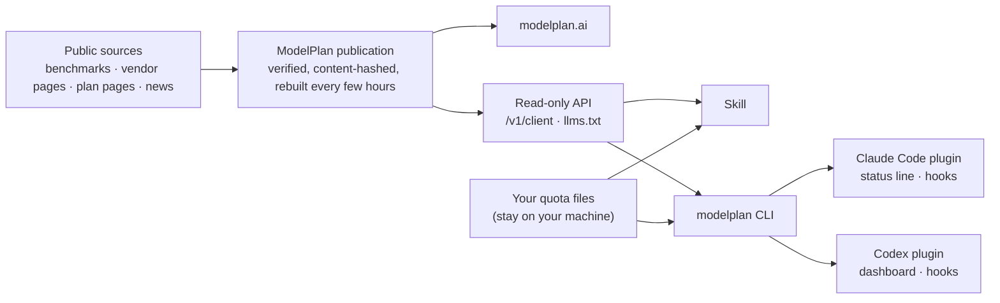

<div align="center">

<a href="https://modelplan.ai"></a>

**Which AI coding model should you use, at which reasoning effort, and is one more step up worth it?**<br>
ModelPlan answers from live, checkable public data, on the web and inside Claude Code, Codex and your terminal.

[](https://github.com/modelplan/modelplan/releases)
[](https://github.com/modelplan/modelplan/actions/workflows/ci.yml)
[](LICENSE)
[](data/)
[](https://modelplan.ai)
[](https://github.com/modelplan/modelplan/stargazers)

[Website](https://modelplan.ai) · [Quick start](#quick-start) · [Screenshots](#what-you-get) · [How it works](#how-it-works) · [FAQ](#faq) · [Methodology](METHODOLOGY.md) · [简体中文](README.zh-CN.md)

</div>

## Why ModelPlan

[Choose an entry point: Mac App, plugins or Skill](docs/product-surfaces.md).

Most leaderboards compare every model at its **top** setting. But inside one model, going from Low to Max often costs several times more and takes several times longer, for a few points of ability. What you actually run is a model *at an effort*.

- **★ Recommended effort.** Every model gets its best-value effort, and you see exactly what one more step up buys (`+4.8 ability`) and costs (`×1.37`).
- **A leaderboard at that effort.** Models are ranked at their own ★ effort, the setup you would really use, with cost per reference coding task and task time beside ability. Outclassed models (costlier and no stronger) are called out, and if you are on one, the CLI tells you once what to switch to: Fable 5.1 → Opus 5.5 (+2.5 points at ×0.52), GPT-6 Astra → GPT-6.1 Sol (about the same at ×0.18).
- **Your own quota.** The Skill and CLI read your local Claude Code and Codex 5-hour and weekly windows (never uploaded). The CLI also reads ZCode's and OpenCode's (V2) local databases, read-only, for tokens per day, session and project. The CLI also keeps a local history of how much of each window you used and under which model and effort (`modelplan history`), the basis for suggesting a default effort from your own weeks, and measures your own speed per model, effort and Fast: output tok/s, time to first token, turn time and tokens, against ★ (`modelplan effort`, `modelplan history`; read from the harness logs' timestamps and token counts only). Plenty left before a reset? Step up, or turn on Codex Fast. Tight, or a recent burst that would use it up within three hours? Stay at ★ or step down, with the time it runs out. After a reset, it reminds you once to go back to the model and effort you used before (and to turn Codex Fast off).

- **Gemini CLI local usage (optional).** `modelplan usage gemini enable` allows read-only tokens/model/day/session accounting from Gemini’s own local chat history. `modelplan usage gemini` displays it; `disable` stops it. No credentials or remote quota are read, and no host is called. Missing counters stay `--`.

- **Other plans (optional).** `modelplan connect zai` reads Z.ai / GLM Coding Plan usage natively, with the API key you keep in `Z_AI_API_KEY` (`--region bigmodel-cn` for open.bigmodel.cn), `modelplan connect opencodego` reads OpenCode Go with `OPENCODE_API_KEY`, and `modelplan connect kiro` asks Kiro's own CLI (`kiro-cli acp`, no prompt sent; Kiro keeps its sign-in). Each key is sent only to its vendor's usage endpoint and never stored; `modelplan connections` shows which reader serves each plan. For the rest, `modelplan codexbar enable cursor zai` reads Copilot, Cursor, Z.ai / GLM, Kiro or OpenCode Go usage through the open-source [CodexBar](https://github.com/steipete/CodexBar) CLI, fetched at a pinned, checksum-checked release (macOS and Linux only). CodexBar keeps the sign-ins; this client keeps only percentages and reset times. Tell it which plan pays (`modelplan declare zhipu-global-pro legacy-v2`) and advice follows how that plan counts: on a per-request plan it never says step down, and points to the next off-peak hours instead.

`modelplan connect cursor` opts into native personal quota using Cursor’s local editor sign-in read-only. It calls private dashboard endpoints on `cursor.com` / `api2.cursor.sh`, never refreshes or stores credentials, and keeps unsupported sign-ins unknown. `--backend codexbar` explicitly selects the existing fallback. [Source paths and limitations](docs/cursor-native-quota.md).

`modelplan connect minimax` opts into plan quota using `MINIMAX_CODING_API_KEY` (or `--key-env NAME`), with `--region international` (default) or `china`. It calls only the selected region, stores no key, and leaves unsupported quota unknown. [Endpoints and privacy](docs/minimax-quota.md).

`modelplan connect copilot` opts in to monthly premium-request usage from the installed, signed-in Copilot runtime (`account.getQuota`), without starting a session or importing tokens. `modelplan disconnect copilot` disables it. If the runtime is missing or incompatible, explicitly choose the existing bridge with `modelplan connect copilot --backend codexbar`; its sign-in remains in CodexBar. `modelplan connections` discloses the runtime command, host boundary and credential handling.
- **Plans and windows.** Coding plan prices and quotas by maker, model and price band; off-peak hours, peaks and public quota resets on a week calendar.
- **In your tools.** One open-source Skill for any agent, plugins for Claude Code and Codex, and a single-binary CLI, all reading the same verified publication as the website.

## Quick start

**The Skill** works in Claude Code, Codex, Cline, Amp and 15+ other agents:

```sh
npx skills add modelplan/modelplan
```

Then ask your agent: *"Which model and effort should I use for this refactor?"* or *"My 5-hour window resets in 40 minutes, should I step up?"*

<details>
<summary><b>Claude Code plugin</b>: the Skill, <code>/modelplan:*</code> commands and a status line</summary>

```text
/plugin marketplace add modelplan/modelplan
/plugin install modelplan@modelplan
```

The plugin fetches its own `modelplan` CLI (a pinned release, checksum-checked) in the background, so there is nothing else to install or upgrade; `/modelplan:setup` checks each part. Commands: `/modelplan:plan`, `/modelplan:effort`, `/modelplan:lineup`, and `/modelplan:statusline` to add the status line (asks before changing your settings). [More](claude-code/)

</details>

<details>
<summary><b>Codex plugin</b>: the Skill plus a GPT effort dashboard</summary>

```sh
codex plugin marketplace add modelplan/modelplan --sparse .agents --sparse codex
codex plugin add modelplan-codex@modelplan
```

Ask Codex to *"Open the ModelPlan dashboard"*. Needs Node.js 22+, found automatically when Codex has one. Setup check, optional CLI and uninstall: [more](codex/)

</details>

<details>
<summary><b>modelplan CLI</b>: a single static binary for macOS and Linux</summary>

```sh
curl -fsSL https://raw.githubusercontent.com/modelplan/modelplan/main/install.sh | sh
modelplan lineup --dev anthropic
```

With Go: `go install github.com/modelplan/modelplan/cli/cmd/modelplan@latest`. The Skill and plugins use it when it is installed and work without it. [More](cli/)

</details>

<details>
<summary><b>Skill by hand</b></summary>

Copy [`skills/model-plan`](skills/model-plan/) into `~/.claude/skills/model-plan` or your agent's skills directory. It needs only a shell and anonymous HTTPS.

</details>

## What you get

### ★ The effort that is worth it, and what the next step costs

Move the throttle and see ability, cost and task time for every native effort; switch on ⚡ Fast or ⚡⚡ Ultrafast to see how plan quota and time change.


### A leaderboard at each model's recommended effort


### Advice that knows your quota, inside Claude Code and Codex

<table>
<tr>
<td width="56%" valign="top">

**Claude Code status line**: live model and effort, 5-hour and weekly usage, the reset countdown, and a hint when it is worth acting (`↑High ×1.37` before a reset with allowance left, `↓` when a window is tight, `↺★` after a reset).


**CLI**: lineups, effort ladders, quota and advice.


</td>
<td width="44%" valign="top">

**Codex dashboard**: GPT models at their ★ effort, the effort curves with a ⚡ switch, your Codex quota and public reset notices.


</td>
</tr>
</table>

### Coding plans, off-peak hours and resets


## Not just another leaderboard

| | Typical leaderboard | ModelPlan |
| --- | --- | --- |
| Setting compared | each model's top setting | each model's ★ recommended effort, plus every other effort |
| Cost | price per million tokens | cost of one reference coding task, at every effort |
| Time | rarely | task time at every effort (estimates marked) |
| One step up | not shown | `+ability` and `×cost` for each step |
| Your quota | no | local Claude Code and Codex windows, never uploaded |
| Plans | no | prices, quotas, off-peak hours and resets |
| Where | a web page | web, API, Skill, CLI, Claude Code and Codex |

## How it works



Every client reads only ModelPlan's verified public publication and the quota files your harness already writes locally. Rankings, verdicts and multipliers come from the publication; clients never compute their own. Formulas and sources: [METHODOLOGY.md](METHODOLOGY.md).

**Principles:** open source (MIT) · read-only · anonymous, no account, no telemetry · quota is read on your machine only · it never switches your model or effort for you.

## FAQ

<details>
<summary><b>What is the ★ recommended effort?</b></summary>

For each model, the native effort (Low, Medium, High, XHigh, Max…) with the best balance of ability, cost and task time. Higher efforts are shown with what they add and cost, so you can decide when a task deserves them. See [Methodology](METHODOLOGY.md).

</details>

<details>
<summary><b>Why isn't ★ the top effort, or the vendor's default?</b></summary>

By design. ★ is the best-value effort among a model's own efforts; the top effort is always listed beside it, and the website can switch every model to its top effort. Cheap models often get higher efforts than expensive ones because one step up costs cents rather than dollars. Vendor defaults also weigh responsiveness and rate limits, so they are shown beside ★ as a reference, not copied. The ability score is a frozen scale (50 = the September 2026 frontier average), so it can be below 0 or above 100.

</details>

<details>
<summary><b>Where do the numbers come from, and how fresh are they?</b></summary>

Ability comes from public benchmarks (such as Artificial Analysis) on one scale; cost is the API cost of one reference coding task at official prices; time comes from public task timings, estimated and marked where missing. Plans come from official pages. A new publication is built and verified every few hours; the website and every client show when it was published.

</details>

<details>
<summary><b>Does anything about me leave my machine?</b></summary>

No. Clients download the public publication anonymously. Your Claude Code and Codex quota is read from local files and only used on your machine. The CLI's own records stay there too: the quota history, your measured speed, tokens per day for up to a year, and the folder names that name your projects in the desktop app (on by default). None of them is synced or uploaded. `modelplan project-labels off` hides the folder names and deletes the stored ones; `MODELPLAN_HISTORY=off` stops the records. There is no account and no telemetry.

</details>

<details>
<summary><b>Will it change my model or effort?</b></summary>

Never. It advises; you switch. Quota hints are shown to you, not your agent; the agent gets one short task-start brief per session and stays quiet about models unless the setting clearly does not fit the task.

</details>

<details>
<summary><b>Which models and plans are covered?</b></summary>

Current coding models from OpenAI, Anthropic, Google, xAI, Zhipu, Moonshot (Kimi), Xiaomi, MiniMax, Meta, Alibaba, DeepSeek, Tencent and others, and their coding plans. The live list is on [modelplan.ai](https://modelplan.ai) and in [`/v1/client`](https://modelplan.ai/v1/client).

</details>

<details>
<summary><b>Can I use the data in my own tool or agent?</b></summary>

Yes: the read-only API needs no key ([OpenAPI](https://modelplan.ai/openapi.json)), agents can start from [llms.txt](https://modelplan.ai/llms.txt), and the off-peak and reset calendar is available as [ICS](https://modelplan.ai/calendar.ics).

</details>

## Repository

| | Directory | What it is |
| --- | --- | --- |
| **ModelPlan Skill** | [`skills/model-plan/`](skills/model-plan/) | The main client, for any agent with Skills: model and effort choice, the multiplier for each step up, planning around your remaining quota and reset times |
| Claude Code plugin | [`claude-code/`](claude-code/) | The Skill, `/modelplan:*` commands, status line and a prompt hook that shows you new hints and gives Claude a short task-start brief once per session |
| Codex plugin | [`codex/`](codex/) | The Skill and a GPT effort dashboard with a ⚡ Fast / Ultrafast switch, your Codex quota and public reset notices |
| Desktop app (preview) | [`desktop/`](desktop/) | A macOS menu bar app: the quota left and the current hint in the menu bar, a popover with your sessions, quota and effort curves, and a notification once per piece of advice. Unsigned builds for now |
| `modelplan` CLI | [`cli/`](cli/) | Single static binary: `lineup`, `effort`, `models`, `quota`, `advise`, `statusline`, `sync`, `doctor` |
| Open data | [`data/`](data/) | The reviewed data behind the site: plan tiers, prices, quota metering, calendars, model identities and effort policies. Mirrored from modelplan.ai on every change, one pull request each |
| Methodology | [`METHODOLOGY.md`](METHODOLOGY.md) | How ability, cost, time and the ★ effort are worked out, and the sources |

## Contributing

Wrong price, quota, effort or news item? [Report a data problem](https://github.com/modelplan/modelplan/issues/new?template=data-problem.yml); the **Report** links on modelplan.ai fill in the page and item for you. Bugs, ideas and pull requests are welcome: see [CONTRIBUTING.md](CONTRIBUTING.md). Release notes are in [CHANGELOG.md](CHANGELOG.md).

If ModelPlan saves you quota or money, a ⭐ helps others find it.

[](https://star-history.com/#modelplan/modelplan&Date)

## License

Code: [MIT](LICENSE). Open data: [per-file licenses](data/LICENSE), crediting ModelPlan; the new original-data publication uses CC BY-SA 4.0, historical CC BY 4.0 grants remain valid, and third-party figures keep their sources' terms. The official desktop visuals in [`desktop/official-visuals/`](desktop/official-visuals/) are under their own [reserved license](desktop/official-visuals/LICENSE.md), not MIT; branding is separate too: [licensing map](LICENSING.md). ModelPlan is independent and not affiliated with any model vendor; vendor names and marks belong to their owners.
