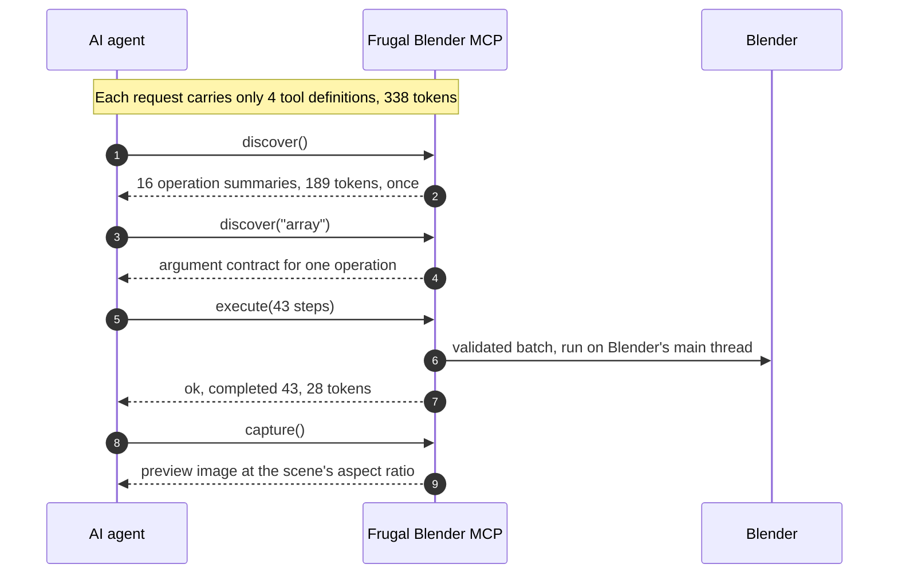

<!-- mcp-name: io.github.mohakmalviya/frugal-blender-mcp -->
<div align="center">

# Frugal Blender MCP

### Let your AI agent build Blender scenes. All of Blender, four tools, 338 tokens.

[](https://github.com/mohakmalviya/frugal-blender-mcp/actions/workflows/ci.yml)
[](https://pypi.org/project/frugal-blender-mcp/)
[](https://www.blender.org/)
[](https://modelcontextprotocol.io/)
[](https://github.com/mohakmalviya/frugal-blender-mcp/blob/main/LICENSE)

**[Quick start](#quick-start)** ·
**[How it saves tokens](#how-four-tools-reach-all-of-blender)** ·
**[Benchmark](#benchmark)** ·
**[Safety](#safety)** ·
**[Example](https://github.com/mohakmalviya/frugal-blender-mcp/tree/main/examples/lighthouse)**


<sub>Five <code>execute</code> calls (109 operations) written by Claude, rendered with Cycles in Blender 5.1.
<a href="https://github.com/mohakmalviya/frugal-blender-mcp/tree/main/examples/lighthouse">Replay the exact calls</a>: they run in under a second.</sub>

<table>
  <tr>
    <td align="center" width="25%"><h2>4</h2>MCP tools</td>
    <td align="center" width="25%"><h2>338</h2>tokens of fixed context</td>
    <td align="center" width="25%"><h2>100</h2>operations per call</td>
    <td align="center" width="25%"><h2>14–22x</h2>less context than other Blender servers</td>
  </tr>
</table>

</div>

## Why it matters

Every MCP client sends each server's tool definitions to the model on **every request**, before you
type anything. Most Blender servers expose 26 to 31 tools and spend thousands of tokens that way.
That's context your agent can't use for your scene, your code or its own reasoning.

Frugal Blender MCP exposes four tools, **`discover`**, **`execute`**, **`inspect`** and **`capture`**,
and still reaches the whole Blender API.

## Quick start

You need [Blender](https://www.blender.org/download/) 4.2+ and [uv](https://docs.astral.sh/uv/getting-started/installation/).

**1. Install the Blender add-on**

```bash
uvx frugal-blender-mcp install-addon
```

In Blender, open **Edit → Preferences → Add-ons** and enable **Frugal Blender MCP**. Then press `N` in
the 3D Viewport, open the **Frugal MCP** tab and click **Start bridge**.

**2. Connect your agent**

<table>
<tr><td><b>Claude Code</b></td><td>

```bash
claude mcp add blender -- uvx frugal-blender-mcp
```

</td></tr>
<tr><td><b>Codex CLI</b></td><td>

```bash
codex mcp add blender -- uvx frugal-blender-mcp
```

</td></tr>
<tr><td><b>Claude Desktop,<br>Cursor, Windsurf</b></td><td>

```json
{
  "mcpServers": {
    "blender": { "command": "uvx", "args": ["frugal-blender-mcp"] }
  }
}
```

</td></tr>
</table>

If a desktop app can't find `uvx`, use its absolute path (`which uvx` or `where uvx`).

**3. Ask for something**

> Build a small lighthouse island at golden hour: a red-and-white tower, a keeper's house, a few
> pines, rocks and a sailboat. Batch your edits, then capture a preview.

## How four tools reach all of Blender

Most servers ship one tool per action, and every definition rides along with every request. This
server keeps the menu short and hands the details over only when the agent asks for them:



| Technique | What it does | Effect |
|---|---|---|
| **Lazy schemas** | Operation arguments live behind `discover`. The agent fetches each one once, only if it uses it. | Fixed cost stays at 338 tokens. Even fetching every schema totals 1,256. |
| **Batching** | One `execute` carries up to 100 operations. `array` makes up to 200 copies in one step, `keyframes` sets up to 1,000 keys. | The lighthouse took 5 calls, not 109. |
| **Compact results** | `execute` returns counts and errors, never the scene echoed back. | 109 operations returned 202 tokens in total. |
| **Look, don't dump** | `capture` returns an image. `inspect` is paged and filtered by name. | The agent checks its work without reading huge scene dumps. |
| **Lean definitions** | Generated schema titles, `null` unions and docstring whitespace are stripped before tools are listed. | Definitions shrank from 406 to 289 tokens. A test fails if they grow past 300. |
| **One escape hatch** | `python` runs any `bpy` code through the same `execute` call, so it needs no extra tool. | Geometry Nodes, rigging, simulation and import/export at zero fixed cost. |

The five calls behind the animation above, and what each one added:


## Benchmark


| Server | Tools | Fixed context per request |
|---|---:|---:|
| **Frugal Blender MCP** | **4** | **338 tokens** |
| [Blender Lab official](https://projects.blender.org/lab/blender_mcp) | 26 | 4,722 tokens (14.0x) |
| [ahujasid mcp-for-blender](https://github.com/ahujasid/mcp-for-blender) | 31 | 7,464 tokens (22.1x) |

<sub>Tool definitions plus server instructions from each server's real <code>initialize</code> and
<code>tools/list</code> responses, tokenized with tiktoken <code>o200k_base</code>.
<a href="https://github.com/mohakmalviya/frugal-blender-mcp/blob/main/docs/tool-context.md">Method, raw data, discovery costs and caveats</a>.</sub>

## What the agent can do

| | Need | Operations |
|---|---|---|
| 🧱 | **Build** | `primitive`, `array`, `transform`, `material`, `assign_material`, `light`, `camera`, `delete` |
| 🎨 | **Refine** | `modifier` (any Blender modifier), `properties` (any RNA property on objects, data, scene or render), `rna` (look up property names and enums) |
| 🎬 | **Animate** | `keyframes`, `frame` |
| 📸 | **Output** | `capture` (preview back to the agent; EEVEE, or Cycles on request), `render` (stills or animations), `save` (a `.blend` copy) |
| 🐍 | **Anything else** | `python`: the full `bpy` API. Off by default. |

## Safety

Blender stays in control. You choose permissions in the add-on panel when you start the bridge, and
the agent can't change them.

- **Write** and **render** are on by default. **Delete**, **save** and **python** are off.
- **Python is unrestricted local code execution.** Turn it on only for agents you trust.
- The bridge listens on loopback only and needs a fresh random token each time you start it.
- Deletes need `confirm: true`. Saves and renders never overwrite existing files.
- Interactive sessions get an undo checkpoint before every batch.
- No telemetry.

Details: [SECURITY.md](https://github.com/mohakmalviya/frugal-blender-mcp/blob/main/SECURITY.md).

## How it compares

Choose by what you need, not just context size:

- **Blender Lab's official server** also searches Blender's manual and API docs, which helps agents
  write correct `bpy`.
- **ahujasid's server** bundles asset providers (Poly Haven, Sketchfab, Hyper3D and others).
- **This server** keeps the fixed context small, batches edits, gates risky actions behind
  permissions, and still reaches the whole API through `python` when you allow it.

## More

<details>
<summary><b>CLI</b>: drive Blender from scripts with the same code path</summary>

```bash
uvx --from frugal-blender-mcp frugal-blender discover
uvx --from frugal-blender-mcp frugal-blender inspect
uvx --from frugal-blender-mcp frugal-blender execute --params '{"steps":[{"op":"primitive","kind":"cube","name":"Demo"}]}'
uvx --from frugal-blender-mcp frugal-blender capture --params '{"filename":"preview.png","size":768}'
```

PowerShell can pipe a file instead of quoting JSON:
`Get-Content -Raw examples/lighthouse/01-sky-and-sea.json | uvx --from frugal-blender-mcp frugal-blender execute --params -`

Captures, renders and saves go to the bridge's `exports/` folder, and the CLI prints the filename.
</details>

<details>
<summary><b>Multiple Blender instances</b></summary>

Each running bridge writes a connection descriptor. If more than one exists, set
`BLENDER_COMPACT_CONNECTION` to the one you want:

- Windows: `%LOCALAPPDATA%/blender-compact-mcp/connection-<pid>.json`
- Linux/macOS: `${XDG_STATE_HOME:-~/.local/state}/blender-compact-mcp/connection-<pid>.json`

Ambiguous discovery fails rather than picking a scene at random. Opening a different file stops the
bridge. After a crash, delete only the stale descriptor.
</details>

<details>
<summary><b>Install without uvx</b></summary>

- **Add-on:** download `frugal-blender-mcp-addon-<version>.zip` from
  [Releases](https://github.com/mohakmalviya/frugal-blender-mcp/releases) and use
  **Install from Disk** in Blender's add-on preferences, or run
  `uvx frugal-blender-mcp install-addon --zip addon.zip`.
- **Server from source:** clone the repository, run `uv sync --frozen`, and point your client at
  `uv run --directory /absolute/path/to/frugal-blender-mcp frugal-blender-mcp`.

Configs that use the old `blender-astra-mcp` or `blender-compact-mcp` commands keep working.
</details>

<details>
<summary><b>Architecture</b></summary>

```text
AI client -- MCP stdio --> Python bridge -- authenticated loopback JSON --> Blender add-on
CLI ----------------------------^                                         bpy.app.timers
```

Blender's timer accepts bounded socket input and runs operations on Blender's main thread. No
background thread touches Blender data. `discover` returns readable argument contracts, and the add-on
validates every batch again before running it. A batch that fails partway reports which step failed
and what already ran. See [design](https://github.com/mohakmalviya/frugal-blender-mcp/blob/main/docs/design.md).
</details>

<details>
<summary><b>Development</b></summary>

```bash
uv sync --frozen
uv run ruff check --config pyproject.toml .
uv run ruff format --check --config pyproject.toml .
uv run pytest -q
```

Tests that need Blender skip unless `BLENDER_EXE` points at a Blender executable. Set
`BLENDER_TEST_UI=1` to also test interactive timers and undo. They launch separate factory-startup
Blender processes and never touch your scenes or preferences. Results:
[validation](https://github.com/mohakmalviya/frugal-blender-mcp/blob/main/docs/validation.md).

`scripts/demo_host.py` runs a headless bridge on an empty scene for replaying `examples/`.
`scripts/bench_tool_context.py` and `scripts/context_chart.py` reproduce the benchmark and chart.
</details>

<div align="center">

**If this saves your agent some tokens, a ⭐ helps other people find it.**

<sub>MIT licensed. Independent project, not affiliated with the Blender Foundation or any model provider.</sub>

</div>
