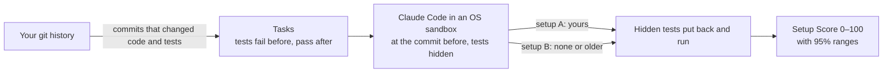

<p align="center">
  
</p>

<p align="center">
  <a href="LICENSE"></a>
  
  
  
</p>

<p align="center">
  <a href="#quick-start">Quick start</a> ·
  <a href="#what-it-checks">What it checks</a> ·
  <a href="#measure-your-setup-with-claude-code">Measure your setup</a> ·
  <a href="#use-it-in-ci">CI</a> ·
  <a href="docs/rules.md">Rules</a> ·
  <a href="#faq">FAQ</a>
</p>

# setupscore

**Check your Claude Code setup before it quietly makes Claude worse.**

`CLAUDE.md`, rules, skills, subagents, `settings.json` and `.mcp.json` rot like any other code. A folder gets renamed and the path in `CLAUDE.md` now points nowhere. A script is removed but the instructions still say to run it. Two rules start to disagree. Someone pastes an API key into a skill. Claude doesn't complain; it just does a worse job.

<p align="center">
  
</p>

## Quick start

```bash
npx setupscore          # check: free, offline, about a second
npx setupscore run      # measure: real tasks from your git history, scored out of 100
```

Requires Node.js 22.12 or newer. `check` works on macOS, Linux and Windows; `run` works on macOS, Linux and WSL2.

## Two tools in one

|  | `setupscore check` | `setupscore run` |
| --- | --- | --- |
| **Question it answers** | Is my setup broken? | Does my setup actually help Claude? |
| **How** | Lints `CLAUDE.md`, `.claude/` and `.mcp.json` | Gives Claude Code real tasks from your git history, with and without your setup, and checks the work with hidden tests |
| **Result** | Errors, warnings and an instruction health score out of 10 | A **Setup Score** out of 100, with 95% ranges |
| **Network and AI** | None. Nothing leaves your machine | Uses your Claude key or subscription, inside an OS sandbox |
| **Cost** | Free | A few dollars for 5 tasks (you set the budget) |
| **Time** | About a second | Minutes |

## What it looks like

<p align="center">
  
</p>

This is the [example project](examples/bakery-api) in this repo, which is broken on purpose (output shortened). Secrets are never printed in full.

<details>
<summary>The same output as text</summary>

```text
$ npx setupscore

CLAUDE.md
  5      warning  "For reports, use raw SQL because it is faster." contradicts line 4: "Use Prisma for all database queries. Never write raw SQL."  contradiction
                  → Keep one rule, or write the exception into it: "Never use X, except in Y".
  8      warning  "Write good code." is too vague for Claude to act on.  vague-rule
  11:23  error    "src/common/logger.js" does not exist, so Claude cannot follow this.  broken-reference
  14:29  error    "docs/api-guide.md" does not exist, so Claude cannot follow this.  broken-reference
                  → Did you mean docs/api-patterns.md?
  15:8   error    "npm run test:e2e" will fail: package.json has no "test:e2e" script.  missing-script
                  → Did you mean "test"? Scripts in package.json: test, lint.

.claude/skills/report-builder/SKILL.md
  1      warning  No description, so Claude has to guess when this skill is useful.  skill-frontmatter
  4:44   error    Looks like a password (ba… (9 characters)).  secret

.mcp.json
  3      warning  Server "postgres" runs "npx @modelcontextprotocol/server-postgres" without a version, so every start may run new code.  mcp-config
  5      warning  Server "postgres" args uses "$DATABASE_URL", which Claude Code never expands.  mcp-config
                  → Write "${DATABASE_URL}" instead.

✖ 4 errors, 8 warnings in 4 setup files
  Instruction health 2/10
```

</details>

## Install

You don't have to install anything: `npx setupscore` always runs the latest version. To pin it in a project:

```bash
npm install --save-dev setupscore     # or: pnpm add -D setupscore / yarn add -D setupscore
npx setupscore
```

Or install it globally with `npm install -g setupscore`, then run `setupscore` anywhere.

## Usage

```bash
npx setupscore                    # check the current folder
npx setupscore check ../my-api    # check another folder
npx setupscore --fix              # fix paths to files that were renamed or moved
npx setupscore --cost             # see how many tokens each file adds to every session
npx setupscore --json             # machine-readable output for CI and other tools
npx setupscore --strict           # fail on warnings too
npx setupscore --quiet            # show errors only
npx setupscore rules              # list every rule and why it matters
```

### What it checks

| Rule | Level | Finds |
| --- | --- | --- |
| `broken-reference` | error | A file path in your instructions that doesn't exist |
| `broken-import` | error | An `@path` import in CLAUDE.md that points to a missing file |
| `missing-script` | error | `npm run x` / `pnpm run x` / `npm test` where the script doesn't exist |
| `invalid-config` | error | `settings.json` or `.mcp.json` that isn't valid JSON, or frontmatter that can't be read |
| `secret` | error | API keys, tokens and passwords written into setup files |
| `misnamed-file` | warning | `claude.md`, `.Claude/` or `skill.md`: wrong letter case, so Claude Code on Linux never loads it |
| `risky-permission` | warning | `"Bash"` allowed without limits, `rm`/`curl`/`git push` with no prompt, `bypassPermissions` |
| `env-not-denied` | warning | A local `.env` file Claude is allowed to read |
| `mcp-config` | warning | Unpinned `npx`/`uvx` MCP servers, `$VAR` that never expands, plain `http://` |
| `contradiction` | warning | Two rules that say opposite things |
| `vague-rule` | warning | Rules like "write good code" that give Claude nothing to act on |
| `duplicate-rule` | warning | The same rule written twice |
| `too-long` | warning | CLAUDE.md over 200 lines or a skill over 500 lines (Anthropic's guidance) |
| `deep-import` | warning | `@import` chains deeper than Claude Code follows |
| `unused-path-rule` | warning | A `.claude/rules/` file whose `paths:` match no file, so it never loads |
| `skill-frontmatter` | warning | Skills with a missing, one-word or invalid name or description |
| `agent-frontmatter` | warning | Subagents without a name or a useful description |

Every rule is explained, with good and bad examples, in [docs/rules.md](docs/rules.md).

### Files it reads

`CLAUDE.md` and `CLAUDE.local.md` (in any folder), files they `@import`, and everything in `.claude/`: `rules/`, `skills/*/SKILL.md`, `agents/`, `commands/`, `settings.json`, `settings.local.json`. It also reads `.mcp.json`. It skips `node_modules`, `.git` and build output.

### Auto-fix

`--fix` only changes something when the right answer is certain:

- the file was **renamed in git history**, or
- exactly **one file with that name** exists somewhere else in the project.

It only rewrites that path on that line, keeps your line endings, and prints every change. A guess like "did you mean docs/api-patterns.md?" is shown as a hint and never applied.

### Context cost

```bash
npx setupscore --cost
```

This shows how many tokens each file adds, and when: on every message, only when Claude works in a folder, or only when a skill is used. It counts roughly 4 characters per token, so treat the numbers as estimates.

## Measure your setup with Claude Code

```bash
npx setupscore doctor                 # 1. is this machine ready?
export ANTHROPIC_API_KEY=sk-ant-... # 2. or CLAUDE_CODE_OAUTH_TOKEN from `claude setup-token`
npx setupscore run --baseline         # 3. your setup vs no setup
```

```text
$ npx setupscore run --baseline
...
setupscore run 20261105-101500-a1b2 · 5 tasks × 2 setups × 2 repeats · $4.50 spent

  Setup     Source   Score  Success (95% range)  Cost/try  Turns  Rule breaks  vs none
  A         working  97     100% (72%–100%)      $0.24     14     1            +60 pts
  baseline  none     40     40% (17%–69%)        $0.21     11     0

Verdict: Setup A passed 100% of attempts (likely between 72% and 100%). That is +60 points over no instructions, and the ranges do not overlap: your setup clearly helps.

Tasks
  a41c9e2  Add GST to invoice totals                         A 2/2  baseline 2/2
  7d03b18  Retry failed payment webhooks                     A 2/2  baseline 1/2
  c92e5af  Validate phone numbers on signup                  A 2/2  baseline 1/2
  1be7f40  Paginate the orders endpoint                      A 2/2  baseline 0/2
  58aa3d1  Cache product prices for five minutes             A 2/2  baseline 0/2

Suggestions  (details: npx setupscore suggest)
  1. Tell Claude to run the tests before it finishes — Claude did not run the tests in 6 of 10 attempts.

Report: .setupscore/runs/20261105-101500-a1b2/report.html
```

This is an example: your numbers depend on your project, your tasks and the model. `npx setupscore suggest --apply run-tests` would add the suggested step to CLAUDE.md for you.

How a run works:



1. **Tasks** come from your git history (see [below](#turn-git-history-into-test-tasks)).
2. Each task goes to Claude Code (`claude -p`) in a throwaway clone at the commit before the change, with the commit's tests hidden. Claude works on its own copy of `node_modules`. This happens once for every setup you compare and every repeat.
3. Then Claude's copy of `node_modules` is thrown away, and the commit's tests, test helpers, fixtures and test settings are put back and run the way the commit ran them. Editing a test or the test script can't fake a pass. setupscore also records:
   - whether Claude broke a "never use `X`" rule from your instructions,
   - whether it ran the tests itself,
   - which skills it used,
   - its turns and cost.
4. The **Setup Score** (0–100) combines several parts. Every success rate comes with a 95% range, and setupscore only calls a difference real when the ranges don't overlap, so you don't chase noise.
   - success: 40
   - rule following (in solved attempts): 20
   - consistency: 15
   - cost per solved task: 15
   - instruction health: 10

   Every part except health rewards solved attempts, so a setup that solves nothing keeps only its health points.

| Command | What it does |
| --- | --- |
| `setupscore run` | Score your current setup (`--setup-a working`) |
| `setupscore run --baseline` | ...and compare it with Claude using no instructions at all |
| `setupscore run --setup-b main` | ...or with the setup on another branch, tag or commit |
| `setupscore run --resume <id>` | Continue a run that stopped (budget, Ctrl+C or SIGTERM) with the same settings; finished tries are kept |
| `setupscore report [--format html\|markdown\|json] [--output file]` | Show a run again |
| `setupscore suggest [--apply <id>]` | Changes to CLAUDE.md based on what went wrong, and apply one |
| `setupscore watch --model <id>` | Re-run the last run with another model, and show what got worse |

**Cost.** Every try is a real Claude Code session on your key or subscription. setupscore shows the plan and an estimate and asks first. The defaults (`--repeat 2`, `--budget 5`, `--attempt-budget 1.5`, `--max-turns 30`) keep a run of 5 tasks to a few dollars. When the budget is used up, no new session starts; sessions already running finish, and every result is kept. Ctrl+C stops a run cleanly too.

**Safety.** Claude runs with permissions skipped, because nobody is there to approve them, so it always runs inside the OS sandbox:

- Only the throwaway clone and a few temp and log folders are writable.
- Only the Claude API and your package registries can be reached.
- `~/.ssh`, cloud and deploy credentials, `~/.npmrc`, shell history and your `.env` files are hidden.
- A fresh, empty Claude config folder is used, so your personal `~/.claude` settings and memory don't affect the result.
- Claude can't look up the answer: the clone has no later commits in reach, your real folder and its git metadata are hidden, and digging through git objects makes the attempt count as failed.

Each run's results are saved in `.setupscore/runs/`, readable only by you, with credentials removed from the transcripts.

Scoring, verdicts, resuming and every option are explained in [docs/run.md](docs/run.md).

## Turn git history into test tasks

```bash
npx setupscore tasks      # build tasks from your git history
```

`setupscore run` does this automatically when there are no tasks yet, and saves the tasks it builds; run `setupscore tasks` on its own to look at the tasks first. `setupscore tasks` finds commits that changed both code and tests. For each one, it checks out the commit before it, adds the commit's tests with their helpers, fixtures and test settings, and runs them: they must **fail**. Then it checks out the commit itself, and the same test command must **pass**. Only then is it a fair task, because the tests really check the change. The commit title, the files involved and the names of the new tests become the task prompt. Results go to `.setupscore/tasks.json`, so add `.setupscore/` to your `.gitignore`.

On commander.js, for example, it builds 6 tasks out of the 8 most recent candidate commits in about 90 seconds. The 2 it skips only added tests for behaviour that already existed.

Installing dependencies and running tests means running the project's code, so it all happens **in your operating system's own sandbox. No Docker is needed.** Tests get no network, can only write to a throwaway copy of the repo and a few temp and log folders, and can't read `~/.ssh`, cloud credentials or your `.env` files. See [docs/sandbox.md](docs/sandbox.md) for the details.

| Option                | Default |                                                                  |
| --------------------- | ------- | ---------------------------------------------------------------- |
| `--limit <n>`         | 10      | Stop after this many valid tasks                                 |
| `--since <date>`      |         | Only commits after a date, e.g. `2026-01-01` or `"6 months ago"` |
| `--timeout <seconds>` | 120     | Time limit for each test run                                     |
| `--sandbox none`      |         | No isolation. CI only (or add `--yes`)                           |
| `--json`              |         | Machine-readable output                                          |

JavaScript and TypeScript projects only for now (npm, pnpm, Yarn or Bun). The test runner in your `test` script gets the commit's test files: node --test, Jest, Vitest, Mocha, AVA, tap, uvu and Bun are recognised. Use `tasks.test` in `setupscore.yml` for anything else.

## Configuration

Most projects need none. To change a rule's level or turn it off, add `setupscore.yml` (or `.setupscore.yml`) to the project root:

```yaml
version: 1
rules:
  vague-rule: off        # off, warning or error
  too-long: error
ignore:
  - "examples/**"        # folders or files to skip
tasks:
  test: "vitest run {files}"   # optional: how to run test files ({files} is replaced)
  install: "pnpm install"      # optional: how to install dependencies
sandbox:
  domains:                     # optional: extra hosts the install step may reach
    - npm.mycompany.dev
agent:
  bin: "/opt/claude/bin/claude"  # optional: how "run" starts Claude Code (like --claude-bin)
  model: claude-sonnet-5-5       # optional: the model "run" tests (like --model)
```

Flags on the command line win over `agent:`. `setupscore run` also uses your `rules` and `ignore` settings when it measures instruction health.

To silence one line, put a comment above it in any markdown file:

```markdown
<!-- setupscore-disable-next-line vague-rule -->
- Follow our best practices doc.
```

Use `<!-- setupscore-disable -->` to turn every rule off for a whole file, or `<!-- setupscore-disable secret -->` to turn off just one.

## Use it in CI

```yaml
# .github/workflows/setupscore.yml
name: setupscore
on: [pull_request]
permissions:
  contents: read
jobs:
  check:
    runs-on: ubuntu-latest
    steps:
      - uses: actions/checkout@v7
      - uses: actions/setup-node@v7
        with:
          node-version: 22
      - run: npx setupscore@1
```

Or use the GitHub Action, which can also score the setup on pull requests and post the result as a comment:

```yaml
# .github/workflows/setupscore.yml
name: setupscore
on: [pull_request]
permissions:
  contents: read
  pull-requests: write                        # for the results comment
jobs:
  setup:
    runs-on: ubuntu-latest                    # or macos-latest; "run" needs a sandbox, so not Windows
    steps:
      - uses: actions/checkout@v7
        with:
          fetch-depth: 0                      # tasks come from git history
      - uses: mohamedsabith/setupscore@v1
        with:
          command: run                        # or "check" (free)
          args: --setup-b origin/main --limit 5 --budget 3 --fail-under 60
          anthropic-api-key: ${{ secrets.ANTHROPIC_API_KEY }}
```

| Input | Default | What it does |
| --- | --- | --- |
| `command` | `check` | `check` (free, offline) or `run` (calls Claude Code and costs money) |
| `args` |  | Extra arguments. Quotes work as in a shell (`--claude-bin "my agent"`); nothing is expanded |
| `version` | `0` | setupscore version from npm: the newest `1.x`, or an exact version such as `1.0.0` |
| `claude-code-version` | `latest` | Claude Code version to install for `run` |
| `anthropic-api-key` |  | For `run`: a secret such as `${{ secrets.ANTHROPIC_API_KEY }}` |
| `claude-code-oauth-token` |  | For `run`, instead of the key: a token from `claude setup-token` |
| `comment` | `true` | For `run` on pull requests: post the results as a comment and update it on every push |

Outputs: `exit-code` (see the table below) and `report` (the path of this run's Markdown summary). A `run` also adds its summary to the job summary. A comment that can't be posted (for example without `pull-requests: write`) is a warning, never a failure.

Secrets aren't available to pull requests from forks, so `command: run` stops there before installing anything, with a message saying so. Use `command: run` only for branches in your own repository, and `command: check` for everything else. The action uses the runner's Node.js if it's 22.12 or newer, and only sets one up otherwise.

**Exit codes:**

| Code | Meaning |
| --: | --- |
| `0` | No errors |
| `1` | Errors found (or warnings with `--strict`), no usable tasks, or a score below `--fail-under` |
| `2` | Bad usage or an invalid config file |
| `3` | An environment problem, such as a missing sandbox tool, Claude Code not installed or no API key (run `setupscore doctor`), or no attempt could be scored (for example the Claude API was unreachable the whole time) |
| `4` | A run stopped early (budget used up or Ctrl+C); continue it with `--resume` |

Every error message says what went wrong and what to do next. If you hit something unexpected, run it again with `SETUPSCORE_DEBUG=1` and include the output in a bug report.

**JSON output** (`--json`) has `schemaVersion: 1`. Fields may be added in later versions, but they will never be renamed or removed within a schema version.

```json
{
  "schemaVersion": 1,
  "tool": { "name": "setupscore", "version": "1.0.0" },
  "health": 2,
  "summary": { "files": 4, "errors": 4, "warnings": 8, "fixable": 0, "startupTokens": 144 },
  "issues": [
    { "rule": "broken-reference", "severity": "error", "file": "CLAUDE.md", "line": 11, "column": 23,
      "message": "\"src/common/logger.js\" does not exist, so Claude cannot follow this.", "fixable": false }
  ]
}
```

## Use it from code

```ts
import { check } from 'setupscore';

const result = check('.');
console.log(result.health, result.errors, result.warnings);
for (const issue of result.issues) console.log(issue.file, issue.line, issue.message);
```

## FAQ

**Does it send my code anywhere?** `check` doesn't: it reads files on disk and runs `git log` to find renames, with no network requests and no AI calls. `tasks` only goes online to install your dependencies from your package registry. `run` sends the task prompts and the files Claude reads to the Claude API, exactly as Claude Code does when you use it yourself. Results stay in `.setupscore/` on your machine.

**Do I need Docker?** No. `tasks` and `run` use the sandbox built into macOS, or bubblewrap on Linux and WSL2 (with `socat` and `ripgrep`). See [docs/sandbox.md](docs/sandbox.md).

**Why does `run` need an API key when I'm already signed in to Claude Code?** Your normal sign-in lives in your keychain or home folder, which the sandbox hides on purpose. Set `ANTHROPIC_API_KEY`, or run `claude setup-token` and set `CLAUDE_CODE_OAUTH_TOKEN` to use your subscription.

**How many tasks do I need?** Five tasks with 2 tries each are enough to see big differences. setupscore tells you when a difference could be chance; add `--repeat 3` or more tasks for small ones.

**What is "instruction health"?** A quick score from 0 to 10: 10, minus 1 per error and 0.5 per warning. Use it to track your setup over time.

**I got a false alarm.** Please [open an issue](https://github.com/mohamedsabith/setupscore/issues/new?template=false-alarm.yml) with the line that was flagged. Avoiding false alarms matters more than catching everything. Meanwhile, silence it with a disable comment.

**Does it support Codex (`AGENTS.md`) or Cursor rules?** Not yet. Claude Code comes first, and Codex and Cursor are planned next.

## Roadmap

- **Now (Claude Code):**
  - `check`: a free, offline linter.
  - `tasks`: test tasks from git history.
  - `run`: a test bench with a Setup Score, in an OS sandbox with no Docker.
  - `report`, `suggest` and `watch`.
  - A GitHub Action.
- **Next:** Codex (`AGENTS.md`) and Cursor rules, with the same tasks and the same score, so you can compare agents too.
- **Later:** Python and Go projects, and a shared history of scores across a team.

## Contributing

Bug reports, false-alarm reports and new rules are very welcome. See [CONTRIBUTING.md](CONTRIBUTING.md).

## License

[MIT](LICENSE) © Mohamed Sabith

`setupscore tasks` and `setupscore run` download [@anthropic-ai/sandbox-runtime](https://www.npmjs.com/package/@anthropic-ai/sandbox-runtime) (Apache-2.0) on first use. It isn't bundled or installed with setupscore.
