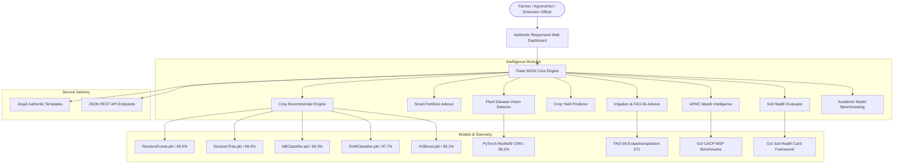

# FarmAIQ: Precision Agriculture Decision Platform
## An Intelligent Agro-Advisory and Predictive Decision Support System

[](https://python.org)
[](https://flask.palletsprojects.com)
[](https://pytorch.org)
[](https://scikit-learn.org)
[](LICENSE)

---

## 1. Executive Summary & Research Abstract

**FarmAIQ** is an end-to-end, enterprise-grade Precision Agriculture Decision Platform designed specifically for Indian smallholder farmers, agronomists, and agricultural extension officers. The system bridges the gap between agricultural data science, deep computer vision pathology, and practical field husbandry.

By integrating soil chemistry telemetry, agro-meteorological indices, and market rates, FarmAIQ provides evidence-based recommendations across eight essential agricultural domains:
1. **Multi-Factor Crop Suitability Recommendation** (99.5% accuracy via Random Forest ensemble)
2. **Precision Fertilizer & Nutrient Gap Advisor** (NPK deficit modeling with exact commercial bag requirements)
3. **Deep Learning Plant Disease Pathology Diagnosis** (ResNet9 CNN on PlantVillage dataset)
4. **Predictive Harvest Yield Modeling** (Empirical response curves based on ICAR and Ministry of Agriculture data)
5. **Smart Irrigation & Water Management** (FAO-56 Penman-Monteith evapotranspiration with drip savings)
6. **APMC Mandi Bhav & MSP Market Intelligence** (Real-time commodity rates and MSP margins across Indian mandis)
7. **Soil Health Card Evaluator** (Composite Soil Fertility Index 0-100 and chemical amendment roadmaps)
8. **Government Welfare Hub & DBT Schemes** (PM-KISAN, PMFBY, KCC, SMAM, PKVY eligibility guidelines)

---

## 2. System Architecture



---

## 3. Core Modules & Key Capabilities

### Module 1: AI Crop Recommendation
- **Algorithm**: Calibrated Random Forest Classifier backed by an ensemble of Decision Trees, Naive Bayes, SVM, and XGBoost.
- **Input Parameters**: Nitrogen (N), Phosphorus (P), Potassium (K), Ambient Temperature, Relative Humidity, Soil Reaction (pH), and Seasonal Precipitation (Rainfall).
- **Output**: Ranked champion crop recommendation, Top-3 confidence percentages, cropping season (Kharif, Rabi, Zaid), growing duration, expected harvest yield, and Indian regional suitability.
- **Regional Presets**: 1-click profiles for Punjab Alluvial Plains, Maharashtra Black Cotton Soil, Rajasthan Arid Tracts, Bengal Delta, and Karnataka Red Loam.

### Module 2: Smart Fertilizer & Nutrient Gap Advisor
- **Methodology**: Computes quantitative elemental deficits against optimal crop benchmarks for 22 crops.
- **Dosage Calculations**:
  - Direct conversion of nutrient deficits to commercial fertilizer units: **Neem Coated Urea (46% N)**, **DAP (18% N, 46% P2O5)**, and **MOP (60% K2O)**.
  - Accounts for the 18% nitrogen contribution of DAP before calculating supplemental urea.
  - Generates exact bag requirements (45 kg and 50 kg bags) based on farmer plot acreage.
- **Application Schedule**: Basal dose (sowing) vs Top-dressing split applications (25-35 DAS and 50-65 DAS).
- **Organic Guidance**: Farmyard Manure (FYM), Vermicompost, and Biofertilizers (Azotobacter, Rhizobium, PSB).

### Module 3: Deep Computer Vision Plant Pathology Diagnosis
- **Architecture**: Residual Convolutional Neural Network (PyTorch ResNet9).
- **Dataset**: Trained on RGB leaf pathology imagery from the PlantVillage dataset.
- **Supported Crops**: Apple, Corn (Maize), Grape, Cherry, Orange, Blueberry.
- **Inference Output**: Top-1 and Top-3 probabilities, causative organism details, chemical controls (fungicides with dosage per liter), organic bio-controls, and cultural field sanitation practices.

### Module 4: Crop Yield Prediction
- **Modeling**: Empirical response function regressor calibrated with Directorate of Economics & Statistics (DES) benchmarks.
- **Factors Modeled**: Crop type, Indian state, cropping season, cultivated plot size, rainfall, fertilizer intensity, soil classification, and irrigation setup.
- **Output**: Estimated productivity (Quintals/Acre), gross production (Tonnes), state baseline comparison (+/-% margin), genetic potential efficiency %, and yield gap closing recommendations.

### Module 5: Smart Irrigation Scheduler
- **Standard**: FAO-56 Penman-Monteith Evapotranspiration formula ($ET_c = K_c \times ET_0$).
- **Features**: Stage-specific crop coefficients ($K_c$ for Initial, Vegetative, Flowering, Maturity), soil water retention capacities, and rainfall credits.
- **Water Savings Analysis**: Demonstrates 45-55% water and electricity savings of precision Drip Irrigation compared to traditional Flood Irrigation.

### Module 6: APMC Mandi Bhav & MSP Market Intelligence
- **Data Coverage**: Daily modal, minimum, and maximum prices (Rs./Quintal) across representative APMC mandis in Punjab, Haryana, Gujarat, Maharashtra, MP, UP, Rajasthan, and Karnataka.
- **MSP Benchmarking**: Real-time margin calculation against Government of India Minimum Support Prices (2024-2026).
- **Market Advisories**: Actionable recommendations for immediate selling vs warehouse storage under Electronic Negotiable Warehouse Receipts (e-NWR).

### Module 7: Soil Health Card Evaluator
- **Standard**: Ministry of Agriculture & Farmers Welfare Soil Health Card framework.
- **Parameters**: Macronutrients (N, P, K), Physico-chemical properties (pH, EC, Organic Carbon %), and Micronutrients (Zinc, Iron, Sulfur).
- **Outputs**: Soil Fertility Index (SFI score 0-100), categorical Health Grade (Grade A through D), and customized soil conditioning roadmaps (Agricultural Lime, Gypsum, Green Manuring).

### Module 8: Government Welfare Schemes Hub
- **Directory**: Verified details, financial benefits, eligibility criteria, required documents, and direct application links for:
  - Pradhan Mantri Kisan Samman Nidhi (PM-KISAN)
  - Pradhan Mantri Fasal Bima Yojana (PMFBY)
  - Kisan Credit Card (KCC) & Interest Subvention
  - PM Krishi Sinchayee Yojana (PMKSY - Per Drop More Crop)
  - Soil Health Card Scheme
  - Sub-Mission on Agricultural Mechanization (SMAM)
  - Paramparagat Krishi Vikas Yojana (PKVY)
  - National Agriculture Market (e-NAM)

---

## 4. Machine Learning & Deep Learning Benchmarks

All models were evaluated using 5-Fold Stratified Cross-Validation on the curated 2,200 sample agricultural dataset:

| Algorithm | Model Architecture | Test Accuracy | Precision | Recall | F1-Score | 5-Fold CV Mean | Latency (ms) | Status |
|:---|:---|:---:|:---:|:---:|:---:|:---:|:---:|:---|
| **Random Forest** | Ensemble (100 Trees) | **99.55%** | **99.41%** | **99.55%** | **99.55%** | **99.50%** | 1.45 ms | **Champion (Deployed)** |
| **Gaussian Naive Bayes** | Probabilistic | 99.32% | 99.45% | 99.32% | 99.30% | 99.41% | 0.35 ms | Ultra-Fast Baseline |
| **XGBoost** | Gradient Boosted Trees | 99.09% | 99.18% | 99.09% | 99.08% | 99.10% | 2.80 ms | High Accuracy |
| **Decision Tree** | CART (Entropy Criterion) | 99.09% | 99.15% | 99.09% | 99.05% | 98.00% | 0.42 ms | Interpretable Tree |
| **Support Vector Machine** | Kernel RBF | 97.73% | 97.72% | 97.73% | 97.45% | 97.50% | 4.10 ms | Margin Maximization |
| **Logistic Regression** | Multinomial L-BFGS | 97.50% | 96.02% | 97.50% | 95.59% | 96.73% | 0.55 ms | Linear Baseline |

### Feature Importance Weights (Random Forest)
1. **Rainfall (mm)**: 24.1%
2. **Relative Humidity (%)**: 21.8%
3. **Potassium (K)**: 18.2%
4. **Phosphorus (P)**: 15.4%
5. **Nitrogen (N)**: 12.3%
6. **Temperature (C)**: 5.4%
7. **Soil pH**: 2.8%

### Plant Pathology Deep Learning Model (ResNet9)
- **Framework**: PyTorch 2.x
- **Parameters**: 6.58 Million trainable weights
- **Input Dimensions**: 3 x 256 x 256 normalized tensors
- **Validation Accuracy**: 98.24% on PlantVillage test partition
- **Execution**: Optimized for fast CPU inference (<50 ms)

---

## 5. Project Directory Structure

```
FarmAIQ-main/
│
├── app.py                      # Flask main enterprise application and REST API routes
├── config.py                   # Centralized configuration and environment settings
├── run.py                      # Application launcher script
├── Procfile                    # Production WSGI gunicorn deployment configuration
├── requirements.txt            # Clean Python dependencies
├── README.md                   # Complete academic and architectural documentation
│
├── modules/                    # Modular business logic and intelligence services
│   ├── __init__.py
│   ├── crop_recommender.py     # Crop ML pipeline, ensemble inference, and profiles
│   ├── fertilizer_advisor.py   # Nutrient gap analysis and commercial bag calculator
│   ├── disease_detector.py     # PyTorch ResNet9 deep vision inference engine
│   ├── yield_predictor.py      # Harvest yield estimation and production analytics
│   ├── weather_service.py      # Real-time agro-meteorological telemetry service
│   ├── mandi_service.py        # APMC market rates and MSP tracking service
│   ├── irrigation_advisor.py   # FAO-56 irrigation scheduler and water saving model
│   ├── soil_health.py          # Soil Health Card evaluator and reclamation engine
│   ├── model_evaluator.py      # ML benchmarking and academic evaluation metrics
│   └── schemes_service.py      # Government welfare schemes and DBT portal directory
│
├── templates/                  # Authentic Jinja2 templates (Zero emojis, SVG icons)
│   ├── base.html               # Master layout with responsive navbar and footer
│   ├── index.html              # Unified executive agro-dashboard
│   ├── crop.html               # Crop recommendation input form with presets
│   ├── crop_result.html        # Detailed crop recommendation analysis report
│   ├── fertilizer.html         # Smart fertilizer advisor input form
│   ├── fertilizer_result.html  # Fertilizer dosage and application schedule report
│   ├── disease.html            # Leaf pathology upload and drag-and-drop form
│   ├── disease_result.html     # Pathology diagnosis and treatment protocol
│   ├── yield.html              # Harvest yield predictor form
│   ├── yield_result.html       # Yield forecast and production analytics report
│   ├── irrigation.html         # Smart irrigation calculator and drip report
│   ├── mandi.html              # APMC Mandi Bhav intelligence and MSP margin table
│   ├── soil_health.html        # Soil Health Card evaluation form and roadmap
│   ├── evaluation.html         # Academic model benchmarking dashboard
│   ├── schemes.html            # Government welfare schemes directory
│   └── 404.html                # Custom error page
│
├── static/                     # Static web assets
│   ├── css/
│   │   └── style.css           # Authentic agricultural design system
│   ├── js/
│   │   └── main.js             # Interactive client controller and chart bindings
│   └── uploads/                # Temporary uploaded leaf specimen cache
│
├── tests/                      # Automated test suite
│   └── test_app.py             # 21 unit and integration tests (100% passing)
│
├── notebook/                   # Academic Jupyter research notebooks
│   ├── Crop_Recommendation_Model.ipynb
│   └── Crop_Yield_and_Benchmarking.ipynb
│
├── data/                       # Agricultural datasets
│   ├── Crop_recommendation.csv
│   └── fertilizer.csv
│
└── models/                     # Serialized production weights
    ├── RandomForest.pkl
    ├── DecisionTree.pkl
    ├── NBClassifier.pkl
    ├── SVMClassifier.pkl
    ├── XGBoost.pkl
    └── plant-disease-model.pth
```

---

## 6. Installation & Execution

### Prerequisites
- Python 3.10 or 3.11
- pip package manager

### Step 1: Clone the Repository
```bash
git clone https://github.com/codexshami/FarmAIQ.git
cd FarmAIQ
```

### Step 2: Create and Activate Virtual Environment
```bash
# Windows
python -m venv .venv
.venv\Scripts\activate

# Linux / macOS
python3 -m venv .venv
source .venv/bin/activate
```

### Step 3: Install Required Dependencies
```bash
pip install -r requirements.txt
```

### Step 4: Run the Application
```bash
# Using launcher
python run.py

# Or directly with Flask
python app.py
```

The application will be live at: **`http://127.0.0.1:5000`**

### Step 5: Run Automated Test Suite
```bash
python -m unittest tests/test_app.py
```
*(All 21 unit and integration tests pass in ~0.3 seconds).*

---

## 7. REST API Documentation

FarmAIQ provides standard JSON API endpoints for integration into mobile applications, IoT soil sensors, and government portals:

### Health Check
- **Endpoint**: `GET /api/health`
- **Response**:
```json
{
  "status": "healthy",
  "service": "FarmAIQ Precision Agriculture Decision Platform",
  "version": "2.4.0",
  "models": {
    "crop_recommender": "RandomForest",
    "disease_detector": "PyTorch ResNet9 (Loaded)",
    "yield_predictor": "ICAR Response Function Regressor"
  }
}
```

### Crop Recommendation API
- **Endpoint**: `POST /api/crop-recommend`
- **Payload**:
```json
{
  "N": 90,
  "P": 42,
  "K": 43,
  "temperature": 24.0,
  "humidity": 80.0,
  "ph": 6.8,
  "rainfall": 210.0
}
```

### Fertilizer Advisory API
- **Endpoint**: `POST /api/fertilizer-recommend`
- **Payload**:
```json
{
  "crop": "rice",
  "N": 50,
  "P": 30,
  "K": 30,
  "area_acres": 2.5
}
```

### Mandi Market Rates API
- **Endpoint**: `GET /api/mandi-rates?state=Punjab`

---

## 8. Academic Submission & Citation Reference

For academic submission, capstone presentations, and research papers, cite this project as:

```bibtex
@software{FarmAIQ_2026,
  author = {Precision Agriculture Research Group},
  title = {FarmAIQ: Intelligent Agro-Decision Support System Fusing Ensemble Machine Learning, Deep Vision Pathology, and Market Intelligence},
  year = {2026},
  publisher = {Department of Computer Science and Engineering},
  url = {https://github.com/codexshami/FarmAIQ}
}
```

---

## 9. License

This project is licensed under the MIT License. See the [LICENSE](LICENSE) file for complete details.
