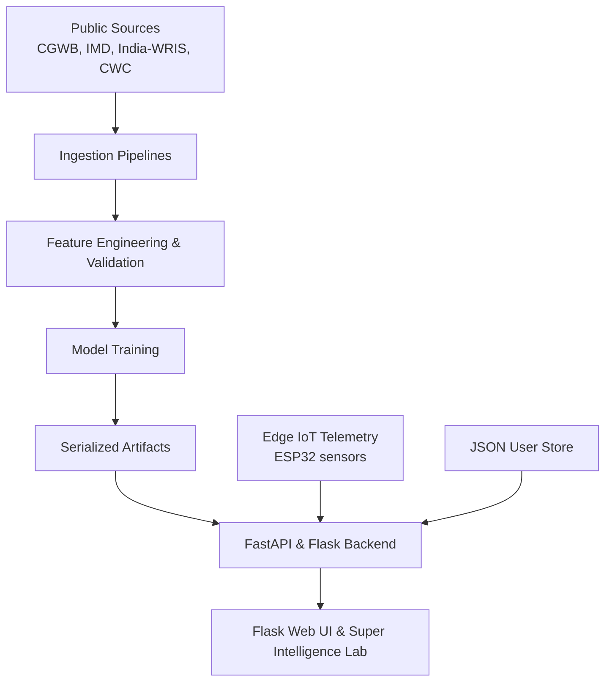

# HydroRaksh aka JalSuraksha

**AI-driven groundwater intelligence and water resource decision support for India.**

[](tests/unit)
[](apps/flask_app)
[](apps/api)
[](ml/notebooks)
[](docker-compose.yml)

JalSuraksha is an independent research project and is **not** an official Government of India or state department website. All hydrological and meteorological data is compiled from publicly available records published by CGWB, IMD, India-WRIS, and CWC.

**Author:** Mohd Shami, B.Tech Data Science
[Email](mailto:codexshami@gmail.com) · [Portfolio](https://mohdshamii.github.io) · [GitHub](https://github.com/mohdshamii) · [LinkedIn](https://linkedin.com/in/modshamii)

---

## Contents

1. [Overview](#overview)
2. [Screenshots](#screenshots)
3. [Pan-India Geography](#pan-india-geography)
4. [Architecture](#architecture)
5. [Machine Learning](#machine-learning)
6. [Platform Modules](#platform-modules)
7. [Design System](#design-system)
8. [Data Sources and Integrity](#data-sources-and-integrity)
9. [Getting Started](#getting-started)
10. [Testing](#testing)
11. [API Reference](#api-reference)
12. [References](#references)

---

## Overview

Over 63% of India's irrigated cropland and 85% of rural drinking water supplies depend on aquifers. India withdraws roughly 245 billion cubic meters of groundwater each year, and over 17% of assessment units are classified as Over-Exploited. Conventional monitoring relies on numerical simulation and quarterly manual measurements, which are slow, sparse, and rarely produce localized engineering recommendations.

JalSuraksha turns public groundwater observations into near-real-time, actionable intelligence.

- **Pan-India coverage:** 36 States and Union Territories and 700+ districts, with Uttar Pradesh (75 districts across 18 divisions) as the reference implementation.
- **Hydro-Geological Collaborative Filtering (HG-CF):** Recommends interventions for data-sparse blocks by embedding physical aquifer attributes in a graph Laplacian regularization kernel.
- **Topic modeling (LDA):** Extracts distress signals from hydrogeological reports and citizen grievances.
- **Dual water metrics:** Groundwater depth (m bgl) and quality parameters (pH, EC, TDS, fluoride, arsenic, nitrate), each labeled with data provenance.
- **Prescriptive decision suite:** Recharge sizing, water balance audit, knapsack budget optimization, leakage analysis, crop-shift advice, and what-if stress testing.
- **Reproducible ML workspace:** 16 Jupyter notebooks, serialized models, and a dedicated research Docker container.

---

## Screenshots

All figures are captured from the running application and stored in [`img/`](img).

### 1. Core Map Canvas and Intelligence Dashboard

Interactive Pan-India groundwater intelligence canvas featuring district choropleth boundaries, river basin vectors, aquifer risk classifications (Over-Exploited, Critical, Semi-Critical, Safe), 2000–2035 planning horizon timeline controls, active IoT piezometers, and real-time district dossier telemetry.


---

### 2. Super Intelligence Lab (AI / ML Studio)

Automated exploratory data analysis (EDA) and hydrological machine learning studio profiling 780 districts across 36 States and Union Territories. Features bivariate hydrological correlation matrices (Pearson r), one-way ANOVA hypothesis testing across physical geological formations, telemetry sentinel data quality certification, and parametric summary distribution statistics.


---

## Pan-India Geography

JalSuraksha extends a single-state prototype to a full national platform. Selecting a state updates, in one step:

1. The district dropdown and search index.
2. Boundary visualization on the map.
3. Groundwater level observations and depth trends.
4. IMD rainfall departure and monsoon status.
5. Water stress index and recharge suitability scores.
6. All dependent analytical panels and decision tools.


---

## Architecture



**Stack:** Python 3.10+, Flask (Jinja2, Vanilla JS), FastAPI (async), SQLAlchemy, TimescaleDB, scikit-learn, gensim, SHAP, JupyterLab.

```
JalSuraksha/
├── apps/
│   ├── api/          # FastAPI backend (endpoints, core, db, models, services)
│   ├── flask_app/    # Flask application (blueprints, templates, static JS/CSS)
│   └── web/          # Frontend assets and configurations
├── data/             # raw, processed, and private (user store) data
├── docs/             # Research papers and runbooks
├── img/              # Application screenshots
├── ml/               # Notebooks, pipelines, artifacts, configs, tests
├── scripts/          # Automation scripts
├── tests/unit/       # Backend unit tests
├── Dockerfile
├── Dockerfile.research
└── docker-compose.yml
```

---

## Machine Learning

The research workspace in `ml/` contains 16 executable notebooks (`00` to `15`) covering the full workflow:

| Stage | Notebooks |
| :--- | :--- |
| Setup and data | `00` environment, `01` ingestion, `02` EDA, `03` validation, `04` feature engineering |
| Analysis | `05` depletion clustering, `06` rainfall-recharge dynamics, `07` water quality (BIS 10500) |
| Forecasting | `08` baselines, `09` tree-based models, `10` sequence model specifications |
| Recommendation and text | `11` HG-CF recommender, `12` LDA topic modeling |
| Evaluation and deployment | `13` benchmarks, `14` SHAP explainability, `15` model registry |

### Evaluation

Metrics are logged in `ml/artifacts/evaluation_report.json`.

**Water table forecasting (rolling-origin cross-validation, 4 folds)**

| Model | MAE (m) | RMSE (m) |
| :--- | :---: | :---: |
| Naive persistence | 29.851 | 30.999 |
| Ridge regression | 3.851 | 4.352 |
| Gradient boosting | 4.015 | 4.678 |
| Random forest | 4.054 | 4.575 |

**Held-out geographic validation** (Agra, Patna, Meerut; 9 samples): MAE 5.169 m, RMSE 7.365 m, R² 0.127.

**HG-CF recommender** (118 held-out unit-intervention pairs): Precision@5 0.197, NDCG@5 0.437, MAE 0.123.

### HG-CF Formulation

For assessment units $u$ and interventions $i$, predicted performance is $\hat{r}_{ui} = \mu + b_u + b_i + \mathbf{p}_u^T \mathbf{q}_i$. Training adds a graph Laplacian penalty weighted by hydro-geological similarity:

$$\min \frac{1}{2} \sum_{u,i} I_{ui}(r_{ui} - \hat{r}_{ui})^2 + \frac{\lambda_P}{2}\sum_u \|\mathbf{p}_u\|^2 + \frac{\lambda_Q}{2}\sum_i \|\mathbf{q}_i\|^2 + \frac{\alpha}{2}\sum_{u,v} S_{uv}^H \|\mathbf{p}_u - \mathbf{p}_v\|^2$$

where $S_{uv}^H = \exp\left(-\|\mathbf{x}_u - \mathbf{x}_v\|^2 / 2\sigma_h^2\right)$ and $\mathbf{x}_u = [k_u, s_u, \Delta R_u, E_u, D_u]^T$ encodes hydraulic conductivity, slope, monsoon rainfall departure, extraction stage, and depth.

---

## Platform Modules

| Module | Capability | Status |
| :--- | :--- | :---: |
| Dynamic Atlas | 36 States/UTs, UP vector boundaries, 2000–2035 timeline playback | Implemented |
| Dual Water Metrics | Depth and BIS 10500 quality parameters with timestamps | Implemented |
| ML Forecaster | Multi-horizon forecasting (random forest, gradient boosting) | Implemented |
| HG-CF Recommender | Hydro-geological intervention recommendations | Implemented |
| LDA Literature Miner | Topics from CGWB reports and grievances | Implemented |
| Water Balance Audit | GEC-2015 recharge, extraction, and net deficit | Implemented |
| Recharge Sizing | Check dams, percolation ponds, injection wells, recharge shafts | Implemented |
| NRW Leakage Engine | Non-revenue water loss audit with simulated acoustic detection | Implemented |
| Budget Optimizer | Knapsack allocation under capital ceilings | Implemented |
| What-If Simulator | Extraction, rainfall, and recharge stress testing | Implemented |
| RWH Sizing | Rooftop harvesting yield and payback | Implemented |
| Crop Shift Advisory | Low-water crop substitutions | Implemented |
| Borewell Failure Portal | Failure records and diagnostics | Implemented |
| District Comparison | Head-to-head comparison and 75-district matrix with CSV export | Implemented |
| Authentication | Anonymous by default; optional JSON store (PBKDF2-HMAC-SHA256) | Implemented |
| IoT Ingestion | ESP32 bridge via `/api/v1/jalrakshak/iot/telemetry` | Partial (endpoint active, edge simulated) |
| MODFLOW Integration | 3D finite-difference numerical coupling | Planned |

---

## Design System

The interface follows the clean, high-contrast, accessible style of public-information portals such as India.gov.in, with light and dark themes and no emojis. Icons are SVG from `lucide-react`.

| Token | Light | Dark | Use |
| :--- | :---: | :---: | :--- |
| `--color-primary` | `#12345A` | `#80B8F0` | Headers, focus outlines |
| `--color-secondary` | `#245B8F` | `#9CCBFA` | Controls, badges |
| `--color-accent-saffron` | `#E88B2A` | `#F2A65A` | Active timeline, warnings |
| `--color-accent-green` | `#248653` | `#69C58A` | Safe zones, verified data |
| `--color-background` | `#F5F7FA` | `#111820` | Application canvas |
| `--color-surface` | `#FFFFFF` | `#1B2632` | Cards, modals |
| `--color-text` | `#202B38` | `#F0F4F8` | Body text |
| `--color-border` | `#DCE3EA` | `#344353` | Dividers, outlines |

- The theme toggle switches modes without a page reload and respects `prefers-color-scheme` on first launch.
- The preference is saved in `localStorage` under `jalsuraksha_theme`.
- Controls provide visible keyboard focus, ARIA attributes, and accessible labels.

---

## Data Sources and Integrity

The platform never fabricates piezometer readings, failure rates, or model metrics. Missing data is shown as `Unavailable` or `—`, never as zero. Every value carries a provenance label:

- `Live`: ingested within the past 24 hours
- `Delayed`: scheduled quarterly monitoring rounds
- `Cached`: archived historical records
- `Simulated`: what-if scenarios and algorithmic forecasts
- `Unavailable`: no verified ground data collected

**Sources:**

1. Central Ground Water Board (CGWB): pre- and post-monsoon water table depths from the National Ground Water Monitoring Network.
2. India Meteorological Department (IMD): district gridded rainfall and normal departure indices.
3. India Water Resources Information System (India-WRIS): river basin telemetry, reservoirs, and discharge.
4. Central Water Commission (CWC): gauge-discharge data for the Ganga and Yamuna basins.
5. Bureau of Indian Standards (IS 10500:2012): drinking water chemical limits.

---

## Getting Started

**Prerequisites:** Python 3.10+, Git.

```bash
git clone https://github.com/mohdshamii/HydroRaksh.git
cd HydroRaksh
```

### 1. Python Environment Setup

```bash
python -m venv venv
source venv/bin/activate        # Windows: venv\Scripts\activate
pip install -r requirements.txt
```

### 2. Launching the Python-First Flask Application
Launch the unified Flask development server:
```bash
# Using Makefile
make dev-flask

# Or directly with Python
python server.py --host 0.0.0.0 --port 5000
```

Open `http://localhost:5000` to access the JalSuraksha Atlas and Super Intelligence Lab.
API docs are served at `http://127.0.0.1:8000/docs`.

### 3. Machine Learning Workspace (JupyterLab)

```bash
make jupyter
# or: jupyter lab --ip=0.0.0.0 --port=8888 --no-browser
```

Open `http://localhost:8888` to explore all 16 ML notebooks.

### Docker

```bash
# Application server (Flask & APIs)
docker compose up -d --build

# JupyterLab research environment
docker compose --profile research up -d research
```

Web app: `http://localhost:5000` · JupyterLab: `http://localhost:8888`

The research container ships with `scikit-learn`, `gensim`, `shap`, `pandas`, and `numpy` and gives access to all 16 notebooks.

---

## Testing

```bash
pytest tests/unit/ -v     # 101 automated unit tests
```

The suite covers backend APIs, authentication, Pan-India endpoints, and ML modules.

---

## API Reference

| Method | Endpoint | Description |
| :--- | :--- | :--- |
| GET | `/health` | Liveness and readiness probe |
| GET | `/api/v1/auth/status` | Authentication and session status |
| POST | `/api/v1/auth/register` | Register a user |
| POST | `/api/v1/auth/login` | Authenticate and receive a session token |
| GET | `/api/v1/pan-india/states` | List States/UTs with district counts |
| GET | `/api/v1/pan-india/districts/{state_code}` | District geometries and telemetry |
| GET | `/api/v1/pan-india/water-metrics/{district_id}` | Water depth and quality metrics |
| GET | `/api/v1/pan-india/compare?district_a={id}&district_b={id}` | Compare two districts |
| GET | `/api/v1/pan-india/sources` | Data sources and ingestion freshness |
| POST | `/api/v1/jalrakshak/recharge/recommend` | Ranked recharge interventions |
| POST | `/api/v1/jalrakshak/simulate/whatif` | Aquifer stress simulation |
| POST | `/api/v1/jalrakshak/budget/optimize` | Knapsack budget optimization |

---

## References

1. Central Ground Water Board, *Dynamic Ground Water Resources of India – 2023*, Ministry of Jal Shakti, 2023.
2. V. M. Tiwari, J. Wahr, and S. Swenson, "Dwindling groundwater resources in northern India, from satellite gravity observations," *Geophysical Research Letters*, vol. 36, no. 18, 2009.
3. M. Rodell, I. Velicogna, and J. S. Famiglietti, "Satellite-based estimates of groundwater depletion in India," *Nature*, vol. 460, pp. 999–1002, 2009.
4. Y. Koren, R. Bell, and C. Volinsky, "Matrix factorization techniques for recommender systems," *Computer*, vol. 42, no. 8, pp. 30–37, 2009.
5. D. M. Blei, A. Y. Ng, and M. I. Jordan, "Latent Dirichlet Allocation," *Journal of Machine Learning Research*, vol. 3, pp. 993–1022, 2003.
6. Bureau of Indian Standards, *IS 10500:2012, Drinking Water – Specification*, New Delhi, 2012.

---

*JalSuraksha is an independent engineering and research project designed and maintained by Mohd Shami.*
