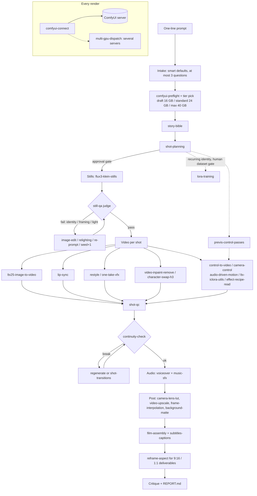

# open-higgsfield-skills

[](https://github.com/mojomast/open-higgsfield-skills/releases/download/v0.1.1-demo/open-higgsfield-skills-demo.mp4)

▶ **[Watch the demo (MP4, 1:26)](https://github.com/mojomast/open-higgsfield-skills/releases/download/v0.1.1-demo/open-higgsfield-skills-demo.mp4)** · [captions (SRT)](docs/media/demo.srt) · [details](#demo)

**One prompt in, a finished short video out, using only open-weights models on your own ComfyUI.**

`open-higgsfield-skills` is an agent-agnostic pack of **37 [Agent Skills](https://agentskills.io)** that teaches any coding agent (Claude Code, Codex, Cursor, OpenCode, Hermes, Pi or your own) to work as a film crew. The `video-director` skill takes a one-line idea such as *"a lighthouse keeper finds a message in a bottle"* and breaks it into a story bible, a shot list, keyframes, video shots, voice, music, captions and a final cut. It sends every step to ComfyUI workflows built on **open weights**: FLUX Klein, LTX-2.x, Qwen-Image-Edit, Wan, SeedVR2, ACE-Step, Chatterbox, Whisper and more.

> **Status: early and community-built.** The workflows come from #OpenSourceHiggsfield hackathon projects and were checked statically (graph structure, node and weight requirements, routing and dry runs). Most have **not** been run end to end on a GPU. The routes in the [demo](#demo) were run on a Google Colab GPU. See [Status and limitations](#status-and-limitations).

---


## Demo

[](https://github.com/mojomast/open-higgsfield-skills/releases/download/v0.1.1-demo/open-higgsfield-skills-demo.mp4)

Every shot in the [demo video](https://github.com/mojomast/open-higgsfield-skills/releases/download/v0.1.1-demo/open-higgsfield-skills-demo.mp4) was rendered by this pack from one manifest. `video-director` validated and packaged it, and `google-colab-runner` ran it as a single notebook on a Google Colab RTX PRO 6000 (96 GB, standard tier). All 14 jobs finished in about 8.5 compute units, including setup and the roughly 99 GB model download. The narration was also generated by the pack.

| shot | what you see | skills and routes |
|---|---|---|
| s01 | astronaut on a red desert ridge | `flux3-klein-stills` (`still.klein`) → `ltx25-image-to-video` (`video.i2v`, two-pass + latent upscale) |
| s02 | the astronaut walks on | `video-director` last-frame chaining (`chain_from: s01`) → `video.i2v` |
| s03 | fox in a yellow raincoat; rain turns to snow; cut-out | `still.klein` → `video.i2v`, `image-edit` (`fix.edit`, Qwen-Image-Edit 2511), `background-matte` (`fix.matte`, BiRefNet) |
| s04 | vintage film camera, arc move | `still.klein` → `camera-control` (`camera.fun`, Wan Fun Camera, `MOVES: "arc-left-45"`) |
| s05 | lighthouse in a storm | `still.klein` → `video.i2v` |
| s06 | robot painting in a studio | `still.klein` → `video.i2v` |
| VO | the narration | `voiceover` (`audio.voice`, Chatterbox Multilingual) |

The final cut, captions and title cards were made with ffmpeg rather than `film-assembly`, and still-qa, shot-qc, continuity-check and music were not exercised in this run. LTX-2.5 weights are under the Lightricks LTX-2 Community License, which is not OSI-approved.

## What it is and why

Hosted "AI director" products string together closed models behind a paywall. This pack does the same job in the open:

- **A director agent, not a single model.** `video-director` plans, renders, judges, fixes and assembles, and records every prompt, seed, model and cost in one resumable JSON manifest.
- **Open weights only.** No skill calls a closed or hosted generation API. You bring a ComfyUI server (local GPU, Google Colab or a hosted ComfyUI) and download the weights yourself. **No model weights are included in this repo.**
- **Agent-agnostic.** Each skill is a plain folder with a `SKILL.md` plus stdlib-only Python scripts and ComfyUI API-format workflows, so any agent that reads Agent Skills can use them.
- **Human in the loop where it matters.** There are approval gates on the bible, the shot plan, spend and stills, and hard caps on retries and GPU-minutes.

## How video-director routes



Routing is data-driven: 70 routes today. [`skills/video-director/references/routing.md`](skills/video-director/references/routing.md) maps each *need* (for example "speaking on camera" or "remove object") to a skill, a workflow, its input bindings, a fallback route and the tiers it suits. To add a skill, you add one row.

## Skills

Licence = the licence of the code and workflows in that folder. Model weights are **never bundled** and carry their own licences. They are mostly **unverified** here, so check the model card before commercial use. VRAM figures are estimates from upstream projects unless noted, not measurements by this repo.

| Skill | What it does | Models | VRAM | Licence |
|---|---|---|---|---|
| [`audio-driven-motion`](skills/audio-driven-motion/) | Make video whose motion is driven by an audio track (a talking or singing avatar with body motion, or music-reactive motion) using open-weights LTX-2 audio-to-video, LTX-2.3 image+audio-to-video, Wan 2.2 S2V, InfiniteTalk or HuMo in ComfyUI | LTX-2 a2v, LTX-2.3, Wan 2.2 S2V, InfiniteTalk, HuMo | 24 GB+ (est.) | Apache-2.0, MIT · weights: LTX-2 Community License (not OSI); Wan S2V / InfiniteTalk: Apache-2.0 (unverified); HuMo: UNVERIFIED; MelBand RoFormer: UNVERIFIED |
| [`background-matte`](skills/background-matte/) | Remove or replace backgrounds and pull mattes with open-weights BiRefNet in ComfyUI (stills to transparent or solid colour, video background removal), plus PlateLock plate compositing (difference matte, temporal stabilise, fidelity report) to put a generated element back onto a real plate | BiRefNet | ~2-4 GB (est.) | MIT · weights: BiRefNet: MIT (unverified) |
| [`camera-control`](skills/camera-control/) | Animate a still with an explicit, repeatable camera move (named trajectories such as orbit, dolly or crane, or drawn ATI point tracks) using open-weights Wan Fun Camera and Wan ATI in ComfyUI | Wan 2.1/2.2 Fun Camera, Wan ATI | ~8-12 GB (1.3B); 24 GB+ (14B) (est.) | Apache-2.0, MIT · weights: Wan 2.1/2.2 Fun Camera, ATI: Apache-2.0 (unverified) |
| [`camera-lens-lut`](skills/camera-lens-lut/) | Apply film-style camera moves (handheld, push, drift), lens effects, a 3D .cube grade LUT and letterboxing to a clip in ComfyUI with the bundled Backlot node pack | none (Backlot post nodes, .cube LUTs) | light (unverified) | MIT · weights: no model weights in the Backlot nodes; loaders unverified |
| [`character-swap-h3`](skills/character-swap-h3/) | Swap a person, face or object in an existing clip for a reference image using open-weights MiniMax H3 (local weights) with D3voz's one-click swap nodes, or an open LTX-2.3 motion-swap fallback | MiniMax H3 (local), Qwen3-VL; LTX-2.3 fallback | 32 GB+ (est.) | MIT · weights: MiniMax H3: UNVERIFIED; Qwen3-VL: Apache-2.0 (unverified); LTX-2 Community License (fallback, not OSI) |
| [`comfyui-connect`](skills/comfyui-connect/) | Submit ComfyUI API-format workflows to any ComfyUI server (local, a Google Colab tunnel, or a hosted instance), poll for completion, download outputs, upload inputs, and cancel jobs | - | - | MIT · weights: none |
| [`comfyui-preflight`](skills/comfyui-preflight/) | Check, before submitting, that a ComfyUI server has every node type and model weight file a workflow needs. Reads /object_info only; submits nothing | - | - | MIT · weights: none |
| [`continuity-check`](skills/continuity-check/) | Sweep adjacent shots and takes for continuity breaks (cast, wardrobe, props, grade, lighting, screen direction, timing) at plan level and take level, and report findings with proposed fixes - never edits | open VLM via still-qa | VLM-dependent | MIT · weights: uses still-qa VLM |
| [`control-to-video`](skills/control-to-video/) | Generate video that follows a control signal (depth, OpenPose skeleton or canny edges extracted from a reference or previs clip) with open-weights LTX-2 and Wan 2.2 Fun Control / Wan VACE in ComfyUI | LTX-2, Wan 2.2 Fun Control, Wan VACE, DWPose | 24 GB+ (est.) | Apache-2.0, MIT · weights: LTX-2 Community License (not OSI); Wan 2.1/2.2: Apache-2.0 (unverified); DWPose: Apache-2.0; SDPose: UNVERIFIED; Depth Anything >Small: CC-BY-NC (not bundled) |
| [`effect-recipe-read`](skills/effect-recipe-read/) | Reverse-engineer a video effect into a reusable JSON recipe: a local Qwen3-VL 8B reads START/MIDDLE/END frames of a reference clip and writes the end-frame and motion prompts, then an open LTX-2 + Qwen edit graph applies the recipe to the user's photo (forkfield) | Qwen3-VL 8B, LTX-2 + Qwen edit | ~16-20 GB reader; 24 GB+ apply (est.) | MIT · weights: Qwen3-VL 8B: Apache-2.0 (unverified); LTX-2 Community License (not OSI) |
| [`film-assembly`](skills/film-assembly/) | Cut the final film with ffmpeg - normalise clips to one size/fps, join with cuts or crossfades (optionally snapped to music beats), lay narration over a ducked music bed, and export for 16:9, 9:16, 1:1 or 4:5 | ffmpeg | CPU | MIT · weights: none (ffmpeg) |
| [`flux3-klein-stills`](skills/flux3-klein-stills/) | Generate stills and keyframes with open-weights FLUX Klein (distilled FLUX 3 Klein, FLUX 3 Klein base with prompt upsampling, or FLUX.2 Klein 4B/9B) through ComfyUI | FLUX 3 Klein, FLUX.2 Klein 4B/9B | ~12 GB int8/fp8; ~24 GB 9B bf16 (est.) | 0BSD, Apache-2.0, MIT · weights: FLUX 3 Klein: UNVERIFIED; FLUX.2 Klein 4B: Apache-2.0 (unverified); FLUX.2 Klein 9B: FLUX Non-Commercial (unverified) |
| [`frame-interpolation`](skills/frame-interpolation/) | Raise a clip's frame rate (e.g. 24 to 48/60 fps, or smooth slow motion) with open-weights FILM frame interpolation in ComfyUI | FILM | low (~0.1 GB weights) | MIT · weights: FILM: Apache-2.0 (unverified) |
| [`google-colab-runner`](skills/google-colab-runner/) | Run video-director on Google Colab: package a manifest into a self-contained Google Colab notebook bundle (ComfyUI and custom nodes at pinned commits, model downloads with your own HF token from Google Colab secrets, per-shot API workflows, GPU tier detection, outputs to Drive or a zip), or let the director drive a running Google Colab ComfyUI through a tunnel with a compute-unit estimate, spend gate, hard cap, resume after a dropped session and teardown | - (runs the routed skills) | T4 / L4 / A100 / H100 → draft / standard / max | MIT · weights: inherits the routed skills' licences |
| [`image-edit`](skills/image-edit/) | Edit a still with open-weights Qwen-Image-Edit in ComfyUI - instruction edits, new camera angles, push-in, coverage close-ups, relighting, and outpainting to a new aspect | Qwen-Image-Edit 2509/2511, Lightning LoRA | 16-20 GB fp8 (est.) | MIT · weights: Qwen-Image / Edit: Apache-2.0 (unverified); Lightning LoRA: Apache-2.0 (unverified) |
| [`image-to-3d`](skills/image-to-3d/) | Turn a still (or 4 views) into a GLB mesh with open-weights TRELLIS.2 or Pixal3D in ComfyUI | TRELLIS.2, Pixal3D | 16-24 GB (est.) | MIT · weights: TRELLIS.2: MIT (unverified); Pixal3D, MoGe-2: UNVERIFIED; DINOv3 licence (unverified) |
| [`lip-sync`](skills/lip-sync/) | Make a character speak or sing to an audio track with open weights in ComfyUI - talking shot from a photo + audio (LTX-2.3), re-dub an existing video (LTX-2.3 IC-LoRA lipdub), or low-VRAM singing/talking (Wan 2.1 + InfiniteTalk) | LTX-2.3, Wan 2.1 InfiniteTalk | 24 GB+ (est.); Wan GGUF lower | MIT · weights: LTX-2 Community License (not OSI); Gemma Terms (unverified); Wan 2.1: Apache-2.0 (unverified); InfiniteTalk: UNVERIFIED; syncnet weights (research-only): excluded |
| [`lora-training`](skills/lora-training/) | Train a LoRA (character, product, style or motion) for an open-weights image or video model with ostris/ai-toolkit, behind a hard human approval gate on the dataset | ostris/ai-toolkit on your chosen base model | base-model dependent | MIT · weights: whatever base model you train (check its licence; FLUX.2 Klein 9B believed non-commercial, LTX-2 not OSI) |
| [`ltx-iclora-utils`](skills/ltx-iclora-utils/) | LTX-2.3/2.5 IC-LoRA and LoRA utility graphs: motion transfer from a reference clip, motion-guided i2v, LTX-2.5 effects, plus official templates for subtitle and watermark removal, archival restoration, style transitions, generic IC-LoRA and ID-LoRA (identity) | LTX-2.3 / 2.5 IC-LoRA, ID-LoRA | 24-32 GB+ (est.) | MIT · weights: LTX-2 Community License (not OSI); Gemma Terms (unverified); community IC-LoRAs: UNVERIFIED |
| [`ltx25-image-to-video`](skills/ltx25-image-to-video/) | Animate a still into a shot with open-weights LTX-2.5 in ComfyUI (image-to-video with optional last frame, or text-to-video), including LTX's native audio latent | LTX-2.5 | 16-24 GB (est.) | Apache-2.0, MIT · weights: LTX-2 Community License (not OSI) |
| [`multi-gpu-dispatch`](skills/multi-gpu-dispatch/) | Spread a production across several GPUs or ComfyUI servers: round-robin shots across server URLs with a stdlib dispatcher, or install ComfyUI-Distributed (parallel workers and tiles) or raylight (split one large model across GPUs with FSDP/xDiT) | ComfyUI-Distributed, raylight | per worker | Apache-2.0, MIT · weights: inherits the routed workflow |
| [`music-sfx`](skills/music-sfx/) | Generate music beds, songs and sound effects with open-weights ACE-Step 1.5, Stable Audio Open / Stable Audio 3 and MiniMax Music 3 in ComfyUI, using model-specific prompt rules | ACE-Step 1.5, Stable Audio Open / 3, MiniMax Music 3 | ~6-8 GB (est.) | MIT · weights: ACE-Step: Apache-2.0 (unverified for 1.5); Stable Audio Open: Stability AI Community (unverified); Stable Audio 3, MiniMax Music 3: UNVERIFIED |
| [`one-take-vfx`](skills/one-take-vfx/) | Add a stylised VFX effect to an existing clip in one pass (set-on-fire, disintegrate, time-freeze, hologram, portal, rain-stop, levitate, aurora trails, liquid chrome, neon wireframe, particle bloom, slow-mo debris) with open-weights LTX IC-LoRA union control and Kainotomic's preset node | LTX (IC-LoRA guide) | 24 GB+ (est.) | MIT · weights: LTX-2 Community License (not OSI) |
| [`previs-control-passes`](skills/previs-control-passes/) | Block a shot in 3D and export deterministic control passes (OpenPose skeleton MP4, depth MP4, subject alpha, 4x4 camera matrices, 24 fps previs) from ComfyUI Motion Previs Studio, then feed them to control-to-video or camera-control. Also applies its verified template-binding format to ComfyUI API graphs | Motion Previs Studio (WebGL app) | none (WebGL) | MIT · weights: none bundled; downstream skill licences apply |
| [`reframe-aspect`](skills/reframe-aspect/) | Reframe a finished clip to another aspect ratio (16:9 to 9:16, 1:1, 4:5) by outpainting video with an open-weights LTX-2.3 IC-LoRA in ComfyUI, instead of cropping | LTX-2.3 IC-LoRA outpaint | 24 GB+ (est.) | MIT · weights: LTX-2 Community License (not OSI); Gemma Terms (unverified) |
| [`relighting`](skills/relighting/) | Relight a still (change light direction, colour, time of day, or match a plate) with open-weights models: Qwen-Image-Edit 2509 relight, FLUX.2 Klein + normal-map lights (motionfield), or the Comfy-Org portrait relighting template. Stills only; animate afterwards with image-to-video | Qwen-Image-Edit 2509, FLUX.2 Klein + DA3 normals | 16-24 GB (est.) | Apache-2.0, MIT · weights: FLUX.2 Klein 4B: Apache-2.0 (unverified); Qwen-Image-Edit: Apache-2.0 (unverified); Depth Anything 3 / V2 large: CC-BY-NC (unverified, not bundled); IC-Light: excluded |
| [`restyle`](skills/restyle/) | Restyle or re-motion an existing clip with open-weights LTX (IC-LoRA depth/union control restyle, or LTX-2.5 motion guide from a reference video) | LTX IC-LoRA depth, LTX-2.5 motion guide | 24 GB+ (est.) | MIT · weights: LTX-2 Community License (not OSI); Depth Anything V2 Small: Apache-2.0 (unverified) |
| [`shot-planning`](skills/shot-planning/) | Staged preproduction from a sentence or script to a locked shot list - beats, shots with camera/duration/narration, per-shot prompts, cost and time estimate - with human approval gates and no auto-spend | LLM only | - | MIT · weights: none |
| [`shot-qc`](skills/shot-qc/) | Model-free quality control for rendered shots and final cuts using ffprobe/ffmpeg measurements: duration, aspect, audio present, frozen frames, black frames, hard-cut count, flicker, soft (blurry) frames and clipped highlights/shadows, with a 0-100 score | none (ffprobe/ffmpeg) | CPU | MIT · weights: none (ffprobe/ffmpeg) |
| [`shot-transitions`](skills/shot-transitions/) | Generate a bridging transition clip between two shots (first-frame/last-frame video) with open-weights LTX-2.5 or LTX-2.3 transition LoRA via Seam's graphs, with an optional VLM that describes both frames to write the transition prompt | LTX-2.5 FLF2V, LTX-2.3 | ~31 GB peak (reported by Seam) | MIT · weights: LTX-2 Community License (not OSI); Gemma Terms (unverified) |
| [`still-qa`](skills/still-qa/) | Judge loop for generated stills and video frames using an open-weights vision-language model (e.g. Qwen2.5-VL/Qwen3-VL via an OpenAI-compatible local server) - score prompt match, identity, artifacts, composition and style, then retry once with a concrete fix | Qwen2.5-VL / Qwen3-VL (your server) | VLM-dependent | MIT · weights: your chosen VLM (e.g. Qwen2.5-VL / Qwen3-VL: Apache-2.0, unverified) |
| [`story-bible`](skills/story-bible/) | Write and maintain a story bible - logline, cast sheets with locked visual descriptors, locations, props, style/LUT, voice - that every prompt, shot and check reads from | LLM only | - | MIT · weights: none |
| [`subtitles-captions`](skills/subtitles-captions/) | Make captions and subtitles - SRT/ASS from the shot plan's narration timing or from Whisper ASR (open weights, local ComfyUI node), then burn them in or ship a sidecar with ffmpeg | Whisper large-v3-turbo | ~1.6 GB | Apache-2.0, MIT · weights: Whisper large-v3-turbo: MIT (unverified) |
| [`video-director`](skills/video-director/) | Top-level orchestrator that turns a one-line video idea into a finished short (story short, product spot, music-video snippet) on ComfyUI (local, Google Colab or Comfy Cloud) using only open-weights models. It does brief intake with defaults, a preflight and budget check that picks a draft, standard or max tier, then story bible and timed shot plan, stills first with a QA judge loop, image-to-video, continuity checks, voiceover, music and SFX, assembly with captions and exports, and a self-critique report. It keeps one resumable JSON manifest of every prompt, seed, model and cost | routes to the others (70 routes) | tier: 16 / 24 / 40 GB | MIT · weights: inherits the routed skills' licences |
| [`video-inpaint-remove`](skills/video-inpaint-remove/) | Remove or replace an object in a video using a mask, with open-weights Wan 2.1 VACE or LTX-2.3 in-painting in ComfyUI (tracked mask, feathering, original pixels kept outside the mask) | Wan 2.1 VACE, LTX-2.3, SAM 2 | 24 GB+ (est.) | MIT · weights: Wan 2.1 VACE: Apache-2.0 (unverified); LTX-2 Community License (not OSI); SAM 2: Apache-2.0 (unverified) |
| [`video-upscale`](skills/video-upscale/) | Upscale and restore generated video or stills with open-weights SeedVR2 in ComfyUI (one-step diffusion restoration) | SeedVR2 3B/7B | 16-24 GB+ (est.) | MIT · weights: SeedVR2: Apache-2.0 per upstream repo (UNVERIFIED for these weights) |
| [`voiceover`](skills/voiceover/) | Narration and voice-over with open-weights Chatterbox Multilingual TTS (23 languages, optional voice reference) in ComfyUI, following one-voice narration rules | Chatterbox Multilingual | ~6 GB (est.) | MIT · weights: Chatterbox: MIT (unverified) |

> **Comfy-Org UI templates ship in both formats.** Files under `skills/*/workflows/ui/*.ui.json` are official Comfy-Org (and ComfyUI-Distributed / raylight) workflows in ComfyUI's UI format. Each one is also in `skills/*/workflows/api/<name>.api.json`, converted with ComfyUI's own frontend (`app.graphToPrompt` in a headless, CPU-only ComfyUI at a pinned commit) and validated against `/object_info`, so `comfy_client.py`, the director and the Google Colab runner submit them directly. 26 of 27 convert; `relighting/…/character_portrait_relighting` is excluded because it needs a closed hosted API node. Details: [`skills/google-colab-runner/references/ui-to-api.md`](skills/google-colab-runner/references/ui-to-api.md).

## Quick start

1. **Get a ComfyUI server** and note its URL: `export COMFY_URL=http://127.0.0.1:8188` (or your Google Colab tunnel URL).
2. **Install the skills** for your agent (see below). Copy all of them, or just the ones you need. `video-director` expects its sibling skills to sit next to it.
3. **Preflight:** ask your agent to "run comfyui-preflight for the standard tier". It lists the missing custom nodes and weight files without submitting anything.
4. **Direct:** ask your agent, *"Use video-director to make a 30-second story short about …"*.

```bash
git clone https://github.com/mojomast/open-higgsfield-skills
cd open-higgsfield-skills
```

| Agent | Where skills go | How to invoke |
|---|---|---|
| **Claude Code** | `.claude/skills/<name>/` (project) or `~/.claude/skills/<name>/` (user) | Skills load automatically by description. You can also ask *"use the video-director skill"* or type `/video-director`. |
| **Codex** | `.agents/skills/<name>/` (from CWD up to the repo root) or `~/.agents/skills/<name>/` | Mention the skill by name in your prompt (`$video-director`), or let Codex pick it from its description. |
| **Cursor** | `.cursor/skills/` or `.agents/skills/` (project); `~/.cursor/skills/` or `~/.agents/skills/` (user) | Ask in Agent chat, e.g. *"use video-director to …"*. |
| **OpenCode** | `.opencode/skills/`, `.agents/skills/` or `.claude/skills/`; user: `~/.config/opencode/skills/` | The agent loads skills through its skill tool. Name the skill in your prompt. |
| **Hermes** | `~/.hermes/skills/`, or add `~/.agents/skills` under `skills.external_dirs` in `~/.hermes/config.yaml` | Name the skill in your prompt. Tap install (`hermes skills tap add mojomast/open-higgsfield-skills`) should work with this layout but is **untested**. |
| **Pi** | `.agents/skills/` or `~/.agents/skills/` | Name the skill in your prompt. |
| **Any other agent** | Anywhere | Point the agent at `skills/video-director/SKILL.md` and tell it to read the sibling `SKILL.md` files as it needs them. Every script is plain `python3` and needs only the standard library. |

One shared install that Codex, Cursor, OpenCode and Pi all read:

```bash
mkdir -p ~/.agents/skills && cp -r skills/* ~/.agents/skills/
mkdir -p ~/.claude/skills && cp -r skills/* ~/.claude/skills/   # Claude Code
```

Skill-folder locations follow each agent's documentation as of October 2026. Check your agent's docs if a path has changed.

## Run on Google Colab

No local GPU? `google-colab-runner` runs the same manifest on Google Colab. Nothing starts a session or spends compute units without you pressing Run, and your Hugging Face token stays in your own Google Colab secrets (`HF_TOKEN`).

```bash
# 1. estimate session minutes and compute units (rates are unverified placeholders)
python3 skills/google-colab-runner/scripts/colab.py estimate m.json --gpu L4
python3 skills/video-director/scripts/direct.py approve m.json spend

# 2a. package mode: a notebook bundle you open in Google Colab and run end to end
python3 skills/video-director/scripts/direct.py package --target google-colab m.json --out dist
#     -> dist/<id>-google-colab/<id>.ipynb (+ .zip): ComfyUI and node packs at pinned commits,
#        model downloads, per-shot API workflows for each tier, GPU tier detection (T4/L4/A100/H100),
#        a watchdog (session cap, idle, teardown request) and outputs to Drive or a zip
python3 skills/google-colab-runner/scripts/colab.py ingest m.json <id>-google-colab-outputs.zip

# 2b. orchestrate mode: run the notebook with MODE=orchestrate, paste its tunnel URL here
python3 skills/video-director/scripts/direct.py run m.json --target google-colab --url https://<name>.trycloudflare.com
python3 skills/google-colab-runner/scripts/colab.py teardown --url https://<name>.trycloudflare.com
```

Orchestrate mode needs a compute-unit cap (`target.budget.max_credits` or `--max-cu`). It refuses an estimate over the cap, stops at the `spend` gate until you approve, checks the meter before every render, and offers teardown at the end. If the session drops (exit 5), restart the notebook and re-run the same command with the new URL: it resumes from the manifest and re-uploads finished assets. Use **local** when you have a 16 GB+ GPU and **Comfy Cloud** when you already pay for it. The full runbook is [`skills/google-colab-runner/references/google-colab.md`](skills/google-colab-runner/references/google-colab.md).

## Tiers

`video-director` picks the highest tier that fits your VRAM, your ready routes (from preflight) and your GPU-minute budget, and steps down otherwise:

| Tier | Min VRAM | Stills | Video base → final | Retry caps (still / variants / video / continuity) | Pass mean / min | Extras |
|---|---|---|---|---|---|---|
| draft | 16 GB | FLUX.2 Klein 4B, 1024×576 | 512×288 → 1024×576 | 1 / 1 / 0 / 0 | 3.0 / 2 | none |
| standard | 24 GB | FLUX 3 Klein distilled, 1280×704 | 640×352 → 1280×704 | 2 / 1 / 1 / 1 | 3.5 / 3 | LUT grade |
| max | 40 GB | FLUX 3 Klein base | 768×448 → 1536×896 | 3 / 2 / 2 / 2 | 4.0 / 3 | SeedVR2 upscale, FLF transitions |

Optional routes on any tier: control-to-video, camera-control, audio-driven-motion, relighting, LTX IC-LoRA utilities, effect recipes, LoRA training (behind a human dataset gate), shot-qc and multi-GPU dispatch.

## Requirements

- **ComfyUI** reachable over HTTP: a local install, a **Google Colab** notebook with a tunnel, or a hosted ComfyUI exposing the standard API.
- **GPU / VRAM:** the `video-director` tiers assume about **16 GB** (draft), **24 GB** (standard) or **40 GB** (max). LTX video, H3 swap and transitions want 24 GB or more. On **Google Colab**, an L4 (24 GB) or A100 is the realistic target. All VRAM numbers are estimates.
- **Custom nodes and weights:** each skill's `references/requirements.md` lists every node `class_type` with the node pack that provides it, plus the weight files and their licences. Some node packs are bundled under `skills/*/assets/` with their own licences.
- **Python 3.9+** for the scripts (standard library only), **ffmpeg** for `film-assembly` and `subtitles-captions`, and an **open VLM** behind an OpenAI-compatible endpoint for `still-qa`.

## Example prompts

- *"Use video-director: a 30-second story short about a lighthouse keeper who finds a message in a bottle, painterly 35mm, dusk."*
- *"Make a 15-second vertical product spot for this sneaker photo. It's for commercial use."* (The director will flag the weight-licence caveats.)
- *"20-second music-video snippet for track.wav, with the singer lip-syncing the chorus."*
- *"Remove the boom mic from shot_03.mp4, then upscale it with SeedVR2."*
- *"Reframe final.mp4 to 9:16 and burn in captions."*
- *"Run preflight against my Google Colab ComfyUI for the standard tier and tell me what's missing."*

## Example walkthrough

The worked examples in [`skills/video-director/references/examples/`](skills/video-director/references/examples/) are full manifests: a 30 s story short (standard tier), a 15 s product spot (max) and a 20 s music-video snippet (draft). Try the planner without a GPU:

```bash
cd skills/video-director
python3 scripts/direct.py routes                     # check every route's skill and workflow exist
python3 scripts/direct.py validate references/examples/story-short-30s.manifest.json
python3 scripts/direct.py run references/examples/story-short-30s.manifest.json --dry-run
# -> prints every planned call; e.g. "dry run complete: 87 steps planned, est 43.3 GPU-min, render cap 40. No network calls were made."
```

The GPU-minute estimate uses **placeholder rates**, not measured ones. For a real run, use `python3 scripts/direct.py run m.json --url $COMFY_URL`. It stops with exit code 3 at each human gate. Run `direct.py approve` and re-run, and it resumes from the manifest.

What happens on the story short: intake fills in the defaults (16:9, 24 fps, narration + music + SFX). Preflight picks the standard tier. The bible locks a full visual descriptor for the keeper. The shot plan is split into timed shots, then each shot runs Klein still → still-qa → LTX-2.5 i2v → frame judge. Continuity checks each join. Chatterbox reads the narration, ACE-Step scores it, and assembly grades it with a LUT, ducks the music and writes an SRT. Finally a `REPORT.md` lists the models, licences, caps hit and three things to improve.

## Repo layout

```
skills/<name>/
  SKILL.md                 # frontmatter: name, description; then instructions
  scripts/                 # stdlib-only Python (comfy_client.py, preflight.py, ...)
  workflows/               # ComfyUI API-format JSON (ui/ = Comfy-Org UI templates, api/ = their API conversions)
  references/              # requirements.md, upstream notes, presets
  assets/                  # bundled custom-node packs (own LICENSE inside)
docs/SKILL_FORMAT.md       # the SKILL.md format used here
licenses/                  # upstream licence and NOTICE texts
NOTICE                     # per-file provenance
THIRD_PARTY_LICENSES.md    # per-skill sources, authors, licences, weight licences
CONTRIBUTING.md
LICENSE                    # MIT
```

## Contributing

New skills are welcome. In short: make one folder per skill with a valid `SKILL.md` (see [`docs/SKILL_FORMAT.md`](docs/SKILL_FORMAT.md)) and a `references/requirements.md`, add one row to the routing table if the director should use it, and **copy only MIT, Apache-2.0 or BSD material**, with provenance in `NOTICE` and the upstream licence in `licenses/`. Never commit model weights. Full rules are in [CONTRIBUTING.md](CONTRIBUTING.md).

## Status and limitations

Be clear about what has and hasn't been checked:

**Checked (static, no GPU):**
- Every `SKILL.md` has a valid `name`/`description` frontmatter that matches its folder.
- All Python scripts compile. `direct.py routes` reports no route errors, and the example manifests validate and dry-run.
- Every copied workflow, preset and node-pack file was matched byte-for-byte to its upstream repo at a pinned commit, and every upstream licence was checked.
- Each workflow's node types and weight files are listed in `requirements.md` (from ComfyUI core class names and the ComfyUI-Manager node map).

**Excluded on licence grounds:** the GPL-3.0 Stubelius LTX node pack and the previs template that needs it; syncnet weights (research-only); IC-Light; and the non-commercial Depth Anything checkpoints, which are not bundled and are flagged per file. See [THIRD_PARTY_LICENSES.md](THIRD_PARTY_LICENSES.md#excluded-not-mitapachebsd-or-weights-not-redistributable).

**Not tested:**
- **No workflow in this repo has been run on a GPU by this project.** The graphs come from upstream projects, which may have tested them in their own setups.
- VRAM figures, GPU-minute rates and timings are estimates or upstream claims (marked *unverified* in each `requirements.md`).
- Model-weight licences are mostly **unverified**. The LTX-2 weights use the Lightricks LTX-2 Community License, which is **not** OSI-approved. FLUX.2 Klein 9B is believed to be non-commercial. Check every model card before commercial use.
- Agent-specific install paths come from each agent's docs. Hermes tap install and Pi project paths are untested.
- ComfyUI node packs change quickly, so class names or inputs may drift. Run `comfyui-preflight` first.
- The converted `workflows/api/*.api.json` graphs were validated statically against `/object_info` only; none has been executed, and the role-to-node bindings in their routing rows were read from the graphs by hand.
- The Google Colab runner is **untested on a real Google Colab GPU**. It was tested against a stdlib mock ComfyUI only. Compute-unit rates and GPU speed factors are unverified placeholders, and 19 of 111 model files have no resolved download URL.
- `lora-training` writes an ai-toolkit config and checks the dataset, but training itself has not been run here.

## Credits

This pack exists because of the **#OpenSourceHiggsfield** hackathon community. Thank you to every project below. Workflows, node packs and methods were copied or adapted (with licences preserved) from these:

[rossaai/rosesfield](https://github.com/rossaai/rosesfield), [jtydhr88/ComfyArt](https://github.com/jtydhr88/ComfyArt), [Editorenbici/leafreel](https://github.com/Editorenbici/leafreel), [DashDashDesign/Kara](https://github.com/DashDashDesign/Kara), [Niutonian/Comfyui_Darius_OS](https://github.com/Niutonian/Comfyui_Darius_OS), [wexloops/openfield](https://github.com/wexloops/openfield), [Trenchplanet/mogfield](https://github.com/Trenchplanet/mogfield), [workingprototype/Fuobe](https://github.com/workingprototype/Fuobe), [fagemx/ZeroField](https://github.com/fagemx/ZeroField), [bgstratt/seriesmith](https://github.com/bgstratt/seriesmith), [jalajbhandula/motionfield](https://github.com/jalajbhandula/motionfield), [TusharTechs/platelock](https://github.com/TusharTechs/platelock), [D3voz/openjutsu](https://github.com/D3voz/openjutsu), [D3voz/comfyui-h3-oneclick-swap](https://github.com/D3voz/comfyui-h3-oneclick-swap), [apsolut/one-shot-multicam](https://github.com/apsolut/one-shot-multicam), [A-Nobody4980/lip-service](https://github.com/A-Nobody4980/lip-service), [Kainotomic/one-take-vfx](https://github.com/Kainotomic/one-take-vfx), [jdnichollsc/seam](https://github.com/jdnichollsc/seam), [xk44/adrift](https://github.com/xk44/adrift), [hodgemann/mondo-music-video](https://github.com/hodgemann/mondo-music-video), [satianurag/openframe](https://github.com/satianurag/openframe), [szprivate/agentY](https://github.com/szprivate/agentY), [DruidCat237/kitty-open-studio](https://github.com/DruidCat237/kitty-open-studio), [MajoorWaldi/HyperKut-Studio](https://github.com/MajoorWaldi/HyperKut-Studio), [marciano71/forkfield](https://github.com/marciano71/forkfield), [navarisun1982/comfyui-motion-previs-studio](https://github.com/navarisun1982/comfyui-motion-previs-studio), [robertvoy/ComfyUI-Distributed](https://github.com/robertvoy/ComfyUI-Distributed), [komikndr/raylight](https://github.com/komikndr/raylight).

**Inspiration and reference only** (studied during the source analysis, with nothing copied unless listed above): [3dkvisual/open-reshoot](https://github.com/3dkvisual/open-reshoot) (MIT), [AIPowerGrid/openfield](https://github.com/AIPowerGrid/openfield) (MIT), [Arfolomew/backlot](https://github.com/Arfolomew/backlot) (MIT), [Bambushu/h3-recast](https://github.com/Bambushu/h3-recast) (MIT), [Burgstall-labs/ComfyUI-SpEdE](https://github.com/Burgstall-labs/ComfyUI-SpEdE) (AGPL-3.0), [Ex8-ca/openjutsu](https://github.com/Ex8-ca/openjutsu) (MIT), [MVOlekhno/previz2shot](https://github.com/MVOlekhno/previz2shot) (MIT), [RahmelJackson/frameforge-studio](https://github.com/RahmelJackson/frameforge-studio) (MIT), [SydFloyd/openjutsu](https://github.com/SydFloyd/openjutsu) (Apache-2.0), [ToxicLizard99/Dataset-Forge](https://github.com/ToxicLizard99/Dataset-Forge) (MIT), [VisualFrisson/ComfyUI-OneShotMV](https://github.com/VisualFrisson/ComfyUI-OneShotMV) (MIT), [doubletwisted/ComfyUI-Spool](https://github.com/doubletwisted/ComfyUI-Spool) (GPL-3.0), [ergophobian/comfyfield](https://github.com/ergophobian/comfyfield) (MIT), [hexeosis-prime/nightshift](https://github.com/hexeosis-prime/nightshift) (Apache-2.0), [iamdagy/redo](https://github.com/iamdagy/redo) (MIT), [jhoard/open-ads-studio](https://github.com/jhoard/open-ads-studio) (Apache-2.0), [junjunjunbong/facetrue-restore](https://github.com/junjunjunbong/facetrue-restore) (MIT), [kevin9327/OpenSourceHiggsfield](https://github.com/kevin9327/OpenSourceHiggsfield) (MIT), [lucataco/open-source-higgsfield](https://github.com/lucataco/open-source-higgsfield) (Apache-2.0), [m24927605/h3-long-ads](https://github.com/m24927605/h3-long-ads) (MIT), [mahdi-salmanzade/toybox-director](https://github.com/mahdi-salmanzade/toybox-director) (MIT), [mexxmillion/comfy-commander](https://github.com/mexxmillion/comfy-commander) (AGPL-3.0), [mojomast/comfyrizz](https://github.com/mojomast/comfyrizz) (MIT), [naman-sharma12345/kimo](https://github.com/naman-sharma12345/kimo) (MIT), [neuropixelplus/ComfyUI-RenderPasses](https://github.com/neuropixelplus/ComfyUI-RenderPasses) (AGPL-3.0), [okkazoo/MOTNGRFX](https://github.com/okkazoo/MOTNGRFX) (Apache-2.0), [rk0neki/OpenKatana](https://github.com/rk0neki/OpenKatana) (Apache-2.0), [soft-jelly/shotcheck](https://github.com/soft-jelly/shotcheck) (MIT), [ylchen333/comfy-dial](https://github.com/ylchen333/comfy-dial) (MIT), [yunachoi404/nightshift](https://github.com/yunachoi404/nightshift) (Apache-2.0), [KantLex/NovaField](https://github.com/KantLex/NovaField) (AGPL-3.0), [HomoLapis/justae-flow](https://github.com/HomoLapis/justae-flow) (GPL-3.0), [audriu/fxjutsu](https://github.com/audriu/fxjutsu) (no licence), [stuubszzz/Stubelius-Ultimate-LTX2.5](https://github.com/stuubszzz/Stubelius-Ultimate-LTX2.5) (GPL-3.0).

**Platforms and models:** [Comfy-Org](https://github.com/Comfy-Org) and its [workflow_templates](https://github.com/Comfy-Org/workflow_templates) (many graphs here follow them), and [ComfyUI](https://github.com/comfyanonymous/ComfyUI) itself; **Lightricks** for [LTX-Video / LTX-2](https://github.com/Lightricks/LTX-2) and [ComfyUI-LTXVideo](https://github.com/Lightricks/ComfyUI-LTXVideo); **Black Forest Labs** for [FLUX](https://github.com/black-forest-labs/flux) and FLUX Klein; and the teams behind Qwen-Image, Wan, SeedVR2, ACE-Step, Stable Audio, Chatterbox, Whisper, BiRefNet, TRELLIS, SAM 2 and FILM.

Full per-file attribution is in [NOTICE](NOTICE) and [THIRD_PARTY_LICENSES.md](THIRD_PARTY_LICENSES.md).

## Licence

Original text and scripts: **MIT**, Copyright (c) 2026 Kyle Durepos (mojomast). See [LICENSE](LICENSE). Third-party files keep their own MIT, Apache-2.0 or 0BSD licences (see [THIRD_PARTY_LICENSES.md](THIRD_PARTY_LICENSES.md)). Model weights are not included and are licensed by their owners.
