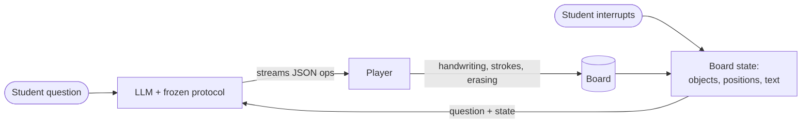
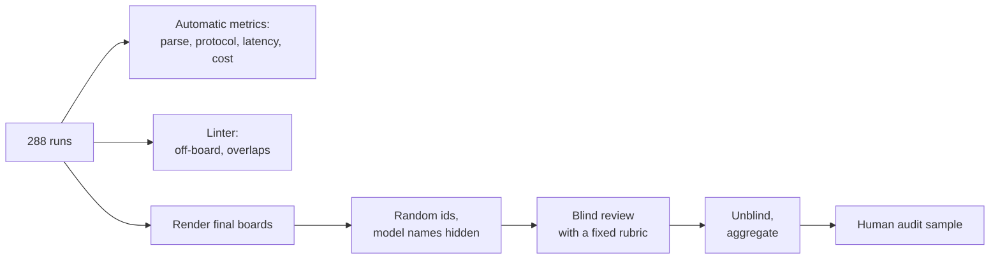

<div align="center">

# Whiteboard AI Tutor

**An open-source AI tutor that teaches on a whiteboard — and a benchmark of which LLM does it best.**

It writes, draws and erases while it explains, and the student can interrupt.<br>
One frozen prompt. Six models. 288 lessons drawn stroke by stroke. Blind-reviewed.

[English](README.md) · [简体中文](README.zh-CN.md)

**[▶ Live gallery: replay every lesson in your browser](https://molly554.github.io/whiteboard-ai-tutor/)**


<sub>Gemini 4 Argon proving the Pythagorean theorem. The model only wrote JSON; the player turned it into handwriting. Played at 3× speed.</sub>

</div>

## What is this?

An AI tutor (or AI teacher) that writes, draws and erases on a whiteboard while it talks — and lets the student cut
in — looks like a model capability. It isn't. It is a small protocol: the model streams drawing instructions as JSON,
a browser plays them as handwriting, and when the student interrupts, the app sends the board back to the model.

So any LLM can be the tutor. This repository is two things:

- **A reference implementation** of that loop: the protocol, a whiteboard player, and a runner for Claude, Gemini and
  DeepSeek.
- **A benchmark** of how well they teach: same prompt, same eight scenarios (science, maths, economics), six models,
  two thinking settings, three repeats. Every board is in this repo, and you can replay each one.

It is not a hosted tutoring app. The player replays recorded lessons; to generate new ones, run the benchmark runner
with your own API key.

## Leaderboard

<picture>
  <source media="(prefers-color-scheme: dark)" srcset="docs/assets/leaderboard-dark.svg">
  
</picture>

| Model | Blind review: boards passed | Strict | First stroke (lesson, p50) | Cost per lesson | Main weakness |
|---|---|---|---|---|---|
| Gemini 4 Argon | **11 / 11** | 11 | 8.0 s | $0.0277 | slowest to start; price doubles on 2026-12-01 |
| Claude Haiku 5.5 | 9 / 11 | 9 | 12.9 s | $0.0019 | thinks even on the low setting, so it starts late |
| Gemini 3.8 Flash | 8 / 11 | 8 | 3.4 s | $0.0080 | marks points off the curves, mislabels positions |
| Claude Sonnet 5.5 | 7 / 11 | 5 | **2.8 s** | $0.0158 | cleanest layout, but the figure often contradicts the text |
| DeepSeek V4 Pro | 5 / 10 | 4 | 3.8 s | $0.0064 | overprinted text, covered diagrams (thinking off) |
| DeepSeek V4.1 Flash | 4 / 10 | 4 | 2.5 s | $0.0017 | 7 of 24 calls drew a blank board (thinking off) |

Latency and cost are for the low-thinking setting. "Strict" also fails boards where a marked point sits 20–35 px off
the true intersection. Eleven boards per model is a small sample: the gap between the top and the bottom is clear, the
order in the middle is not. See [Limitations](#limitations).

## Same question, six models

*"Why does the Pythagorean theorem work?"* — low-thinking setting, one board per model, exactly as drawn.

<table>
<tr>
<td width="33%"><br><sub><b>Gemini 4 Argon</b> · pass · two arrangements, exact geometry</sub></td>
<td width="33%"><br><sub><b>Gemini 3.8 Flash</b> · pass · same proof, one misplaced highlight box</sub></td>
<td width="33%"><br><sub><b>Claude Haiku 5.5</b> · pass · algebraic version</sub></td>
</tr>
<tr>
<td><br><sub><b>Claude Sonnet 5.5</b> · pass · wrote the algebra, then erased it</sub></td>
<td><br><sub><b>DeepSeek V4 Pro</b> · fail · the c² square is not on the hypotenuse and has the wrong size</sub></td>
<td><br><sub><b>DeepSeek V4.1 Flash</b> · fail · no actual argument on the board</sub></td>
</tr>
</table>

All 64 reviewed boards, with verdicts and notes, are in the
[live gallery](https://molly554.github.io/whiteboard-ai-tutor/); click a board to watch it being written.

## What we found

1. **The words are right; the pictures are wrong.** Of the 20 boards that failed, 12 failed because the figure
   contradicted the text: a season label on the wrong Earth, an equilibrium point drawn beside the intersection instead
   of on it. Written statements were almost never wrong.
2. **There is no single winner.** Gemini 4 Argon drew the most accurate boards (11 / 11). Claude Sonnet 5.5 started
   drawing first (2.8 s) and had the cleanest layout. Claude Haiku 5.5 was 8–15× cheaper than either and still
   passed 9 / 11.
3. **A cheap, fast model with thinking off can simply not follow the protocol.** DeepSeek V4.1 Flash returned
   instructions without the `op` field in 7 of 24 calls. They parse as JSON and draw nothing.
4. **Our linter was a bad judge.** It flagged 41 of the 64 boards for "hard errors"; the blind review passed 26 of
   those. It punishes rich diagrams (labels near lines) and cannot see the main failure, a figure that disagrees with
   its own caption.
5. **More thinking mostly bought waiting.** With thinking on, the first stroke took 30–120 s on Gemini 3.8 Flash and
   both DeepSeek models, and 23 calls ran into the 8,000-token output cap before finishing the board.
6. **Interruptions are handled, but messily.** All 24 interruption boards answered the student. Eleven of them wrote
   over the existing drawing or wiped the board to start again.

<table>
<tr>
<td width="33%"><br><sub><b>Labels swapped.</b> The Earth leaning toward the Sun is labelled "North: winter". (Claude Sonnet 5.5)</sub></td>
<td width="33%"><br><sub><b>Point off the crossing.</b> E₂ sits on the supply line, above where D₂ meets S, so P₂ and Q₂ are read wrong. (Gemini 3.8 Flash)</sub></td>
<td width="33%"><br><sub><b>Overprint.</b> Every step title written on the same spot. (DeepSeek V4 Pro)</sub></td>
</tr>
</table>

## How it works



The model never touches a canvas. It emits steps, each with a line of narration and a list of operations:

```json
{ "title": "The tilt", "say": "Earth's axis is tilted 23.5 degrees and keeps pointing the same way.",
  "ops": [
    { "op": "erase",   "ids": ["guess", "check"] },
    { "op": "write",   "id": "key", "x": 60, "y": 128, "text": "Real reason: the axis is tilted 23.5°", "size": 36, "color": "blue" },
    { "op": "ellipse", "id": "earth1", "cx": 280, "cy": 600, "rx": 34, "ry": 34, "color": "blue", "fill": "blue" },
    { "op": "line",    "id": "axis1", "x1": 255, "y1": 657, "x2": 305, "y2": 543 } ] }
```

Six operations (`write`, `line`, `rect`, `ellipse`, `path`, `erase`) on a 1600 × 900 board. The full prompt is
[`protocol/PROTOCOL.md`](protocol/PROTOCOL.md) (the tested prompt, in Chinese) with an
[English translation](protocol/PROTOCOL.en.md). Because the first operation is usable as soon as it arrives, the
student sees the first stroke after two to four seconds on the fastest models, long before the lesson has finished
generating.

### Interruptions

<div align="center">

</div>

When the student cuts in, the app stops the stream and sends the model the question together with what is on the
board (every object's id, type, bounding box and text). The model replies with new steps only; it may erase or
annotate existing objects by id.

## How it was evaluated



- **Sample.** One board per model and scenario at low thinking (48), plus three scenarios at medium thinking (16).
  Of the three repeats, the one with the median linter score was taken, not the best one.
- **Blind.** Boards were rendered to images under random ids. Scores were written to disk before the id mapping was
  opened ([`bench/blind_view.py`](bench/blind_view.py) never prints a model name).
- **Rubric.** No scientific or mathematical error; the figure agrees with the text; layout 0–2; the lesson is
  complete. Interruptions add: the question is answered; the existing board is not overwritten or wiped.
  Pass = no error, figure agrees, layout ≥ 1.
- **Reviewer.** Claude Fable 5.2, which was not one of the tested models. It checked geometry from pixel positions
  (is the dot on the intersection? which way does the axis lean?).
- **Human audit.** `audit.html` lists 18 boards (every low-confidence or borderline call plus a random pass and fail
  per model) for a human to confirm or overturn. **This audit has not been done yet.**

Details and the exact reproduction steps are in [`docs/METHOD.md`](docs/METHOD.md). The full write-up is
[`docs/REPORT.md`](docs/REPORT.md) ([中文](docs/REPORT.zh-CN.md)).

## Quickstart

Look at the results in the [live gallery](https://molly554.github.io/whiteboard-ai-tutor/), or locally (no keys, no
dependencies):

```bash
git clone https://github.com/molly554/whiteboard-ai-tutor.git
cd whiteboard-ai-tutor
python serve.py            # then open http://localhost:8811/
```

The gallery opens; click any board to watch it being written. `player/` also plays the eight scenarios and shows the
linter output.

Run a model yourself:

```bash
pip install -r requirements.txt
# one key covers Claude and Gemini via OpenRouter; DeepSeek uses its own key
export OPENROUTER_API_KEY=...        # Windows: powershell -File bench/set_key.ps1 -Name OPENROUTER_API_KEY
export DEEPSEEK_API_KEY=...

python bench/run.py preflight --via openrouter                     # free: checks keys, model ids, pinned providers
python bench/run.py smoke --via openrouter --models sonnet-5.5     # 4 calls, a few cents
python bench/run.py main --confirm --via openrouter                # the full matrix, about $4
python bench/aggregate.py                                          # tables in results/summary.md
```

The runner pins every OpenRouter model to its first-party provider and disables fallback, stops at a per-model and
a total budget cap, and appends each call to `results/runs/*.jsonl` so an interrupted run can be resumed.
`bench/mock_server.py` imitates the three APIs locally if you want to test the runner for free.

## Repository layout

```
protocol/      the frozen prompt (tested version in Chinese, plus an English translation)
scenarios/     8 scenarios: 5 lessons, 3 interruptions with their fixed prior board and board state
player/        the whiteboard player, the linter and the frame-capture tool (one HTML file, no build step)
bench/         runner, provider adapters, aggregation, blind-review helpers, chart and animation builders
results/
  runs/        every API call: timings, token usage, cost, raw output
  scripts/     the 263 outputs that parsed, ready to replay
  lint/        linter output per run
  review/      64 rendered boards, the blind scores, the id mapping, per-board notes
docs/          report, method, chart and animation assets
index.html     gallery of all reviewed boards (also the GitHub Pages entry point)
audit.html     the human-audit sheet
```

## Limitations

- **Small review sample.** Eleven boards per model. 9 / 11, 8 / 11 and 7 / 11 are not distinguishable.
- **An LLM did the review, and no human has audited it yet.** The reviewer shares a vendor with two of the tested
  models (the results did not favour them, but that is not proof of independence).
- **Final boards only.** The review looked at each finished board, plus the state before the largest erase on six
  boards. Intermediate states and animation pacing were not reviewed.
- **One prompt.** The protocol is frozen at one wording, written in Chinese. Another wording could reorder the models.
- **Eight scenarios, three repeats.** Middle-school science, maths and economics; nothing about real student
  questions at scale.
- **Latency was measured from one desktop**, and Claude and Gemini went through OpenRouter, which adds a hop. Compare
  models with each other, not with your own production numbers.
- **The medium-thinking results are capped.** 23 calls hit the 8,000-token limit, so parse rates there measure
  truncation, not ability.
- **Handwriting depends on your system font.** The player uses Ink Free, which ships with Windows. Elsewhere it falls
  back to a generic cursive font, so a replay can look different from the reviewed board images, which were rendered
  on Windows.
- **Prices move.** Costs are list prices on 2026-11-11.

## Ideas worth testing next

- Higher-level operations (`mark_intersection(a, b)`, `label(id, text)`) so that code, not the model, computes
  positions. This targets the most common failure directly.
- A second pass that shows the model a screenshot of its own board.
- A vision-model judge compared against human verdicts, to replace the linter as a gate.
- Speech for the narration, and true mid-stroke interruption.

## Acknowledgements

Inspired by the whiteboard-tutor demos people built when Claude Fable 5.2 was released, such as
[Tyler Nishida's chalkboard tutor](https://runtimewire.com/article/fable-52-chalkboard-lesson-tyler-nishida).
Whiteboard AI Tutor is an independent project and is not affiliated with any model vendor.

## License

[MIT](LICENSE). Model outputs in `results/` are included for research and comparison.
