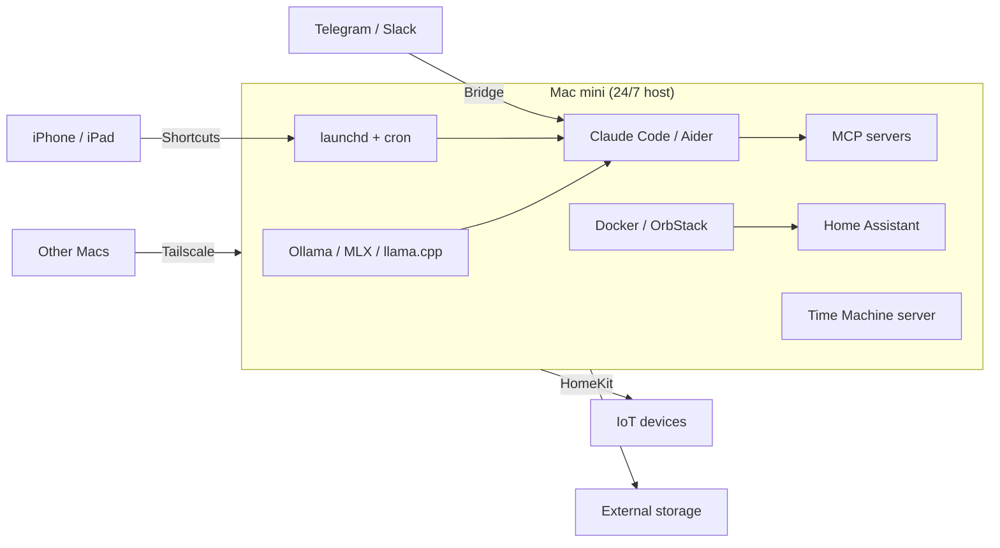

<p align="center">
  
</p>

<h1 align="center">Awesome Mac mini Home Server</h1>

<p align="center">
  <a href="https://awesome.re"></a>
  <a href="https://github.com/momenbasel/awesome-mac-mini-homeserver"></a>
  <a href="https://github.com/momenbasel/awesome-mac-mini-homeserver/network/members"></a>
  <a href="LICENSE"></a>
  <a href="CONTRIBUTING.md"></a>
  <a href="https://momenbasel.github.io/awesome-mac-mini-homeserver/"></a>
</p>

<p align="center"><strong>A curated list of tools, guides, and projects for running an Apple Silicon Mac mini as a 24/7 home server, with agentic AI as the headline focus.</strong></p>

<p align="center">
  <a href="https://twitter.com/intent/tweet?url=https%3A%2F%2Fgithub.com%2Fmomenbasel%2Fawesome-mac-mini-homeserver&text=Turn%20your%20Mac%20mini%20into%20a%2024%2F7%20agentic%20AI%20home%20server.%20400%2B%20curated%20tools%2C%20one-command%20installer.&hashtags=MacMini%2CSelfHosted%2CLocalLLM%2CAgenticAI">
    
  </a>
  <a href="https://www.linkedin.com/sharing/share-offsite/?url=https%3A%2F%2Fgithub.com%2Fmomenbasel%2Fawesome-mac-mini-homeserver">
    
  </a>
  <a href="https://www.reddit.com/submit?url=https%3A%2F%2Fgithub.com%2Fmomenbasel%2Fawesome-mac-mini-homeserver&title=Awesome%20Mac%20mini%20Home%20Server%20-%20400%2B%20curated%20tools%20for%20agentic%20AI%20on%20Apple%20Silicon">
    
  </a>
  <a href="https://news.ycombinator.com/submitlink?u=https%3A%2F%2Fgithub.com%2Fmomenbasel%2Fawesome-mac-mini-homeserver&t=Awesome%20Mac%20mini%20Home%20Server">
    
  </a>
  <a href="https://github.com/momenbasel/awesome-mac-mini-homeserver/discussions">
    
  </a>
</p>

<p align="center">
  <em>If this list saves you time, please <a href="https://github.com/momenbasel/awesome-mac-mini-homeserver">star the repo</a> - it genuinely helps other Mac mini owners discover it.</em>
</p>

## What is this, in plain English?

You buy a Mac mini. You stick it in a closet. It quietly runs, forever, doing useful things for you:

- **Your personal AI.** It runs ChatGPT-style assistants locally, so your prompts never leave your home.
- **Your photo library.** Like iCloud, but you own it.
- **Your password vault.** Like 1Password, but you own it.
- **Your media server.** Like Netflix, with your own shows.
- **Your smart home brain.** Home Assistant, HomeKit, Matter - all in one place.
- **Your personal automation.** Tell it "every morning at 8am, read my emails and summarize them" - it does that.

This list is the map. It tells you **which tools are good**, **what they do**, and gives you a **one-command installer** to get started.

If a tag like `[D]` confuses you, check the [Legend](#legend). If you just want to get going, jump to [Quick Start](#quick-start).

<div align="center">

**[Agentic AI](#agentic-ai)**  ·  **[Self-Hosted Apps](#self-hosted-apps)**  ·  **[Media Servers](#media-servers)**  ·  **[Smart Home](#smart-home)**  ·  **[Quick Start](#quick-start)**

[](LICENSE)
[](CONTRIBUTING.md)
[](https://github.com/momenbasel/awesome-mac-mini-homeserver/actions/workflows/lint.yml)
[](https://github.com/momenbasel/awesome-mac-mini-homeserver/commits/main)

</div>

---

## Why a Mac mini?

Apple Silicon Mac mini is the highest performance-per-watt home server you can buy. Unified memory, Metal and ANE acceleration, silent fans, and native macOS daemons make it the ideal always-on host for local agents, self-hosted services, and home automation.

| Metric | Mac mini M4 | Typical x86 SFF |
|---|---|---|
| Idle power | 4-7 W | 15-35 W |
| Peak power | 65 W | 120-200 W |
| Unified memory ceiling | 64 GB | 64-128 GB (discrete, slow GPU path) |
| LLM inference (70B Q4) | Runs on 64 GB tier | Needs dedicated GPU |
| Fan noise at idle | Inaudible | Audible |
| Form factor | 5 x 5 x 2 in | Typically 8+ in |
| Built-in server daemons | SMB, AFP, HomeKit, Time Machine, AirPlay | None |

---

## Architecture at a glance



---

## Quick Start

Install a curated stack with the included CLI. Pick Agentic AI, Media Server, or Self-Hosted Productivity:

```bash
curl -fsSL https://raw.githubusercontent.com/momenbasel/awesome-mac-mini-homeserver/main/install.sh -o install.sh
chmod +x install.sh
./install.sh
```

Review [`install.sh`](install.sh) before running. Idempotent: safe to re-run. See [docs/agentic-quickstart.md](docs/agentic-quickstart.md) for the opinionated agentic build.

### See it in action

<p align="center">
  
  <br><em>Pick a stack. One command. Idempotent.</em>
</p>

<p align="center">
  
  <br><em>Running <code>./install.sh agentic</code> - brew + pipx + ollama pull + docker compose, all handled.</em>
</p>

<p align="center">
  
  <br><em>Done - your agents are live at these URLs.</em>
</p>

Non-interactive: `./install.sh agentic` / `media` / `selfhosted` / `all`.

### Time Machine server for the whole household

Turn the mini's external drive into a shared Time Machine destination every Mac on the LAN can back up to:

```bash
sudo ./scripts/time-machine-server.sh /Volumes/YourExternalDrive
```

One command. APFS/HFS+ aware. SMB + Bonjour discovery. Optional per-Mac quota via `QUOTA_GB=500`.

### Stack components at a glance

**Agentic AI**


**Media Server**


**Self-Hosted Apps**


---

## Legend

Each entry carries one or more badges so you can see at a glance what it runs on and how it ships.

| Badge | Meaning |
|---|---|
|  | Runs only on Apple Silicon (M1/M2/M3/M4). Not compatible with Intel Macs. |
|  | Intel Mac only. |
|  | Universal binary - works on both Apple Silicon and Intel. |
|  | Ships as a native macOS app or CLI (Homebrew, `.app`, or signed binary). |
|  | Runs in a Docker container (use OrbStack, Colima, or Docker Desktop). |
|  | Paid or freemium - free tier may exist but full use often needs a license. |

---

## Contents

- [Agentic AI](#agentic-ai)
  - [Apple Silicon optimized (MLX / CoreML / ANE)](#apple-silicon-optimized-mlx--coreml--ane)
  - [Local LLM runtimes](#local-llm-runtimes)
  - [Agentic frameworks](#agentic-frameworks)
  - [Coding agents and AI IDEs](#coding-agents-and-ai-ides)
  - [Agent sandboxes](#agent-sandboxes)
  - [MCP servers](#mcp-servers)
  - [Agent gateways and LLMOps](#agent-gateways-and-llmops)
  - [Tool and integration platforms](#tool-and-integration-platforms)
  - [Document ingestion](#document-ingestion)
  - [Agent memory and RAG](#agent-memory-and-rag)
  - [Vector databases](#vector-databases)
  - [Browser and computer-use agents](#browser-and-computer-use-agents)
  - [Voice and multimodal agents](#voice-and-multimodal-agents)
  - [Agent UIs](#agent-uis)
  - [Orchestration and eventing](#orchestration-and-eventing)
  - [Observability](#observability)
  - [Image and video agents](#image-and-video-agents)
  - [Agent bridges](#agent-bridges)
- [Hardware](#hardware)
- [OS and base setup](#os-and-base-setup)
- [Remote access](#remote-access)
- [Containers and virtualization](#containers-and-virtualization)
- [Media servers](#media-servers)
- [Storage and NAS](#storage-and-nas)
- [Self-hosted apps](#self-hosted-apps)
- [Smart home](#smart-home)
- [Ad blocking and DNS](#ad-blocking-and-dns)
- [Reverse proxy and TLS](#reverse-proxy-and-tls)
- [Monitoring and observability](#monitoring-and-observability)
- [Automation and scheduling](#automation-and-scheduling)
- [Development environments](#development-environments)
- [Backup](#backup)
- [Security](#security)
- [Audio and AirPlay](#audio-and-airplay)
- [Game streaming](#game-streaming)
- [Torrents, Usenet, and archiving](#torrents-usenet-and-archiving)
- [Photo and video](#photo-and-video)
- [Databases](#databases)
- [Dashboards](#dashboards)
- [Power and thermals](#power-and-thermals)
- [Bootstrap and dotfiles](#bootstrap-and-dotfiles)
- [CI/CD and build farms](#cicd-and-build-farms)
- [Networking](#networking)
- [Sleep, wake, and persistence](#sleep-wake-and-persistence)
- [CLI power tools](#cli-power-tools)
- [File transfer](#file-transfer)
- [Reference lists](#reference-lists)
- [Contributing](#contributing)

---

## Agentic AI 
Mac mini is the ideal 24/7 host for local agents. Unified memory runs large models natively. Metal accelerates inference. `launchd` turns any script into an always-on worker. See [docs/ram-sizing-llm.md](docs/ram-sizing-llm.md) for model sizing per memory tier.

### Apple Silicon optimized (MLX / CoreML / ANE)

Tools that exploit the Mac mini's unique hardware - Neural Engine, Metal Performance Shaders, and unified memory - for the fastest or lowest-power inference possible.

- [CoreML Tools](https://github.com/apple/coremltools) - Convert PyTorch, TensorFlow, and ONNX models to CoreML for ANE and Metal execution.   
- [DiffusionKit](https://github.com/argmaxinc/DiffusionKit) - Argmax's on-device Stable Diffusion with MLX and CoreML.   
- [exo](https://github.com/exo-explore/exo) - Run a unified LLM cluster across multiple Apple devices at home.   
- [FastMLX](https://github.com/Blaizzy/fastmlx) - OpenAI-compatible high-performance server for MLX models.   
- [llamafile](https://github.com/Mozilla-Ocho/llamafile) - Single-binary LLM distribution with Apple Silicon acceleration.   
- [ml-ane-transformers](https://github.com/apple/ml-ane-transformers) - Apple's reference transformer implementation optimized for the Neural Engine.   
- [MLX](https://github.com/ml-explore/mlx) - Apple's array framework for Apple Silicon unified memory.   
- [MLX-Audio](https://github.com/Blaizzy/mlx-audio) - TTS, STT, and speech-to-speech for MLX.   
- [MLX-LM](https://github.com/ml-explore/mlx-lm) - Run Llama, Mistral, Qwen, Phi via MLX with 4 and 8-bit quantization.   
- [mlx-vlm](https://github.com/Blaizzy/mlx-vlm) - Vision-language models on MLX (LLaVA, Qwen-VL, Pixtral).   
- [mlx-whisper](https://pypi.org/project/mlx-whisper/) - OpenAI Whisper ported to MLX for Apple Silicon native speed.  
- [swift-transformers](https://github.com/huggingface/swift-transformers) - Hugging Face Swift library for CoreML model inference.   
- [WhisperKit](https://github.com/argmaxinc/WhisperKit) - Argmax's CoreML-optimized Whisper with ANE acceleration.   

### Local LLM runtimes

- [GPUStack](https://github.com/gpustack/gpustack) - GPU cluster manager that auto-configures vLLM and SGLang workers across heterogeneous nodes.    
- [Jan](https://jan.ai) - Offline local AI chat with a polished native UI.  
- [llama-swap](https://github.com/mostlygeek/llama-swap) - Go proxy that hot-swaps llama.cpp or any OpenAI-compatible backend on demand.   
- [llama.cpp](https://github.com/ggerganov/llama.cpp) - C/C++ inference engine with first-class Metal backend.   
- [LM Studio](https://lmstudio.ai) - GUI for GGUF models with an OpenAI-compatible headless server.  
- [LocalAI](https://github.com/mudler/LocalAI) - OpenAI-compatible drop-in API for local models.  
- [Ollama](https://ollama.com) - One-command local LLM server, Metal-accelerated by default.  
- [SGLang](https://github.com/sgl-project/sglang) - High-performance serving framework with structured-output and radix-cache scheduling.   
- [vLLM](https://github.com/vllm-project/vllm) - High-throughput inference server, runs via Docker on Apple Silicon.  

### Agentic frameworks

- [AgentScope](https://github.com/modelscope/agentscope) - Production-oriented multi-agent framework from Alibaba with built-in tool, memory, and voice abstractions.   
- [Agno](https://github.com/agno-agi/agno) - Python runtime and AgentOS control plane for building, deploying, and operating agentic systems at scale.    
- [Aider](https://aider.chat) - Terminal-native AI pair programmer with git-aware edits.  
- [AutoGen](https://github.com/microsoft/autogen) - Multi-agent conversation framework from Microsoft.  
- [Claude Code](https://docs.claude.com/en/docs/claude-code) - Anthropic's terminal coding agent, scriptable via stdin and launchd.  
- [Cline](https://cline.bot) - Autonomous coding agent for VS Code. 
- [Continue](https://continue.dev) - Open-source AI code assistant for IDEs. 
- [CrewAI](https://www.crewai.com) - Role-based multi-agent orchestration framework. 
- [DSPy](https://github.com/stanfordnlp/dspy) - Stanford framework for programming (not prompting) LMs via compiled modules and optimizers.   
- [Fabric](https://github.com/danielmiessler/fabric) - Go CLI that applies reusable AI patterns to stdin for summarization, code review, and research.   
- [Goose](https://block.github.io/goose/) - Open-source on-machine AI agent by Block.  
- [Inngest AgentKit](https://github.com/inngest/agent-kit) - TypeScript toolkit for building multi-agent networks on Inngest's durable runtime.   
- [LangGraph](https://github.com/langchain-ai/langgraph) - Stateful multi-actor agent graphs.  
- [Mastra](https://github.com/mastra-ai/mastra) - TypeScript agent framework with workflows, RAG, and evals for shipping production agents.   
- [mcp-agent](https://github.com/lastmile-ai/mcp-agent) - Python framework for composing agents purely out of MCP servers.   
- [Microsoft Agent Framework](https://github.com/microsoft/agent-framework) - Enterprise successor to AutoGen with Python and .NET SDKs for multi-agent workflows.   
- [Open Interpreter](https://www.openinterpreter.com) - Natural language interface that executes code locally.  
- [OpenAI Agents SDK](https://github.com/openai/openai-agents-python) - Lightweight multi-agent orchestration SDK that succeeds Swarm, works with any OpenAI-compatible provider.   
- [OpenClaw](https://github.com/openclaw/openclaw) - Open-source always-on personal AI assistant controllable via WhatsApp, Telegram, Discord, and Slack with persistent memory and 50+ integrations.   
- [OpenHands](https://github.com/All-Hands-AI/OpenHands) - Autonomous software engineer agent platform.  
- [Pydantic AI](https://github.com/pydantic/pydantic-ai) - Type-safe Python agent framework from the Pydantic team.   
- [smolagents](https://github.com/huggingface/smolagents) - Minimal agent library from Hugging Face.  
- [VoltAgent](https://github.com/VoltAgent/voltagent) - TypeScript agent-engineering framework with optional cloud console for observability.    

### Coding agents and AI IDEs

- [Bolt.diy](https://github.com/stackblitz-labs/bolt.diy) - Community fork of StackBlitz Bolt for full-stack web app generation against any LLM.   
- [Claude Agent SDK](https://github.com/anthropics/claude-agent-sdk-python) - Anthropic SDK for building custom agents on top of Claude Code with hooks and custom tools.   
- [Crush](https://github.com/charmbracelet/crush) - Charm's multi-model terminal coding agent with LSP and MCP support.   
- [Gemini CLI](https://github.com/google-gemini/gemini-cli) - Open-source Google agent that brings Gemini or local models into the terminal with extensible tools.   
- [Kilo Code](https://github.com/Kilo-Org/kilocode) - All-in-one agentic engineering platform available as VS Code extension and CLI.   
- [OpenAI Codex CLI](https://github.com/openai/codex) - Lightweight terminal coding agent from OpenAI, works with local OpenAI-compatible endpoints.   
- [OpenCode](https://github.com/anomalyco/opencode) - Provider-agnostic open-source terminal coding agent with a client/server core you can drive remotely.   
- [Roo Code](https://github.com/RooCodeInc/Roo-Code) - VS Code extension with autonomous architect, code, debug, and custom agent modes.   
- [SWE-agent](https://github.com/SWE-agent/SWE-agent) - Princeton/Stanford framework for LM agents that autonomously fix GitHub issues.    
- [Void](https://github.com/voideditor/void) - Open-source Cursor alternative built on VS Code with agentic editing and any-model support.   
- [Zed](https://github.com/zed-industries/zed) - High-performance native macOS editor with first-class agent panel, MCP, and Metal-accelerated UI.   

### Agent sandboxes

- [Daytona](https://github.com/daytonaio/daytona) - Elastic runtime that spins up isolated dev-container sandboxes for agent code execution.   
- [E2B](https://github.com/e2b-dev/E2B) - Open-source secure cloud sandboxes for running AI-generated code, self-hostable.   

### MCP servers

- [awesome-mcp-servers](https://github.com/punkpeye/awesome-mcp-servers) - Community-curated catalog of MCP servers, the canonical discovery index.  
- [FastMCP](https://github.com/jlowin/fastmcp) - Pythonic framework for building MCP servers and clients with auto-generated schemas.   
- [GitHub MCP Server](https://github.com/github/github-mcp-server) - GitHub's official MCP server for repos, issues, PRs, and Actions.   
- [GitMCP](https://github.com/idosal/git-mcp) - Remote MCP server that grounds assistants in any public GitHub repo's docs and code.   
- [Glama MCP Registry](https://glama.ai/mcp/servers) - Directory of 20k+ MCP servers filterable by language, transport, and category. 
- [MCP Filesystem](https://github.com/modelcontextprotocol/servers/tree/main/src/filesystem) - Official filesystem MCP server.  
- [MCP reference servers](https://github.com/modelcontextprotocol/servers) - Official reference implementations (filesystem, git, fetch, memory, sequential-thinking).   
- [mcp.run](https://www.mcp.run) - Registry and runtime for portable MCP servlets. 
- [Playwright MCP](https://github.com/microsoft/playwright-mcp) - Browser automation for agents via structured accessibility snapshots.   
- [Smithery](https://smithery.ai) - Largest open marketplace of MCP servers with one-command install into MCP clients.  
- [Toolhive](https://github.com/stacklok/toolhive) - Secure MCP server manager.  

### Agent gateways and LLMOps

- [LiteLLM](https://github.com/BerriAI/litellm) - Unified OpenAI-compatible gateway and Python SDK fronting 100+ providers and local engines.    
- [OpenLLM](https://github.com/bentoml/OpenLLM) - BentoML project for serving open-source LLMs behind an OpenAI-compatible API.    
- [Portkey AI Gateway](https://github.com/Portkey-AI/gateway) - High-performance edge gateway that routes to 200+ LLMs with guardrails and fallbacks.    
- [promptfoo](https://github.com/promptfoo/promptfoo) - CLI and library for evaluating and red-teaming LLM apps with side-by-side comparisons.   
- [TensorZero](https://github.com/tensorzero/tensorzero) - Rust-based LLMOps stack unifying gateway, observability, evals, and optimization.    
- [Weave](https://github.com/wandb/weave) - W&B's developer toolkit for tracing, evaluating, and debugging GenAI applications.    

### Tool and integration platforms

- [Composio](https://github.com/ComposioHQ/composio) - SDK providing 1000+ authenticated tool integrations and a sandboxed workbench for any agent framework.    

### Document ingestion

- [Crawl4AI](https://github.com/unclecode/crawl4ai) - Open-source web crawler and scraper that emits LLM-ready Markdown for RAG.    
- [Docling](https://github.com/docling-project/docling) - IBM-led document processor that converts PDFs, DOCX, PPTX, and images into structured layouts.   
- [MarkItDown](https://github.com/microsoft/markitdown) - Microsoft utility that converts arbitrary files to clean Markdown for LLM pipelines.   
- [Scrapling](https://github.com/D4Vinci/Scrapling) - Adaptive Python web scraping framework with stealth, anti-bot bypass, and full-crawl support.   

### Agent memory and RAG

- [Cognee](https://github.com/topoteretes/cognee) - Knowledge engine giving agents persistent memory via combined vector and graph stores.    
- [Graphiti](https://github.com/getzep/graphiti) - Temporal knowledge-graph framework for tracking how facts change over time with provenance.   
- [Kotaemon](https://github.com/Cinnamon/kotaemon) - Open-source document-chat UI with advanced citation and multi-modal retrieval.    
- [LangChain](https://github.com/langchain-ai/langchain) - LLM application framework.  
- [Letta](https://github.com/letta-ai/letta) - Stateful agents with long-term memory, formerly MemGPT.  
- [LlamaIndex](https://github.com/run-llama/llama_index) - Data framework for LLM applications.  
- [Mem0](https://github.com/mem0ai/mem0) - Memory layer for AI agents.  
- [Onyx](https://github.com/onyx-dot-app/onyx) - Self-hostable enterprise chat with agentic RAG, web search, and code execution over your data.   
- [PaperQA](https://github.com/Future-House/paper-qa) - High-accuracy agentic RAG for scientific PDFs with iterative search and in-text citations.   
- [RAGFlow](https://github.com/infiniflow/ragflow) - RAG engine with deep document parsing, intelligent chunking, and grounded citations.   
- [Zep](https://www.getzep.com) - Long-term memory for AI agents.  

### Vector databases

- [Chroma](https://www.trychroma.com) - Open-source embedding database.  
- [LanceDB](https://lancedb.github.io/lancedb/) - Serverless vector database with native Metal support.  
- [pgvector](https://github.com/pgvector/pgvector) - Vector similarity search extension for Postgres.  
- [Qdrant](https://qdrant.tech) - Vector search engine with Docker support on Apple Silicon. 
- [Weaviate](https://weaviate.io) - Open-source vector database with hybrid search. 

### Browser and computer-use agents

- [Anthropic Computer Use](https://docs.claude.com/en/docs/build-with-claude/computer-use) - Claude API for controlling the desktop. 
- [browser-use](https://github.com/browser-use/browser-use) - Make websites accessible for AI agents.  
- [Camoufox](https://github.com/daijro/camoufox) - Stealth Firefox fork for undetected automation.  
- [OmniParser](https://github.com/microsoft/OmniParser) - Screen parsing for GUI agents.  
- [Playwright](https://playwright.dev) - Cross-browser automation library.  
- [Skyvern](https://github.com/Skyvern-AI/skyvern) - Automate browser workflows with LLMs.  
- [Stagehand](https://github.com/browserbase/stagehand) - AI web browsing framework.  

### Voice and multimodal agents

- [Dia](https://github.com/nari-labs/dia) - 1.6B dialogue TTS with speaker control and emotion conditioning for multi-voice scenes.   
- [Kokoro TTS](https://github.com/hexgrad/kokoro) - 82M-parameter open-weight TTS that hits top TTS-Arena quality while running fast on Apple Silicon.   
- [Moshi](https://github.com/kyutai-labs/moshi) - Kyutai's real-time full-duplex speech-text foundation model.   
- [OpenVoice](https://github.com/myshell-ai/OpenVoice) - Instant voice cloning.  
- [Parakeet](https://github.com/NVIDIA/NeMo) - NVIDIA ASR model, convertible to CoreML.  
- [Piper](https://github.com/rhasspy/piper) - Fast neural text-to-speech.   
- [SenseVoice](https://github.com/FunAudioLLM/SenseVoice) - Multilingual speech understanding.  
- [Sesame CSM](https://github.com/SesameAILabs/csm) - Conversational speech model that produces RVQ audio codes from text and audio with a Llama backbone.   
- [Ultravox](https://github.com/fixie-ai/ultravox) - Real-time speech-to-speech LLM.  
- [Whisper.cpp](https://github.com/ggerganov/whisper.cpp) - C/C++ port of Whisper with Metal acceleration.   
- [WhisperX](https://github.com/m-bain/whisperX) - Whisper with speaker diarization.  

### Agent UIs

- [AnythingLLM](https://anythingllm.com) - Full-stack RAG application for any LLM.  
- [Cherry Studio](https://github.com/CherryHQ/cherry-studio) - Cross-platform native desktop client with 300+ preconfigured assistants.   
- [Enchanted](https://github.com/gluonfield/enchanted) - Native macOS UI for Ollama.   
- [LibreChat](https://www.librechat.ai) - Enhanced ChatGPT clone with multi-provider support. 
- [LobeChat](https://github.com/lobehub/lobehub) - Feature-rich self-hosted AI workspace with plugins, knowledge base, and multi-provider support.   
- [Msty](https://msty.app) - Native chat UI for local and remote models.  
- [NextChat](https://github.com/ChatGPTNextWeb/NextChat) - Lightweight cross-platform chat client with plugin and MCP support.   
- [Open WebUI](https://openwebui.com) - Extensible self-hosted AI interface. 
- [SillyTavern](https://github.com/SillyTavern/SillyTavern) - Locally installed unified frontend for many LLM APIs with deep customization.   
- [Vane](https://github.com/ItzCrazyKns/Vane) - Privacy-focused self-hosted answering engine (ex-Perplexica) with web source citations.    

### Orchestration and eventing

- [Activepieces](https://www.activepieces.com) - Open-source Zapier alternative. 
- [Dagu](https://github.com/dagu-org/dagu) - Single-binary DAG-based cron replacement with web UI and YAML workflows.    
- [Dify](https://github.com/langgenius/dify) - Production LLM app platform with visual workflows, RAG pipelines, and an agent builder.  
- [Flowise](https://github.com/FlowiseAI/Flowise) - Drag-and-drop visual builder for agents and LLM flows.    
- [Huginn](https://github.com/huginn/huginn) - Build agents that perform automated tasks.  
- [Kestra](https://github.com/kestra-io/kestra) - Event-driven orchestration platform for scheduled and triggered workflows with 600+ plugins.   
- [Langflow](https://github.com/langflow-ai/langflow) - Visual IDE for composing and deploying agentic workflows as APIs or MCP servers.    
- [n8n](https://n8n.io) - Fair-code workflow automation with LLM nodes. 
- [Temporal](https://temporal.io) - Durable execution workflow engine. 
- [Trigger.dev](https://trigger.dev) - Open-source background job framework. 
- [Windmill](https://www.windmill.dev) - Developer platform for internal tools and workflows. 

### Observability

- [Helicone](https://github.com/Helicone/helicone) - Self-hosted LLM observability.  
- [Langfuse](https://langfuse.com) - Open-source LLM engineering platform. 
- [OpenLLMetry](https://github.com/traceloop/openllmetry) - OpenTelemetry for LLM apps.  
- [Phoenix](https://phoenix.arize.com) - ML observability from Arize.  

### Image and video agents

- [ComfyUI](https://github.com/comfyanonymous/ComfyUI) - Node-based Stable Diffusion UI with Metal support.   
- [Draw Things](https://drawthings.ai) - Apple Silicon native Stable Diffusion app with CLI.  
- [Fooocus](https://github.com/lllyasviel/Fooocus) - Simplified SDXL generation UI.  
- [InvokeAI](https://invoke-ai.github.io/InvokeAI/) - Professional Stable Diffusion platform. 

### Agent bridges

- [claude-code-telegram](https://github.com/RichardAtCT/claude-code-telegram) - Telegram bridge for Claude Code.  
- [matterbridge](https://github.com/42wim/matterbridge) - Bridge between chat protocols.   

---

## Hardware 
Pick the right mini. Unified memory is not upgradeable, choose generously.

| Model | Year | Min RAM | Max RAM | Max storage | Notes |
|---|---|---|---|---|---|
| Mac mini M1 | 2020 | 8 GB | 16 GB | 2 TB | Great bargain, limited for 13B+ models |
| Mac mini M2 / M2 Pro | 2023 | 8 / 16 GB | 24 / 32 GB | 8 TB | Sweet spot for most home servers |
| Mac mini M4 / M4 Pro | 2024 | 16 / 24 GB | 32 / 64 GB | 8 TB | Best for agentic workloads and 70B models |

- [Macs Fan Control](https://crystalidea.com/macs-fan-control) - Monitor and override fan curves.  
- [Network UPS Tools](https://networkupstools.org) - NUT client for safe shutdown with a UPS.  
- [OWC Thunderbolt docks](https://eshop.macsales.com/shop/docks) - Quality hubs for storage and display expansion. 
- [Satechi stands](https://satechi.net) - Aluminum stands with USB-C passthrough. 

See [docs/hardware.md](docs/hardware.md) for detailed picks and sizing.

---

## OS and base setup 
- [Asahi Linux](https://asahilinux.org) - Fedora-based Linux for Apple Silicon if you prefer a Linux server OS (M1/M2 series supported, M3/M4 not yet). 
- [Auto-Login Settings](https://support.apple.com/guide/mac-help/set-your-mac-to-log-in-automatically-mh27627/mac) - Required for headless post-reboot startup.  
- [BetterDisplay](https://github.com/waydabber/BetterDisplay) - Virtual display for headless Apple Silicon Macs.   
- [caffeinate(8)](https://ss64.com/osx/caffeinate.html) - Prevent sleep for a process or timeframe.  
- [defaults(1)](https://ss64.com/osx/defaults.html) - Scriptable access to macOS preferences.  
- [OpenCore Legacy Patcher](https://github.com/dortania/OpenCore-Legacy-Patcher) - Run current macOS on unsupported Intel minis to keep old hardware serving.   
- [sharing(1)](https://ss64.com/osx/sharing.html) - Configure SMB, AFP, and Time Machine shares from CLI.  

---

## Remote access 
- [Blink Shell](https://blink.sh) - Best-in-class SSH/mosh client for iOS and iPadOS. 
- [Cloudflare Tunnel](https://developers.cloudflare.com/cloudflare-one/connections/connect-networks/) - Expose local services without opening ports via `cloudflared`.  
- [mosh](https://mosh.org) - Mobile shell, survives roaming and sleep.  
- [RustDesk](https://github.com/rustdesk/rustdesk) - Open-source remote desktop with an optional self-hosted relay server.    
- [Screens 5](https://apps.apple.com/us/app/screens-5-vnc-remote-desktop/id1663047912) - Polished VNC client for managing the mini from Mac, iPhone, and iPad.   
- [Tailscale](https://tailscale.com) - WireGuard-based mesh VPN with SSH, Funnel, and Serve.  
- [WireGuard](https://www.wireguard.com) - Fast modern VPN, use `wg-quick` via launchd.  
- [wush](https://github.com/coder/wush) - Ad-hoc P2P SSH and rsync over WireGuard using Tailscale DERP without a tailnet.   
- [ZeroTier](https://zerotier.com) - Peer-to-peer virtual LAN that puts the mini and all your devices on one flat network.  

---

## Containers and virtualization 
- [Apple Container](https://github.com/apple/container) - Apple's Swift-native Linux container runtime using lightweight VMs, optimized for Apple Silicon.   
- [Arcane](https://github.com/ofkm/arcane) - Modern Go/Svelte Docker management UI covering images, volumes, networks, and Compose stacks.   
- [CapRover](https://caprover.com) - One-click self-hosted PaaS on Docker Swarm with Nginx and Let's Encrypt. 
- [Cilicon](https://github.com/traderepublic/Cilicon) - Self-hosted ephemeral macOS CI runner that clones APFS VM bundles for GitHub Actions and Buildkite.   
- [Colima](https://github.com/abiosoft/colima) - Container runtimes on Lima, fast Docker replacement.   
- [Coolify](https://coolify.io) - Self-hostable Heroku/Vercel alternative deploying apps and 280+ services over SSH.  
- [Docker Desktop](https://www.docker.com/products/docker-desktop/) - Mainstream Docker on macOS with GUI. 
- [Dockge](https://github.com/louislam/dockge) - Reactive web UI dedicated to managing Docker Compose stacks.  
- [Lima](https://github.com/lima-vm/lima) - Linux VMs with automatic file sharing and port forwarding.   
- [OrbStack](https://orbstack.dev) - Fast, light Docker and Linux VMs for macOS.   
- [Parallels Desktop](https://www.parallels.com/products/desktop/) - Full commercial VM suite with server mode.  
- [Portainer CE](https://www.portainer.io) - Web UI for managing Docker, Compose, Swarm, and Kubernetes containers.  
- [Rancher Desktop](https://rancherdesktop.io) - Kubernetes and container management on the desktop. 
- [Runtipi](https://github.com/runtipi/runtipi) - Personal home-server orchestrator with a one-click app store built on Docker Compose.   
- [Tart](https://github.com/cirruslabs/tart) - Native Apple Silicon VMs for macOS and Linux guests.   
- [UTM](https://mac.getutm.app) - QEMU-based VMs with a native UI.  

---

## Media servers 
- [Audiobookshelf](https://audiobookshelf.org) - Self-hosted audiobook and podcast server with mobile apps. 
- [Channels DVR](https://getchannels.com) - DVR server for live TV.  
- [Emby](https://emby.media) - Media server fork of MediaBrowser.  
- [Ente](https://github.com/ente-io/ente) - End-to-end-encrypted self-hostable photos, auth, and locker.   
- [Jellyfin](https://jellyfin.org) - Free and open source media server.  
- [Jellyseerr](https://seerr.dev) - Unified request and discovery manager for Jellyfin, Plex, and Emby. 
- [Komga](https://www.komga.org) - Self-hosted media server for comics, manga, and eBooks. 
- [Navidrome](https://navidrome.org) - Lightweight Subsonic/OpenSubsonic-compatible self-hosted music streaming.   
- [Plex Media Server](https://www.plex.tv) - The original streaming-first media server.  
- [RomM](https://romm.app) - Self-hosted ROM manager with EmulatorJS and 400+ platforms. 
- [Tautulli](https://www.tautulli.com) - Python monitoring and analytics companion for Plex.   

---

## Storage and NAS 
- [Mountain Duck](https://mountainduck.io) - Mount S3/SFTP/WebDAV volumes in Finder.   
- [OpenZFS on OS X](https://openzfsonosx.org) - ZFS filesystem for external storage pools.  
- [rclone](https://rclone.org) - Rsync for cloud storage, 70+ backends.  
- [Resilio Sync](https://www.resilio.com/individuals/) - P2P file sync without a cloud. 
- [Syncthing](https://syncthing.net) - Continuous file sync across devices.  

---

## Self-hosted apps 
### Productivity and notes

- [Actual Budget](https://actualbudget.org) - Envelope-budgeting personal finance app. 
- [AFFiNE](https://github.com/toeverything/AFFiNE) - Local-first open-source Notion/Miro alternative unifying docs, whiteboards, and databases.    
- [AppFlowy](https://appflowy.com) - Open-source local-first Notion alternative with docs, wikis, tasks, and AI.   
- [BookStack](https://www.bookstackapp.com) - Self-hosted wiki organized into Books, Chapters, and Pages with WYSIWYG editing. 
- [Docmost](https://docmost.com) - Confluence/Notion alternative with MCP support and diagramming.  
- [Firefly III](https://firefly-iii.org) - Self-hosted double-entry personal finance manager with budgets, rules, and API. 
- [HedgeDoc](https://hedgedoc.org) - Real-time collaborative markdown editor, formerly CodiMD. 
- [Huly](https://github.com/hcengineering/platform) - All-in-one Linear, Jira, Slack, and Notion alternative with native arm64 containers.   
- [Khoj](https://github.com/khoj-ai/khoj) - Self-hostable personal AI that answers across your notes, docs, and the web.   
- [Logseq](https://logseq.com) - Privacy-first local-first outliner and knowledge graph for daily notes and backlinks.  
- [Mealie](https://mealie.io) - Recipe manager and meal planner with URL scraping and shopping lists. 
- [Memos](https://usememos.com) - Self-hosted timeline for quick markdown notes, daily logs, and snippets. 
- [NocoDB](https://nocodb.com) - No-code Airtable alternative turning Postgres/MySQL into a spreadsheet UI.  
- [Outline](https://www.getoutline.com) - Team knowledge base with real-time collaboration and AI search.  
- [SilverBullet](https://silverbullet.md) - Programmable browser-based markdown PKM platform with Lua scripting. 
- [ToolJet](https://github.com/ToolJet/ToolJet) - Open-source low-code builder for internal tools and dashboards with 80+ data sources.  
- [Trilium Next](https://github.com/TriliumNext/Notes) - Hierarchical self-hosted knowledge base with scripting, relations, and local-first sync.   
- [Vikunja](https://vikunja.io) - Open-source task manager with list, kanban, Gantt, and table views.  

### Files and documents

- [CryptPad](https://cryptpad.org) - End-to-end-encrypted collaborative office suite (docs, sheets, slides, kanban). 
- [Etherpad](https://etherpad.org) - Real-time collaborative plain-text editor with 290+ plugins.   
- [Filebrowser](https://github.com/filebrowser/filebrowser) - Single-binary web file manager for uploading, editing, and sharing files.    
- [Forgejo](https://forgejo.org) - Community Gitea fork for self-hosted git. 
- [Gitea](https://gitea.io) - Lightweight self-hosted git service. 
- [Gitleaks](https://github.com/gitleaks/gitleaks) - Single-binary secret scanner for git history and working trees.   
- [Immich](https://immich.app) - Google Photos replacement with ML. 
- [Nextcloud](https://nextcloud.com) - Full self-hosted cloud suite. 
- [Paperless-ngx](https://docs.paperless-ngx.com) - Document management with OCR. 
- [Stirling PDF](https://www.stirlingpdf.com) - 60+ PDF tools for merging, signing, converting, and OCR.   
- [Vaultwarden](https://github.com/dani-garcia/vaultwarden) - Lightweight Bitwarden server in Rust.  
- [Zoekt](https://github.com/sourcegraph/zoekt) - Trigram-indexed source code search with symbol-aware ranking.    

### Reading and feeds

- [ArchiveBox](https://archivebox.io) - Self-hosted web archive preserving pages as HTML, PDF, PNG, and WARC. 
- [FreshRSS](https://freshrss.org) - Scalable self-hosted RSS/Atom aggregator with WebSub and mobile sync. 
- [Karakeep](https://karakeep.app) - AI-powered bookmark and read-it-later app. 
- [Miniflux](https://miniflux.app) - Minimalist RSS reader. 
- [Readeck](https://codeberg.org/readeck/readeck) - Single-binary Go read-it-later and bookmark manager with article extraction and full-text search.   
- [Shiori](https://github.com/go-shiori/shiori) - Single-binary Go bookmark manager with content archival and Pocket import.    
- [Wallabag](https://wallabag.org) - Self-hosted read-it-later app for saving, syncing, and reading web articles. 

### Analytics and monitoring

- [changedetection.io](https://changedetection.io) - Website change monitor with CSS/xPath filters and 85+ notification channels.  
- [Medama](https://github.com/medama-io/medama) - Sub-1 KB cookieless analytics tracker delivered as a single Go binary.    
- [Plausible CE](https://plausible.io) - Cookieless, privacy-friendly web analytics.  
- [PostHog](https://posthog.com) - Product analytics, session replay, feature flags, and experiments platform.  
- [Rybbit](https://rybbit.com) - Modern cookieless analytics with session replay, funnels, and web vitals.  
- [Umami](https://umami.is) - Simple, privacy-focused self-hosted web analytics. 
- [Vince](https://github.com/vinceanalytics/vince) - Plausible-style privacy analytics as one dependency-free Go binary with automatic TLS.    

### Mail, comms, and push

- [Apprise](https://github.com/caronc/apprise) - One CLI to push notifications to 100+ services including ntfy, Telegram, Discord, and email.    
- [Conduit](https://conduit.rs) - Simple single-binary Rust Matrix homeserver with embedded RocksDB.   
- [docker-mailserver](https://github.com/docker-mailserver/docker-mailserver) - Production-ready containerized full mail stack.  
- [Gotify](https://gotify.net) - Self-hosted push-notification server with REST API and Android client.   
- [Listmonk](https://github.com/knadh/listmonk) - Single-binary self-hosted newsletter and mailing-list manager backed by Postgres.    
- [ntfy](https://ntfy.sh) - HTTP-based pub/sub push notification service, free public and self-hostable.   
- [Stalwart](https://stalw.art) - All-in-one Rust mail and collaboration server with SMTP, IMAP, JMAP, and CalDAV.   
- [Synapse](https://github.com/element-hq/synapse) - Reference Python implementation of the Matrix homeserver.  

### Network tunnels and zero-trust

- [Headscale](https://github.com/juanfont/headscale) - Self-hosted open-source implementation of the Tailscale coordination server.    
- [NetBird](https://netbird.io) - WireGuard-based zero-trust mesh VPN with SSO and policies.    
- [Pangolin](https://github.com/fosrl/pangolin) - WireGuard-based identity-aware reverse proxy and remote-access platform with RBAC.   
- [zrok](https://zrok.io) - OpenZiti-based peer-to-peer sharing and secure tunneling alternative to ngrok.   

### Privacy front-ends and search

- [Invidious](https://invidious.io) - Privacy-respecting alternative front-end for YouTube with RSS and API. 
- [SearXNG](https://docs.searxng.org) - Privacy-respecting metasearch engine aggregating up to 251 sources. 

---

## Smart home 
- [ESPHome](https://esphome.io) - DIY firmware for ESP-based smart devices. 
- [Frigate](https://frigate.video) - Local AI-driven NVR with real-time object detection and Home Assistant integration. 
- [Home Assistant](https://www.home-assistant.io) - Leading open-source home automation platform. 
- [Homebridge](https://homebridge.io) - Bridge non-HomeKit accessories into Apple Home.  
- [HOOBS](https://hoobs.org) - Homebridge distribution with a web UI.  
- [Matterbridge](https://github.com/Luligu/matterbridge) - Node-based Matter plugin manager that bridges devices into Apple Home, Google, and Alexa.    
- [Node-RED](https://nodered.org) - Flow-based programming for automation.   
- [python-matter-server](https://github.com/home-assistant-libs/python-matter-server) - Reference Matter controller WebSocket server used by Home Assistant.   
- [RuView](https://github.com/ruvnet/RuView) - WiFi DensePose: camera-free human pose, presence, and vital-sign monitoring over commodity WiFi.  
- [Scrypted](https://scrypted.app) - HomeKit Secure Video bridge for existing cameras.   
- [Viseron](https://github.com/roflcoopter/viseron) - Self-hosted local-only NVR with object detection, motion detection, and face recognition.  
- [Z-Wave JS UI](https://github.com/zwave-js/zwave-js-ui) - Z-Wave controller UI.  

---

## Ad blocking and DNS 