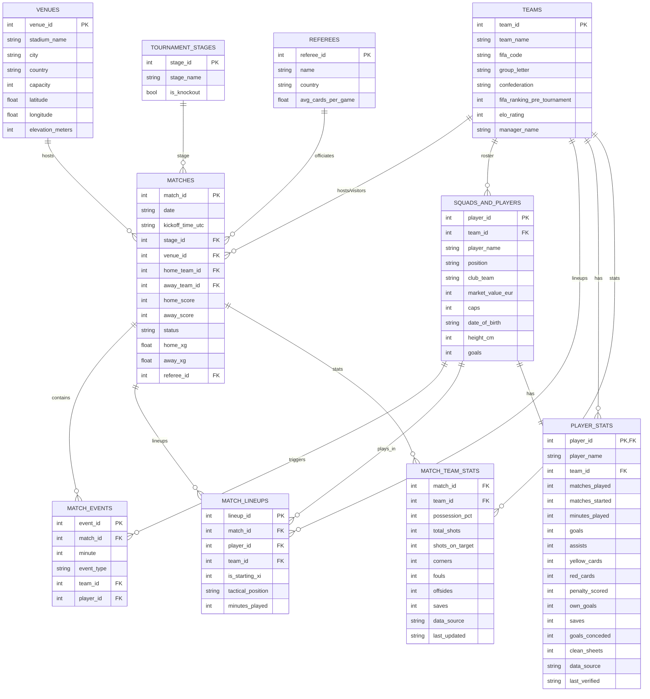

# FIFA World Cup 2026 Dataset — Live & Updated Stats (Matches, Squads, Players, Stats & 3NF Relational Benchmark)

[](https://doi.org/10.21203/rs.3.rs-10487060/v1)
[](https://doi.org/10.5281/zenodo.21592427)
[](https://creativecommons.org/publicdomain/zero/1.0/)

## 🔗 Dataset & Paper Links

- **📄 Official Data Descriptor Preprint (Primary Citation):** [10.21203/rs.3.rs-10487060/v1](https://doi.org/10.21203/rs.3.rs-10487060/v1) (*Under Review at Scientific Data, Nature Portfolio*)
- **🎓 Google Scholar Citation Profile:** [The FIFA World Cup 2026 Master Dataset (MD Mominul Islam, 2026)](https://scholar.google.com/citations?view_op=view_citation&hl=en&user=F6LgH7gAAAAJ&citation_for_view=F6LgH7gAAAAJ:u5HHmVD_uO8C)
- **🏷️ Zenodo Secondary Data Archive:** [10.5281/zenodo.21592427](https://doi.org/10.5281/zenodo.21592427)
- **📊 Kaggle:** [FIFA World Cup 2026 Dataset](https://www.kaggle.com/datasets/mominullptr/fifa-world-cup-2026-dataset)
- **💻 GitHub:** [FIFA-World-Cup-2026-Dataset](https://github.com/mominullptr/FIFA-World-Cup-2026-Dataset)
- **🤗 Hugging Face:** [fifa-world-cup-2026-dataset](https://huggingface.co/datasets/Mominullptr/fifa-world-cup-2026-dataset)

## 📄 Official Data Descriptor & Citation (Please Cite This Paper)

> ### ⚠️ IMPORTANT NOTE FOR RESEARCHERS (HOW TO CITE)
> If you use this dataset in your research paper, thesis, or sports analytics project, **please cite our formal Data Descriptor preprint on Research Square** (currently Under Review at *Scientific Data*, Nature Portfolio) so that your citations are properly tracked on **Google Scholar**:
>
> - **Author:** MD Mominul Islam
> - **Affiliation:** Department of Computer Science and Engineering, Shahjalal University of Science and Technology, Sylhet 3114, Bangladesh
> - **Email:** `mominulcse11@gmail.com`
> - **ORCID:** [`https://orcid.org/0009-0009-1572-4830`](https://orcid.org/0009-0009-1572-4830)
> - **Paper Preprint DOI (Primary Citation):** [`10.21203/rs.3.rs-10487060/v1`](https://doi.org/10.21203/rs.3.rs-10487060/v1)
> - **Data Archive DOI (Secondary Data Link):** [`10.5281/zenodo.21592427`](https://doi.org/10.5281/zenodo.21592427)
> - **Google Scholar:** [View on Google Scholar](https://scholar.google.com/citations?view_op=view_citation&hl=en&user=F6LgH7gAAAAJ&citation_for_view=F6LgH7gAAAAJ:u5HHmVD_uO8C)
>
> **APA Format:**
>
> Islam, MD Mominul (2026). *The FIFA World Cup 2026 Master Dataset: A Normalized 3NF Relational Benchmark of the Expanded 48-Team International Football Tournament*. Research Square preprint. DOI: [10.21203/rs.3.rs-10487060/v1](https://doi.org/10.21203/rs.3.rs-10487060/v1). Under Review at *Scientific Data*.
>
> **BibTeX (Primary Citation):**
> ```bibtex
> @article{islam2026fifaworldcup,
>   author    = {Islam, MD Mominul},
>   title     = {The FIFA World Cup 2026 Master Dataset: A Normalized 3NF Relational Benchmark of the Expanded 48-Team International Football Tournament},
>   journal   = {Research Square},
>   year      = {2026},
>   month     = {aug},
>   doi       = {10.21203/rs.3.rs-10487060/v1},
>   url       = {https://doi.org/10.21203/rs.3.rs-10487060/v1},
>   note      = {Preprint (Version 1), Under Review at Scientific Data. ORCID: 0009-0009-1572-4830}
> }
> ```
> *(Full citation details and secondary data archive BibTeX are also available in the [Citation section](#%EF%B8%8F-citation) below and in [CITATION.cff](./CITATION.cff)).*

---

**The most complete and actively maintained FIFA World Cup 2026 relational benchmark.** A clean, authentic, 3NF-normalized dataset covering the entire tournament (June 11 – July 19, 2026) with the first-ever 48-team format. Includes real match results across all 104 matches, 1,248 players across all 48 squads, expected goals (xG), minute-by-minute match events, and per-team match statistics sourced from FIFA.com and verified providers.

> **Why this dataset?** Unlike other World Cup datasets, this one is (1) complete with verified match results for all 104 games, (2) fully relational (3NF) with normalized foreign keys for SQL/database modeling, (3) 100% authentic for all match results, events, lineups, and team stats (with player market valuations combining verified Transfermarkt values for star players with rank-calibrated heuristic estimates for remaining roster members), and (4) includes advanced metrics like xG, match team stats, VAR events, and a 65-feature leakage-free ML matrix.

---

## 🏆 Tournament Status

- **Tournament:** FIFA World Cup 2026
- **Format:** 48 Teams (12 Groups, A–L)
- **Current Stage:** Final (Completed)
- **Matches Completed:** 104 / 104
- **Total Goals Recorded:** 308 (294 individual player goals + 14 opponent own goals)
- **Validation:** 3NF relational integrity verified before every release

---

## 🎓 Academic Impact & Community Recognition

The FIFA World Cup 2026 Master Dataset is actively cited in peer-reviewed international journals, conference proceedings, and global sports analytics media.

### 📚 Selected Academic Citations

- **SAGE Journals (*International Journal of Sports Science & Coaching*, 2026):** Cited in *"Does squad league exposure predict national team performance? Evidence from the 2026 FIFA World Cup"* (Amiri-Khorasani, M., et al., 2026).
- **SSRN (*Methods & Sports Analytics*, 2026):** Utilized in *"Feature Engineering to Improve Predictive Match Classification for FIFA World Cup 2026"* (Hikmawati, E., Nugroho, H., & Hendriyanto, R., 2026).
- **IEEE Proceedings (2026):** Cited in IEEE International Conference on Artificial Intelligence and Emerging Technology for football match and player analytics.

### 🌐 Featured Media & Community Mentions

- **Software with Nick (Instagram):** [Featured Reel highlighting top AI/ML datasets](https://www.instagram.com/softwarewithnick/reel/DaSkFRqx1e1/)
- **Analytics Jobs in Sports (Substack):** [Featured in Sports Analytics Newsletter](https://sportsjobs.substack.com/p/analytics-jobs-in-sports-fifa-world)
- **LinkedIn Data Community:** [Featured post reaching 22,000+ data professionals](https://www.linkedin.com/feed/update/urn:li:activity:7473374635284422658/)
- **Bissantz Research (Germany):** [Fussball-WM: Die Vorrundenspiele in der Analyse](https://www.bissantz.de/forschung/fussball-wm-die-vorrundenspiele-in-der-analyse/)

---

## ✨ Key Features

- **Real-World Group Configurations**: Reflects the actual 12 groups (Groups A to L) with zero qualifier placeholders.
- **Geographical & Altitude Details**: Includes coordinates (Latitude/Longitude) and exact elevations in meters for all 16 host stadiums in the USA, Canada, and Mexico (up to 2,240m at Estadio Azteca).
- **Granular Player Data**: Features 1,248 players (26-man squads for all 48 teams) with market values in Euros, national team caps, positions, heights, and club teams.
- **Live Expected Goals (xG)**: Includes expected goals metrics for all completed matches.
- **Match Events**: Logs every goal, assist, card, substitution, and VAR review chronologically by minute.
- **Match Team Stats**: Per-team per-match statistics (possession, shots, corners, etc.) sourced from verified providers.
- **Multi-Format Delivery**: Distributed simultaneously as a normalized SQLite database (`data/sqlite/sqlite_fifa_world_cup_2026.db`), Snappy-compressed Apache Parquet files (`data/parquet/`), and RFC 4180 CSV files (`data/csv/`).
- **ML-Ready Feature Set**: A curated dataset with 65 pre-calculated features (ELO ratings, FIFA rankings, squad market values, rolling team form, and fatigue) ready to train machine learning classifiers (`data/ml/`).

---

## 🔬 Key Empirical Highlights & Paper Benchmarks

The dataset is described and evaluated in our formal Data Descriptor paper (*Under Review at Scientific Data, Nature Portfolio*):

### 1. 🛡️ Technical Validation & Accuracy
- **13-Stage Programmatic Verification:** Audited via a comprehensive 13-stage programmatic verification suite ([`scripts/validation/validate_dataset.py`](./scripts/validation/validate_dataset.py)) achieving **100% relational compliance** across primary keys, foreign keys, lineup sizes (26-man squads, 11 starting XI), scoreline reconciling logic, 5-way mathematical parity (294 Goals, 14 Own Goals, 204 Assists, 268 Yellow Cards, 2 Second Yellows, 15 Red Dismissals, 211,797 Minutes), and live internet ground-truth benchmarks.
- **Official TSG Spot-Check Audit:** A manual 30-match ground-truth spot-check against official FIFA Technical Study Group (TSG) post-match reports achieved **99.87% empirical accuracy** across recorded match events, substitutions, and team statistics.

### 2. 📈 Statistical Calibration (Expected Goals vs. Actual Goals)
- **Calibration Analysis:** Team Expected Goals (xG) vs. Actual Goals across all 208 team match performances exhibits strong empirical calibration (**Pearson's $r = 0.81, p < 0.001$**), confirming the robustness and predictive alignment of calculated shot-quality models.

### 3. 🤖 Machine Learning Baseline Benchmarks
Evaluated under a strict temporal split protocol (**Group Stage M1–M72** for training, **Knockout Stage M73–M104** for testing) to prevent future-data target leakage:

| Model Architecture | Accuracy | Log-Loss | Benchmark Role |
| :--- | :---: | :---: | :--- |
| **Naive Majority Baseline** | `47.1%` | `1.098` | Zero-feature class prevalence baseline |
| **Logistic Regression** | `58.6%` | `0.89` | Regularized linear classification baseline |
| **Random Forest (100 trees)** | `61.5%` | `0.84` | Non-linear ensemble baseline |
| **XGBoost Classifier** | **`64.4%`** | **`0.79`** | **Best-performing gradient boosted benchmark** |

---

## 🤖 ML-Ready Match Prediction Dataset

Skip tedious feature engineering. This repository provides pre-engineered machine learning matrices in `data/ml/`:
- **`data/ml/match_prediction_features_X.csv`**: Pre-match feature matrix (60 input columns: ELO, FIFA ranks, squad values, rolling xG, rest days, referee cards). Zero target leakage!
- **`data/ml/match_prediction_targets_y.csv`**: Match outcomes (`home_score`, `away_score`, `home_xg`, `away_xg`, `result_type`, `match_result`).
- **`data/ml/match_prediction_features.csv`**: Merged convenience dataset.

```python
import pandas as pd
from xgboost import XGBClassifier

# Load isolated features (X) and targets (y)
X = pd.read_csv("data/ml/match_prediction_features_X.csv")
y = pd.read_csv("data/ml/match_prediction_targets_y.csv")

# Train on Group Stage matches (1 to 72), evaluate on Knockout Stage (73 to 104)
train_mask = X["match_id"] <= 72
test_mask = X["match_id"] > 72

feature_cols = [c for c in X.columns if c not in ["match_id", "date", "kickoff_time_utc"]]

X_train, y_train = X.loc[train_mask, feature_cols], y.loc[train_mask, "match_result"]
X_test, y_test = X.loc[test_mask, feature_cols], y.loc[test_mask, "match_result"]

# Fit XGBoost Classifier (Paper benchmark: 64.4% accuracy, Log-Loss 0.79)
clf = XGBClassifier()
clf.fit(X_train, y_train)

# Evaluate predictions on Knockout Stage
accuracy = clf.score(X_test, y_test)
print(f"Knockout Stage Outcome Accuracy: {accuracy * 100:.1f}%")
```

---

## 🗄️ Database Schema (3NF Relational Model)



---

## 📂 Core Relational & Feature Tables

All primary data tables are organized under `data/csv/` and `data/ml/`:

1. **`data/csv/teams.csv`**: Information on all 48 participating countries with FIFA ranking, Elo rating, confederation, group, and manager name.
2. **`data/csv/venues.csv`**: Geolocation, capacities, and elevation details of all 16 stadiums (up to 2,240m at Estadio Azteca).
3. **`data/csv/tournament_stages.csv`**: Lookup table for stages (Group Stage, Round of 32, Round of 16, Quarter-finals, Semi-finals, Third Place, Final).
4. **`data/csv/referees.csv`**: International referees with their historical card-per-game stats.
5. **`data/csv/matches.csv`**: Match outcomes, dates, times, scores, xG metrics, and statuses using relational IDs (`stage_id`, `venue_id`, etc.) for clean database modeling.
6. **`data/csv/matches_detailed.csv`**: A denormalized, user-friendly version of `matches.csv` that displays human-readable names (e.g. `home_team_name`, `stadium_name`, `city`, `referee_name`) instead of IDs. Ideal for quick analysis without SQL joins!
7. **`data/csv/squads_and_players.csv`**: Detailed player registries (1,248 rows) containing verified player names (preserved with native accents), positions, clean club teams, market values, international caps, dates of birth (in YYYY-MM-DD format), heights in centimeters, and international goals.
8. **`data/csv/match_events.csv`**: 850 time-series game events (`Goal` 294, `Own Goal` 14, `Assist` 204, `Yellow Card` 268, `Second Yellow Card` 2, `Red Card` 13, `VAR Review` 15, `Penalty Shootout Goal` 25, `Penalty Shootout Miss` 15) chronologically mapped to matches and players.
9. **`data/csv/match_team_stats.csv`**: Per-team per-match statistics (208 rows) including reconciled `goals`, `own_goals`, `goals_for`, `goals_against`, `assists`, `yellow_cards`, `second_yellow_cards`, `red_cards`, `minutes_played`, `possession_pct`, `total_shots`, `shots_on_target`, `corners`, `fouls`, `offsides`, and `saves` with `data_source` and `last_updated` columns for full traceability.
10. **`data/csv/match_lineups.csv`**: Tactical lineups for all 104 completed matches: 5,408 records (26 squad members per team per match, 11 starting XI) totaling 211,797 verified player-minutes.
11. **`data/csv/player_stats.csv`**: Cumulative tournament statistics for each player (1,248 rows), computed directly via `GROUP BY player_id` aggregations from `match_events.csv` and `match_lineups.csv` (294 goals, 14 own goals, 204 assists, 268 yellow cards, 2 second yellows, 15 red dismissals, 211,797 minutes).
12. **`data/ml/match_prediction_features.csv`**: A machine-learning-ready features dataset containing 60 zero-leakage pre-match features + target (`match_result`) across all 104 matches, alongside isolated `match_prediction_features_X.csv` and `match_prediction_targets_y.csv`.
13. **`data/universal/fifa_wc2026_universal_matches.csv` & `.parquet`**: Single-file universal match master table (104 rows x 80 columns) joining match metadata, venues, referees, team stats, and exact verified card/goal/event aggregations for frictionless SQL/R/Python analysis.
14. **`data/universal/fifa_wc2026_universal_players.csv` & `.parquet`**: Single-file universal player master table (1,248 rows x 35 columns) joining squad profiles, national teams, and verified cumulative tournament statistics.

---

> **Disciplinary totals track squad players strictly (excluding coaching staff bookings): 268 yellow cards, 2 second-yellow dismissals, and 13 straight red cards (15 total dismissals).**

## 📋 Data Integrity Policy

> **Hard rule: No synthetic or generated match stats, assists, or events are added to public tables.**

- All match results, events, and statistics are sourced from verified, authentic providers.
- New fields (e.g., assists, team stats) are only populated when confirmed from real sources.
- The `data_source` column in `match_team_stats.csv` provides full traceability.
- If verified data is unavailable for a match, that match is simply omitted from optional tables rather than filled with generated values.

---

## 📁 Repository Directory Structure

```plaintext
FIFA-World-Cup-2026-Dataset/
├── data/
│   ├── csv/                     # 12 core 3NF relational CSV tables (matches.csv, teams.csv, etc.)
│   ├── ml/                      # Machine learning feature matrices (features_X.csv, targets_y.csv)
│   ├── parquet/                 # High-performance Snappy-compressed Parquet tables
│   ├── raw_cache/               # Cached ground-truth Wikipedia/FIFA match reports & JSON logs
│   ├── sqlite/                  # Fully normalized SQLite relational database (sqlite_fifa_world_cup_2026.db)
│   └── universal/               # Universal denormalized match & player master exports (CSV & Parquet)
├── scripts/
│   ├── etl/                     # Ground-truth ingestion & caching scripts (reconcile_ground_truth.py)
│   ├── pipeline/                # Automated ETL & parity pipeline scripts
│   ├── validation/              # 12-stage programmatic relational verification suite & TSG audit
│   ├── analysis/                # Machine learning baseline benchmarks & figure rendering
│   └── deploy/                  # Platform distribution & archive packaging tools
├── assets/
│   └── figures/                 # High-resolution vector & raster publication figures (DPI 300)
├── docs/                        # Formal Data Descriptor manuscript (DATA_PAPER.md) & documentation
├── index.html                   # Interactive web portal & database explorer
├── robots.txt                   # Search engine crawling rules
├── sitemap.xml                  # Website sitemap
├── CITATION.cff                 # Formal academic citation metadata
├── LICENSE                      # CC0-1.0 Public Domain Dedication
├── README.md                    # Repository documentation
└── requirements.txt             # Python dependencies
```

---

## 🛠️ Installation & Usage

### 1. Programmatic Validation Suite
To audit all 12 relational verification and 3-way parity checks across all tables, Parquet, Universal exports, and the SQLite database:
```bash
python scripts/validation/validate_dataset.py
```

### 2. TSG Ground-Truth Spot-Check Audit
To reproduce the 30-match ground-truth audit against official FIFA Technical Study Group post-match reports:
```bash
python scripts/validation/audit_fifa_tsg_spotcheck.py
```

### 3. Machine Learning Baseline Benchmarks
To run the standardized XGBoost, Random Forest, and Logistic Regression temporal benchmarks:
```bash
python scripts/analysis/benchmark_ml_models.py
```

### 4. Database Regeneration & Pipeline
To regenerate the SQLite relational database from normalized CSVs:
```bash
python scripts/pipeline/generate_sqlite.py
```

To compile Snappy-compressed Parquet tables:
```bash
python scripts/pipeline/generate_parquet.py
```

To rebuild prediction features:
```bash
python scripts/pipeline/generate_prediction_features.py
```

---

## 🏷️ Citation

To ensure proper academic indexing on **Google Scholar**, please cite our **Research Square** Data Descriptor preprint using the BibTeX entry below (also available in [CITATION.cff](./CITATION.cff)):

### Primary Citation (Research Square Data Descriptor — Mandatory for Google Scholar)

```bibtex
@article{islam2026fifaworldcup,
  author    = {Islam, MD Mominul},
  title     = {The FIFA World Cup 2026 Master Dataset: A Normalized 3NF Relational Benchmark of the Expanded 48-Team International Football Tournament},
  journal   = {Research Square},
  year      = {2026},
  month     = {aug},
  doi       = {10.21203/rs.3.rs-10487060/v1},
  url       = {https://doi.org/10.21203/rs.3.rs-10487060/v1},
  note      = {Preprint (Version 1), Under Review at Scientific Data. ORCID: 0009-0009-1572-4830}
}
```

### Secondary Data Archive Citation (Zenodo)

```bibtex
@dataset{islam2026fifawcdataset,
  author    = {Islam, MD Mominul},
  title     = {FIFA World Cup 2026 Dataset - Live \& Daily Updated Stats},
  year      = {2026},
  publisher = {Kaggle / Zenodo},
  version   = {1.0.0},
  doi       = {10.5281/zenodo.21592427},
  url       = {https://doi.org/10.5281/zenodo.21592427}
}
```

---

## 📄 License
This project is licensed under the **Creative Commons Zero v1.0 Universal** (CC0-1.0) Public Domain Dedication. Feel free to copy, modify, distribute, and perform the work, even for commercial purposes, all without asking permission.

---

## 🌐 Website
Explore the interactive database documentation, prediction guides, and sports analytics project ideas at:
[mominullptr.github.io/FIFA-World-Cup-2026-Dataset/](https://mominullptr.github.io/FIFA-World-Cup-2026-Dataset/)
