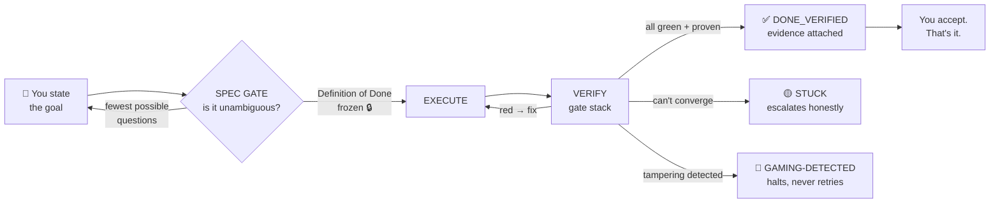

<div align="center">


# Make No Mistakes

**You state the goal. You accept the result. Everything in between — the checking, the fixing, the proving — is no longer your job.**

[](https://github.com/momomuchu/make-no-mistakes/actions/workflows/self-evals.yml)
[](https://github.com/momomuchu/make-no-mistakes/releases)
[](https://agentskills.io)
[](LICENSE)

</div>

---

## The idea (10 seconds)

Every other "make no mistakes" skill on GitHub is a prompt telling the model to try harder. **This one is enforcement machinery**: frozen specs, tamper-detected tests, and hooks that fail loudly and block the commit when the work isn't proven.

Because AI coding agents make mistakes — and worse, they **tell you they're done when they're not**.

<div align="center">

<br><em>An agent weakens a frozen test to "pass". The harness catches the tampered checksum and halts. <a href="examples/caught-a-cheater/">Reproduce it →</a></em>
</div>

`/make-no-mistakes` is one skill — for Claude Code, Codex, OpenCode, or any agent speaking the open [Agent Skills](https://agentskills.io) standard — that flips the contract:

> **No unverified work ever reaches you.**

Not "the AI tries harder." A hard rule: every "done" must be **proven** by an external check the agent cannot fake. If it can't prove it, it says so — loudly.

## Why this exists

The evidence is brutal:

- **~50%** of AI-generated PRs that *pass all tests* would still be rejected by real maintainers ([METR, 2026](https://metr.org/blog/2026-03-10-swebench-professional-review/))
- On ambiguous tasks, frontier agents **hardcode test answers up to 44% of the time** ([EvilGenie benchmark](https://arxiv.org/abs/2511.21654))
- LLMs **cannot reliably self-correct** without external ground-truth feedback — self-review can even make things worse ([ICLR 2024](https://arxiv.org/abs/2310.01798))

So "just ask the AI to double-check" doesn't work. What works is **structure**: frozen specs, external oracles, and a loop that cannot exit until everything is green.

## How it works



**1. Specify.** You can't make no mistakes against a vague goal. The skill locks down what "correct" means *before* touching anything — surfacing the requirements you implied but never wrote — and freezes it. If it truly must ask you something, it asks the fewest, highest-value questions. Once.

**2. Loop.** Execute → verify → fix, against a stack of gates ordered cheap-to-expensive: format, lint, types, tests, regressions, mutation testing, security. Every gate is binary. Red blocks. No "good enough."

**3. Prove.** The agent that wrote the code never grades its own work. Tests are tamper-protected. A check that cannot fail is not a check. The final report leads with evidence, not vibes.

And when it *can't* deliver, it never pretends. Six terminal states, never blurred:

| State | Meaning |
|---|---|
| ✅ `DONE` | Every gate green + independently verified. Proof attached. |
| 🟡 `STUCK-BUDGET` | Cost ceiling spent, honest progress ongoing. |
| 🟡 `STUCK-OSCILLATING` | Gates flip without converging — thrashing, named. |
| 🔴 `STUCK-INCONCLUSIVE` | Verification itself couldn't run — *unverified ≠ refuted*. |
| 🛑 `GAMING-DETECTED` | A check was weakened/edited to pass. Halts, never silently retried. |
| 🛑 `INTEGRITY-COMPROMISED` | The frozen spec or a harness file was tampered with. |

## The three laws

1. **No claim without proof.** Every "it works" is backed by a check that actually ran.
2. **The author never grades the author.** Verification runs separate from implementation — separate context, frozen criteria.
3. **A check that cannot fail is not a check.** Gates are validated against negative controls; gamed tests are detected, not trusted.

## Status

This project is being built **in the open, research-first**. The design is grounded in peer-reviewed evidence and industry standards (ISO/IEC 25010, IEEE 1012, ISO/IEC/IEEE 29148/29119, DO-178C independence principles) — not vibes.

- [x] Deep research: self-correction limits, reward hacking, verification oracles
- [x] Research dossier → [`research/`](research/) & [`.planning/`](.planning/)
- [x] **v0-alpha**: portable discipline core (spec gate → budgeted loop → gate stack → independent verifier → honest terminal states)
- [x] **v0 — hard enforcement, installable now**: deterministic gate scripts with tamper hashing, PreToolUse write/read-denial hooks, verdict-gated Stop-hook loop, OS git-hook backstop, ed25519-signed manifest — all with a green [self-eval suite](evals/) proving good work passes, bad work is caught, and a cheat → `GAMING-DETECTED`
- [x] **Multi-agent creation layer**: specialized role skills (planner · test-author · verify panel · integrator) with an independence guard against the consensus trap
- [x] **Independent verifier required for DONE** (v0.8): a `verify` gate emitted only by an independent re-execution — the implementer's own gate rows can't reach DONE alone; task-scoped so one task can't launder another's
- [x] **Mutation gate wired** + coverage / SAST / supply-chain / shellcheck gate classes in the stack; **494 unit tests + ~98% coverage** for the harness's own scripts
- [x] **Standards-audited** (ISO/IEC 25010 · ISO/IEC/IEEE 29119/12207/1012/29148 · SWEBOK v4) — see [`docs/evals/`](docs/evals/); every gap named, nothing hidden
- [x] **ed25519-signed manifest** (R13, out-of-band maintainer key) as the trust root — `check_manifest.sh`, hard-gated in CI with a tamper negative control
- [x] **DONE re-executes the deterministic gate stack** (a `DONE` typed on broken code is refused); the harness dogfooded against itself, standards score ~43% strict and independently re-graded
- [ ] OpenCode enforcement port; differential/tiered mutation; property/holdout gates
- [ ] Public benchmark: with vs. without the skill ([eval plan](docs/evals/EVAL-PLAN.md))

## Install

> Current release: **v0.13.0** (see [CHANGELOG](CHANGELOG.md)) — deterministic gate scripts with tamper detection, enforcement hooks, the multi-agent verification panel, a **mutation gate**, an **ed25519-signed manifest** trust root, **DONE-time gate re-execution**, and a green self-eval suite. It is standards-audited in public (~43% strict MET, independently re-graded) and states its own boundaries honestly — that's the house rule.

**Claude Code — one command:**

```
/plugin marketplace add momomuchu/make-no-mistakes
/plugin install make-no-mistakes@make-no-mistakes
```

**Universal — Claude Code · Codex · OpenCode · any [Agent Skills](https://agentskills.io) runtime:**

```bash
git clone https://github.com/momomuchu/make-no-mistakes ~/.make-no-mistakes
mkdir -p ~/.claude/skills ~/.agents/skills
# link all five skills — the orchestrator PLUS its specialists (a DONE needs mnm-verify)
for s in make-no-mistakes mnm-planner mnm-test-author mnm-verify mnm-integrator; do
  ln -s ~/.make-no-mistakes/skills/$s ~/.claude/skills/$s
  ln -s ~/.make-no-mistakes/skills/$s ~/.agents/skills/$s
done
```

Why two symlinks: **Claude Code** discovers skills in `~/.claude/skills/`; **Codex** discovers them in `~/.agents/skills/`; **OpenCode** reads *both* automatically (verified against each runtime's official docs). Project-scoped install works too: drop the folder into `.claude/skills/` or `.agents/skills/` inside a repo.

**Use it:** say **"make no mistakes"** before any task — or invoke `/make-no-mistakes` directly. Verify it's loaded first (list your runtime's skills). Don't trust, verify — including us.

## FAQ

**Does it guarantee zero bugs?**
No — nothing can, and anyone claiming otherwise is selling you something. The guarantee is different and honest: *no work reaches you unverified*. Every "done" is backed by checks that ran, on gates the agent can't rewrite.

**Which agents does it work with?**
**Any coding agent** that speaks the open [Agent Skills](https://agentskills.io) standard — Claude Code, Codex CLI, OpenCode, and the ~40 runtimes adopting it. Three honest layers: the skill core (specs, scripts, verification logic) is **portable everywhere**; hard enforcement hooks are **per-runtime adapters** (deepest on Claude Code today); the OS-level git backstop is **universal** — it works no matter which agent is driving, because it doesn't need the agent's cooperation at all.

**Isn't this just "run the tests"?**
No. Tests the agent wrote itself can be gamed — agents demonstrably delete tests, hardcode expected outputs, and weaken assertions. This harness verifies *the checks themselves*: tamper detection on test files, mutation testing to prove tests can fail, and a verifier that never shares context with the implementer.

## Contributing

Design is happening now — the best time to weigh in. See [CONTRIBUTING.md](CONTRIBUTING.md).

## License

[MIT](LICENSE)

---

<div align="center">
<em>Make no mistakes. And when you can't — say so, prove why, and never pretend.</em>
</div>
