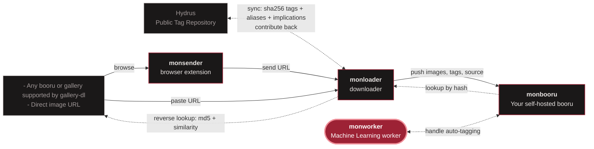

# monworker

The Machine Learning (ONNX) worker of [monbooru](https://github.com/monbooru/monbooru): it runs the auto-tagging models, on CPU or GPU.

It is optional. The bundled monbooru downloads and docker images already carry it (except the -lite variants). You can run it on its own to tag on another machine.

## Related applications

monworker is a companion of monbooru:



- **monworker**: this application; runs monbooru's machine learning models.
- **[monbooru](https://github.com/monbooru/monbooru)**: self-hosted booru; organizes, tags, and serves your collection.
- **[monloader](https://github.com/monbooru/monloader)**: downloader; fetches images from the web and pushes them into monbooru.
- **[monsender](https://github.com/monbooru/monsender)**: browser extension; sends the URL of the page you're browsing to monloader.

## Install

```yaml
services:
  monworker:
    image: ghcr.io/monbooru/monworker:latest-cuda
    environment:
      MONWORKER_MONBOORU_URL: http://nas:8455
      MONWORKER_NAME: gpu-box
    ports: ["8457:8457"]
    volumes: ["./models:/models", "./config:/config"]
    deploy:
      resources:
        reservations:
          devices: [{driver: nvidia, count: all, capabilities: [gpu]}]
```

The images are `latest` (CPU), `latest-cuda` (NVIDIA) and `latest-openvino` (Intel GPU). After launching it, approve the worker in monbooru under **Settings → Auto-Tagger**.

| Variable | Default | |
| --- | --- | --- |
| `MONWORKER_MONBOORU_URL` | | monbooru's address, to pair with |
| `MONWORKER_NAME` | the host name | the name monbooru shows |
| `MONWORKER_MODELS` | `./models` | the models directory |
| `MONWORKER_PROVIDER` | `cpu`; `cuda` and `openvino` in those images | `cpu`, `cuda`, `directml`, `openvino`, ... |
| `MONWORKER_THREADS` | every core | threads the models may use |
| `MONWORKER_PARALLEL` | 4 | images tagged at once |
| `MONWORKER_IDLE_MINUTES` | 15 | minutes unused before the models are unloaded and the memory, VRAM included, is given back; 0 is half a minute |
| `MONWORKER_LISTEN` | `0.0.0.0:8457` | address to listen on |


## License

[AGPL-3.0](LICENSE).
