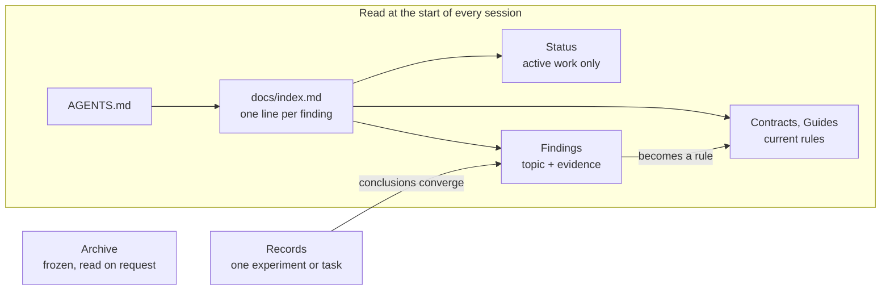

# project-docs

**Write the converged state of the project, not the path that led to it.**

`project-docs` is project-level memory management: it keeps the facts that belong to one project
(interface invariants, experiment conclusions, current progress and blockers) as repository docs
that evolve with the code and are rewritten in place, so agents work more fluently inside that
project, without replacing or trying to manage all the memory on a machine.

It ships as an agent skill ([`SKILL.md`](skills/project-docs/SKILL.md)) and a `project-docs` CLI
that checks a few structural rules, also as a Claude Code hook; the skill does the main work and
the linter is a safety net. [中文文档](README_zh.md)

## Project memory vs. global memory

We keep project facts out of global agent memory because, in our view, global memory tends to grow
redundant and contradictory as it accumulates, and experience tied to one project tends to interfere
with other tasks and generalize poorly once stored globally. So global memory keeps cross-project
collaboration preferences and pointers, and project facts stay in the project's repository.

## Core rules

- Write down conclusions once a discussion or experiment has converged, not the path to them.
- Rewrite affected text in place, delete superseded statements and keep each fact in one place.
- Keep the status page to one screen: active work, an as-of date and source, next step, blockers.
- Name each finding after its topic; list it in the docs index as `topic - one-sentence conclusion`.
- Entry documents (AGENTS.md, docs index, status) never link archived files, which open with a
  one-line "historical, not current guidance" banner.

```markdown
<!-- Appended: every reader has to work out which line is still true -->
Hash table load must stay below 0.85.
Update (2026-11-12): 0.85 stalls on street scenes, use 0.70.

<!-- Rewritten in place: the current fact and a link to its evidence -->
Hash table occupancy stays at or below 0.70 ([load factor](findings/voxel-hashing.md)).
```

How the document types relate:



## Install

The skill installs with `npx skills add mq-yuan/project-docs -g`, or by copying it by hand:

```bash
git clone https://github.com/mq-yuan/project-docs.git
mkdir -p ~/.agents/skills ~/.claude/skills
cp -R project-docs/skills/project-docs ~/.agents/skills/
cp -R project-docs/skills/project-docs ~/.claude/skills/
```

The CLI needs Python 3.11+ and has no runtime dependencies. It is not published on PyPI: install or
run it from GitHub pinned to a release tag, and never run a bare `uvx project-docs` or `uvx pdocs`
without `--from` (that either fails or fetches an unrelated PyPI package).

```bash
uvx --from git+https://github.com/mq-yuan/project-docs@v0.1.1 project-docs check
uv tool install git+https://github.com/mq-yuan/project-docs@v0.1.1   # adds project-docs and pdocs
```

## Usage

```text
project-docs check [PATH] [--format text|json]   check a repository (default: .)
project-docs map [PATH]                          list discovered documents and their types
project-docs init [PATH] [--force]               write .project-docs.toml, docs/index.md, docs/status.md
project-docs hook                                Claude Code PostToolUse hook (reads stdin)
exit codes: 0 pass, 1 problems found, 2 hook feedback, 3 usage, config or IO error
```

The linter reads the root `AGENTS.md`, `CLAUDE.md`, `CLAUDE.local.md`, `README*.md`,
`.claude/CLAUDE.md`, `docs/` and `[paths]` matches. Types come from `[paths]`, then the fixed `docs/`
layout of [`examples/3d-recon-docs/`](examples/3d-recon-docs/) (`index.md`, `status.md`, `contracts/`,
`guides/`, `records/`, `findings/`, `archive/`). Nested repositories are skipped, as is `docs/` itself
when it is a nested repository or a symlink; use `exclude` for a site generator's source directory
(Docusaurus, Jekyll, ...).

## Rules

All rules are errors, structural and language-independent; ambiguous cases are not reported.

| Rule | Checks |
| --- | --- |
| PD000 | Every discovered Markdown file can be read as UTF-8. |
| PD001 | Entry documents, the docs index and status do not link to archived files (`[x](y)`, `[x]: y`, `<a href>` or `@path`); the archive index may be linked. |
| PD002 | An archived file (other than the archive index) starts with a `>` line. |
| PD003 | Status has at most `status_max_lines` non-empty lines (default 60). |
| PD004 | Status contains a valid `YYYY-MM-DD` date no later than tomorrow. |
| PD007 | Every finding is linked from the docs index (list item, table row or any line) with a conclusion: a word character besides the link on that line or on the indented line after it. |
| PD009 | Relative links in non-archived documents point to existing paths. Anchors are not checked; targets outside the repository, ignored by its `.gitignore` (as a file or directory) or undecidable for git (e.g. inside an uninitialized submodule) are skipped. |

## Configuration

Keep the configuration at the repository root, in `.project-docs.toml` (which wins if both exist)
or under `[tool.project-docs]` in `pyproject.toml`. Unknown keys or wrong types exit with code 3.

```toml
status_max_lines = 60                 # non-empty line budget for status
exclude = ["experiments/scratch/**"]  # files and directories to skip

[paths]  # index, status, contract, guide, record, finding, archive, archive_index
status = "STATUS.md"
finding = ["notes/findings/**"]
```

## Claude Code hook

Add this to `.claude/settings.json` or `~/.claude/settings.json`:

```json
{"hooks": {"PostToolUse": [
  {"matcher": "Edit|Write", "hooks": [{"type": "command", "command": "project-docs hook"}]}
]}}
```

The hook acts only in repositories with a configuration file (`project-docs init` writes one) and
reports problems in the edited file only, exiting with code 2 so Claude Code passes them to the
agent. The root is the directory where the Claude Code session was started (`$CLAUDE_PROJECT_DIR`);
put the configuration there. The hook needs `project-docs` on `PATH` (`uv tool install`).

## Relation to ADRs

An architecture decision record (ADR) keeps one immutable file per decision. project-docs splits
what an ADR holds by lifetime, so the default reading path carries only what is true today:

| ADR content | In project-docs |
| --- | --- |
| The decision | Contract, rewritten when the design changes, with a one-line reason |
| Evidence for choosing A over B | Records and the topic Finding they support |
| Proposed or in-progress work | Status and the active Record |
| Superseded decisions | Archive when the history should be kept; otherwise git |

project-docs keeps no numbered, chronological decision log. A team that needs one can keep ADRs as
frozen decision records alongside these docs, and put finer background in commit messages or pull
request descriptions.

## Background & Further Reading

- *Can Agent Memory Systems Track Evolving State?* (StateMemBench, [arXiv:2608.19652](https://arxiv.org/abs/2608.19652)):
  memory systems struggle to track state that has been superseded.
- *Filesystem-Based Memory for LLM Agents: Organization, Evolution, and Sustainability* ([arXiv:2607.26637](https://arxiv.org/abs/2607.26637)):
  the organization of agent-maintained filesystem memory erodes over time, except under the strongest managing agent.
- *Skill-V: Verifiable Self-Evolving Skill Library for Interactive Agents* ([arXiv:2610.11781](https://arxiv.org/abs/2610.11781)):
  skill libraries need explicit, verifiable boundaries of applicability.
- *Scaling Test-Time Compute for Agentic Coding* (COLM 2026, [arXiv:2604.16529](https://arxiv.org/abs/2604.16529)):
  finished rollouts are compressed into structured summaries before they are reused.

MIT License. See [LICENSE](LICENSE). Community: [LINUX DO](https://linux.do).
