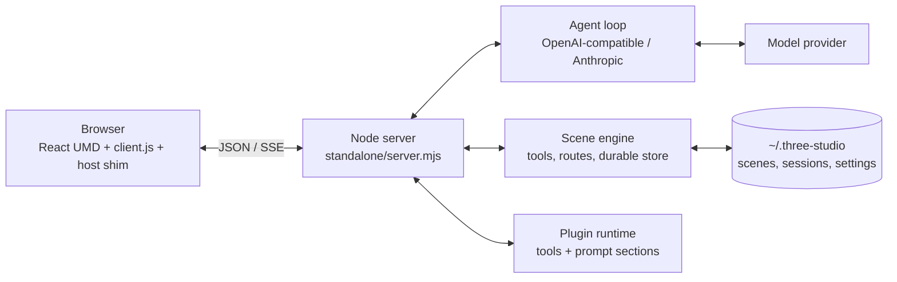

# Three Studio

**An AI-native 3D workbench for Three.js — standalone, local-first, and fully
embedded.**

Three Studio turns a conversation into a live 3D workspace. The AI writes
self-contained Three.js scenes through tools, the preview renders them in a
sandboxed `srcDoc` iframe, and the same surface carries an editor, timeline,
dope sheet, shots, review pins, measurements, assets, history, sessions, model
settings and a plugin market.

The primary deployment runs **without DeepSeek Harness**: its own Node server,
storage, agent loop and React shell. The original host-integrated Harness plugin
remains available as an optional legacy mode.

[English](README.md) · [简体中文](README.zh.md)

**Live demos:** <https://mrw7.github.io/three-studio/> — eleven runnable Three.js
demos: two one-minute procedural films (ONE MINUTE and The Lamplighter), a
turbofan digital manual, agency page, product configurator, education workshop,
motion studies, audio/data visualizations and a spatial walkthrough.


## Highlights

- **AI-native studio** — chat, streaming tool calls and scene revisions in the
  same surface as the viewport.
- **Real Three.js editing** — outliner, inspector, material/lighting controls,
  transform gizmos, parameters, timeline, keyframes, dope sheet, shots, review
  pins, measurements and deterministic exports.
- **Many export targets** — PNG, deterministic MP4/GIF and realtime WebM,
  animated or static glTF (`.glb`), STL, OBJ, project ZIP and standalone HTML;
  USDZ for AR previews and a native binary FBX 7.4 writer for DCC interop.
  USDZ/FBX are static exports: geometry, hierarchy, transforms,
  Phong-converted materials, normals and one UV set survive; animation,
  skinning, textures, PBR channels and vertex colors are not carried over
  (FBX uses metre units via `UnitScaleFactor=100`, matching Blender's
  metre-unit output).
- **Manual and film from one scene** — capture camera/selection steps and
  BOM/hotspots as an interactive manual; order film shots with eased camera
  moves, safe-area guides, SRT captions and a local music track; export
  1080p/4K 16:9/9:16/1:1/4:5 MP4 (no silent WebM fallback) or batch-export all
  four aspects; share a read-only manual with print-to-PDF and a QR code. The
  AI drafts manual steps as reviewable proposals.
- **Sandboxed execution** — model-written code runs only inside an opaque-origin
  `srcDoc` iframe (`allow-scripts allow-pointer-lock allow-downloads`, never
  `allow-same-origin`, never navigable).
- **Bring your own model** — DeepSeek is built in; add, edit or delete any
  OpenAI-compatible or Anthropic-compatible provider with its own API key, base
  URL and model list; test the connection from Settings before sending a task.
- **Session lifecycle** — archive and restore old sessions, permanently delete
  unused sessions, and keep conversation history bounded with whole-turn
  compaction and atomic persistence.
- **Plugin market** — twenty native modules install with one click: skills,
  planning, todo, subagents, web reading and search, deep research, project
  memory, context files, action cards, deliverables, voice input, workspace
  file browser with document preview, background jobs, scheduled tasks,
  automation hooks, MCP connectors, browser automation and a sandboxed web
  pane. Trust surfaces (MCP, browser control) are strictly user-configured.
- **Light and dark themes** — the standalone header has a one-click sun/moon
  toggle; the editor chrome and the default viewport background follow it, and
  the choice is persisted locally. A scene that explicitly sets its own
  background keeps that authored look.
- **Local-first data** — sessions, scenes, settings and credentials live under
  `~/.three-studio`; the server binds loopback only and sends no telemetry.
  Linux uses the crash-fenced fd store. macOS and Windows use a portable
  atomic-snapshot store for scenes, revision history, assets, share links and
  thumbnails, so a restart no longer loses the work.
- **No Harness at runtime** — `standalone/server.mjs` depends only on Node 24 and
  the repository's own code plus vendored Three.js and React.

## Screenshots

| Model settings | Plugin market |
| --- | --- |
|  |  |


| Desktop window (Windows) |
| --- |
|  |

Screenshots use the Chrono Watch example (`examples/scene-watch.js`). Use the
**Sessions** tab to switch sessions and the header clock to browse revision
history.

## Demos

Two complete, self-contained pieces ship in `examples/`. Both are plain scene
scripts for the sandbox plus a product-content JSON document, so they run
offline with no assets.

### Turbofan manual

A procedurally built high-bypass turbofan (inlet lip, 22-blade fan, nacelle
with thrust-reverser grilles, five-stage compressor, annular combustor,
three-stage turbine, nozzle, pylon) plus an eight-step interactive manual with a
seven-part BOM, per-step cameras, hidden parts, highlights and hotspots.


```sh
examples/scene-engine.js        # scene
examples/turbofan-manual.json   # 8 steps, 7 BOM parts, hotspots
```

### The Lamplighter · 点灯人

A 60-second, ten-shot short film. A small robot that lives on the bulb in its
chest walks a foggy street, climbs a lamp post, falls, climbs again, and screws
its own light into the socket — then goes dark so the whole street can glow.
Ten hard cuts, a procedural gait, a mid-climb fall with camera shake, two
dying flickers, a delayed street-light cascade and a title card.

| Walk (shot 2) | The fall (shot 5) |
| --- | --- |
|  |  |

| First light (shot 7) | Title (shot 10) |
| --- | --- |
|  |  |

```sh
examples/scene-lamplighter.js   # scene, 10 hard-cut shots
examples/lamplighter-film.json  # film settings + 10 SRT captions
```

Both are verified by `tests/examples.test.mjs`: the manual passes the host
`workbench_proposal` validation, every UID it references exists in the scene,
and the scene scripts stay inside the documented sandbox globals. See
[`examples/README.md`](examples/README.md) for how each shot and step is built.

## Quick start

Requirements: **Node.js 24+** and a modern browser. No package install is needed
for the standalone Studio; React and Three.js are vendored.

```sh
git clone <repository-url> three-studio
cd three-studio
./standalone/start.sh
# open http://127.0.0.1:3090/
```

To use a different port or data directory:

```sh
THREE_STUDIO_PORT=4000 THREE_STUDIO_HOME=/path/to/data ./standalone/start.sh
```

### Desktop alpha

`desktop/` wraps the same server in an unsigned Electron window and stores data
under the OS application-data directory. It needs Node 24 on `PATH` (or
`THREE_STUDIO_NODE`); see [`desktop/README.md`](desktop/README.md).

### Migrate a Linux disk store to the portable backend

Run this on Linux, then copy the resulting `portable/` directory (or point
`THREE_WORKBENCH_DATA_DIR` at the target) to macOS/Windows:

```sh
node standalone/migrate-portable.mjs --from ~/.three-studio/scenes --to /path/to/target
```

`--to` defaults to `--from`, and the source disk data is never deleted. The
command refuses to overwrite an existing portable manifest unless `--force` is
passed.

### Merge another portable store

Merge scenes, assets, shares and thumbnails from another portable store into
the current one (source is read-only; the target is rewritten):

```sh
node standalone/merge-portable.mjs --from /path/to/source --to /path/to/target
node standalone/merge-portable.mjs --from /path/to/source --to /path/to/target --on-conflict replace
```

The default `skip` policy keeps an existing target scene/asset/share/thumbnail
when the same id exists; `replace` overwrites same-id records. Assets with the
same session/name are always skipped. If a scene session id conflicts, its
assets, thumbnails and shares are skipped in `skip` mode. Make a copy of the
target `portable/` directory before a `replace` merge if it matters.

### Merge sessions and provider settings

Scene data and the rest of the profile are separate files. Stop both Studio
servers, then merge conversation sessions and non-secret provider settings:

```sh
node standalone/profile-merge.mjs --from /path/to/source-home --to /path/to/target-home
node standalone/profile-merge.mjs --from /path/to/source-home --to /path/to/target-home --on-conflict replace
```

- Merges `sessions.json` and `models.json`; same-id sessions/providers are
  skipped by default or replaced with `--on-conflict replace`.
- **Never copies `credentials.json`.** Enter API keys on the target machine.
- Writes a timestamped `.bak-*` copy next to each target file.
- `--dry-run` validates and reports without writing.
- The source home can be a Linux/macOS/Windows profile; this tool is
  platform-independent.

### Configure a model

1. Open the AI Prompt → gear at the bottom-right of the composer.
2. Enter a **DeepSeek** API key, or choose **Add** to create a custom provider
   (provider id, base URL, protocol and model ids).
3. Click **Test connection** to verify the saved key and first model.
4. Pick the provider/model and reasoning effort from the composer.

Keys are stored in `~/.three-studio/credentials.json` with mode `0600`; provider
settings live in `~/.three-studio/models.json`. Nothing is uploaded anywhere
except the requests sent to the provider you configure.

### Install a plugin

Open **Plugin market** in the left rail or the plug icon in the header. All
twenty native modules are installable with one click:

| Area | Plugins |
| --- | --- |
| Agent context | Skills library, planning, todo, project memory, context files, project conventions via `AGENTS.md` |
| Research and web | Subagents, web reader (`web_fetch`), web search, deep research |
| Studio workspace | Deliverables, file browser, document preview, action cards, voice input |
| Automation | Background jobs, scheduled tasks, automation hooks |
| Connectors (opt-in) | MCP connectors, browser automation over CDP, sandboxed web pane |

Installing activates tools immediately; uninstalling removes them. Trust
surfaces are user-authored only: MCP and browser automation read config files
you create by hand and refuse to install until they exist. See
[`docs/PLUGINS.md`](docs/PLUGINS.md) for every tool, its limits and the
configuration files, and
[`docs/TRUST-BOUNDARIES.md`](docs/TRUST-BOUNDARIES.md)
for the trust model. Chinese readers: [`docs/PLUGINS.zh.md`](docs/PLUGINS.zh.md).

## Architecture



- **Browser**: the existing Studio UI (`client.js`) rendered as the whole page by
  a small host shim (`standalone/public/boot.js`). No Cordis/Harness runtime.
- **Server**: HTTP static assets, session/model/plugin APIs and SSE streaming.
- **Scene engine**: the workbench's own `index.js` tools and routes, driven by a
  tiny Cordis-compatible context.
- **Agent**: provider-neutral history, streaming text, tool calls, `three_scene`
  and `workbench_proposal`.
- **Storage**: local files under `~/.three-studio`.

See [`docs/ARCHITECTURE.md`](docs/ARCHITECTURE.md) for the component contracts,
[`docs/PROTOCOL.md`](docs/PROTOCOL.md) for the scene/editor protocol, and
[`standalone/README.md`](standalone/README.md) for deployment details.

## Documentation

- [Architecture](docs/ARCHITECTURE.md)
- [Open-core boundary](docs/OPEN-CORE.md) ([中文](docs/OPEN-CORE.zh.md))
- [Models and providers](docs/MODELS.md)
- [Exports](docs/EXPORTS.md) ([中文](docs/EXPORTS.zh.md))
- [Manual and film](docs/MANUAL-FILM.md) ([中文](docs/MANUAL-FILM.zh.md)) — manual
  steps, film export and the open-core/Pro boundary
- [Plugins and marketplace](docs/PLUGINS.md) ([中文](docs/PLUGINS.zh.md))
- [Security and trust boundaries](docs/SECURITY.md) ([中文](docs/SECURITY.zh.md))
- [Privacy](PRIVACY.md)
- [Plugin trust boundaries](docs/TRUST-BOUNDARIES.md) ([中文](docs/TRUST-BOUNDARIES.zh.md))
- [Plugin configuration examples](examples/plugin-config/README.md)
- [Desktop alpha](desktop/README.md)
- [Demo gallery](https://mrw7.github.io/three-studio/) ([source](site/index.html); [ONE MINUTE](site/one-minute-demo/README.md), [The Lamplighter](site/lamplighter-demo/README.md), [turbofan manual](site/engine-demo/README.md), [agency](site/agency-demo/README.md), [configurator](site/configurator-demo/README.md), [education](site/education-demo/README.md), [motion](site/README.md), [data/space](site/README.md))
- [Development and testing](docs/DEVELOPMENT.md)
- [Scene/editor protocol](docs/PROTOCOL.md)
- [Optional Harness plugin mode](docs/HARNESS-PLUGIN.md)
- [Roadmap](ROADMAP.md)
- [Contributing](CONTRIBUTING.md) ([DCO](DCO))
- [Governance](GOVERNANCE.md)
- [Code of Conduct](CODE_OF_CONDUCT.md)
- [Privacy](PRIVACY.md)
- [Trademark policy](TRADEMARK.md)
- [Changelog](CHANGELOG.md)
- [Third-party notices](THIRD_PARTY_NOTICES.md)

## Development

The unit, protocol and security suites run on Node 24 and use no external test
framework:

```sh
npm test
```

Browser probes live in `tests/e2e/` and need Playwright with Chromium. They
SKIP with exit 0 when the browser or `WORKBENCH_URL` is missing.

`tests/disk.test.mjs` is excluded from local runs because its disk-lock probes
hang in this WSL environment; CI/owners should run it on a native filesystem.
See [`docs/DEVELOPMENT.md`](docs/DEVELOPMENT.md) for layout, screenshot capture
and troubleshooting.

## Limitations

- **USDZ and FBX are static exports.** Geometry, hierarchy, local transforms,
  normals, one UV set and Phong-converted materials survive; animation,
  skinning, textures, PBR channels and vertex colors do not. FBX object names
  are transliterated to printable ASCII and units are metres
  (`UnitScaleFactor=100`). USDZ keeps textures through three's exporter and is
  intended for AR Quick Look. See [`docs/EXPORTS.md`](docs/EXPORTS.md).
- **Web pane embedding.** The sandboxed web pane cannot display sites that send
  `X-Frame-Options`/CSP frame-ancestors; it also refuses private and loopback
  hosts. The pane shares no cookies or storage with the Studio.
- **Web search** defaults to the free DuckDuckGo HTML endpoint, which may rate
  limit or change markup; configure Tavily or Brave with a key in
  `~/.three-studio/search.json` for production use. Results only carry titles,
  URLs and snippets; page bodies still come from `web_fetch`.
- **MCP** supports stdio servers and the tools capability only (no HTTP/SSE
  transport, sampling or roots). Server stderr is discarded, never shown.
- **Scheduled tasks** fire only while the standalone server is running, target
  the session that created them, and stop when the plugin is uninstalled.
- **Voice input** depends on the browser's SpeechRecognition (Chromium-based
  browsers and Safari; Firefox needs a flag), and the button only appears when
  the plugin is installed.
- **Browser automation** needs a Chrome started with
  `--remote-debugging-port` and a hand-written
  `~/.three-studio/browser-automation.json`; it is never enabled by the agent.
- **Plugin trust config** (`mcp.json`, `browser-automation.json`, `hooks.json`,
  `search.json`) is deliberately user-authored: the agent can read state but
  has no tool that writes these files.
- **Persistence scope.** Linux stores scenes, assets, shares, thumbnails and
  revision history in the fd-anchored store. macOS/Windows store the same
  records in the portable snapshot store.
- **Desktop alpha.** `desktop/` is an unsigned Electron shell that spawns the
  standalone server. `npm start` needs Node 24 on `PATH` (or
  `THREE_STUDIO_NODE`); `npm run dist` bundles Node 24 via
  `desktop/scripts/prepare-node.mjs`. Code signing, notarization and
  auto-update are not done yet.
- **Local single-user scope.** The server binds loopback only and has no
  authentication; do not expose the port to an untrusted network. API writes
  from browser pages require a per-process token and same-origin Fetch
  metadata, but the server is not a multi-tenant service.

## Optional Harness plugin mode

The legacy host-integrated mode is `index.js` + `client.js` started through
`./start.sh` against a DeepSeek Harness checkout. It is documented in
[`docs/HARNESS-PLUGIN.md`](docs/HARNESS-PLUGIN.md) and is not required by the
standalone Studio.

## License

The Three Studio core is open source under the **Apache License 2.0**. See
[`LICENSE`](LICENSE) and [`NOTICE`](NOTICE). You may use, modify, distribute and
commercialize it, including in a proprietary hosted service, provided you keep
the license and notice requirements.

Third-party components keep their own licenses; see
[`THIRD_PARTY_NOTICES.md`](THIRD_PARTY_NOTICES.md). The names "Three Studio"
and "Three Workbench" are project marks; see [`TRADEMARK.md`](TRADEMARK.md).
