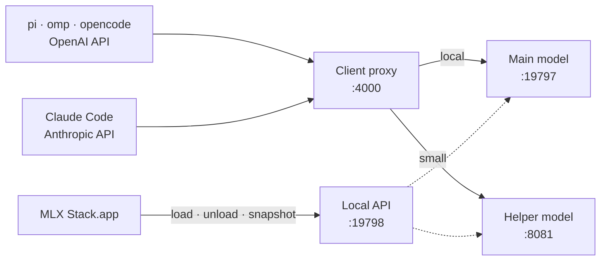

# MLX Stack

[](https://github.com/mukhanov/mlx-stack/releases) [](https://github.com/mukhanov/homebrew-mlx-stack) [](#install) [](#tests) [](#license)

Turn an Apple Silicon Mac into a local AI coding server. MLX Stack is a native macOS menu-bar app that runs models through [MLX](https://github.com/ml-explore/mlx-lm) or [llama.cpp](https://github.com/ggml-org/llama.cpp), connects them to coding agents over localhost and shows their speed, context and memory use. The Python backend and `uv` ship inside the app; separate Python and `uv` installations are not required. Models and coding-agent CLIs are not bundled.

Why this instead of a plain server: per-model launches sized against your free RAM with a live memory forecast, OpenAI and Anthropic endpoints with model aliases, generated configs for the agents you actually use, a real loading progress bar, and no telemetry from MLX Stack.



All four services bind to `127.0.0.1` only. The local API rejects requests with a browser `Origin` or a non-local `Host`, so a web page cannot use it to load, stop or delete models. The client proxy checks `Host` and requires its local key except on health endpoints. The two model servers take no key: any local process that can reach their ports can call them. Loopback binding is not a security boundary between users of the same Mac.

## What it looks like

One glance at what the model is doing and what it costs the machine.


**Monitor** — decode rate over the last four minutes with an activity band (generating, reading the prompt, waiting for the client), context against its cap, time to first token and uncached tokens, plus CPU, RAM and swap. Refreshes once a second; the Main/Small switch picks which model you are watching.


**Models** — the catalog with a hardware-fit score for this Mac, the RAM each model needs and its estimated speed, and everything that is downloaded with size and context. Downloads run in the background with pause/resume, and a load in progress shows its stage and the weights coming into memory instead of leaving you guessing.


**Tools** — every harness in one place: its launch command, endpoint and model alias, the canonical config file with *Copy command*, *Show in Finder* and *Copy path*, and below them the stack's own settings and logs. Loading a model writes all of it for you.

## Install

Requirements: macOS 14 or later on Apple Silicon, and a Homebrew version with the `brew trust` command.

```console
brew tap mukhanov/mlx-stack
brew trust mukhanov/mlx-stack
brew install --cask mlx-stack
open -a "MLX Stack"
```

The cask puts `MLX Stack.app` in `/Applications`. The backend and `uv` travel inside the bundle; no Python installation or terminal setup is needed.

Prefer a file? Download [`releases/MLXStack-v0.1.7.zip`](https://github.com/mukhanov/mlx-stack/releases/download/v0.1.7/MLXStack-v0.1.7.zip) and [its SHA-256 manifest](https://github.com/mukhanov/mlx-stack/releases/download/v0.1.7/MLXStack-v0.1.7.zip.sha256), verify the archive with `shasum -a 256 -c MLXStack-v0.1.7.zip.sha256`, and unzip it into `/Applications`.

Current releases are ad-hoc signed, not Developer ID signed or notarized, so macOS Gatekeeper can warn about or block the app and its bundled `uv`. After verifying the checksum, explicitly allow the verified bundle to run:

```console
xattr -dr com.apple.quarantine "/Applications/MLX Stack.app"
open -a "MLX Stack"
```

This removes quarantine from the entire app and is required for the bundled backend. Skip it only if you understand and accept that tradeoff. The Homebrew cask prints the same warning and performs this step after Homebrew verifies the archive SHA-256.

On first launch the app creates `~/.mlx-stack/mlx-stack-venv`, obtains Python 3.12 if needed and installs the backend's dependencies. A fresh setup needs internet access; catalog refreshes, model downloads and managed backend downloads need it later too. An existing `~/.ollmlx` is migrated to `~/.mlx-stack` and kept as a compatibility symlink.

The backend declares three direct Python dependencies — `mlx-lm`, `huggingface-hub` and `psutil` — and their transitive dependencies are installed into the private environment.

## Quickstart

1. Open **Models**, download an MLX or GGUF model that fits your available memory and choose **Load…**. The first download can be large.
2. Review the launch parameters and the affected agent-configuration paths, then explicitly approve the backup and configuration changes. MLX Stack starts the main and helper model servers and the client proxy, then writes the supported harness configurations described below.
3. Start an installed coding agent. For example, with omp installed:

   ```console
   omp --model ollmlx/local
   ```

   Commands and configuration paths for pi, opencode, Claude Code and dsh are in [Use with coding agents](#use-with-coding-agents) and in the app's **Tools** screen.

## Models

- Browse what is downloaded or search Hugging Face, by format (MLX or GGUF) and by author (mlx-community or everyone), sorted by fit score or by downloads. Each row shows size, downloads, likes and the hardware fit for this Mac: score, quality, speed, context and estimated tokens per second. These values are heuristics, not measured benchmarks.
- MLX repositories are served by `mlx_lm.server`. GGUF repositories are served by llama.cpp's `llama-server`; a macOS arm64 build is selected from GitHub releases on first use and cached by build tag under `~/.mlx-stack/llama.cpp`.
- Downloads run in the background while the loaded models keep serving. They show percentage, bytes and speed, can be paused, resumed and cancelled, and resume after a restart.
- Deleted models are remembered and marked in the catalog; they come back only through an explicit download.
- **Load…** opens the launch parameters: context and prompt cache sized against a shared RAM budget, KV-cache quantization, sampling (temperature, top-p, top-k, min-p), max tokens and the load and client timeouts, with a live forecast of memory use once the cache is full. They are saved per model in `~/.mlx-stack/model-settings.json`; **Defaults** returns to the stack-wide values.
- Loading shows what is happening right away: the model's row and Monitor show a progress bar with the stage and the elapsed seconds. It fills as the weights come into memory (resident memory against their size on disk), then goes through *Starting helper model* and *Warming up*. A failed start is reported with its reason.
- Models can be loaded from the window or from the status-bar menu. A stack started from a terminal is shown in Monitor and Tools but never taken over.

## Monitor

Updated once a second for the main or the helper model, selected with the Main/Small switch.

- **Summary**: decode speed, requests since load and per minute, context used against its cap, memory and swap.
- **Generation**: decode tokens per second over the last four minutes as a line, above an activity band showing whether the model was generating, reading a prompt or waiting for the client, with a tick for every request arrival. A caption gives the same breakdown in words, for example `generating 41% · reading prompt 2% · waiting for client 57% · 32 requests in 4 min`.
- **Context usage**: context size on the same time axis, time to first token, uncached tokens and active requests.
- **System resources**: CPU history and per-core load, memory, swap, the stack's processes and the heaviest other processes.
- **Logs**: collapsed by default. Backend errors and launch failures appear at the top with a **Review logs** action.

Only harness traffic is counted; the watchdog and warm-up probes are excluded. A watchdog restarts a model server that exits or stops completing requests.

## Tools

- Connection settings for pi, omp, opencode, Claude Code and dsh: launch command, endpoint, model alias and the canonical config path, with *Show in Finder* and *Copy path*.
- The latest timestamped agent-configuration backup, with *Show in Finder* and *Restore latest backup*. Restoration asks for confirmation before replacing current configs.
- The stack's own files: model defaults, global context limits, omp roles, the Hugging Face token and the logs folder.

⌘1, ⌘2 and ⌘3 switch between Models, Monitor and Tools. Closing the window keeps the app in the status bar; **Exit** in its menu stops the models and quits.

## Use with coding agents

Loading a model writes the supported harness configuration and points the agents at the client proxy on `127.0.0.1:4000`:

| Harness | Start | Configuration |
|---|---|---|
| pi | `pi --model ollmlx/local` | `~/.pi/agent/models.json` |
| omp | `omp --model ollmlx/local` | `~/.omp/agent/models.json` and `~/.omp/agent/config.yml` |
| opencode | `opencode --model ollmlx/local` | `~/.config/opencode/opencode.json` |
| Claude Code | `claude --settings ~/.mlx-stack/configs/claude.json` | `~/.mlx-stack/configs/claude.json` |
| dsh (DeepSeek Harness) | `dsh web --patch ~/.mlx-stack/configs/dsh-ollmlx.yml` | `~/.mlx-stack/configs/dsh-ollmlx.yml` |

For pi, omp and opencode, the harness path becomes a symlink to its canonical copy in `~/.mlx-stack/configs`; an existing regular file is copied there on first setup. Other settings in plain JSON are preserved, while MLX Stack updates its own provider entries. opencode JSONC is left unchanged, and a non-standard omp `modelRoles` layout needs manual editing. Claude Code uses a generated file in the canonical directory.

Before every model load, the app lists every configuration path that may change and requires explicit approval. Each write is transactional: MLX Stack creates a timestamped backup under `~/.mlx-stack/config-backups`, applies file and symlink changes atomically, and restores the backup automatically if any write fails. If a regular harness file and its canonical copy have diverged, the load stops instead of replacing either version.

Use **Tools → Restore latest backup** to undo the most recent configuration write, or `local-llm rollback` from the backend CLI. Backups can contain the same credentials as the original agent configs; keep the backup directory private.

dsh is different: the overlay only adds a provider, so nothing in `$DSH_HOME` is rewritten. It declares the custom provider `ollmlx` with the OpenAI Chat Completions protocol, the base URL and the local key as an `Authorization` header — no environment variable needed. The same values can be entered in dsh's Web UI via **Settings → Models → Add model provider → Custom model API**.


The proxy speaks both APIs:

| API | Endpoints | Used by |
|---|---|---|
| OpenAI | `POST /v1/chat/completions`, `GET /v1/models` | pi, omp, opencode |
| Anthropic | `POST /v1/messages` | Claude Code |

- Model names: `local` is an alias for the loaded main model and `small` for the helper. The full repository names of the loaded models are also accepted. Any other name is refused with `404`, because the model server would otherwise load whatever repository a request names.
- Anthropic requests are translated to chat completions, streaming and tool use included. Actual tool-use support depends on the loaded model and the harness.
- Send the key from the harness configs as `Authorization: Bearer …` or `x-api-key`.
- The helper model (`mlx-community/Qwen3-0.6B-4bit` by default, override with `OLLMLX_SMALL_MODEL`) answers short background calls so they do not queue behind the main model.

## Privacy and limits

- MLX Stack's proxy and model traffic stays on loopback; it does not use a hosted inference API. Coding agents are separate programs and can have their own telemetry, update checks or other network traffic.
- Dependency installation contacts Python package indexes. Model search and downloads contact Hugging Face; its DNS fallback can contact Cloudflare's `1.1.1.1` DNS-over-HTTPS service. The hardware catalog comes from the llmfit repository on GitHub. Managed llama.cpp and optional model-runtime downloads also contact GitHub. An optional Hugging Face token is used for Hugging Face requests.
- Only the chat/model API operations listed above are documented; this is not a complete implementation of every OpenAI or Anthropic API endpoint.
- Fit scores, RAM forecasts and estimated tokens per second are guidance, not reproducible performance measurements. Model size, available memory, context length and cache settings can prevent a model from loading or serving a session.
- The managed llama.cpp build and its SHA-256 are pinned by the MLX Stack release and verified before installation. For a custom, already installed server, set `OLLMLX_LLAMA_SERVER`.
- The app is local-only and is not designed to expose models to other machines or to isolate multiple local users.

## Backend without the app

The same backend runs headless from `Backend/local-llm`:

| Argument | |
|---|---|
| `serve <org/model> [quant] [--approve-configs]` | Start a model in the foreground; preview and back up agent configs before updating them. Interactive runs ask for approval; non-interactive runs require `--approve-configs`. Ctrl-C or SIGTERM stops it |
| `list` | Downloaded models with size and RAM estimate |
| `stop` | Stop the model servers an interrupted run left on the stack's ports; model servers on other ports are left alone |
| `rollback [--yes]` | Restore the latest agent config backup; asks unless `--yes` is supplied |
| `rm [org/repo…]` | Delete downloaded models; prompts when called without arguments |
| `token [hf_… \| --clear]` | Show, save or clear the Hugging Face token |
| `widget` | Open MLX Stack.app |

Ports and limits are set with environment variables. In the app, the launch parameters chosen in Models take precedence.

| Variable | Default | |
|---|---|---|
| `MLX_PORT` | `19797` | Main model server |
| `MLX_SMALL_PORT` | `8081` | Helper model server |
| `PROXY_PORT` | `4000` | Client proxy |
| `WIDGET_PORT` | `19798` | Local API of the app |
| `MLX_MAX_CTX` | `110000` | Hard context ceiling in tokens |
| `MLX_PROMPT_CACHE_BYTES` | `17179869184` | Prompt cache limit, `0` disables it |
| `MLX_KV_BITS`, `MLX_KV_GROUP_SIZE` | `0`, `64` | KV-cache quantization, `0` disables it |
| `LOAD_TIMEOUT`, `CLIENT_TIMEOUT` | `900`, `1800` | Seconds to wait for the weights; budget per request |
| `OLLMLX_TEMP`, `OLLMLX_TOP_P`, `OLLMLX_TOP_K`, `OLLMLX_MIN_P` | `0.0`, `1.0`, `0`, `0.0` | Sampling defaults of the model server |
| `OLLMLX_MAX_TOKENS` | `32768` | Longest answer, in tokens |
| `OLLMLX_SMALL_MODEL`, `OLLMLX_LLAMA_SERVER` | | Helper model; path to a `llama-server` binary |
| `MLX_STACK_HOME` | `~/.mlx-stack` | Settings, configuration and logs |

## Files

```
~/.mlx-stack/
├── mlx-stack-venv/         Python environment of the bundled backend
├── configs/                harness configuration, canonical copies
├── config-backups/         timestamped agent config snapshots and manifests
├── logs/                   app.log, mlx-stack.log, mlx-server.log, mlx-small.log,
│                           proxy.log, mlx-watchdog.log, llama-server.log
├── llama.cpp/              cached llama-server builds for GGUF models
├── model-settings.json     launch parameters per model
├── context-settings.json   stack-wide context and prompt-cache limits
├── launch.json             stage of the model being loaded, removed when it serves
├── downloads.json          unfinished downloads
├── deleted-models.json     models deleted locally
└── hf-token                Hugging Face token
```

Server and proxy logs keep the previous run as `.log.1`.

## Build from source

Requirements: macOS 14+, Apple Silicon, Swift Command Line Tools and [uv](https://docs.astral.sh/uv/). The build bundles `uv` into the app.

```console
./build.sh 0.1.7
open "build/MLX Stack.app"
```

The script compiles the Swift sources in `Sources/` with `MACOSX_DEPLOYMENT_TARGET=14.0` and verifies the resulting Mach-O minimum before packaging. It copies the backend from `Backend/`, ad-hoc signs the bundle and writes `releases/MLXStack-v<version>.zip` plus the corresponding `.zip.sha256`. It does not notarize the app; the cask separately pins the release archive's SHA-256. Verify a downloaded pair from the `releases` directory with `shasum -a 256 -c MLXStack-v<version>.zip.sha256`.

## Tests

```console
swiftc Sources/MemoryBudget.swift Tests/MemoryBudgetTests.swift -o /tmp/mlx-memory-budget-tests
/tmp/mlx-memory-budget-tests
PYTHONPATH=Backend ~/.mlx-stack/mlx-stack-venv/bin/python -m unittest discover -s Backend/tests -v
```

## How it runs

At launch the app uses its bundled `uv` to prepare `~/.mlx-stack/mlx-stack-venv`, installs the backend from `Contents/Resources/backend` as a regular package and starts `python -m local_llm.widget`, the local API on port 19798. The backend is reinstalled whenever its files in the bundle change.

Loading a model starts `python -m local_llm serve <model> --approve-configs` after the app's preview and approval, runs the client proxy in its own thread and the model servers as foreground children. Quitting the app, or choosing **Exit** in the status-bar menu, stops them all.

## License

MIT
