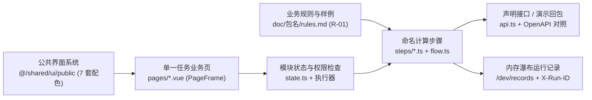

# Vue 3 企业业务后台前端模板

[](CHANGELOG.md)
[](LICENSE)
[](package.json)
[](design/frontend-template.md)
[](src/shared/ui/README.md)
[](doc/formal-verification.md)
[](AGENTS.md)

**简体中文** | [English](README.en.md)

这是一个面向**人类工程师与 AI 编程代理（Claude Code、Codex、Cursor、Antigravity 等）协同开发和迁移企业后台**的 Vue 3 通用前端模板。业务规则、代码生成、动作步骤、界面组件、自动化测试与浏览器运行记录拥有一一对应的固定入口：人负责确认业务规则与视觉效果，AI 按开发包逐项实现并完成自检。

> **前后端全栈配套**：本仓库可对接任意 HTTP 后端，也可与配套后端模板 **[fastapi-business-template](https://github.com/mumuxsy/fastapi-business-template)** 组合使用。两端对齐了登录接口契约、OpenAPI 字段核验、`X-Request-ID` / `X-Run-ID` 链路追踪，以及一键启停的前后端隔离业务验收（`npm run test:acceptance`）。

---

## 为什么做这个模板

企业后台在快速开发或用 AI 批量生成页面时，经常陷入四个困境：

1. **页面堆满零散卡片与冗余说明**：一页塞进多个主按钮、多层嵌套卡片和标题下无意义的副标题，视觉杂乱且重点不清。
2. **业务规则、异步状态与界面搅在一起**：组件里直接写裸请求、乱加自动重试；查询竞态覆盖新数据，写入中断时重复提交或直接吞掉报错。
3. **难以追查问题出在前端哪一步**：点击按钮没反应或数据不对时，分不清是校验拦截、步骤跳过、接口报错还是后台未返回。
4. **模板复制后无法跟随上游演进**：公共组件与业务代码混在一起改，上游升级了交互与安全细节，已有项目根本不敢合并。

本模板通过**单一任务工作区页面检查、声明式动作与命名步骤执行器、基于 Reka UI + Tailwind CSS 4 自研的三层界面系统，以及 `framework.lock` 三方框架升级工具**，从根源解决上述问题。

---

## 界面与内置开发者工具预览

以下画面均由本仓库开发服务器真实渲染采集（创建下游新产品时自动清理样板模块与展示图）：

| 单一工作区经营总览配方（指标、趋势与待处理） | 样板开发包运行效果（筛选条、表格、上传与分页） |
| --- | --- |
|  |  |
| **深色模式下的采购审批详情配方** | **内置七套配色、明暗、圆角、疏密与侧栏设置** |
|  |  |
| **开发者工具：瀑布时间线与步骤级运行追踪** | **设计预览：内置 AI 对话与代码排版组件** |
|  |  |

---

## 核心特性

### 1. 自研三层界面系统与单一任务版式约束
- **Reka UI 无障碍原语 + Tailwind CSS 4 语义色**：不依赖笨重的第三方后台组件库。底层由 Reka UI 提供完整的键盘导航、焦点管理与读屏支持，上层封装表格、筛选条、表单、抽屉、弹窗、趋势图、侧栏与 AI 对话组件（`@/shared/ui/public`）。
- **七套预设配色与多维外观切换**：内置石墨、暖砂、海盐、松林、绛红、墨黑、夜航七套配色，支持浅色/深色模式、三种圆角、紧凑（44px 行高）/宽松（48px 行高）疏密、三种侧栏风格与背景质感；所有预设组合的文字对比度均由 Playwright 浏览器测试逐项校验。
- **AST 页面版式硬约束**：每个业务页登记唯一的 `task`，整页保持单一主工作区与最多一个主要操作按钮；检查器自动拒绝多卡片拼页、正文前冗余说明段落、私写局部样式及原生未封装表单控件。

### 2. 规则编号闭环与声明式步骤执行器
- **规则、步骤与测试双向绑定**：每个业务包在 `doc/包名/rules.md` 编写带编号（如 `R-01`）的业务规则与验证路径；动作中的每个命名步骤（`defineStep`）必须绑定规则编号，未声明或缺少对应测试路径时 `npm run check` 直接报错。
- **受控字段读写与零副作用篡改**：动作使用 Zod 校验输入与字段，步骤只允许读取已声明字段并产出类型校验后的新值（嵌套对象与数组同样只读保护）。
- **查询取最新、写入单次提交、未知结果显式可见**：并发查询自动取消旧请求并只采纳最新结果；写入绝不盲目自动重发，遇到断网或超时明确归类为“结果未知”，引导先查询后台实际状态再决定下一步。关键并发逻辑配有 **TLA+（`LatestQuery.tla` / `SubmitWrite.tla`）状态模型验证**。

### 3. 内置浏览器开发者工作台（`/dev`）
- **功能地图与计算图（`/dev/map`）**：可视化浏览当前已登记的业务包、页面、动作步骤、接口与源码行号。
- **操作记录与瀑布追踪（`/dev/records`）**：在页面内存记录最近 100 次操作的瀑布时间线、每一步耗时、脱敏字段摘要、HTTP 状态码、`X-Request-ID` 与后台 `X-Run-ID`（演示服务如实标注无后台编号，绝不伪造）。
- **页面速度、组件画廊与五类企业示例（`/dev/speed`、`/dev/design`、`/dev/examples`）**：内置经营总览、客户管理、活动编辑、采购审批、客服会话五个完整可交互配方供对照复用。

### 4. 安全边界、构建预算与无历史三方框架升级
- **内存态会话与动作级权限检查**：访问令牌只保存在当前页面内存，退出或过期时清理运行记录；每个动作声明自身权限并由执行器核验；默认生产构建拦截演示模式（`demo.ts` 禁止进入生产业务代码），并由 `build-budget.json` 控制产物体积。
- **干净初始化与冲突安全升级**：`npm run start:project` 一键生成不含样板业务和模板历史的新产品；`framework.lock` 保护公共框架文件，`npm run update:framework` 支持旧模板、新模板与产品文件的三方对比预览与安全合并。

---

## 三层架构与工作流



---

## 快速开始

### 环境要求
- Node.js `22.12+`（支持 `22.x`、`24.x` 或 `26.x`）

### 1. 本地运行模板与交互示例

```sh
npm ci
npm run dev
```

浏览器打开 `http://127.0.0.1:5180`：
- **样板业务（`/files`）**：体验团队文件列表筛选、上传、下载与删除（演示数据保存在开发服务内存中）。
- **开发者工具（左下角入口或 `/dev`）**：查看功能地图（`/dev/map`）、操作步骤瀑布记录（`/dev/records`）、页面速度（`/dev/speed`）与组件设计预览（`/dev/design`）。
- **五类企业任务示例（`/dev/examples`）**：直接切换体验经营总览、客户管理、活动编辑、采购审批与客服会话五种标准页面拼法。

### 2. 初始化干净的下游新产品

```sh
npm run start:project -- /绝对路径/my-admin-web --name "订单运营后台"
cd /绝对路径/my-admin-web
npm ci
npm run docs
```

生成的新产品已自动移除样板文件模块、演示测试、Git 历史以及本模板自身的开源 `LICENSE`、社区文档、Issue 模板和展示截图，同时将环境模板切换为 `VITE_API_MODE=real`，写入 `.template/` 框架来源摘要供日后升级。

### 3. 生成业务包、页面与步骤并完成验证

```sh
# 1. 创建新开发包（自动登记到 catalog.ts 与 scaffold.json，并生成 rules.md 与测试骨架）
npm run new:module -- orders --title 订单管理

# 2. 按五种内置任务布局之一新增页面（blank / list / form / detail / overview）
npm run new:page -- orders detail --layout detail --title 订单详情 --task "核对单笔订单金额、履约进度并处理异常"

# 3. 先在 doc/orders/rules.md 声明规则编号（如 R-01），再生成绑定该规则的步骤
npm run new:step -- orders load_detail --action orders.prepare --rule R-00 --title 读取订单详情

# 4. 导出生成总图，执行静态+单测检查、浏览器检查与真实模式生产构建
npm run docs
npm run check
npm run test:browser
VITE_API_MODE=real npm run build
```

---

## 常用 CLI 命令与内置 Agent Skills

通过 `npm run <命令> [-- 参数]` 完成日常生成、诊断与验证：

| 类别 | 命令 | 说明 |
| --- | --- | --- |
| **创建与升级** | `npm run start:project -- <目录> [--name <名称>]` | 初始化干净的下游前端产品目录 |
| | `npm run update:framework -- --source <新模板目录> [--apply]` | 三方比较预览并安全更新共用框架文件 |
| | `npm run framework -- --accept` | 确认共用框架改动后更新 `framework.lock` 保护摘要 |
| **代码生成** | `npm run new:module -- <包名> --title <中文名>` | 生成标准业务开发包、规则文档与测试骨架 |
| | `npm run new:page -- <包名> <页面名> [--layout <布局>] [--task <任务>]` | 在业务包内生成并登记单一任务页面 |
| | `npm run new:step -- <包名> <步骤名> --action <动作> --rule <规则号>` | 生成绑定规则编号的命名计算步骤 |
| **总览与联调** | `npm run project [-- --module <包名>] [-- --json]` | 查看已登记模块、步骤位置与最新检查指纹状态 |
| | `npm run impact -- --base main` | 根据 Git 改动分析受影响模块与最低必要检查命令 |
| | `npm run api` / `npm run runs -- --file <记录文件> --run <编号>` | 对照后端 `openapi.json` 接口定义或解析导出的运行记录 |
| | `npm run docs [-- --check]` | 从源码登记导出 `doc/structure.md` 与各包 `flows.md` |
| **分层验证** | `npm run check [-- --quick --module <包名>]` | 执行 AST 结构、样式、注释/类型检查、Prettier 核对与 Vitest 测试 |
| | `npm run test:browser` | 启动 Playwright Chromium 验证组件交互、对比度、窄屏与路由状态 |
| | `npm run test:acceptance -- --backend <后端目录>` | 启动隔离的真实 FastAPI + Vue 服务执行端到端验收并自动清理 |
| | `npm run verify:state` | 按需运行 TLA+ 并发查询/单次写入状态模型检查与回归 |

仓库在 `.agents/skills/` 内置 8 个随新产品一起复制的专用 Skill：

| Skill | 适用时机 |
| --- | --- |
| [vue-guide](.agents/skills/vue-guide/SKILL.md) | 首次接手项目，快速了解目录分工、数据流向与标准开发顺序 |
| [vue-module](.agents/skills/vue-module/SKILL.md) | 新建业务包、页面、动作步骤，维护业务规则与测试映射 |
| [vue-ui](.agents/skills/vue-ui/SKILL.md) | 选择页面配方、组合公共组件，并在浏览器中核对真实渲染画面 |
| [vue-check](.agents/skills/vue-check/SKILL.md) | 选择最小检查层级、编写模块与浏览器测试、更新框架保护锁 |
| [vue-project](.agents/skills/vue-project/SKILL.md) | 维护产品计划、查看项目总览、分析改动影响范围与排查运行记录 |
| [vue-backend](.agents/skills/vue-backend/SKILL.md) | 对接真实后端登录与业务接口、核对 OpenAPI 契约与联调结果 |
| [vue-migration](.agents/skills/vue-migration/SKILL.md) | 将存量旧前端按业务包和规则逐页迁移到本框架 |
| [vue-template](.agents/skills/vue-template/SKILL.md) | 从模板初始化新产品或跨版本合并框架更新 |

---

## 文档导航

- **入门与协作入口**：[AGENTS.md](AGENTS.md)
- **模板设计原理**：[design/frontend-template.md](design/frontend-template.md)
- **界面组件与页面配方**：[界面系统说明](src/shared/ui/README.md) · [页面配方（唯一版式说明）](doc/ui-recipes.md) · [五类功能示例](doc/ui-examples.md)
- **业务包开发与交付**：[开发一个业务包](doc/development.md) · [产品交付清单](doc/delivery.md) · [自动生成的结构总图](doc/structure.md)
- **验证、验收与部署**：[检查结果说明](doc/verification.md) · [前后端隔离业务验收](doc/acceptance.md) · [TLA+ 状态模型验证](doc/formal-verification.md) · [真实后台接入与容器部署](doc/deployment.md)
- **开源治理**：[参与贡献（CONTRIBUTING.md）](CONTRIBUTING.md) · [安全策略（SECURITY.md）](SECURITY.md) · [行为准则（CODE_OF_CONDUCT.md）](CODE_OF_CONDUCT.md) · [版本记录（CHANGELOG.md）](CHANGELOG.md)

---

## 开源许可

本模板仓库基于 [MIT License](LICENSE) 开源。使用 `npm run start:project` 创建的新产品默认不包含本模板的 `LICENSE` 文件，你可以为自己的产品自由选择专有或开源许可。
